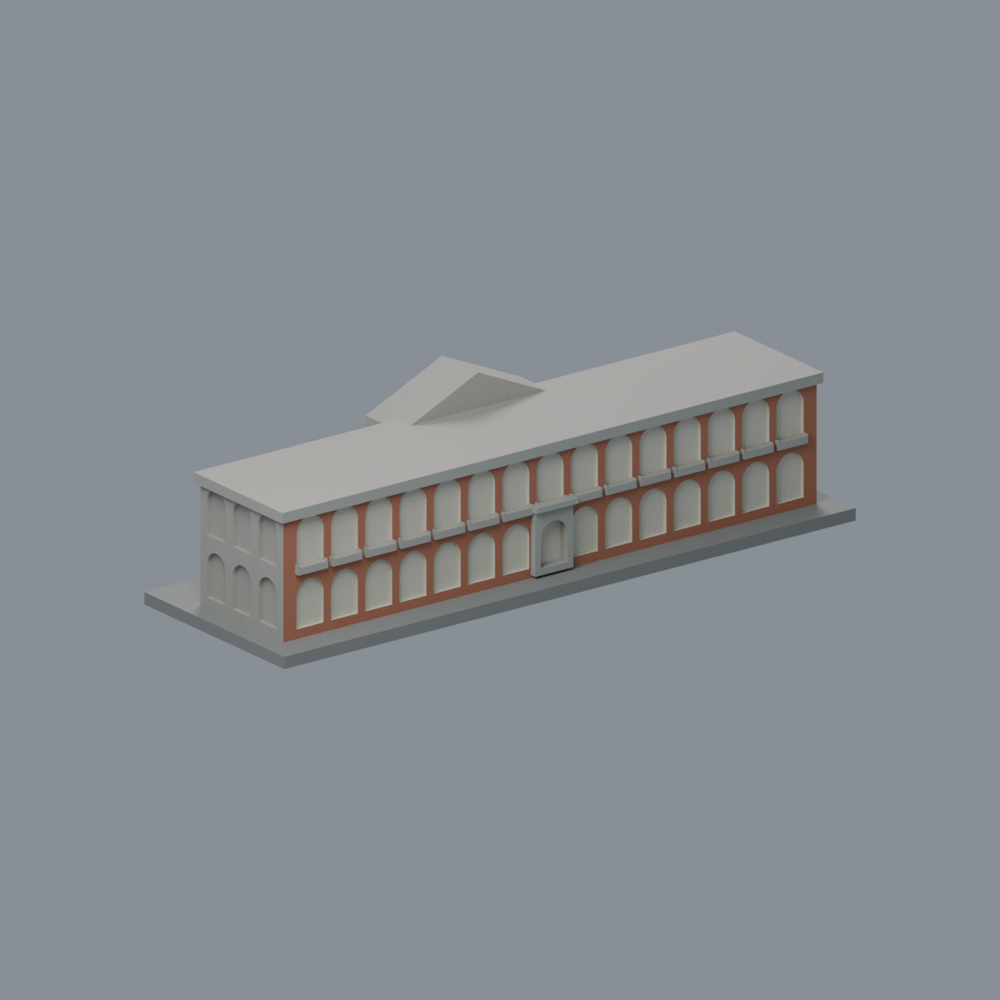
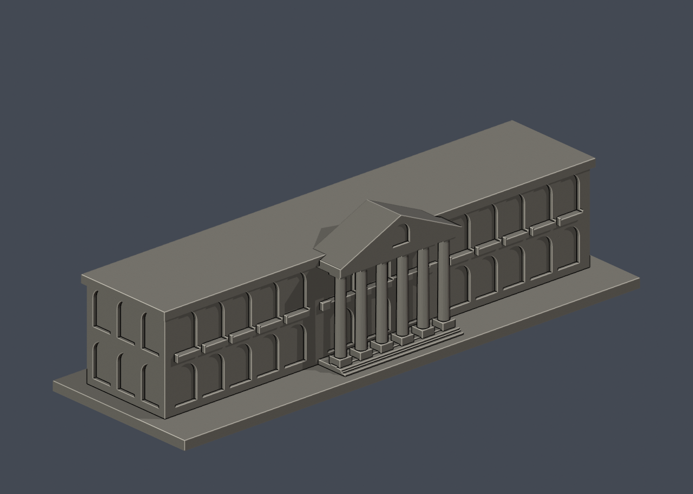
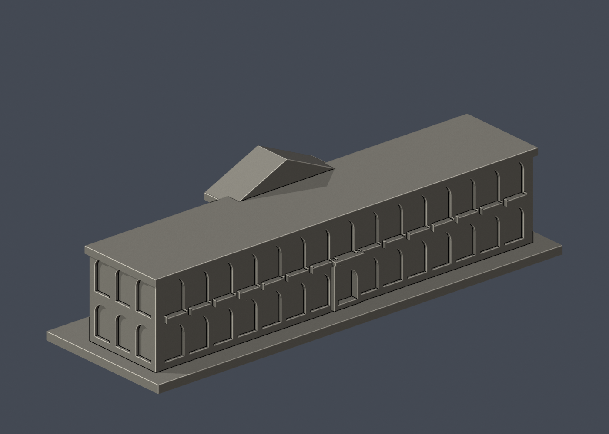

# 國立成功大學｜大成館

## 模型預覽

| 模型預覽 | 模型預覽 | 模型預覽 |
| :---: | :---: | :---: |
| 正面原幾何配色<br> | 另一已登錄長面<br> |  |

第二批獨立外觀模型；校區：光復校區。不是全校完成。尺寸含底座：150 × 49 × 40.3 mm；最長邊150 mm，各件獨立比例。

## 最新六材質外觀版（2026-10-20）


[來源界線與四視角](appearance/README.md) · [表面色 3MF](appearance/nckudacheng-appearance.3mf) · [可編輯場景](appearance/scene.blend)

依官方前後長面照片登錄磚牆、六石柱與實心欄板；凹拱代表開放走廊而非玻璃，屋頂與短端中性。原STL與歷史QA不變，不是新增幾何。[原單色正面](previews/front.png)／[原單色背面](previews/rear.png)

| 模型預覽 | 模型預覽 | 模型預覽 |
| :---: | :---: | :---: |
| 原單色正面<br> | 原單色背面<br> |  |


## 來源及實際像素觀察

- [校方素材網：大成館（2025年照片）](https://material.ncku.edu.tw/picture.php?/3126)：已檢視另一長邊正向像素，見兩層拱廊、中間較小入口與長向水平簷帶。
- [校方素材網：大成館（2020年照片）](https://material.ncku.edu.tw/picture.php?/2576)：已檢視斜角像素：長邊連續拱廊、短邊端部、柱腳與二樓欄板。
- [校方研討會頁面的大成館外觀照片](https://computing.ncku.edu.tw/p/404-1138-216274.php?Lang=zh-tw)：已檢視頁面大成館照片像素：六根巨柱、三角山牆、圓拱窗及兩側拱廊。

## 本件範圍、保留與近似

範圍限定大成館這一棟，沒有把歷史系館、禮賢樓或整個原日軍營舍群納入。六根圓柱、柱腳與山牆保留，拱廊改成淺凹，欄板變成實心浮雕。另一長邊依校方2025年照片製作重複拱廊及較小入口；開間數、兩端及深度為照片估算。短邊另一端以相同節奏近似；屋頂未有俯視證據，採低平簡化，不代表屋頂實際構造。照片未能連續覆蓋整棟總長，不能把本件窗數當作精確開間普查。

## 交付與重建

- `model.stl`：毫米單位，與底座合成的單一實體。最長邊為 150 mm（含底座）；各棟獨立縮放，不適合直接拼成等比例校園。
- `build_model.py`：完整可攜參數化原始程式，無外部貼圖、私有路徑或參考照片依賴。
- `scene.blend`：由交付 STL 匯入，只有一個建築網格，可在 Blender 編輯頂點；細部參數請修改 Python 後重建。
- `previews/front.png`、`rear.png`、`elevation.png`：由實際交付 STL 產生。
- `validate_model.py`、`validation.json`：可重跑的幾何與重建驗證。

建議 Python 3.12，在虛擬環境執行：

```sh
python -m pip install -r requirements.txt
python build_model.py
blender -b -t 2 -P render_preview.py
python validate_model.py
```

已使用 Blender 4.3.2。驗證器在獨立臨時目錄重建 STL 並比較 SHA-256，讀取 Blender 場景的網格後比較三角形幾何。它檢查原始二進位 STL 儲存法線、面積、封閉性、邊恰有兩面、頂點連結為單一環、表面只有一個連通分量、正體積、底面位於 Z=0、最長邊 150 mm。單一封閉表面也排除獨立藏在內部的空腔殼；沒有宣稱完成所有自交的窮舉檢測。

## 製作原則與限制

這是依公開照片觀察製作的外觀近似收藏模型，不是測繪、修復、工程或精確 BIM 資料。牆身為實體，門窗、拱廊通常改成淺凹浮雕；不含室內、設備或安全配置。屋頂、深度、窗距及後側比例沒有測量基準，不能視為實際尺寸。原始參考照片未收錄、未重新授權或隨套件發布。來源權利屬原作者／校方；原創模型與程式可沿用儲存庫授權，不涵蓋外部參考照片。

## 列印說明

底座平貼平台，Z 軸向上。可從 0.4 mm 噴嘴、0.16–0.20 mm 層高、3 道外牆與 12–18% 填充開始試切片；這是設定建議，並非已測參數。小於約 0.8 mm 的淺浮雕可能因噴嘴或縮放消失。STL 是封閉實體，切片器仍會依填充率產生內部填充。

未實體試印、未執行切片器列印驗證，沒有保證免支撐。請依下列模型特有支撐需求檢查切片預覽。

六柱上方三角山牆與梁有約3–5 mm柱間跨距，柱後至主牆之間也有懸挑。建議門廊下方配置可移除支撐，拱頂與屋簷另作局部切片檢查。柱徑約2.8–3.1 mm，小幅縮放仍可能增加斷柱風險。

查核日期：2026-10-13。


## 整合版截面與薄特徵補充驗證

本整合版使用固定共同邊方向後插值的 `validate_sections.py` 與 [0.2 mm 截面結果](cross_sections.json)，避免同一邊浮點方向差異造成假斷環。原始 STL 幾何未修改。舊截面程式有閉合斷言，既有通過結果不代表曾有破面；此處以新版重跑結果為準。

另提供 `check_thin.py` 與 [新增 0.8 mm 薄特徵輔助篩查](thin-feature-check.json)：每 1 mm 水平取樣，先確認輪廓閉合與有效，再作半徑 0.4 mm 形態開運算。這不是切片器、完整壁厚分析或實體試印，尖屋頂、銳角也會造成損失，不能據此宣稱無支撐或列印成功。執行前請安裝 requirements.txt。

本件窄屋頂最高取樣層的開運算面積損失約 **0.1382 mm²**，比例略高於 1%；需留意尖頂細節與實際切片設定。
