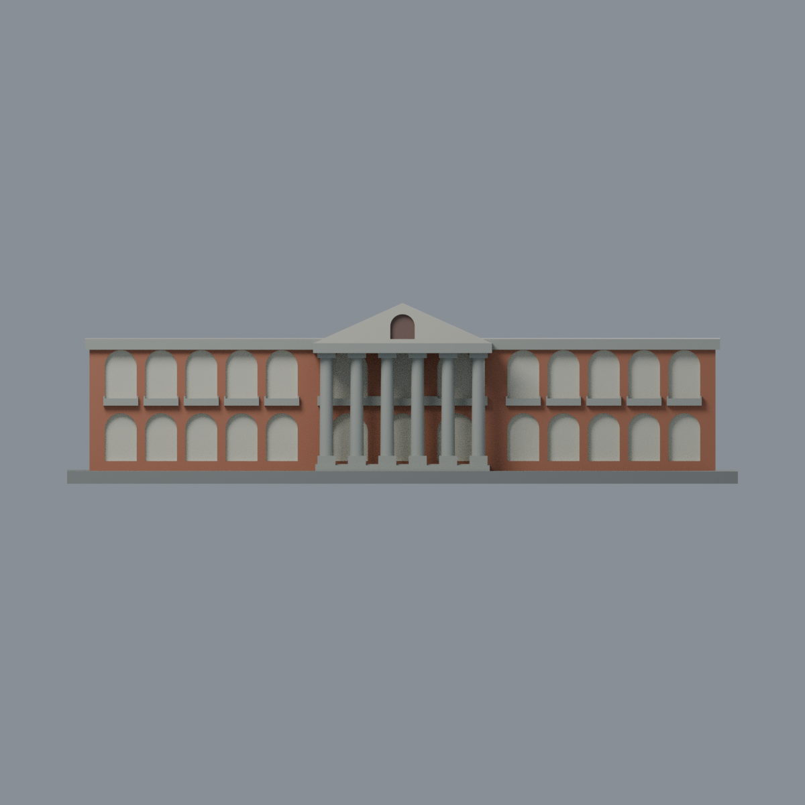
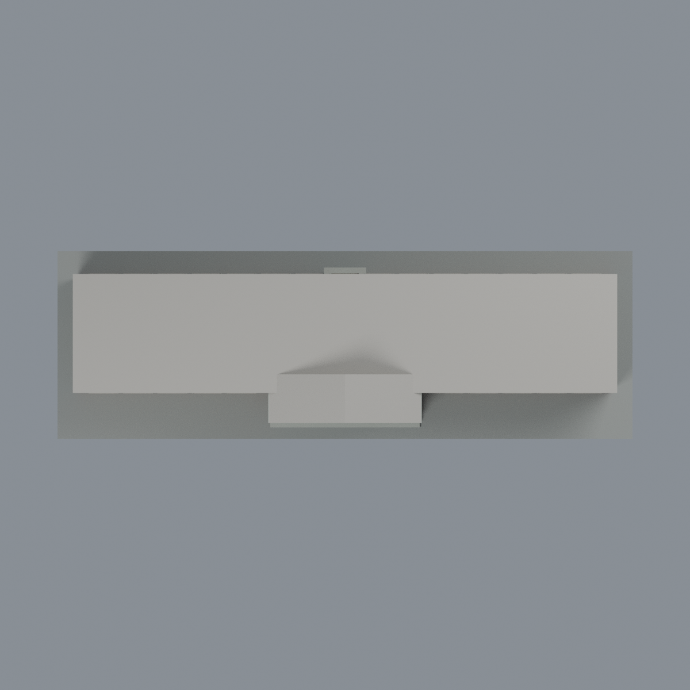

# 成大大成館：六材質外觀版

沿用原 **9,608 三角面／4,794 頂點**，不改原 STL 位元、座標、面序或幾何；這是既有模型外觀改版，不增加模型包數。

| 模型預覽 | 模型預覽 | 模型預覽 |
| :---: | :---: | :---: |
| 正面  | 另一已登錄長面  |  |
|  |  |  |

[表面色 3MF](nckudacheng-appearance.3mf) · [可編輯 Blender](scene.blend) · [材質色表](palette.json) · [逐面指派與依據](face-materials.json) · [原 STL](../model.stl)

## 來源與配色邊界

親自查看校方[2019 未來運算研討會場地頁](https://computing.ncku.edu.tw/p/404-1138-216274.php?Lang=zh-tw)的[六柱正面照片](https://computing.ncku.edu.tw/var/file/138/1138/img/WFC2019_jpg05.jpg)，以及素材網[另一長面照片頁](https://material.ncku.edu.tw/picture.php?/3126)與[原圖](https://material.ncku.edu.tw/_data/i/upload/2025/01/14/20250114091808-b2f2103c-me.jpg)，後者署名外國語文學系蔡美慧、上架日 2025-01-14。兩張本地來源皆無拍攝 EXIF；2019 活動及 2025 上架日期都不是已核實快門日期。跨年來源不宣稱同日外觀或 2026 現況，照片不隨模型散布。

- 兩個有照片的長面磚柱與拱間牆為暖磚紅；原凹拱背面和內緣奶油色。**這些凹拱代表開放走廊，不是深色玻璃**；原模型仍是封閉淺凹，不新增貫穿洞或室內。
- 照片中拱外細奶油色飾框未在原幾何分出；不切分三角面或畫不規則白色拼塊來偽造完整飾框。奶油色限原凹拱表面與正面山牆面，並非完整建材分區復刻。
- 六根既有大柱、柱腳、簡化柱頭、門廊橫梁、前階梯、兩側既有實心欄板及長面簷帶為灰石色。欄板仍是實心代理，沒有新增細柱或透空孔。
- 後長面的較小入口框與橫梁為灰色，入口凹面奶油色；不複製正面六柱門廊到後面。中央山牆原小窗背面低彩紅棕，不新增窗格。
- 未見屋頂平面、山牆上面與背面、短端面及其原凹格保持中性，不因已有推估短端開口就擅自延伸材質。
- 原面未分出的牆基與細線不另畫新色界；不加字樣、空調、落水管、植栽或污漬。色值未校正，不是建材標準色。

[原幾何與來源界線](../README.md) · [本次來源覆核](qa/source-review.json)

## 重建與核驗

安裝 [依賴](source/requirements.txt)，Blender 使用 4.3.2。由本資料夾上層提供原 model.stl：

1. `python appearance/source/build_appearance.py`
2. `python appearance/source/verify_exchange.py`
3. `blender -b -t 3 --python-exit-code 1 -P appearance/source/render_appearance.py`
4. `blender -b -t 3 --python-exit-code 1 -P appearance/source/verify_scene.py`

[獨立重建 ZIP](rebuild-source.zip)含原 STL、四支程式及依賴，不含第三方照片；不取代原建模腳本。[逐檔 SHA256](SHA256SUMS)

[交換／拓撲 QA](qa/exchange-validation.json)核對原座標與面序、全部面材質、單連通、有向水密邊、頂點 link 單環、正體積與零退化／重複面；lib3mf 嚴格讀取零警告，實際編輯單材質再存讀，其他材質及面指派不變。SDK 六位小數量化誤差另列。

[Blender 存讀與編輯](qa/scene-validation.json) · [渲染記錄](qa/render-manifest.json) · [獨立重建](qa/rebuild-validation.json)

## 製造限制照舊

尺寸仍為 150 × 49 × 40.3 mm；原 STL、建模程式、場景及歷史 QA 保留。原層檢與薄特徵檢查本次未重跑，不能由材質 QA 代替。

3MF 是同一網格的表面色，不是六個封閉分色實體、切片專案、噴頭映射或 G-code。切片 GUI、多材料路徑與實體列印未測；柱頭、屋簷、窗框及薄邊仍須評估材料、支撐及拆除風險，沒有保證可印或免支撐。
