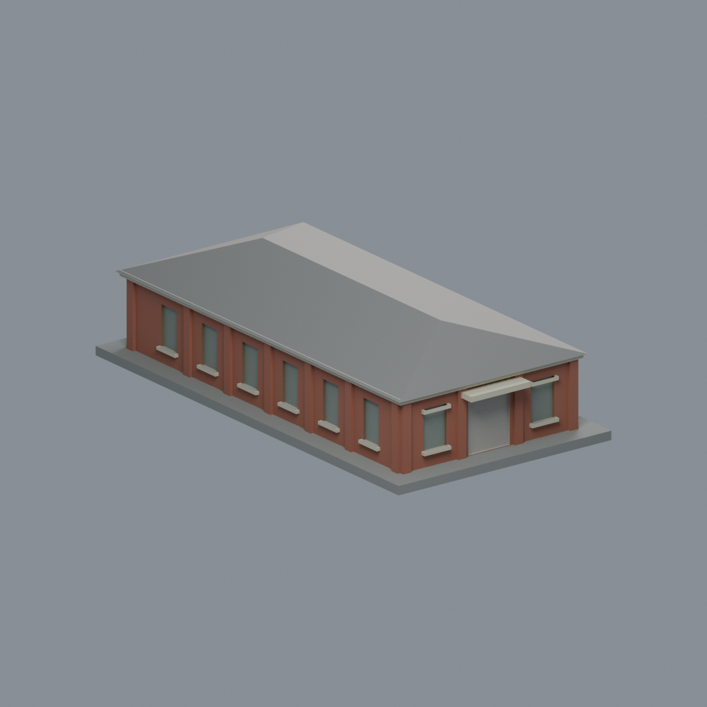
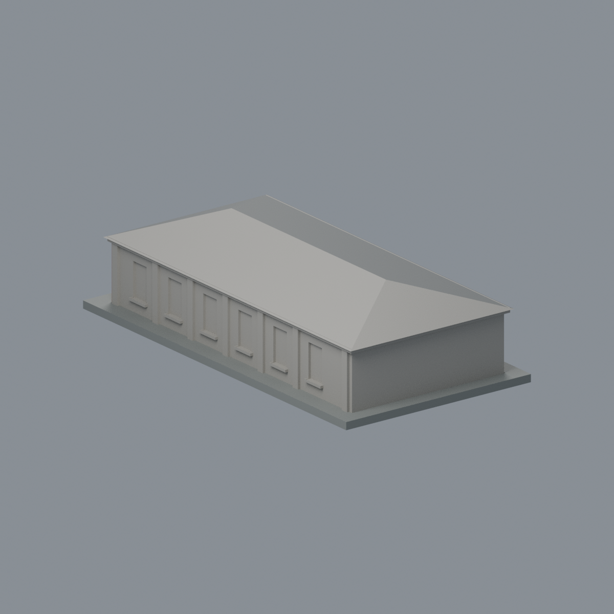

# 國立成功大學｜歷史文物館

## 模型預覽


| 模型預覽 | 模型預覽 | 模型預覽 |
| :---: | :---: | :---: |
| 正面原幾何配色<br> | 背面與未見面保持中性<br> |  |

第二批獨立外觀模型；校區：光復校區。不是全校完成。尺寸含底座：79 × 150 × 37.3 mm；最長邊150 mm，各件獨立比例。

## 最新七材質外觀版（2026-10-20）


[來源界線與四視角](appearance/README.md) · [表面色 3MF](appearance/artifact-appearance.3mf) · [可編輯場景](appearance/scene.blend)

依官方照片登錄紅棕正面與左長側、奶油窗楣雨遮及灰色已見屋頂坡；深入口不是玻璃。另一長側、後端與遠側屋頂中性，不增加白牆基分界或磚瓦紋理。原STL與歷史QA不變，不是新增幾何。原單色正面（歷史檔案留存，不作本頁預覽）／原單色背面（歷史檔案留存，不作本頁預覽）


## 來源及實際像素觀察

- [校方素材網：成大歷史文物館（2024年正面）](https://material.ncku.edu.tw/picture.php?/3055)：已檢視正面像素：低矮單層磚造、中央門及小雨遮、兩旁窗、厚窗楣與四坡屋頂。
- [校方素材網：歷史文物館（2025年斜側）](https://material.ncku.edu.tw/picture.php?/3489)：已檢視像素：較長側牆、反覆壁柱與窗口、屋頂長脊和前方短邊。
- [校方歷史文物館改造啟用報導](https://web.ncku.edu.tw/p/404-1000-162003.php?Lang=zh-tw)：確認是光復校區成功湖畔的歷史文物館，與成功校區成大博物館不同。

## 本件範圍、保留與近似

本件是光復校區單棟歷史文物館，與首批成功校區博物館分開。保留單層長方形體量、四坡屋頂、中央入口雨遮、兩側前窗及磚柱節奏。長側的具體窗口數、深度與屋頂坡度為照片估算。另一長側採相似節奏近似；背面無完整照片，保留簡化實牆。瓦片、磚縫、館名字牌文字、周圍樹木與相鄰系館不建模。

## 交付與重建

- `model.stl`：毫米單位，與底座合成的單一實體。最長邊為 150 mm（含底座）；各棟獨立縮放，不適合直接拼成等比例校園。
- `build_model.py`：完整可攜參數化原始程式，無外部貼圖、私有路徑或參考照片依賴。
- `scene.blend`：由交付 STL 匯入，只有一個建築網格，可在 Blender 編輯頂點；細部參數請修改 Python 後重建。
- `previews/front.png`、`rear.png`、`elevation.png`：由實際交付 STL 產生。
- `validate_model.py`、`validation.json`：可重跑的幾何與重建驗證。

建議 Python 3.12，在虛擬環境執行：

```sh
python -m pip install -r requirements.txt
python build_model.py
blender -b -t 2 -P render_preview.py
python validate_model.py
```

已使用 Blender 4.3.2。驗證器在獨立臨時目錄重建 STL 並比較 SHA-256，讀取 Blender 場景的網格後比較三角形幾何。它檢查原始二進位 STL 儲存法線、面積、封閉性、邊恰有兩面、頂點連結為單一環、表面只有一個連通分量、正體積、底面位於 Z=0、最長邊 150 mm。單一封閉表面也排除獨立藏在內部的空腔殼；沒有宣稱完成所有自交的窮舉檢測。

## 製作原則與限制

這是依公開照片觀察製作的外觀近似收藏模型，不是測繪、修復、工程或精確 BIM 資料。牆身為實體，門窗、拱廊通常改成淺凹浮雕；不含室內、設備或安全配置。屋頂、深度、窗距及後側比例沒有測量基準，不能視為實際尺寸。原始參考照片未收錄、未重新授權或隨套件發布。來源權利屬原作者／校方；原創模型與程式可沿用儲存庫授權，不涵蓋外部參考照片。

## 列印說明

底座平貼平台，Z 軸向上。可從 0.4 mm 噴嘴、0.16–0.20 mm 層高、3 道外牆與 12–18% 填充開始試切片；這是設定建議，並非已測參數。小於約 0.8 mm 的淺浮雕可能因噴嘴或縮放消失。STL 是封閉實體，切片器仍會依填充率產生內部填充。

未實體試印、未執行切片器列印驗證，沒有保證免支撐。請依下列模型特有支撐需求檢查切片預覽。

前門雨遮與四周薄屋簷有局部懸挑，建議雨遮下方配置局部支撐。屋簷薄邊應使用切片預覽確認連續擠出，不能據封閉網格推論任何噴嘴皆能列印。

查核日期：2026-10-13。


## 整合版截面與薄特徵補充驗證

本整合版使用固定共同邊方向後插值的 `validate_sections.py` 與 [0.2 mm 截面結果](cross_sections.json)，避免同一邊浮點方向差異造成假斷環。原始 STL 幾何未修改。舊截面程式有閉合斷言，既有通過結果不代表曾有破面；此處以新版重跑結果為準。

另提供 `check_thin.py` 與 [新增 0.8 mm 薄特徵輔助篩查](thin-feature-check.json)：每 1 mm 水平取樣，先確認輪廓閉合與有效，再作半徑 0.4 mm 形態開運算。這不是切片器、完整壁厚分析或實體試印，尖屋頂、銳角也會造成損失，不能據此宣稱無支撐或列印成功。執行前請安裝 requirements.txt。
