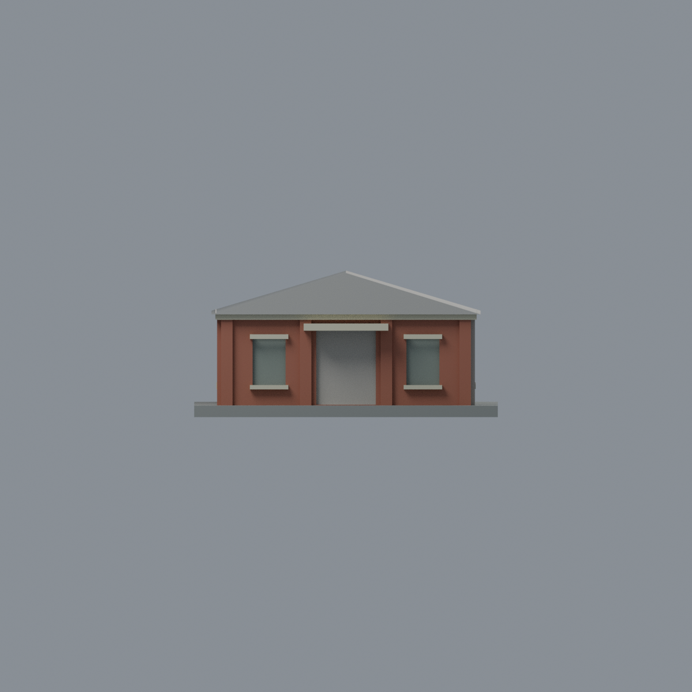
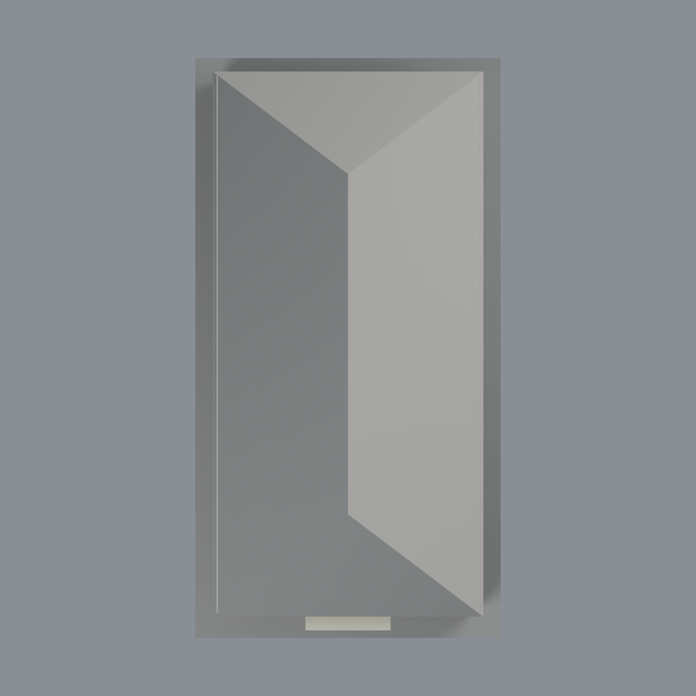

# 成大歷史文物館：七材質外觀版

沿用原 **1,040 三角面／518 頂點**，不改原 STL 位元、座標、面序或幾何；這是既有模型外觀改版，不增加模型包數。

| 正面 | 背面保持中性 |
|---|---|
|  |  |
|  |  |

[表面色 3MF](artifact-appearance.3mf) · [可編輯 Blender](scene.blend) · [材質色表](palette.json) · [逐面指派與依據](face-materials.json) · [原 STL](../model.stl)

## 來源與配色邊界

親自查看校方素材網[正面 3055](https://material.ncku.edu.tw/picture.php?/3055)的[照片](https://material.ncku.edu.tw/_data/i/upload/2024/08/07/20240807110814-35ded5a3-me.jpg)，署名計網中心行政與諮詢組陳永川，上架 2024-08-07；及[斜側 3489](https://material.ncku.edu.tw/picture.php?/3489)的[照片](https://material.ncku.edu.tw/_data/i/upload/2025/02/05/20250205130217-02c1d215-me.jpg)，署名外國語文學系蔡美慧，上架 2025-02-05。兩圖無可讀 EXIF 拍攝時間，**上架日不是快門日期**；不宣稱 2026 現況，也不散布來源影像。

- 本件為光復校區**歷史文物館**，不是成功校區的成大博物館。登錄正面及照片可見左長側紅棕磚牆、原壁柱；不加磚縫貼圖或牌字。
- 原正面窗楣／窗臺、左長側窗臺、雨遮及已見簷帶立緣奶油色。原幾何無照片中完整階梯狀上楣、白牆基的獨立色界，故不新增圖案、不用跨界三角形硬畫白基座；磚色是連續牆面代理，不宣稱材料分界精確。
- 原凹窗內緣暖木色、背面低彩度灰綠作玻璃代理；未建窗框／窗扇不加造。中央門口是深入口，保持中性，不當作玻璃門或黑牆。
- 只將可登錄正面與左長側的原屋頂坡面作灰瓦色示意，**不產生瓦片幾何或紋理**。未見右長側、後端及遠側屋頂坡維持中性；已有鏡像窗節奏不當作來源已觀察證據。
- 展示底板不是白石牆基或現地鋪面。色值未校正，原尺寸、窗數及坡度仍是簡化推估；不加入陰影、樹木、污漬、設備或鄰棟。

[原幾何與來源界線](../README.md) · [本次來源覆核](qa/source-review.json)

## 重建與核驗

安裝 [依賴](source/requirements.txt)，Blender 使用 4.3.2。由本資料夾上層提供原 model.stl：

1. `python appearance/source/build_appearance.py`
2. `python appearance/source/verify_exchange.py`
3. `blender -b -t 3 --python-exit-code 1 -P appearance/source/render_appearance.py`
4. `blender -b -t 3 --python-exit-code 1 -P appearance/source/verify_scene.py`

[獨立重建 ZIP](rebuild-source.zip)含原 STL、四支程式及依賴，不含第三方照片；不取代原建模腳本。[逐檔 SHA256](SHA256SUMS)

[交換／拓撲 QA](qa/exchange-validation.json)核對原座標與面序、全部面材質、單連通、有向水密邊、頂點 link 單環、正體積與零退化／重複面；lib3mf 嚴格讀取零警告，實際編輯單材質再存讀，其他材質及面指派不變。SDK 六位小數量化誤差另列。

[Blender 存讀與編輯](qa/scene-validation.json) · [渲染記錄](qa/render-manifest.json) · [獨立重建](qa/rebuild-validation.json)

## 製造限制照舊

尺寸仍為 79 × 150 × 37.3 mm；原 STL、建模程式、場景及歷史 QA 保留。原層檢與薄特徵檢查本次未重跑，不能由材質 QA 代替。

3MF 是同一網格的表面色，不是七個封閉分色實體、切片專案、噴頭映射或 G-code。切片 GUI、多材料路徑與實體列印未測；柱頭、屋簷、窗框及薄邊仍須評估材料、支撐及拆除風險，沒有保證可印或免支撐。
