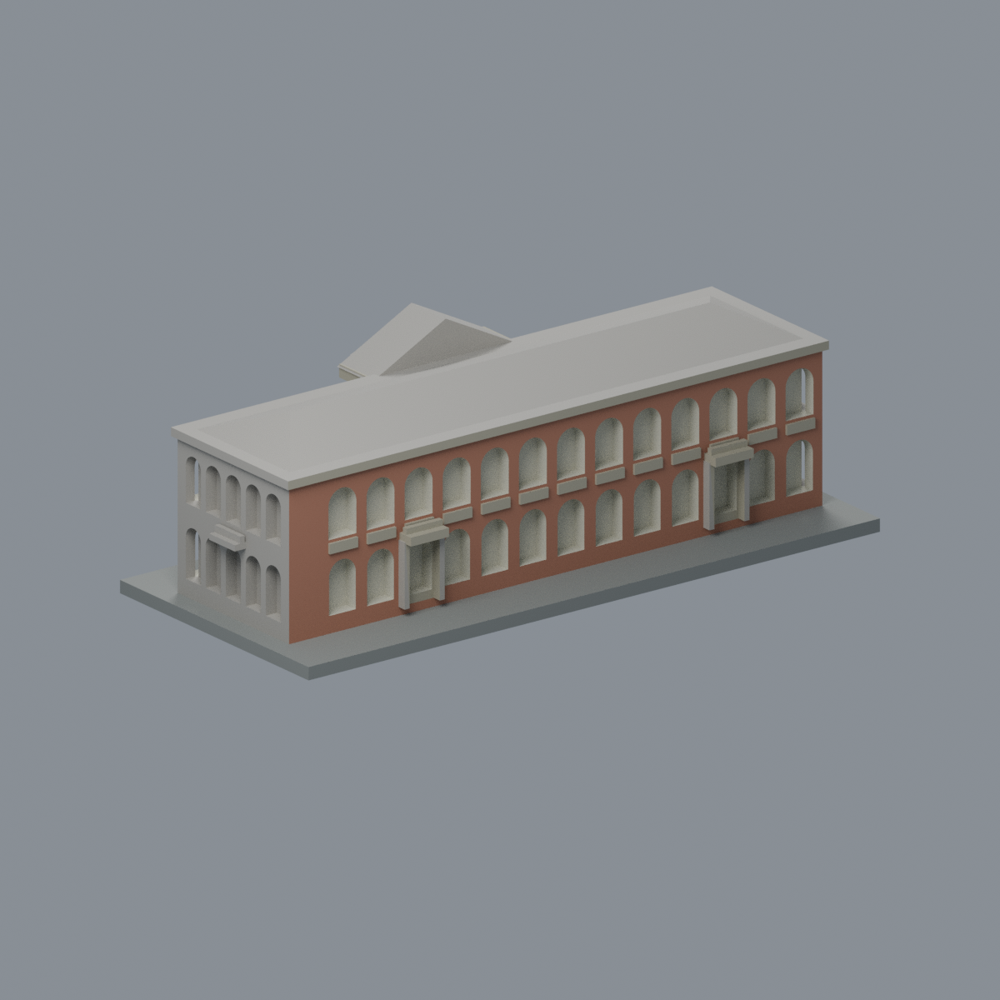
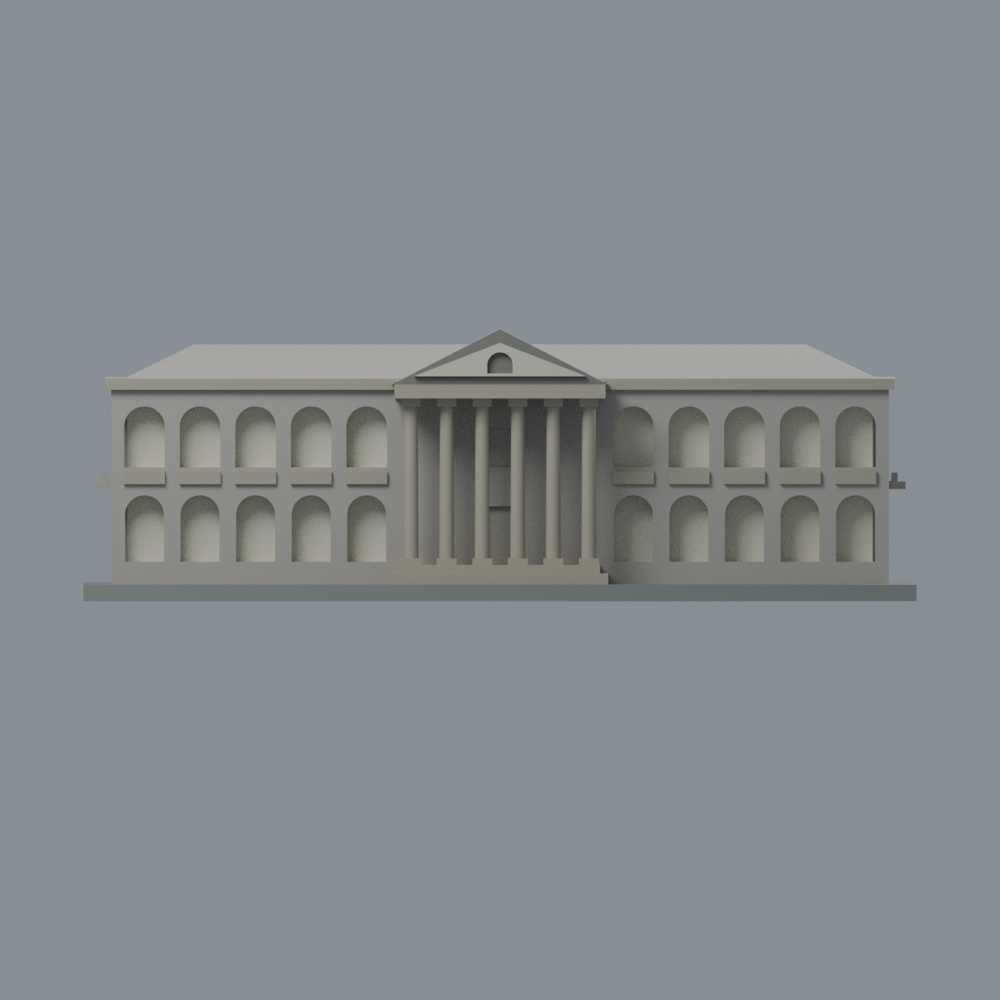
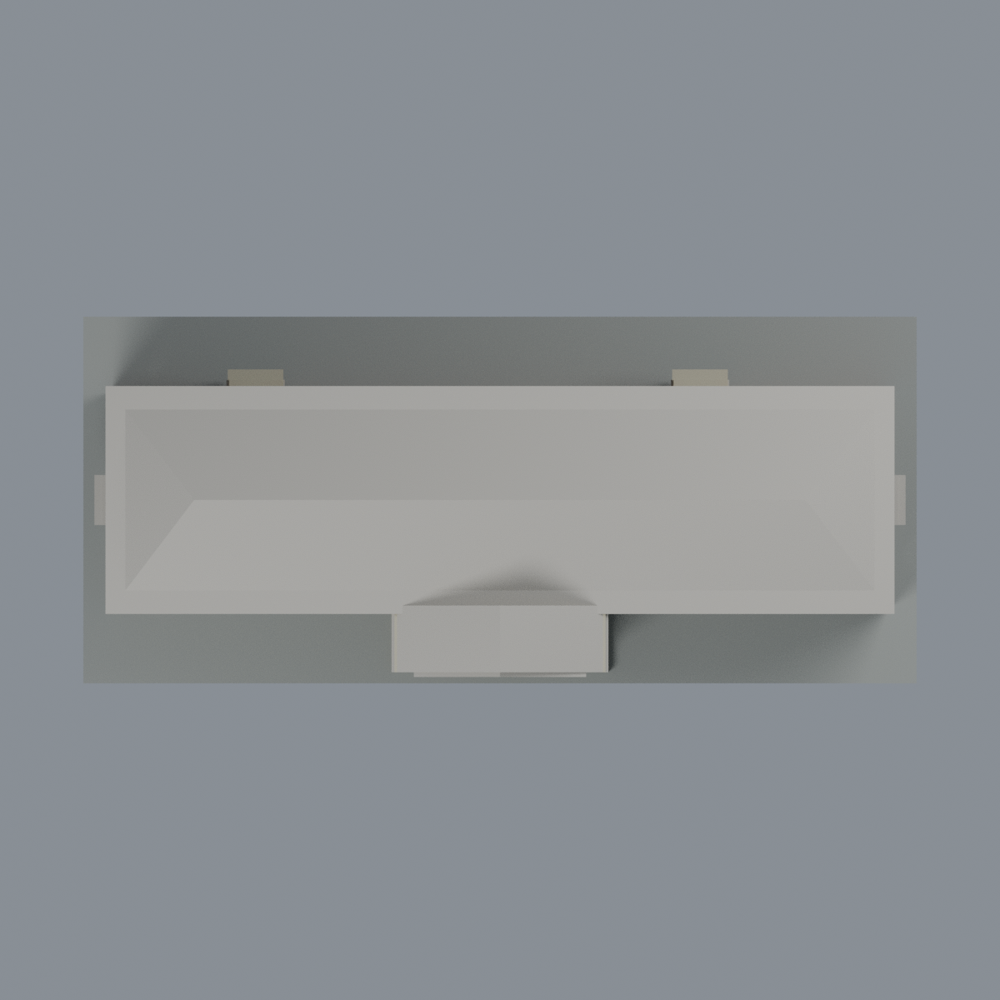

# 成大歷史學系館：六材質外觀版

沿用原 **9,056 三角面／4,506 頂點**，不改原 STL 位元、座標、面序或幾何；這是既有模型外觀改版，不增加模型包數。

| 正面 | 已登錄背面長廊 |
|---|---|
|  |  |
|  |  |

[表面色 3MF](history-appearance.3mf) · [可編輯 Blender](scene.blend) · [材質色表](palette.json) · [逐面指派與依據](face-materials.json) · [原 STL](../model.stl)

## 來源與配色邊界

親自查看成大素材網[正面 3458](https://material.ncku.edu.tw/picture.php?/3458)、[短端 3464](https://material.ncku.edu.tw/picture.php?/3464)與[背面長廊 3472](https://material.ncku.edu.tw/picture.php?/3472)照片。三者署名外國語文學系蔡美慧，上架日為 2025-02-05，不等於拍攝日期，來源未經色卡校正，亦不宣稱 2026 現況。精確影像 URL 及雜湊見[來源紀錄](qa/source-review.json)，不隨包散布照片。

- 已登錄背面長牆紅棕磚色。正面兩翼雖可見磚色，但原三角面跨到中央灰牆，直接分配會出現假斜角邊界；因此正面外牆整片中性，不畫斜角色塊，也不把中央牆誤塗紅磚。既有長廊的拱凹內緣與背面採淡色後牆代理，**不是玻璃**。
- 照片外立面有白色拱圈，但原網格未獨立分出完整圈帶，不能只塗整塊磚柱當白拱圈；本版只改既有拱內緣，不畫假外圈。未建立的木百葉、窗格與廊內門不新增或以一整片棕色冒充。
- 六根原 Tuscan 柱、柱腳／柱頭、前檐與平台、原長廊欄板及後方兩座次入口陽臺採暖灰石材色。仍是原厚化構件，不新增雕刻、欄杆孔、柱紋或建材接縫。
- 原三角門楣內面淡色，外框保守灰色；照片逆光且外框實際材質未獨立判定，**不主張木材復原**。原頂部拱凹中性，不增加文字或假窗扇。
- 短端照片顯示五拱節奏，但未能獨立核實是模型哪一端，**兩個短端都保持中性**，不把鏡像當實測。所有屋面及未登錄簷頂同樣中性。
- 照片灰色牆基在原連續牆三角面中沒有可靠分界，本版不畫虛假斜角牆基；展示底板也不是實際地坪。原幾何比例、簡化廊深、窗口數等界線不變。

[原幾何與來源界線](../README.md)

## 重建與核驗

安裝 [依賴](source/requirements.txt)，Blender 使用 4.3.2。由本資料夾上層提供原 model.stl：

1. `python appearance/source/build_appearance.py`
2. `python appearance/source/verify_exchange.py`
3. `blender -b -t 3 --python-exit-code 1 -P appearance/source/render_appearance.py`
4. `blender -b -t 3 --python-exit-code 1 -P appearance/source/verify_scene.py`

[獨立重建 ZIP](rebuild-source.zip)含原 STL、四支程式及依賴，不含第三方照片；不取代原建模腳本。[逐檔 SHA256](SHA256SUMS)

[交換／拓撲 QA](qa/exchange-validation.json)核對原座標與面序、全部面材質、單連通、有向水密邊、頂點 link 單環、正體積與零退化／重複面；lib3mf 嚴格讀取零警告，實際編輯單材質再存讀，其他材質及面指派不變。SDK 六位小數量化誤差另列。

[Blender 存讀與編輯](qa/scene-validation.json) · [渲染記錄](qa/render-manifest.json) · [獨立重建](qa/rebuild-validation.json)

## 製造限制照舊

尺寸仍為 150 × 66 × 49 mm；原 STL、建模程式、場景及歷史 QA 保留。原層檢與薄特徵檢查本次未重跑，不能由材質 QA 代替。

3MF 是同一網格的表面色，不是六個封閉分色實體、切片專案、噴頭映射或 G-code。切片 GUI、多材料路徑與實體列印未測；柱頭、屋簷、窗框及薄邊仍須評估材料、支撐及拆除風險，沒有保證可印或免支撐。
