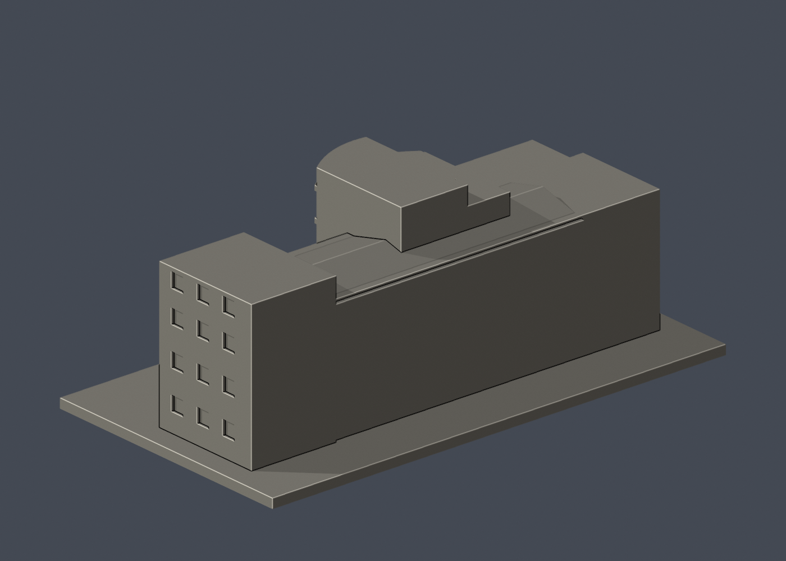

# 國立成功大學｜修齊大樓（文學院暨語言中心大樓）

第十二批；光復校區。校方GIS A022，財產校碼R1A-47-0。尺寸約 150 × 83 × 55.9 mm，含底座最長邊150 mm，各件獨立比例。

## 建模範圍與近似

一棟連續的長向主體、左右不等高端部、前凸弧面入口塔及左側低翼；不含南側相鄰獨立館舍。依四張實拍辨識前部曲面、外階梯、端牆窗、主體窗帶；地圖用於外框比例，不用任何內部平面。塔頂階差、長向淺雙坡屋面與後側素面是外觀近似，後側未逐角度核實，不能當作測繪模型。

只建公開外觀，不包含室內、設備、安全配置。厚窗框、窗凹口、遮陽構件和小屋簷均為適應迷你比例的概化；不是文資修復或工程測繪資料。預覽方位為方便看到主要立面的相機角度，不代表地理正南/正北。

## 列印與支撐

入口門棚下方、柱廊凹口頂部及弧面塔窗上緣可能需要支撐。階梯和屋簷已加粗，但仍須自行切片檢查。

未實體試印，未切片驗證。0.8 mm薄特徵篩查只作水平幾何輔助，不是全部壁厚或噴嘴路徑分析；尖角面積損失不直接等於列印失敗，數值低也不能保證成功。

## 來源

- [校方公共GIS名稱、外觀照片及建物外框](https://nckumap.ncku.edu.tw/map.php)：僅公開外觀與外部輪廓；不採室內/樓層/設備圖層。地圖原圖不公開轉載。
- [校方財產清冊2026-01-30](https://prop-oga.ncku.edu.tw/var/file/59/1059/img/4743/218075103.pdf)：光復校區、校碼R1A-47-0名稱對照；財產筆數非獨立建物棟數。
- [校方建物名稱與背景](https://news-secr.ncku.edu.tw/p/404-1037-46568.php)：名稱、校區或同一棟範圍核對；不使用內部配置。
- [已檢視像素的校方實拍](https://db.nckumap.ncku.edu.tw/nckugis/public/uploadfiles.htm?action=listImg&q=38149)：公開可見建築外觀；原照片不納入公開套件。
- [已檢視像素的校方實拍](https://db.nckumap.ncku.edu.tw/nckugis/public/uploadfiles.htm?action=listImg&q=38148)：公開可見建築外觀；原照片不納入公開套件。
- [已檢視像素的校方實拍](https://db.nckumap.ncku.edu.tw/nckugis/public/uploadfiles.htm?action=listImg&q=36349)：公開可見建築外觀；原照片不納入公開套件。
- [已檢視像素的校方實拍](https://db.nckumap.ncku.edu.tw/nckugis/public/uploadfiles.htm?action=listImg&q=36348)：公開可見建築外觀；原照片不納入公開套件。

## 檔案與重建

- [模型 STL](model.stl)、[可編輯 Blender](scene.blend)
- [正面原圖](previews/front.png)、[背面原圖](previews/rear.png)、[立面圖](previews/elevation.png)，均從實際 STL 產生
- `pip install -r requirements.txt` 後執行 `python build_model.py`
- `blender -b -t 2 -P render_preview.py` 重建 Blender 與預覽
- `python validate_model.py` 重驗原始 STL 法線、邊/頂點流形、封閉、單一連通表面、無額外內部空腔殼、正體積、乾淨重建雜湊與 Blender 幾何一致性
- `python validate_sections.py` 執行固定共同邊方向0.2 mm截面閉合檢查；拒絕不閉合／退化輪廓
- `python check_thin.py` 執行每1 mm取樣、0.8 mm形態開運算薄特徵輔助篩查
- [原始驗證](validation.json)、[截面結果](cross_sections.json)、[薄特徵結果](thin-feature-check.json)、[結構化來源](sources.json)

任一原始驗證false或程式非零退出碼，整批均不可封版；沒有窮盡自交檢測或實體列印保證。原始參考照片與地圖只供內部核對，不放公開包。

### 曲面與側入口修訂

中央高立面保留照片明顯的凸曲面，以24段近似並加入相接的外凸樓層帶；半徑與弧高並未測繪。左翼側入口採一個寬淺拱口與兩根粗化中柱，表現照片中的弧形門廊，不以多個狹窄高拱替代。這些均為實體幾何，不只色彩貼圖。
