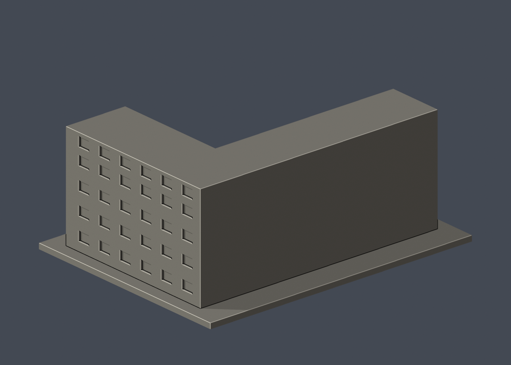
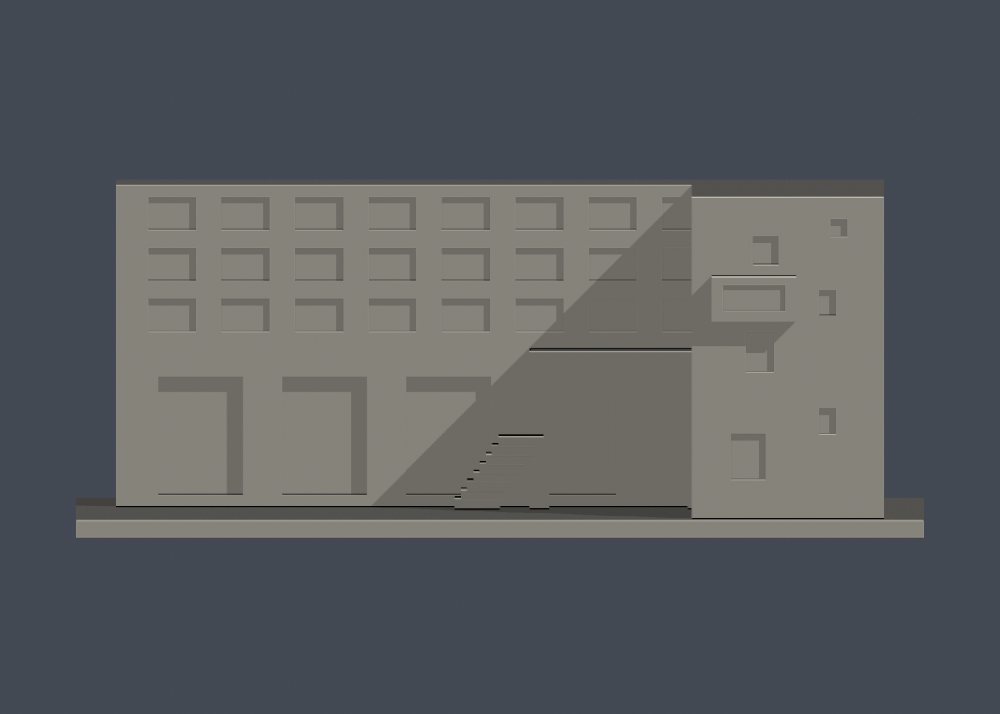

# 國立成功大學｜工業與資訊管理系館大樓

## 模型預覽

| 模型預覽 | 模型預覽 | 模型預覽 |
| :---: | :---: | :---: |
|  |  |  |

第十三批；光復校區。校方GIS A039，財產校碼R1A-17-0。尺寸約 150 × 116 × 59.9 mm，含底座最長邊150 mm，各件獨立比例。

## 棟別範圍與近似

只做GIS A039的L形長翼與東側回翼；北側已另製A040管理學院綜合大樓、西側A038會計系館與院中火車頭倉庫都排除。公共院落照片顯示入口大懸挑、粗柱、三排上層窗、室外階梯；側/端面照片補核較素磚牆、不規則小窗與外凸窗間。樓翼厚度與屋頂高度近似，後側缺乏清楚照片保持素面。照片中各教學單位的招牌不據以另分棟；只做外殼，不做室內、設備或安全配置。

只做公開外觀，不含室內、設備、管線、安全配置、人物或周遭藝術品。窗凹口不是穿入室內的實測空間；細框、屋簷、百葉與樓板唇部按迷你比例加粗。正背預覽為便於觀察外形的相機方向，不代表地理南北。

## 列印與支撐

入口懸挑下方、外階梯底面、凸窗下方與深窗槽需切片評估支撐。粗柱/懸挑均與主體及底座連通，不保證無支撐列印。

未實體試印，未切片驗證。截面閉合與0.8 mm薄篩都是輔助幾何檢查，不是全部壁厚、支撐或列印成功保證。

## 公開來源

- [校方GIS建物身分與外框](https://nckumap.ncku.edu.tw/map.php)：光復校區A039公開外觀及外部輪廓；不使用室內/設備圖層，不轉載地圖原圖。
- [校方財產清冊2026-01-30](https://prop-oga.ncku.edu.tw/var/file/59/1059/img/4743/218075103.pdf)：名稱、校區及R1A-17-0校碼交叉核對；不是以財產筆數當獨立建物數。
- [已檢視像素的校方素材網外觀實拍 photo 3311](https://material.ncku.edu.tw/picture.php?/3311)：僅外觀；照片版權仍歸原權利人，原圖不放公開包。上傳日期不當作拍攝或現況驗證日期。
- [已檢視像素的校方素材網外觀實拍 photo 3313](https://material.ncku.edu.tw/picture.php?/3313)：僅外觀；照片版權仍歸原權利人，原圖不放公開包。上傳日期不當作拍攝或現況驗證日期。
- [已檢視像素的校方素材網外觀實拍 photo 3316](https://material.ncku.edu.tw/picture.php?/3316)：僅外觀；照片版權仍歸原權利人，原圖不放公開包。上傳日期不當作拍攝或現況驗證日期。
- [已檢視像素的校方素材網外觀實拍 photo 3318](https://material.ncku.edu.tw/picture.php?/3318)：僅外觀；照片版權仍歸原權利人，原圖不放公開包。上傳日期不當作拍攝或現況驗證日期。
- [已檢視像素的校方素材網外觀實拍 photo 3381](https://material.ncku.edu.tw/picture.php?/3381)：僅外觀；照片版權仍歸原權利人，原圖不放公開包。上傳日期不當作拍攝或現況驗證日期。
- [已檢視像素的校方素材網外觀實拍 photo 3382](https://material.ncku.edu.tw/picture.php?/3382)：僅外觀；照片版權仍歸原權利人，原圖不放公開包。上傳日期不當作拍攝或現況驗證日期。
- [已檢視像素的校方素材網外觀實拍 photo 3385](https://material.ncku.edu.tw/picture.php?/3385)：僅外觀；照片版權仍歸原權利人，原圖不放公開包。上傳日期不當作拍攝或現況驗證日期。
- [已檢視像素的校方素材網外觀實拍 photo 3387](https://material.ncku.edu.tw/picture.php?/3387)：僅外觀；照片版權仍歸原權利人，原圖不放公開包。上傳日期不當作拍攝或現況驗證日期。

## 檔案與重驗

- [STL](model.stl)、[可編輯 Blender](scene.blend)、[結構化來源與照片直接網址](sources.json)
- [正面原圖](previews/front.png)、[背面原圖](previews/rear.png)、[立面](previews/elevation.png)，均由實際 STL 產生
- 安裝 `requirements.txt` 後執行 `python build_model.py` 重建 STL
- `blender -b -t 2 -P render_preview.py` 重建 Blender 與預覽
- `python validate_model.py` 檢查原始法線、封閉性、邊/頂點流形、單一連通表面、無額外內部空腔殼、正體積、乾淨重建雜湊與 Blender 幾何一致性；見 [validation.json](validation.json)
- `python validate_sections.py` 使用固定共同邊方向插值，檢查每0.2 mm水平截面輪廓閉合；見 [cross_sections.json](cross_sections.json)
- `python check_thin.py` 每1 mm取樣，先確認閉合/有效輪廓，再做0.8 mm形態開運算；見 [thin-feature-check.json](thin-feature-check.json)

| 模型預覽 | 模型預覽 | 模型預覽 |
| :---: | :---: | :---: |
| 立面  |  |  |

任一原始驗證false、程式非零退出碼或資產雜湊不一致都不可封版。沒有窮盡自交檢測，也不以報告代替實體列印。原始參考照片和地圖不隨公開包散布。
