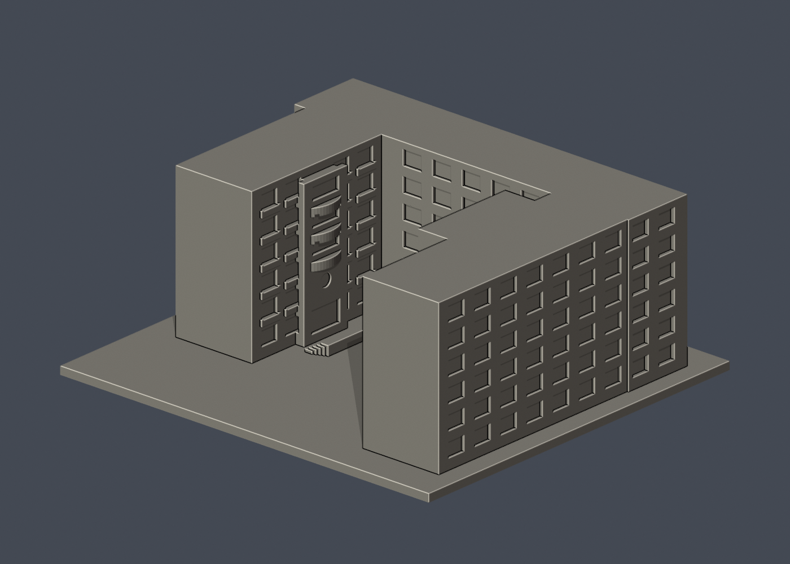
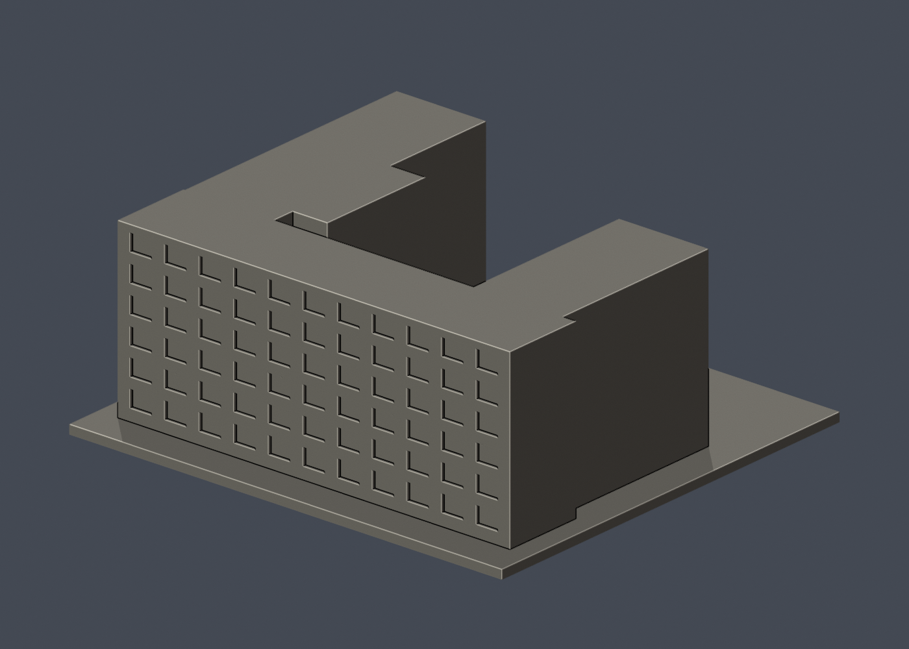
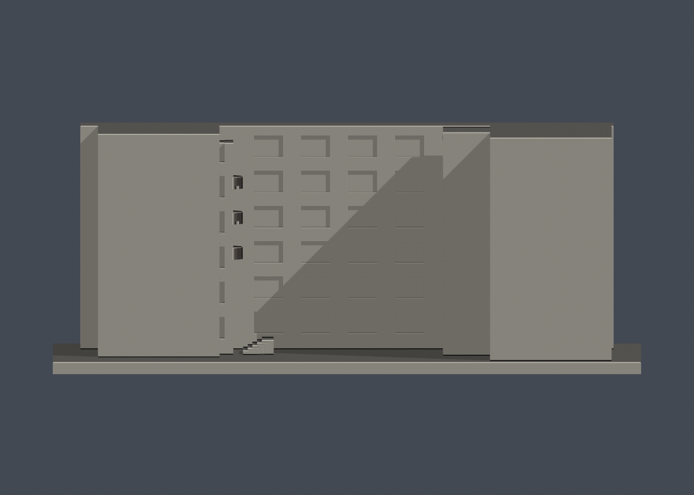

# 國立成功大學｜管理學院綜合大樓

第十二批；光復校區。校方GIS A040，財產校碼R1A-34-0。尺寸約 150 × 138 × 59.9 mm，含底座最長邊150 mm，各件獨立比例。

| 模型預覽 | 模型預覽 | 模型預覽 |
| :---: | :---: | :---: |
|  |  |  |

## 建模範圍與近似

模型僅A040：北長翼與兩端不等長回翼形成開口院落。南側相接的A039工業與資訊管理系館是另一棟、另一財產，明確排除；不能說整個管理學院群棟已完成。保留六層節奏、內向入口三段弧形陽臺、圓形牆面開口、入口階梯與柱樑窗帶。主立面與長側面依三張實拍；回翼深度和連接位置依校方外框。未見屋頂採平頂；其餘未見的內向外牆窗格按可見層次概化，並非逐窗核實。

只建公開外觀，不包含室內、設備、安全配置。厚窗框、窗凹口、遮陽構件和小屋簷均為適應迷你比例的概化；不是文資修復或工程測繪資料。預覽方位為方便看到主要立面的相機角度，不代表地理正南/正北。

## 列印與支撐

弧形陽臺下方、門口及窗凹槽上緣可能需要支撐；底座平放列印，不能保證免支撐。

未實體試印，未切片驗證。0.8 mm薄特徵篩查只作水平幾何輔助，不是全部壁厚或噴嘴路徑分析；尖角面積損失不直接等於列印失敗，數值低也不能保證成功。

## 來源

- [校方公共GIS名稱、外觀照片及建物外框](https://nckumap.ncku.edu.tw/map.php)：僅公開外觀與外部輪廓；不採室內/樓層/設備圖層。地圖原圖不公開轉載。
- [校方財產清冊2026-01-30](https://prop-oga.ncku.edu.tw/var/file/59/1059/img/4743/218075103.pdf)：光復校區、校碼R1A-34-0名稱對照；財產筆數非獨立建物棟數。
- [校方建物名稱與背景](https://management.ncku.edu.tw/p/412-1017-27017.php?Lang=zh-tw)：名稱、校區或同一棟範圍核對；不使用內部配置。
- [已檢視像素的校方實拍](https://db.nckumap.ncku.edu.tw/nckugis/public/uploadfiles.htm?action=listImg&q=38145)：公開可見建築外觀；原照片不納入公開套件。
- [已檢視像素的校方實拍](https://db.nckumap.ncku.edu.tw/nckugis/public/uploadfiles.htm?action=listImg&q=36386)：公開可見建築外觀；原照片不納入公開套件。
- [已檢視像素的校方實拍](https://db.nckumap.ncku.edu.tw/nckugis/public/uploadfiles.htm?action=listImg&q=36385)：公開可見建築外觀；原照片不納入公開套件。

## 檔案與重建

- [模型 STL](model.stl)、[可編輯 Blender](scene.blend)
- [正面原圖](previews/front.png)、[背面原圖](previews/rear.png)、[立面圖](previews/elevation.png)，均從實際 STL 產生
- `pip install -r requirements.txt` 後執行 `python build_model.py`
- `blender -b -t 2 -P render_preview.py` 重建 Blender 與預覽
- `python validate_model.py` 重驗原始 STL 法線、邊/頂點流形、封閉、單一連通表面、無額外內部空腔殼、正體積、乾淨重建雜湊與 Blender 幾何一致性
- `python validate_sections.py` 執行固定共同邊方向0.2 mm截面閉合檢查；拒絕不閉合／退化輪廓
- `python check_thin.py` 執行每1 mm取樣、0.8 mm形態開運算薄特徵輔助篩查
- [原始驗證](validation.json)、[截面結果](cross_sections.json)、[薄特徵結果](thin-feature-check.json)、[結構化來源](sources.json)

| 模型預覽 | 模型預覽 | 模型預覽 |
| :---: | :---: | :---: |
| 立面圖  |  |  |

任一原始驗證false或程式非零退出碼，整批均不可封版；沒有窮盡自交檢測或實體列印保證。原始參考照片與地圖只供內部核對，不放公開包。
