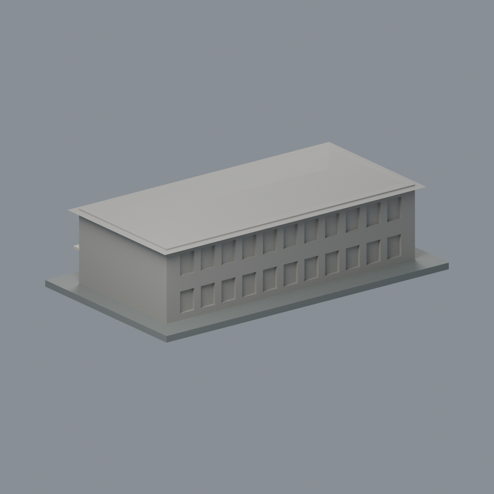

# 國立成功大學｜軍訓大樓

## 模型預覽


| 模型預覽 | 模型預覽 | 模型預覽 |
| :---: | :---: | :---: |
| 正面原幾何配色<br> | 背面與未見面保持中性<br> |  |

第十一批，光復校區。尺寸 150 × 86 × 40 mm，含底座最長邊150 mm；每件獨立比例。

## 最新六材質外觀版（2026-10-20）


[來源界線與四視角](appearance/README.md) · [表面色 3MF](appearance/military-appearance.3mf) · [可編輯場景](appearance/scene.blend)

依官方地圖照片登錄紅赭正面與小窗短端、暖白廊背及原厚化欄帶；深廊口不是玻璃。屋頂、背面與另一素面短端中性，不增加窗格或設備。原STL與歷史QA不變，不是新增幾何。原單色正面（歷史檔案留存，不作本頁預覽）／原單色背面（歷史檔案留存，不作本頁預覽）


## 來源與像素檢視

- [校方GIS：短端與長廊](https://db.nckumap.ncku.edu.tw/nckugis/public/uploadfiles.htm?action=listImg&q=38137)：已檢視兩層紅色量體、深柱廊與淺屋頂。
- [校方GIS：長側及另一端](https://db.nckumap.ncku.edu.tw/nckugis/public/uploadfiles.htm?action=listImg&q=38136)：已檢視兩層廊柱、微折拱頭、白色欄帶、短端窗及寬簷。
- [校方GIS：較早街側照片](https://db.nckumap.ncku.edu.tw/nckugis/public/uploadfiles.htm?action=listImg&q=36338)：交叉檢視相同矩形兩層外殼；未使用設備或內部配置。
- [校方公開GIS建物外框](https://nckumap.ncku.edu.tw/map.php)：只採A014及gis_base外部輪廓，不採樓層室內配置。
- [校方2026/1/30財產清冊](https://prop-oga.ncku.edu.tw/var/file/59/1059/img/4743/218075103.pdf)：光復校區R1D-17-0名稱對照。

## 範圍與近似

本件為GIS A014的獨立矩形兩層大樓，依R1D-17-0財產名列名，沒有將旁邊成功廳、唯農樓或學生活動中心混入。只保留公共可見外殼：兩層深柱廊、廊口微折頭、淺四坡屋頂及側窗。欄杆改為較厚的水平帶，柱距和拱頭曲率概化；前後細部未逐處測量，沒有確實像素的端面留素面。屋頂內部、室內、設備、管線、監視及任何安全設施均未建模。

## 交付與重建

- `model.stl`：毫米單位，與底座合成的單一實體。最長邊為 150 mm（含底座）；各棟獨立縮放，不適合直接拼成等比例校園。
- `build_model.py`：完整可攜參數化原始程式，無外部貼圖、私有路徑或參考照片依賴。
- `scene.blend`：由交付 STL 匯入，只有一個建築網格，可在 Blender 編輯頂點；細部參數請修改 Python 後重建。
- `previews/front.png`、`rear.png`、`elevation.png`：由實際交付 STL 產生。
- `validate_model.py`、`validation.json`：可重跑的幾何與重建驗證。

建議 Python 3.12，在虛擬環境執行：

```sh
python -m pip install -r requirements.txt
python build_model.py
blender -b -t 2 -P render_preview.py
python validate_model.py
```

已使用 Blender 4.3.2。驗證器在獨立臨時目錄重建 STL 並比較 SHA-256，讀取 Blender 場景的網格後比較三角形幾何。它檢查原始二進位 STL 儲存法線、面積、封閉性、邊恰有兩面、頂點連結為單一環、表面只有一個連通分量、正體積、底面位於 Z=0、最長邊 150 mm。單一封閉表面也排除獨立藏在內部的空腔殼；沒有宣稱完成所有自交的窮舉檢測。

## 製作原則與限制

這是依公開照片觀察製作的外觀近似收藏模型，不是測繪、修復、工程或精確 BIM 資料。牆身為實體，門窗、拱廊通常改成淺凹浮雕；不含室內、設備或安全配置。屋頂、深度、窗距及後側比例沒有測量基準，不能視為實際尺寸。原始參考照片未收錄、未重新授權或隨套件發布。來源權利屬原作者／校方；原創模型與程式可沿用儲存庫授權，不涵蓋外部參考照片。

## 列印說明

底座平貼平台，Z 軸向上。可從 0.4 mm 噴嘴、0.16–0.20 mm 層高、3 道外牆與 12–18% 填充開始試切片；這是設定建議，並非已測參數。小於約 0.8 mm 的淺浮雕可能因噴嘴或縮放消失。STL 是封閉實體，切片器仍會依填充率產生內部填充。

未實體試印、未執行切片器列印驗證，沒有保證免支撐。請依下列模型特有支撐需求檢查切片預覽。

兩層深凹柱廊上方、入口小棚及四周屋簷可能需局部支撐，欄帶加厚不代表實體欄杆尺寸。

## 幾何輔助檢查

`validate_sections.py`固定共享邊方向求交，0.20mm抽樣閉合；見`cross_sections.json`。`check_thin.py`斷言1.0mm截面閉合有效後作0.8mm參考寬度形態開運算；見`thin-feature-check.json`。尖角也會產生面積差，不能直接當壁厚失敗或可列印保證。這兩項不是實際切片器、支撐拆除或實體試印驗證。

查核日期2026-10-13；GIS照片未標最近攝影日期，不宣稱現況逐細節一致。
