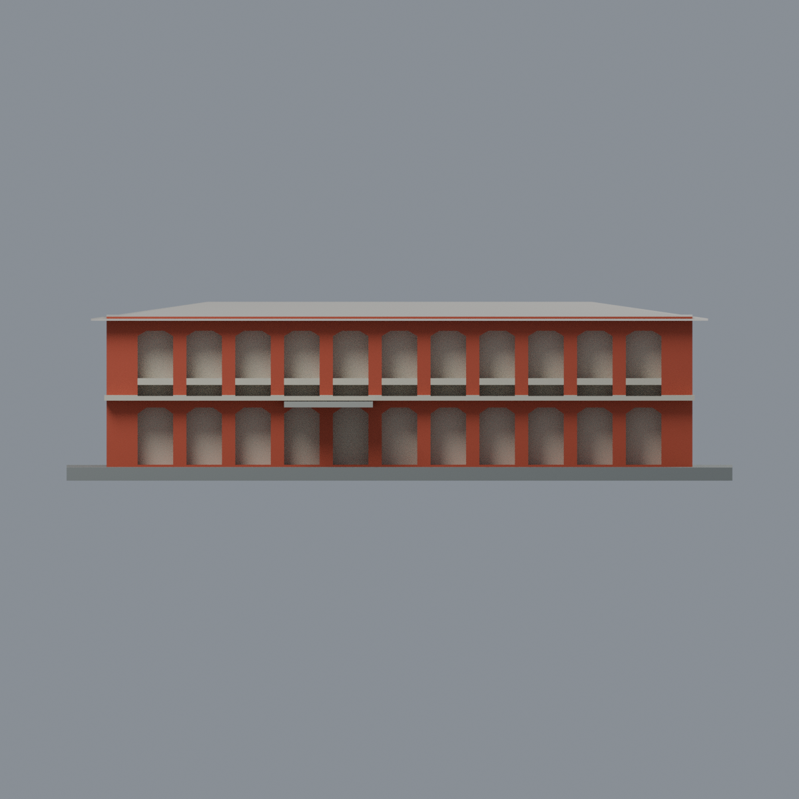

# 成大軍訓樓：六材質外觀版

沿用原 **1,360 三角面／682 頂點**，不改原 STL 位元、座標、面序或幾何；這是既有模型外觀改版，不增加模型包數。

| 正面 | 背面保持中性 |
|---|---|
|  |  |
|  |  |

[表面色 3MF](military-appearance.3mf) · [可編輯 Blender](scene.blend) · [材質色表](palette.json) · [逐面指派與依據](face-materials.json) · [原 STL](../model.stl)

## 來源與配色邊界

親自查看成大校園地圖官方影像[38136](https://db.nckumap.ncku.edu.tw/nckugis/public/uploadfiles.htm?action=listImg&q=38136)及[38137](https://db.nckumap.ncku.edu.tw/nckugis/public/uploadfiles.htm?action=listImg&q=38137)。無可靠拍攝日期，不以下載時間推定年代，不宣稱 2026 現況；來源照片不隨模型散布。

- 登錄長正面紅赭外柱／外牆；原廊口的深凹背面採暖白作廊內後牆代理，**不是玻璃，也不把樹蔭或廊影畫成黑牆**。兩層廊口原形、數量與厚化尺度不改。
- 原上層實心橫欄條及前凸水平帶採暖白；原件只有簡化厚化欄帶，沒有照片的多層細金屬扶手，不新增欄杆細節，不宣稱逐條還原。
- x=-66 的短端由 38136 三組小上窗登錄紅外牆，原上凹窗淡內緣、灰綠玻璃代理；下窄凹口白背面。原短端窗數／寬高是合成簡化，**不宣稱與照片逐窗吻合**；不增加黃門、框格或開啟窗扇。
- 38137 另一短端有高廊口，但模型 x=+66 是原保留素牆，保持中性而不塗假廊口。原 y=+31 推估重複背面同樣中性。
- 原入口小雨棚灰色示意；屋面與屋簷全留中性。照片能見深邊與淺 soffit，但原低坡屋頂未分離簷板，不將整坡面染成深色或假造分界。底板僅展示用途。
- 色值未校正，不能代表塗料型號或精確材料測繪；不烘焙樹影、風化、電線、冷氣、燈具、標牌或其他設備。只改既有外表面材質，不增幾何。

[原幾何與來源界線](../README.md) · [本次來源覆核](qa/source-review.json)

## 重建與核驗

安裝 [依賴](source/requirements.txt)，Blender 使用 4.3.2。由本資料夾上層提供原 model.stl：

1. `python appearance/source/build_appearance.py`
2. `python appearance/source/verify_exchange.py`
3. `blender -b -t 3 --python-exit-code 1 -P appearance/source/render_appearance.py`
4. `blender -b -t 3 --python-exit-code 1 -P appearance/source/verify_scene.py`

[獨立重建 ZIP](rebuild-source.zip)含原 STL、四支程式及依賴，不含第三方照片；不取代原建模腳本。[逐檔 SHA256](SHA256SUMS)

[交換／拓撲 QA](qa/exchange-validation.json)核對原座標與面序、全部面材質、單連通、有向水密邊、頂點 link 單環、正體積與零退化／重複面；lib3mf 嚴格讀取零警告，實際編輯單材質再存讀，其他材質及面指派不變。SDK 六位小數量化誤差另列。

[Blender 存讀與編輯](qa/scene-validation.json) · [渲染記錄](qa/render-manifest.json) · [獨立重建](qa/rebuild-validation.json)

## 製造限制照舊

尺寸仍為 150 × 86 × 40 mm；原 STL、建模程式、場景及歷史 QA 保留。原層檢與薄特徵檢查本次未重跑，不能由材質 QA 代替。

3MF 是同一網格的表面色，不是六個封閉分色實體、切片專案、噴頭映射或 G-code。切片 GUI、多材料路徑與實體列印未測；柱頭、屋簷、窗框及薄邊仍須評估材料、支撐及拆除風險，沒有保證可印或免支撐。
