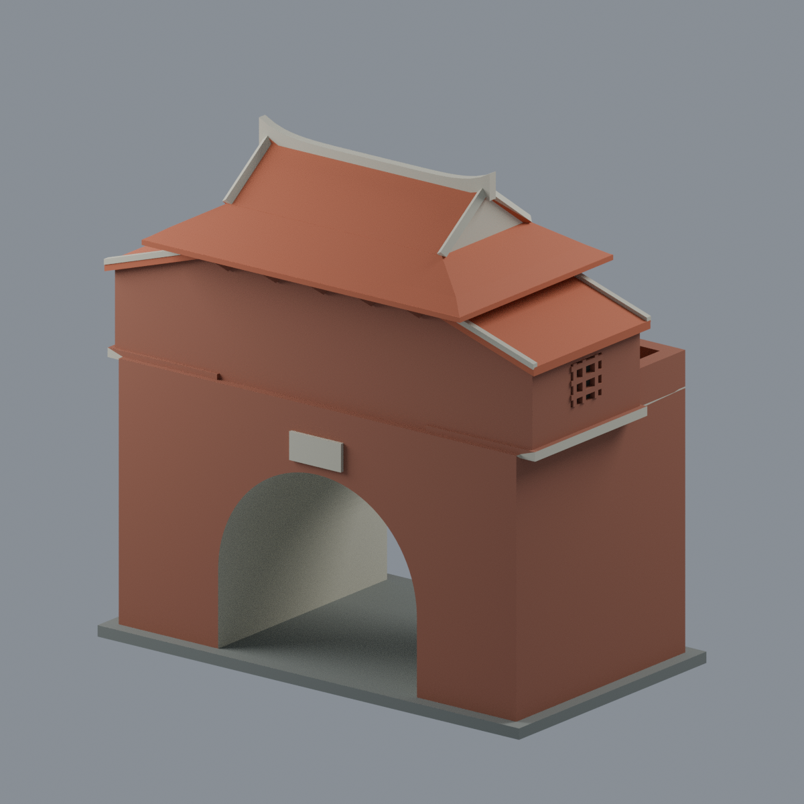
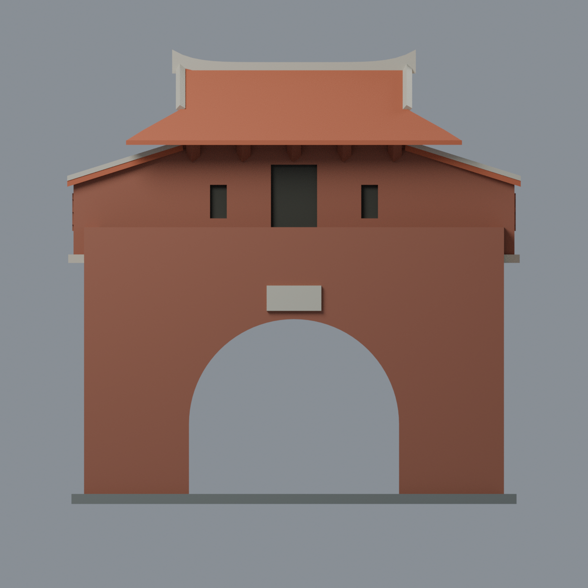
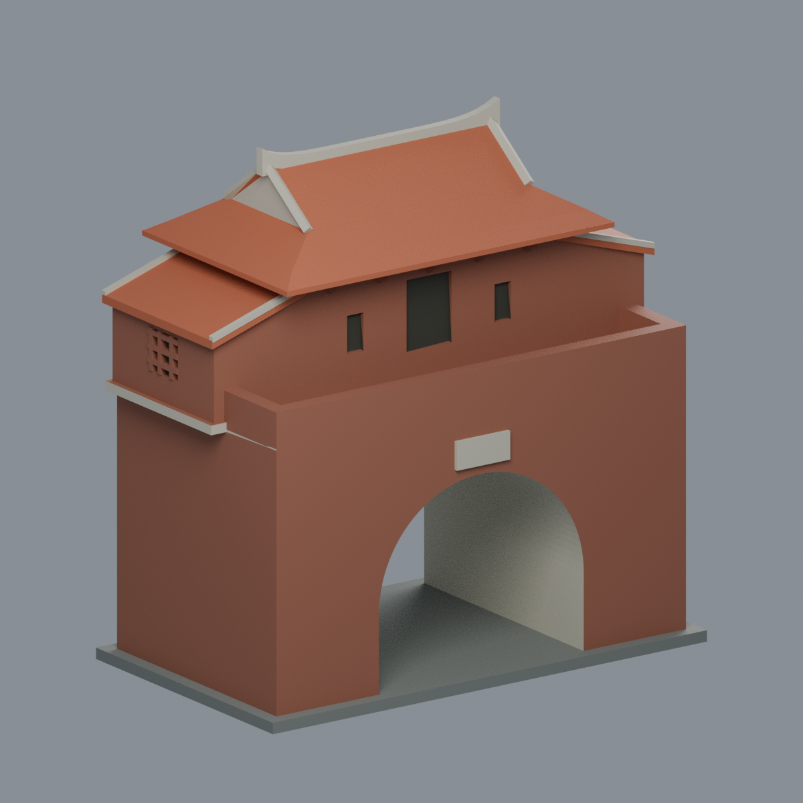
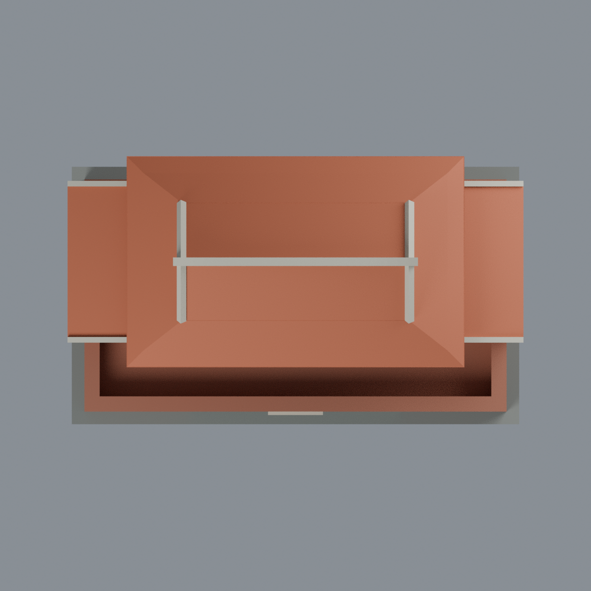

# 國立成功大學・光復校區小西門（靖波門）

遷建後完整門樓的**照片比例近似外觀模型**：拱形通道基座、上層中央門樓、單簷歇山主屋頂、兩側後退單坡附屋與前平台。非實測、非現況調查、非古蹟修復模型。

| 模型預覽 | 模型預覽 | 模型預覽 |
| :---: | :---: | :---: |
|  |  |  |

| 模型預覽 | 模型預覽 | 模型預覽 |
| :---: | :---: | :---: |
| 模型視角  | 模型視角  |  |
|  |  |  |

## 檔案
- [可編輯彩色 Blender](scene.blend)／[彩色 3MF](model.3mf)／[單色 STL](model.stl)
- [Python 產生器](build_model.py)、[實際網格渲染器](render_model.py)、[來源](SOURCES.md)、[QA](QA.md)。
- 五張預覽均渲染自交付3MF原三角面，非生成式圖片；Blender只有一個模型網格，保留5種可編輯材質，無外部貼圖。3MF顏色是顯示材質，不是多色列印機噴頭配置。

## 不對稱與簡化
負Y為道路側，一門二窗；正Y為校園側連續磚牆。附屋向校園側後退，前方保留露台。上層與基座遷移時轉向不同，不拿舊址照片推補對稱。門窗及花格是有背淺凹、脊飾合併加厚；細燕尾、磚瓦數與刻字不重建。獨立展示底板不代表現地鋪面。

## 重建與列印提醒
Python套件見 requirements.txt；執行 `python build_model.py`、`python qa_model.py`、`python check_features.py`、`python check_architecture.py`。使用 Blender 4.3.2執行 `blender -b --threads 4 --python-exit-code 1 --python render_model.py`。`verify_scene.py`、`verify_render.py`和`verify_exchange.py`各自檢查編輯重開、渲染重現及官方lib3mf交換；`verify_package.py`核對報告綁定。

尺寸約108 ×63.5 ×108.2 mm，是展示模型正規化大小。網格封閉不等於可無支撐列印；拱洞、簷口、托架及附屋底托有懸垂。薄端測試保留失敗，需切片、支撐、方向與材料評估。**尚未實際列印，不承諾0.8mm全面通過或免支撐。**
