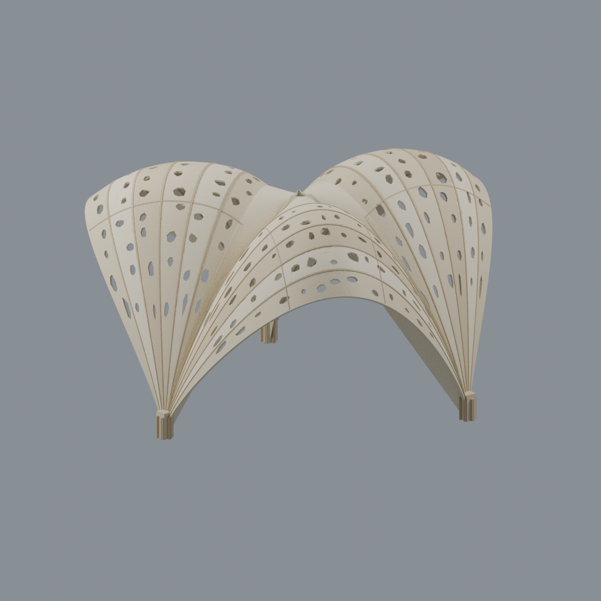
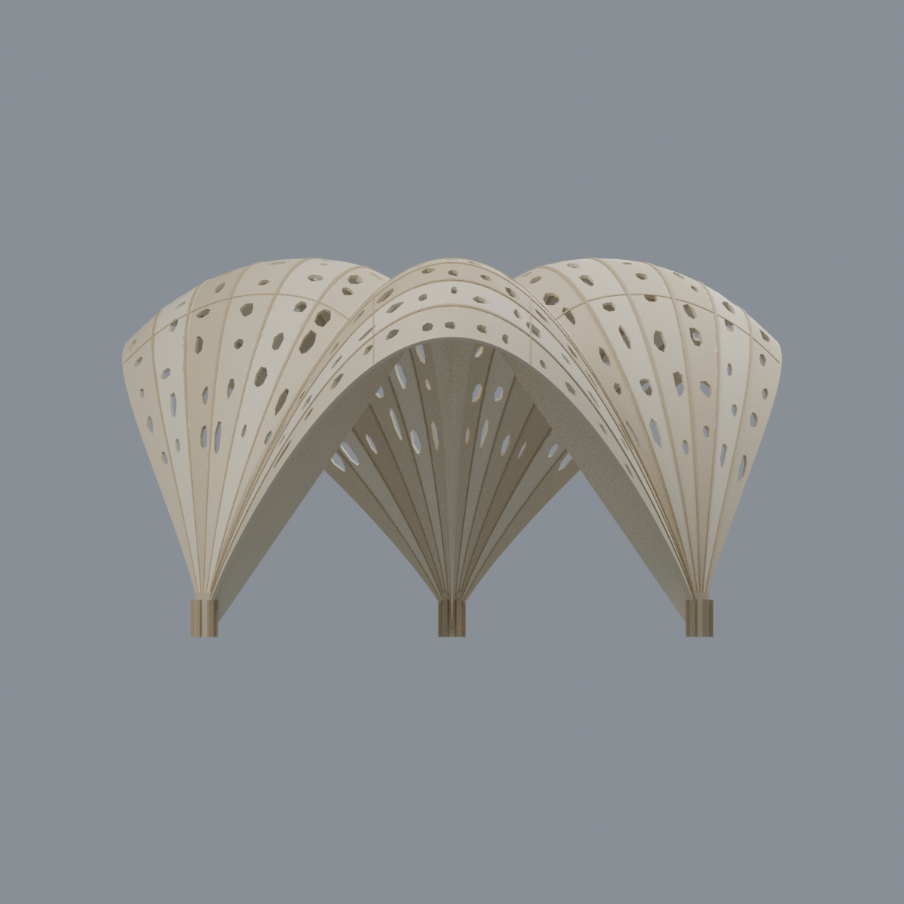
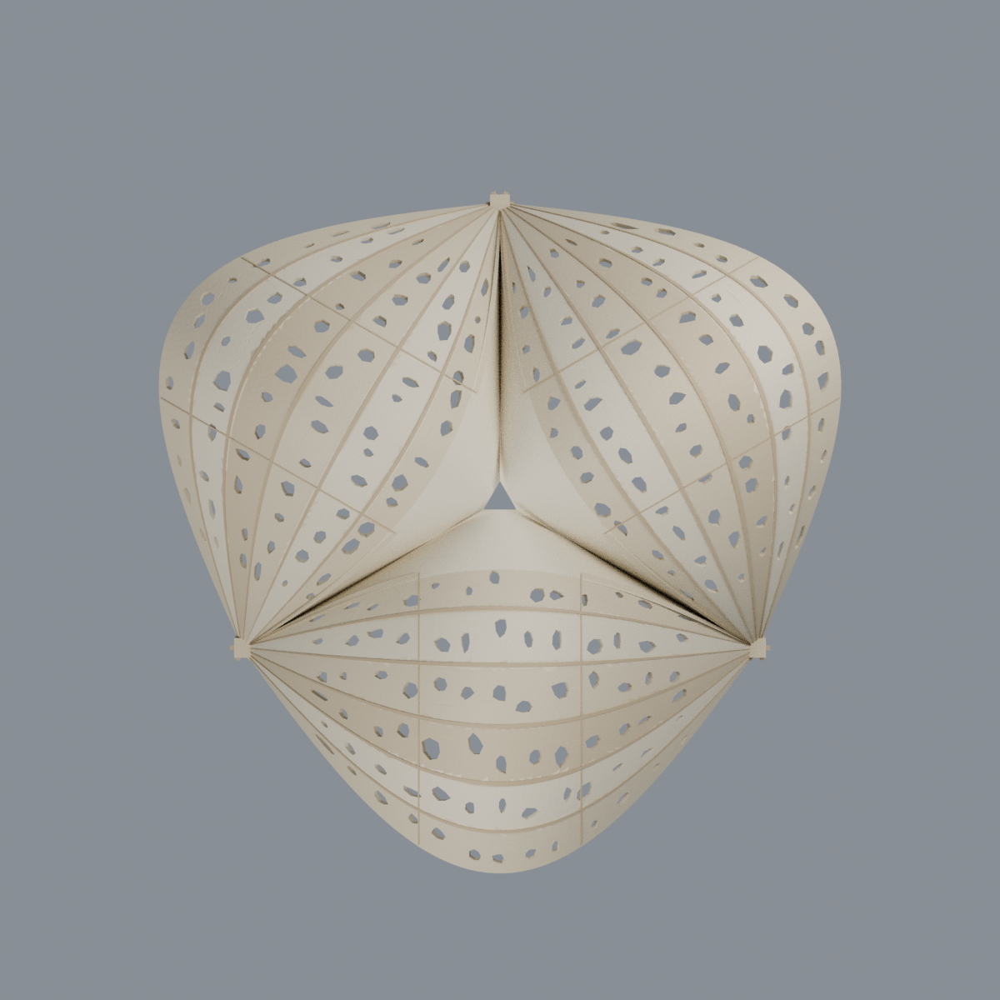
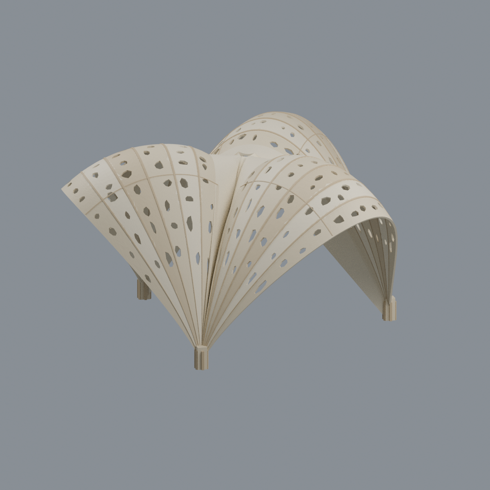

# 國立成功大學｜光復校區｜懸鏈・榭（Sewn Pavilion）

**建築系館院落研究實作亭的完整可見外觀近似；不是測繪復原，也不代表目前仍存。** 身分取自2013年論文公開書目／目錄，形體主要依2014年4月文章中的已組裝成品與構築圖。照片拍攝日、精確完工日與2025／2026存續狀態均未確認。

[可編輯Blender](scene.blend) · [具名材質3MF](model.3mf) · [單色實體STL](model.stl) · [來源](SOURCES.md) · [完整QA](QA.md)

## 實際最終mesh五視圖
全部PNG由交付3MF內與STL逐三角相同的幾何生成，不是概念圖、來源照片或AI繪圖。視角名稱只指模型座標，不代表已測定方位。

| 正面斜視 | 反面斜視 | 開放拱下立面 |
|---|---|---|
|  |  |  |

| 模型預覽 | 模型預覽 | 模型預覽 |
| :---: | :---: | :---: |
| 俯視三葉與中央缺口<br> | 側向曲帶層次<br> |  |

## 模型保留的辨識特徵
- **三葉A／B／C、每葉六道0–5曲帶、三個共用腳ab／bc／ca**。曲帶跨兩腳成拱、向腳部收束，不增造第四腳，也不是柱子加平頂的普通涼亭。
- 各帶的曲率／傾斜與起伏不同，保留扇狀層次、外緣與接縫的辨識及三腳之間真正開放的穿行空間。來源各帶上緣有錯層／局部上翹；**本模型用連續邊界曲帶＋細接縫近似，不是逐片折曲復原**。
- 中央有**三向拱形連接框片及小三角缺口**，不是實心平蓋，也不是只有一個沒有框片的大孔。此拓樸主要由同篇爆炸與組裝圖補足成品遮擋。
- 曲帶保留代表性的非均勻穿孔與實體邊帶，**照片中的成組微孔省略**。孔數、孔形、逐孔位置及細小接頭是示意簡化，不是逐孔還原，也不是每孔均有竣工照片量測證據。
- 使用日照照片所示淡木色；夜照的暖橙光與構築圖的藍色標示都不當成實體塗裝。

展示外包尺寸 **156.90 × 156.96 × 90.21 mm**；82,794個三角面、1個連通閉殼。展示尺寸是本模型的毫米設定，不是已知實物尺寸、測量比例或與其他模型可直接拼接的承諾。

## 場址與日期界線
「建築系館院落」是**影像交叉定位推論**：成品夜照與官方具名院照共同呈現左側下層柱窗／上部外挑連續窗帶、草坪旁斜向方格鋪面、右側寬階分段側緣，以及階頂樹與相鄰翼樓的組合；不是僅以相似建築風格判定。校區再以系館官方沿革的1981年遷入光復校區交叉分類。

官方院照的2025-02-05是**上傳日，非已知拍攝日**；照片沒有本亭，不能據此斷言拆除日期或今日存否。文章另述的榕園課程方案未集體實作，不能把那個擬議場址移植到本件已完成的論文亭。

## 模型強化不是原作厚度
曲帶名義法向厚度為0.95mm。中央拱框保留擬合中心曲面與小三角孔，**為模型製作而加厚至近法向0.95mm**；其垂直厚度依局部法向調整，不是固定0.95mm。極陡近腳處設垂直厚度上限約7.92mm，底面裁至展示z≥0。這是非測量的製作強化，不能反推原作板厚；近腳上限、分片與布林重疊處以交付STL的實際ray結果為準。

## 編輯與列印限制
Blender及3MF保存具名材質與逐面分派，可修改幾何、色彩及尺寸；**STL不保存顏色或透明資訊**。所有建模尺寸、薄片加厚、曲帶三維曲率、中央孔尺度與框片局部曲面均為展示／製作考量的近似，不能當作建築施工、結構設計或雷射裁切資料。

**尚未實際列印，不保證免支撐。** raw拓樸合格不代表可印；所有薄件與懸挑診斷原樣留在[QA](QA.md)，不因構件小而豁免。

全局452個切層樣本（0.2mm間距，另含頂部追加樣本）保留34個警告層／61個未通過0.8mm侵蝕檢查的成分。薄曲帶、穿孔邊緣、分片接縫與腳部接片仍易折損；拱下跨度、外伸翼緣及中央框片需要支撐與去支撐規劃。 局部檢查記錄90個實體、69個空氣樣本；保留10個薄樣本／10個薄成分，法向ray不足0.8mm共0個。向下超45°面共11885個。局部通過不等於全表面厚度／強度證明。 曲帶實際法向ray樣本範圍0.944–0.959mm，數字來自交付raw STL，不是實物測量，也不是全域最小厚度。 加厚中央框片實際法向ray樣本範圍0.932–0.956mm，數字來自交付raw STL，不是實物測量，也不是全域最小厚度。

## 重建與檢查
Python依賴見[requirements.txt](requirements.txt)，另需Blender4.3.2或相容版。不需要來源圖片、外部字型或網路資產。

```bash
python build_model.py
blender -b -t 8 --python-exit-code 1 --python render_model.py
python qa_model.py
python check_features.py
python verify_exchange.py
blender -b -t 8 --python-exit-code 1 --python verify_scene.py
blender -b -t 8 --python-exit-code 1 --python verify_render.py
python rebuild.py --output ../new-clean-rebuild --blender blender --threads 8
python verify_identity.py
python verify_package.py
```

`rebuild.py`需使用全新輸出目錄，檢查4個核心輸出及5張PNG逐byte相同；不同Blender／函式庫版本可能影響布林或渲染結果。`verify_exchange.py`可用`BUILD_PYTHON`指定具建模依賴的Python。`SHA256SUMS`涵蓋除校驗檔自身外的交付檔。

檔案識別：`ncku-sewn-pavilion`；校園分類：國立成功大學／光復校區。只交付自建幾何、自渲染圖與程式；來源照片、圖紙、PDF及裁圖**不隨包散布**。其他取捨見[SOURCES.md](SOURCES.md)。
