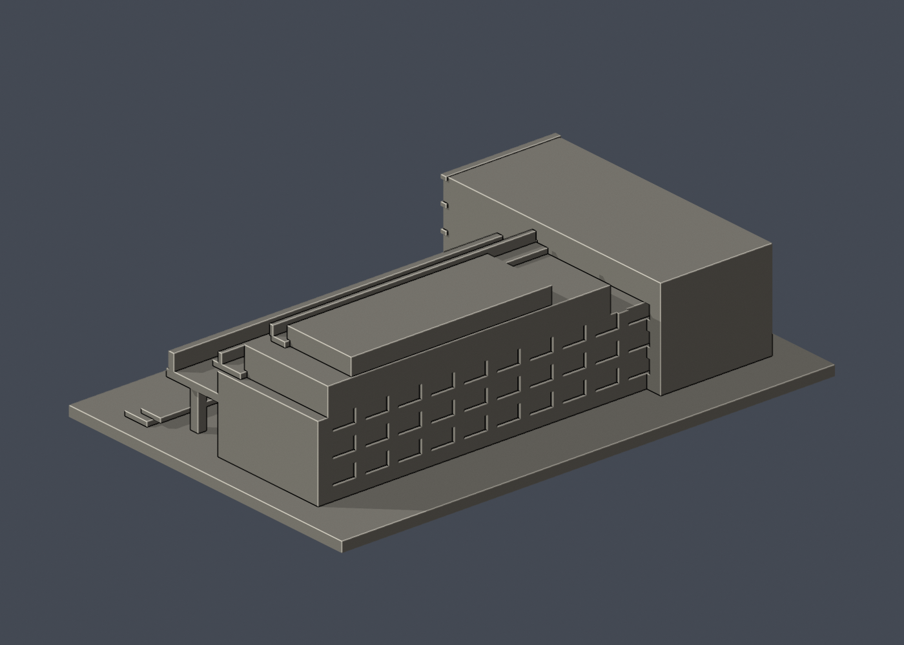

# 國立成功大學｜學生活動中心（連續L形建築）

第十一批，光復校區。尺寸 150 × 98 × 38 mm，含底座最長邊150 mm；每件獨立比例。




## 來源與像素檢視

- [校方虛擬校園：學生活動中心](https://virtualcampustour.ossd.ncku.edu.tw/index.php?id=6&inter=detail)：核實1982年建築及其L形連續配置，避免把名稱不同的活動空間誤當各自獨立棟。只取外觀相關說明。
- [校方GIS：主要懸挑正面](https://db.nckumap.ncku.edu.tw/nckugis/public/uploadfiles.htm?action=listImg&q=38141)：已檢視大懸挑、底部退縮柱列、外側階梯與逐層退縮橫帶。
- [校方GIS：L形轉角](https://db.nckumap.ncku.edu.tw/nckugis/public/uploadfiles.htm?action=listImg&q=38140)：已檢視西側連續短翼與東向長翼的接合、開放前庭。
- [校方GIS：反向長立面](https://db.nckumap.ncku.edu.tw/nckugis/public/uploadfiles.htm?action=listImg&q=38139)：已檢視長面下部窗與粗柱、上部階梯狀外形。
- [校方GIS：後側轉角](https://db.nckumap.ncku.edu.tw/nckugis/public/uploadfiles.htm?action=listImg&q=38138)：已檢視實牆、窗組及階梯狀長面；未建設備。
- [校方公開GIS建物外框](https://nckumap.ncku.edu.tw/map.php)：只採A018及gis_base外部輪廓，不採樓層室內配置。
- [校方2026/1/30財產清冊](https://prop-oga.ncku.edu.tw/var/file/59/1059/img/4743/218075103.pdf)：光復校區R1A-9-0名稱對照。

## 範圍與近似

本件為校方明確記載的連續L形學生活動中心，長翼與西側短翼相連，沒有把周遭獨立大樓或操場納入。保留L形外框、大懸挑平台、底層退縮粗柱、上層退縮橫帶及外側階梯。外廊以有實體背板的凹槽近似，不作內部活動空間。長寬高比例、各層退縮、細面板和後側缺照片部分均簡化；照片中的細網/彩板用厚橫帶呈現，不擬真材質。屋頂小機房與設備不建，公共雕塑、植栽亦省略。

## 交付與重建

- `model.stl`：毫米單位，與底座合成的單一實體。最長邊為 150 mm（含底座）；各棟獨立縮放，不適合直接拼成等比例校園。
- `build_model.py`：完整可攜參數化原始程式，無外部貼圖、私有路徑或參考照片依賴。
- `scene.blend`：由交付 STL 匯入，只有一個建築網格，可在 Blender 編輯頂點；細部參數請修改 Python 後重建。
- `previews/front.png`、`rear.png`、`elevation.png`：由實際交付 STL 產生。
- `validate_model.py`、`validation.json`：可重跑的幾何與重建驗證。

建議 Python 3.12，在虛擬環境執行：

```sh
python -m pip install -r requirements.txt
python build_model.py
blender -b -t 2 -P render_preview.py
python validate_model.py
```

已使用 Blender 4.3.2。驗證器在獨立臨時目錄重建 STL 並比較 SHA-256，讀取 Blender 場景的網格後比較三角形幾何。它檢查原始二進位 STL 儲存法線、面積、封閉性、邊恰有兩面、頂點連結為單一環、表面只有一個連通分量、正體積、底面位於 Z=0、最長邊 150 mm。單一封閉表面也排除獨立藏在內部的空腔殼；沒有宣稱完成所有自交的窮舉檢測。

## 製作原則與限制

這是依公開照片觀察製作的外觀近似收藏模型，不是測繪、修復、工程或精確 BIM 資料。牆身為實體，門窗、拱廊通常改成淺凹浮雕；不含室內、設備或安全配置。屋頂、深度、窗距及後側比例沒有測量基準，不能視為實際尺寸。原始參考照片未收錄、未重新授權或隨套件發布。來源權利屬原作者／校方；原創模型與程式可沿用儲存庫授權，不涵蓋外部參考照片。

## 列印說明

底座平貼平台，Z 軸向上。可從 0.4 mm 噴嘴、0.16–0.20 mm 層高、3 道外牆與 12–18% 填充開始試切片；這是設定建議，並非已測參數。小於約 0.8 mm 的淺浮雕可能因噴嘴或縮放消失。STL 是封閉實體，切片器仍會依填充率產生內部填充。

未實體試印、未執行切片器列印驗證，沒有保證免支撐。請依下列模型特有支撐需求檢查切片預覽。

大平台下、上層水平懸挑帶與斜向外階須評估支撐；支柱已加粗，拆支撐可能仍損傷細處，不能保證免支撐。

## 幾何輔助檢查

`validate_sections.py`固定共享邊方向求交，0.20mm抽樣閉合；見`cross_sections.json`。`check_thin.py`斷言1.0mm截面閉合有效後作0.8mm參考寬度形態開運算；見`thin-feature-check.json`。尖角也會產生面積差，不能直接當壁厚失敗或可列印保證。這兩項不是實際切片器、支撐拆除或實體試印驗證。

查核日期2026-10-13；GIS照片未標最近攝影日期，不宣稱現況逐細節一致。


### 連續棟別與支撐範圍

模型包含同一連續L形學生活動中心的高低翼及轉角連接部；不是將校區相鄰獨立館舍併成一棟。校方虛擬校園文字與六張GIS外觀照交叉判讀；背側及局部階梯深度仍為近似。寬大的上層懸挑、露臺底面、柱間橫跨與樓梯底部，建議由實際切片檢視並配置支撐，不能保證免支撐；此包未做切片或試印。
