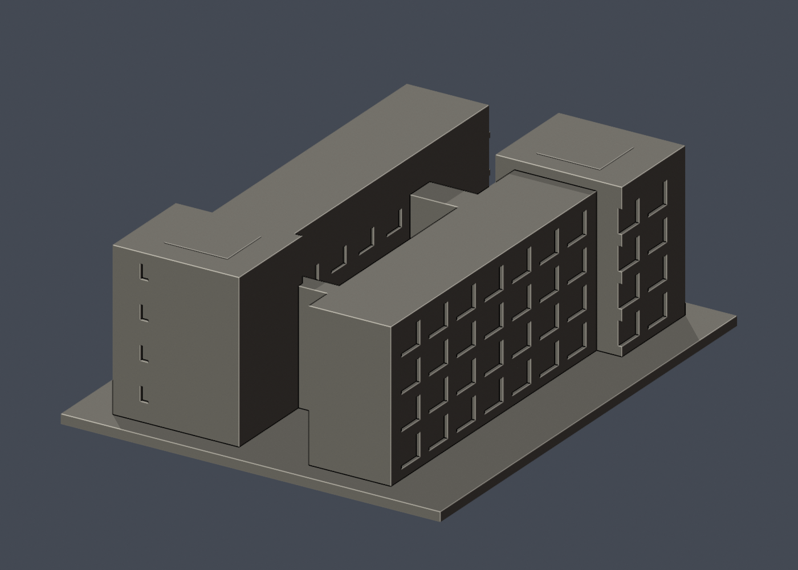
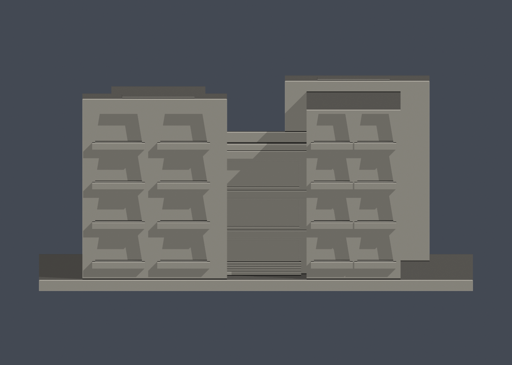

# 國立成功大學｜唯農大樓

第十三批；光復校區。校方GIS A013，財產校碼R1A-11-0。尺寸約 120 × 150 × 53 mm，含底座最長邊150 mm，各件獨立比例。

| 模型預覽 | 模型預覽 | 模型預覽 |
| :---: | :---: | :---: |
|  |  |  |

## 棟別範圍與近似

校方GIS外框與校方素材網正面、長側、端牆照片共同判讀為同一連續相連建物：兩條長翼、錯置較大端部及兩道較低連接段；保留中央露天院落，不混入周遭獨立館舍。四層外廊以深淺窗槽及厚樓板帶概化，樹遮處、內向院落部分窗距及屋頂小突出高度估計，不是逐窗測繪。入口照片亦可見校內其他教學單位招牌，僅以校方財產名「唯農大樓」列名，不以租用/使用單位推論另一棟。

只做公開外觀，不含室內、設備、管線、安全配置、人物或周遭藝術品。窗凹口不是穿入室內的實測空間；細框、屋簷、百葉與樓板唇部按迷你比例加粗。正背預覽為便於觀察外形的相機方向，不代表地理南北。

## 列印與支撐

較低連接段門廊、窗槽上緣與樓板唇部可能需支撐；院落、柱廊不保證可無支撐跨印。

未實體試印，未切片驗證。截面閉合與0.8 mm薄篩都是輔助幾何檢查，不是全部壁厚、支撐或列印成功保證。

## 公開來源

- [校方GIS建物身分與外框](https://nckumap.ncku.edu.tw/map.php)：光復校區A013公開外觀及外部輪廓；不使用室內/設備圖層，不轉載地圖原圖。
- [校方財產清冊2026-01-30](https://prop-oga.ncku.edu.tw/var/file/59/1059/img/4743/218075103.pdf)：名稱、校區及R1A-11-0校碼交叉核對；不是以財產筆數當獨立建物數。
- [已檢視像素的校方素材網外觀實拍 photo 3562](https://material.ncku.edu.tw/picture.php?/3562)：僅外觀；照片版權仍歸原權利人，原圖不放公開包。上傳日期不當作拍攝或現況驗證日期。
- [已檢視像素的校方素材網外觀實拍 photo 3568](https://material.ncku.edu.tw/picture.php?/3568)：僅外觀；照片版權仍歸原權利人，原圖不放公開包。上傳日期不當作拍攝或現況驗證日期。
- [已檢視像素的校方素材網外觀實拍 photo 3570](https://material.ncku.edu.tw/picture.php?/3570)：僅外觀；照片版權仍歸原權利人，原圖不放公開包。上傳日期不當作拍攝或現況驗證日期。
- [已檢視像素的校方素材網外觀實拍 photo 3571](https://material.ncku.edu.tw/picture.php?/3571)：僅外觀；照片版權仍歸原權利人，原圖不放公開包。上傳日期不當作拍攝或現況驗證日期。
- [已檢視像素的校方素材網外觀實拍 photo 3573](https://material.ncku.edu.tw/picture.php?/3573)：僅外觀；照片版權仍歸原權利人，原圖不放公開包。上傳日期不當作拍攝或現況驗證日期。
- [已檢視像素的校方素材網外觀實拍 photo 3577](https://material.ncku.edu.tw/picture.php?/3577)：僅外觀；照片版權仍歸原權利人，原圖不放公開包。上傳日期不當作拍攝或現況驗證日期。
- [已檢視像素的校方素材網外觀實拍 photo 3579](https://material.ncku.edu.tw/picture.php?/3579)：僅外觀；照片版權仍歸原權利人，原圖不放公開包。上傳日期不當作拍攝或現況驗證日期。
- [已檢視像素的校方素材網外觀實拍 photo 3580](https://material.ncku.edu.tw/picture.php?/3580)：僅外觀；照片版權仍歸原權利人，原圖不放公開包。上傳日期不當作拍攝或現況驗證日期。

## 檔案與重驗

- [STL](model.stl)、[可編輯 Blender](scene.blend)、[結構化來源與照片直接網址](sources.json)
- [正面原圖](previews/front.png)、[背面原圖](previews/rear.png)、[立面](previews/elevation.png)，均由實際 STL 產生
- 安裝 `requirements.txt` 後執行 `python build_model.py` 重建 STL
- `blender -b -t 2 -P render_preview.py` 重建 Blender 與預覽
- `python validate_model.py` 檢查原始法線、封閉性、邊/頂點流形、單一連通表面、無額外內部空腔殼、正體積、乾淨重建雜湊與 Blender 幾何一致性；見 [validation.json](validation.json)
- `python validate_sections.py` 使用固定共同邊方向插值，檢查每0.2 mm水平截面輪廓閉合；見 [cross_sections.json](cross_sections.json)
- `python check_thin.py` 每1 mm取樣，先確認閉合/有效輪廓，再做0.8 mm形態開運算；見 [thin-feature-check.json](thin-feature-check.json)

| 模型預覽 | 模型預覽 | 模型預覽 |
| :---: | :---: | :---: |
| 立面  |  |  |

任一原始驗證false、程式非零退出碼或資產雜湊不一致都不可封版。沒有窮盡自交檢測，也不以報告代替實體列印。原始參考照片和地圖不隨公開包散布。

### 前端陽臺與預覽方位修訂

正面兩翼保留實拍可見的四層開放陽臺節奏與斜邊框輪廓，以有實體背板的深槽、加厚凸出欄板近似；不以素牆小窗替代。斜邊角度及欄板深度未測繪。背面維持另一組端牆與外廊，正、背相機使用不同側角度，避免近似同景的誤讀。
