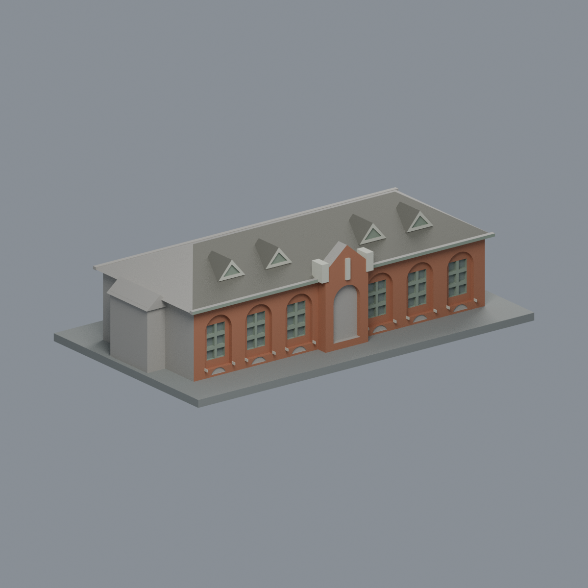
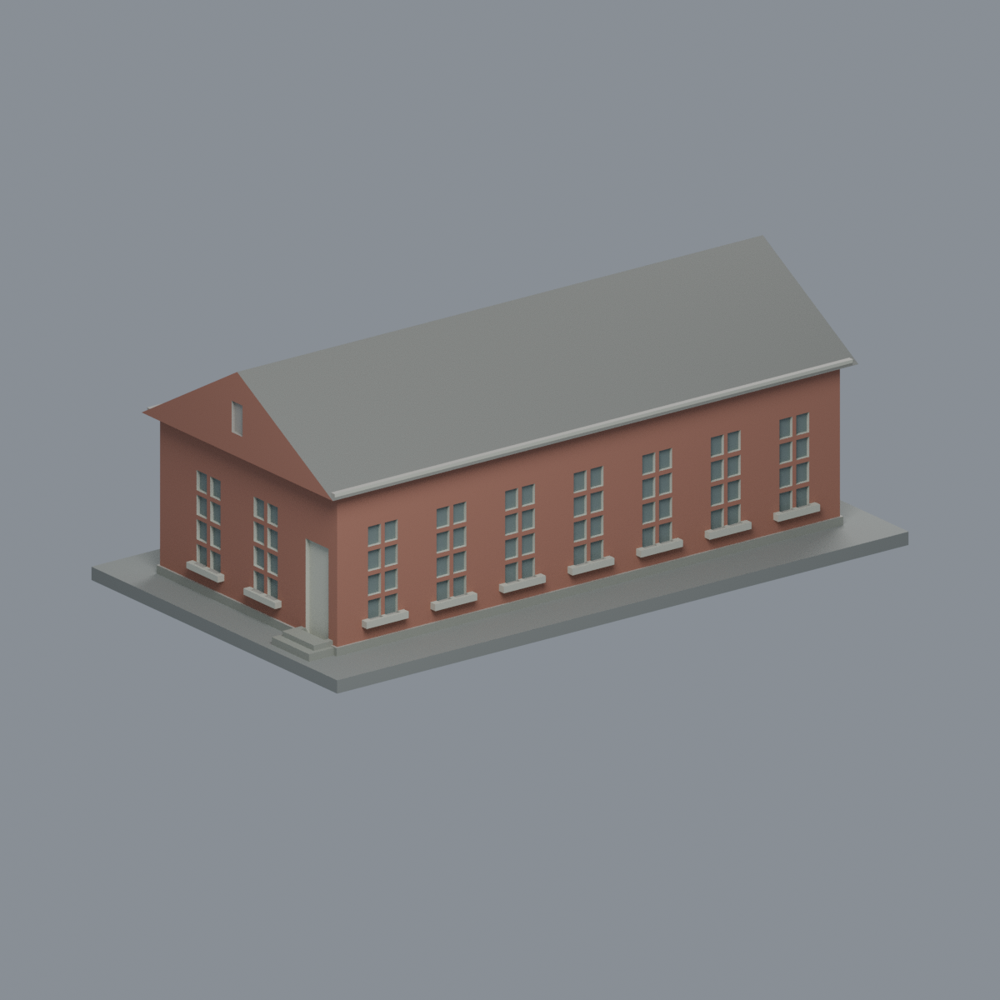
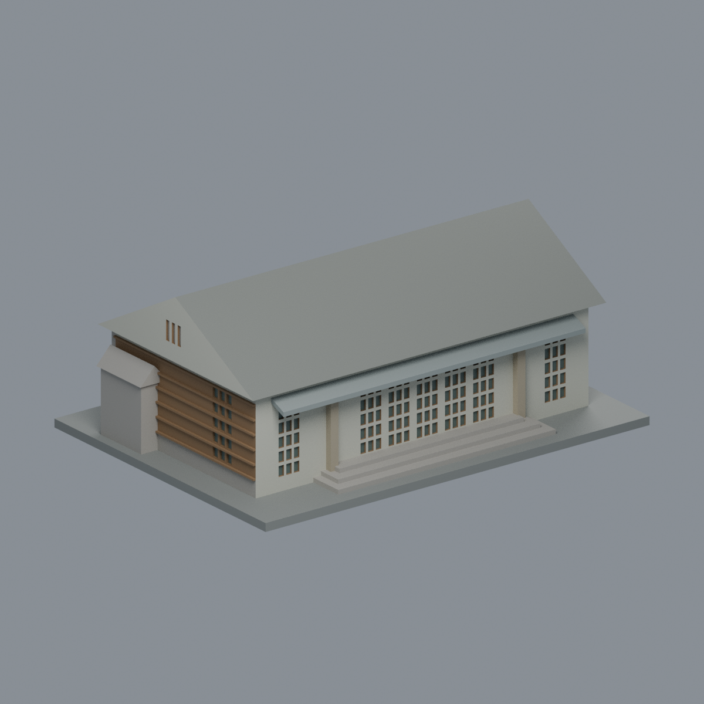
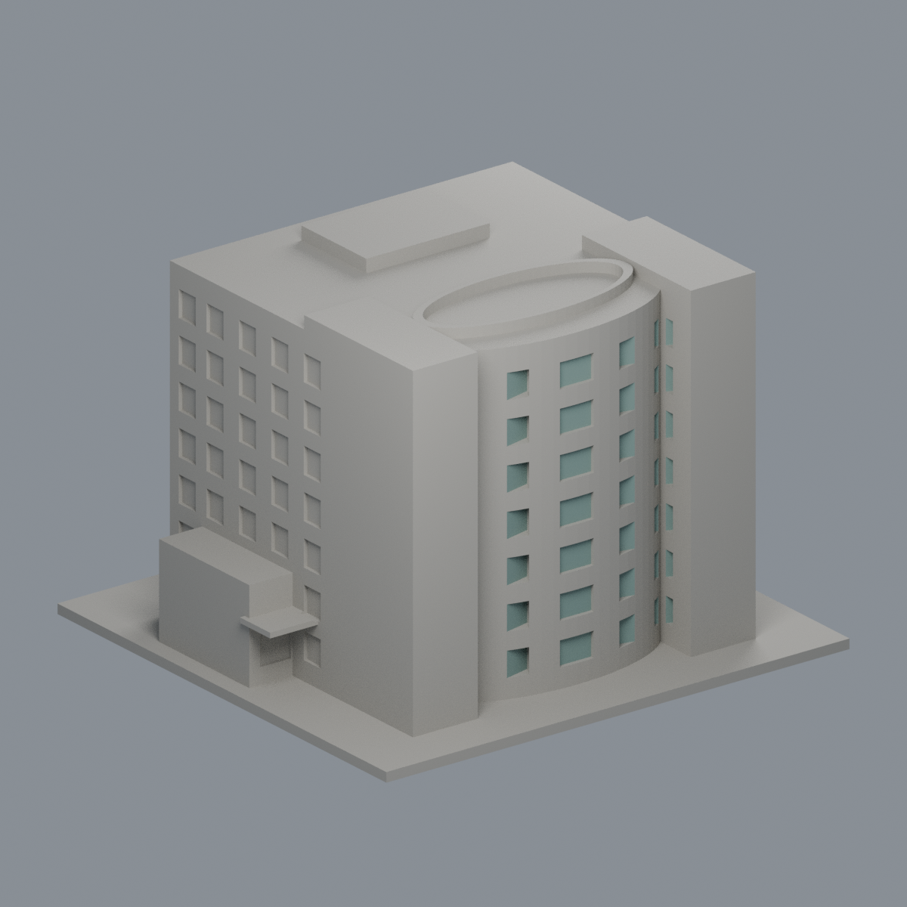

# 國立成功大學・力行校區

[返回學校總覽](../README.md)

本校區目前收錄 5 件數位外觀近似模型；包含局部段或同一財產不同量體，件數不等於完整建物棟數。歷史批次多為含底座最長150mm；綠色魔法學校整棟升級版為235mm展示長，各件獨立縮尺。尚未完成全校，未實體試印或進行印表機切片驗證。

## 三欄模型圖鑑

每格是一件不同模型。範圍、來源年代、近似與薄件警示以各件詳頁為準。

| 模型 | 模型 | 模型 |
|---|---|---|
| **國立成功大學｜孫運璿綠建築研究大樓（綠色魔法學校）**  [正面](buildings/magic-school-green-technologies/previews/front.png) · [背面](buildings/magic-school-green-technologies/previews/rear.png) [說明與來源](buildings/magic-school-green-technologies/README.md) · [STL](buildings/magic-school-green-technologies/model.stl) | **國立成功大學｜臺灣文學系E101棟（原軍方辦公室048）**  [正面](buildings/taiwan-literature-e101/appearance/previews/front.png) · [背面](buildings/taiwan-literature-e101/appearance/previews/rear.png) [說明與來源](buildings/taiwan-literature-e101/README.md) · [STL](buildings/taiwan-literature-e101/model.stl) | **國立成功大學｜臺灣文學系E102棟（原軍方兵舍042）**  [正面](buildings/taiwan-literature-e102/appearance/previews/front.png) · [背面](buildings/taiwan-literature-e102/appearance/previews/rear.png) [說明與來源](buildings/taiwan-literature-e102/README.md) · [STL](buildings/taiwan-literature-e102/model.stl) |
| **國立成功大學｜台文講堂E107棟（原軍方中山室035）**  [正面](buildings/taiwan-literature-lecture-hall/appearance/previews/front.png) · [背面](buildings/taiwan-literature-lecture-hall/appearance/previews/rear.png) [說明與來源](buildings/taiwan-literature-lecture-hall/README.md) · [STL](buildings/taiwan-literature-lecture-hall/model.stl) | **國立成功大學｜統一健康研究大樓（國衛院共用）**  [正面](buildings/uni-president-health-building/appearance/previews/front.png) · [背面](buildings/uni-president-health-building/appearance/previews/rear.png) [說明與來源](buildings/uni-president-health-building/README.md) · [STL](buildings/uni-president-health-building/model.stl) |  |

[七材質外觀與來源界線](buildings/taiwan-literature-e101/appearance/README.md)

[七材質外觀與來源界線](buildings/taiwan-literature-e102/appearance/README.md)

[八材質外觀與來源界線](buildings/taiwan-literature-lecture-hall/appearance/README.md)

## 綠色魔法學校整棟升級

綠色魔法學校既有整棟模型升級，原已有3材質，非新增建物或套數：入口與長窗側按真1F/3F配準，-X/-Y紅柱L廊、中央兩層真挑空通廊、低層半圓服務區、三座通風塔、雨水外階與船陽臺；綠坡、獨立雙坡會議廳頂及上浮葉形PV保持三層分離。2011 EXIF／2013文章早期外觀，非2026設備現況或測繪BIM；無完整RF，遮蔽細節近似。235×175×142.908mm、13材質Blend/3MF/STL、5真mesh圖及2不切mesh細圖；81412三角單閉殼、strict材質與Blend頂點存讀、乾淨9檔bytes一致與獨審通過。715有效切層仍保留576層／4620個0.8mm薄島告警，細PV格0.275mm，需支撐/放大評估，未實印、不保證免支撐。

[完整模型與來源](buildings/magic-school-green-technologies/README.md) · [QA與保留告警](buildings/magic-school-green-technologies/QA.md) · [固定歷史38檔](https://github.com/root50643/taiwan-buildings-3d/tree/8bd98a3a8c306d4195336529208f97a0b5a57790/國立成功大學/力行校區/buildings/magic-school-green-technologies)。全校47件、力行校區5件不變；既有校級批次manifest保留歷史快照，現行本件以新詳頁QA為準。
