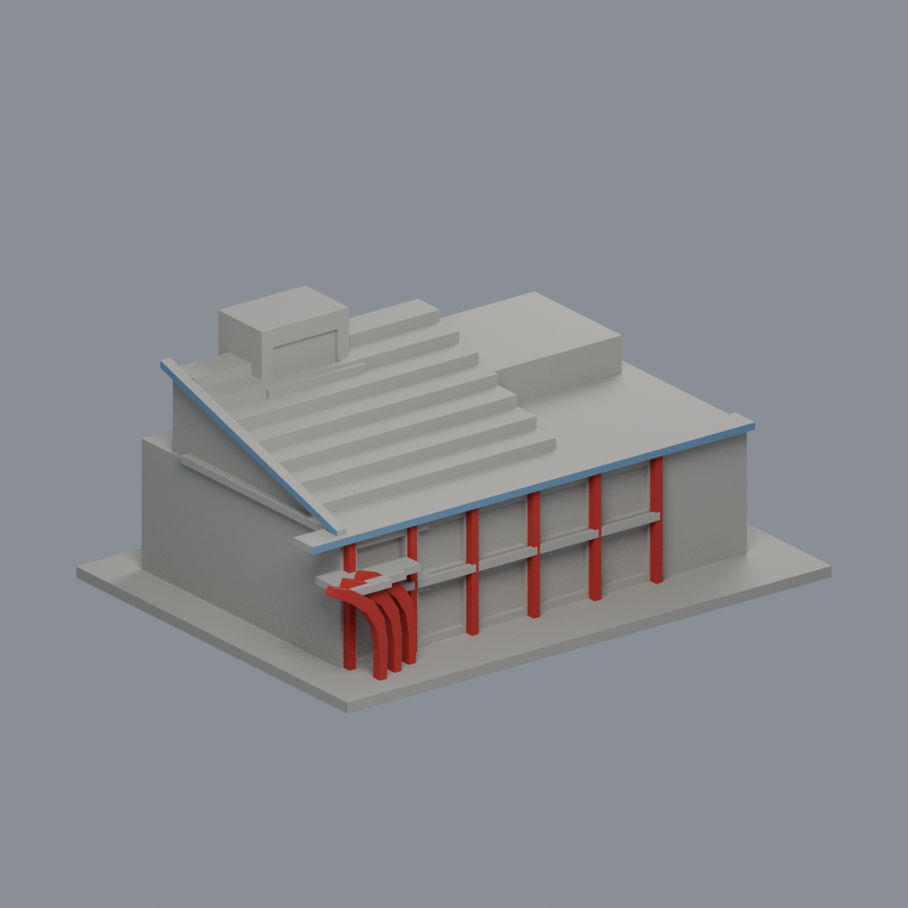
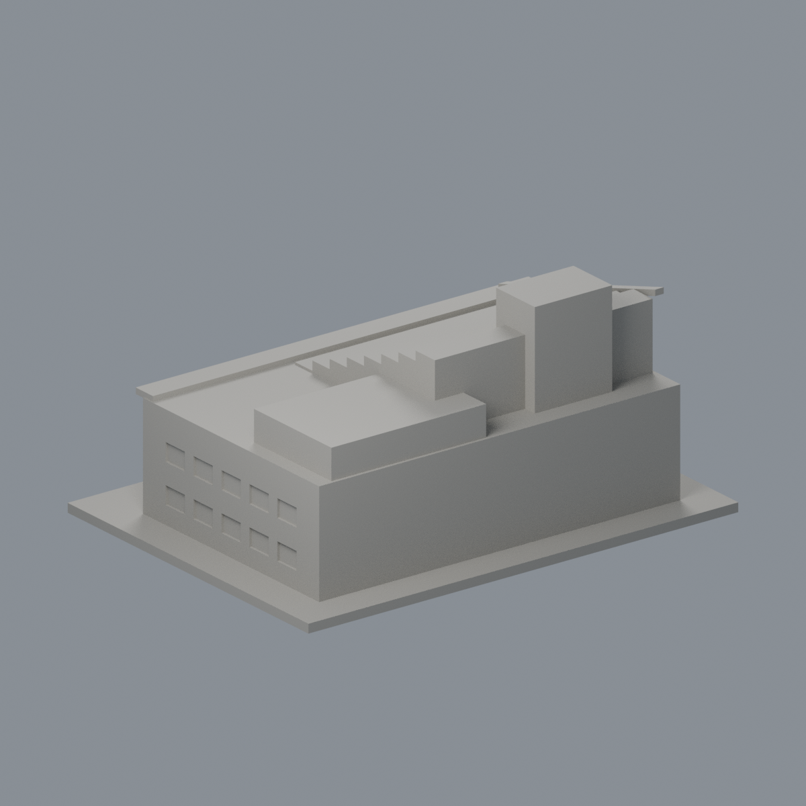
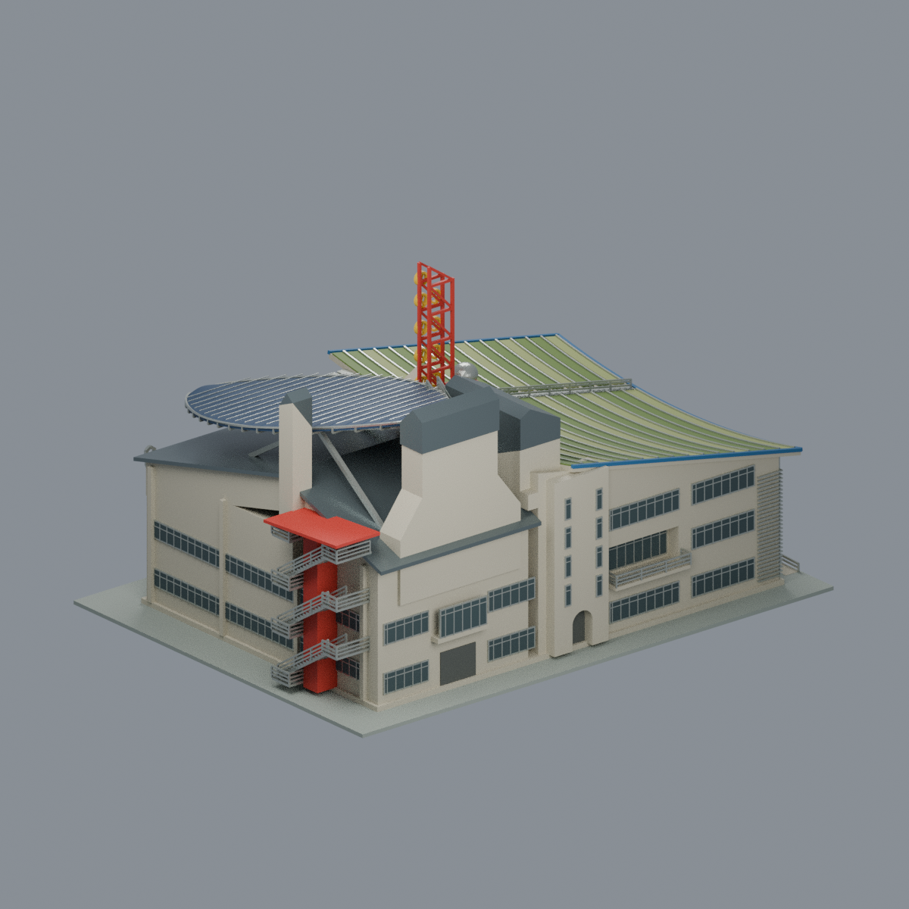

# 國立成功大學｜孫運璿綠建築研究大樓（綠色魔法學校）

## 3 材質外觀版（2026-10-21）

| 正面與來源支持區域 | 未見外側背面中性 |
|---|---|
|  |  |

[來源界線與四視角](appearance/README.md) · [表面色 3MF](appearance/nckumagic-appearance.3mf) · [可編輯場景](appearance/scene.blend)

依 2013 官方照片，僅既有三紅曲片、前細紅肋及兩段藍色外簷原面；根部簡化連接塊、混合陽台凹背與屋頂植栽平台均中性，不新增設備或文字。 原 STL 與歷史 QA 不變；這是外觀改善，不是新增幾何。[原單色正面](previews/front.png)／[原單色背面](previews/rear.png)


第三批外觀近似模型；校區：力行校區。最長邊150 mm（含底座），各模型獨立比例。尺寸：150 × 112 × 70 mm。




## 公開來源及像素查核

- [校方：綠色魔法學校獲獎報導](https://web.ncku.edu.tw/p/404-1000-103834.php?Lang=zh-tw)：已檢視報導照片像素：高視角總體、地面斜角、入口近照。辨識退台屋頂、前方細柱與水平陽台帶、三片紅色曲面入口構件。
- [校方：大樓落成啟用](https://web.ncku.edu.tw/p/404-1000-74413.php?Lang=zh-tw)：確認正式名稱及位於力行校區。
- [校方：綠色魔法學校新展](https://web.ncku.edu.tw/p/404-1000-246741.php?Lang=zh-tw)：確認此建築與台文系歷史建築群是不同建築，不合併為一件。

## 本件範圍、保留與近似

本件只作單棟研究大樓的量體與入口辨識特徵。保留升高的階梯屋面、側邊斜向收邊、照片後左可見的屋頂高塔外殼、前沿突出檐口、雙層外觀開間與三片曲線入口構件；入口構件加粗，曲線以折線近似並用實心根部連到主體。退台綠化簡化成階層實體，不含植物、太陽能板或其他設備。照片背景另棟多層高樓不屬於本件，未併入。屋頂塔的位置、高度、窗口以有限照片近似，不含其內部或設備。照片中前方船形雕塑獨立於建築，不納入，以免把造景誤當結構。完整背立面及尺寸沒有取得，後方採簡單實牆與屋頂量體近似；不得視為精確綠建築復原。

## 交付與重建

- `model.stl`：毫米單位，與底座合成的單一實體。最長邊為 150 mm（含底座）；各棟獨立縮放，不適合直接拼成等比例校園。
- `build_model.py`：完整可攜參數化原始程式，無外部貼圖、私有路徑或參考照片依賴。
- `scene.blend`：由交付 STL 匯入，只有一個建築網格，可在 Blender 編輯頂點；細部參數請修改 Python 後重建。
- `previews/front.png`、`rear.png`、`elevation.png`、`comparison.png`（較低角度）：由實際交付 STL 產生。
- `validate_model.py`、`validation.json`：可重跑的幾何與重建驗證。

建議 Python 3.12，在虛擬環境執行：

```sh
python -m pip install -r requirements.txt
python build_model.py
blender -b -t 2 -P render_preview.py
python validate_model.py
```

已使用 Blender 4.3.2。驗證器在獨立臨時目錄重建 STL 並比較 SHA-256，讀取 Blender 場景的網格後比較三角形幾何。它檢查原始二進位 STL 儲存法線、面積、封閉性、邊恰有兩面、頂點連結為單一環、表面只有一個連通分量、正體積、底面位於 Z=0、最長邊 150 mm。單一封閉表面也排除獨立藏在內部的空腔殼；沒有宣稱完成所有自交的窮舉檢測。

## 製作原則與限制

這是依公開照片觀察製作的外觀近似收藏模型，不是測繪、修復、工程或精確 BIM 資料。牆身為實體，門窗、拱廊通常改成淺凹浮雕；不含室內、設備或安全配置。屋頂、深度、窗距及後側比例沒有測量基準，不能視為實際尺寸。原始參考照片未收錄、未重新授權或隨套件發布。來源權利屬原作者／校方；原創模型與程式可沿用儲存庫授權，不涵蓋外部參考照片。

## 列印說明

底座平貼平台，Z 軸向上。可從 0.4 mm 噴嘴、0.16–0.20 mm 層高、3 道外牆與 12–18% 填充開始試切片；這是設定建議，並非已測參數。小於約 0.8 mm 的淺浮雕可能因噴嘴或縮放消失。STL 是封閉實體，切片器仍會依填充率產生內部填充。

未實體試印、未執行切片器列印驗證，沒有保證免支撐。請依下列模型特有支撐需求檢查切片預覽。

入口曲線構件與根部、前檐口存在懸垂，建議局部支撐；入口構件厚度約2.8 mm。退台屋頂已實心化，並非薄薄的平台拼接。

## 抽樣逐層截面檢查

新增 `validate_sections.py` 與 `cross_sections.json`，對實際STL每0.20 mm高度抽樣一次平面交線，檢查每節點度數為2及無零長線段；恰遇頂點平面時向下避開0.0173 mm，細節記錄於JSON。這是截面閉合檢查，不是切片器工具路徑、支撐或擠出驗證。執行 `python validate_sections.py` 可重跑。

查核日期：2026-10-13。


## 整合版截面與薄特徵補充驗證

本整合版使用固定共同邊方向後插值的 `validate_sections.py` 與 [0.2 mm 截面結果](cross_sections.json)，避免同一邊浮點方向差異造成假斷環。原始 STL 幾何未修改。舊截面程式有閉合斷言，既有通過結果不代表曾有破面；此處以新版重跑結果為準。

另提供 `check_thin.py` 與 [新增 0.8 mm 薄特徵輔助篩查](thin-feature-check.json)：每 1 mm 水平取樣，先確認輪廓閉合與有效，再作半徑 0.4 mm 形態開運算。這不是切片器、完整壁厚分析或實體試印，尖屋頂、銳角也會造成損失，不能據此宣稱無支撐或列印成功。執行前請安裝 requirements.txt。
