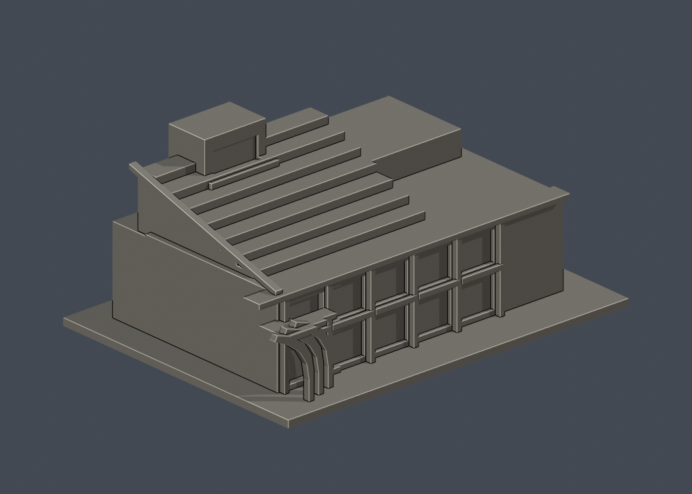

# 成功大學綠色魔法學校｜整棟外觀升級研究模型

[學校總覽](../../../README.md) · [力行校區](../../README.md) · [全站](../../../../README.md)

**早期2011–2013外觀近似；非2026設備現況、非測繪BIM、未實體列印。** 此件沿用既有 `magic-school-green-technologies` 身份，替換原已3材質但後立面簡牆近似；不是新增建築，不增加套數。本次整棟升級沿用既有 canonical 目錄，不增加模型套數；驗證範圍以 qa/final-validation.json 與獨審報告為準，發布狀態以儲存庫 commit 歷史為準。

| 模型預覽 | 模型預覽 | 模型預覽 |
| :---: | :---: | :---: |
|  |  |  |

## 交付與範圍
- [可編輯Blender場景](scene.blend)：真頂點與13組可編輯材質，不是貼圖截圖；無嵌入外部圖片或腳本。
- [彩色3MF](model.3mf)：millimeter、單一模型、逐面base-material指派；[STL](model.stl)只帶幾何，**STL本身沒有顏色/透明度**。
- [五方向圖](previews/) 是同一真mesh渲染；[來源與限制](SOURCES.md)、[QA與薄件告警](QA.md)、[授權](LICENSE.txt)。

模型涵蓋地上完整自然主體、入口百葉與紅曲簷、中央真挑空與通廊、兩辦公翼、會議廳、三座浮力通風塔、獨立紅黃風機架、雨水外階、附著船陽臺、綠化梯坡與階梯、獨立雙坡廳頂和上浮葉形PV。來源1F可辨的半圓服務外突只表現低層外邊界，上層依3F圖，不把弧形任意複製三層。植物以分帶色面代表，不建品種。

綠坡與會議廳屋頂及PV是三層不同構造。PV只採已見的一個靜態姿態，不是可動機構；風機葉片也不活動。約 **235.0×175.0×142.9 mm**，僅展示比例，不宣稱實物精密比例尺。

## 配準與近似

使用未鏡射1F/3F平面建立相對座標：+X是會議廳，-X是主入口；+Y是中央拱口/長窗後面。這是圖面關聯座標，不宣稱完成地理羅盤測量。入口相鄰紅柱外廊為 -X/-Y 轉角 L 形。入口紅曲簷背後是真空間；+Y長窗側2F凹陽台保留實際凹深。斜坡、階梯與雨水外階分別建模，背景高樓、鄰棟古蹟與前方獨立船造景均不納入。

無獨立RF圖、完整外部尺寸及2F全平面；小窗格/PV格數/部分遮蔽接縫/機電位置與尺寸只能近似。圖面外突的上層過渡未知，採保守低層表達。辦公及廳內部簡化封閉；中央中庭和可見外廊留空。地下B1不復刻，底板是展示封底，非實際地形。

## 印製前必看

原始STL 81,412三角、39,040精確焊點、單閉殼；這**不等於免支撐或最小壁厚全面通過**。715個實際水平切層，576層共4620個連通薄島無法承受0.8mm侵蝕測試，逐項保留。PV細格0.275mm、風機細葉0.55mm、欄杆約0.65mm。外階、葉形PV及背架、折紙棚、廊簷與船陽臺需支撐/放大/拆件策略；未做實體列印與材料負載試驗。

## 重建

Python3.12，版本見 `qa/toolchain.json`。安裝 numpy2.3.5、trimesh5.1.1、manifold3d3.5.4、lib3mf2.5.0、shapely2.2.0、rtree1.4.1；Blender4.3.2。

```sh
python build_model.py
blender -b -t 4 --python-exit-code 1 --python render_model.py
python run_all_checks.py
python rebuild.py --output /tmp/ncku-magic-clean --threads 4
```

獨立乾淨目錄重建比較STL、3MF、mesh、palette和5PNG逐bytes，不把Blender檔的非幾何存檔差異冒稱bit一致。

## 舊版可追溯

[固定commit舊版完整包](https://github.com/root50643/taiwan-buildings-3d/tree/8bd98a3a8c306d4195336529208f97a0b5a57790/國立成功大學/力行校區/buildings/magic-school-green-technologies)。本次已讀回該固定8bd commit的全部38個舊目標檔，逐bytes與原工作樹相符；不複製或搬動無關資料。既有版本歷史的來源/QA/限制保留可追，不拿舊QA套在新版。發布由parent sole-writer另行核准，本文件不是發布批准。

## 校級歷史批次快照

校級 `model-manifest.json`、`bundle-validation.json` 與 `publication-manifest.json` 保留初始批次原始紀錄，當中的舊 STL／舊 QA／檔案清單不是此升級版的現行驗證。請以此目錄的新檔與 QA 為準；舊版38檔可由上列固定 `8bd98a3a8c306d4195336529208f97a0b5a57790` 歷史連結完整還原。活 `model-index.json` 與校級 SHA256SUMS 另同步此新版。
