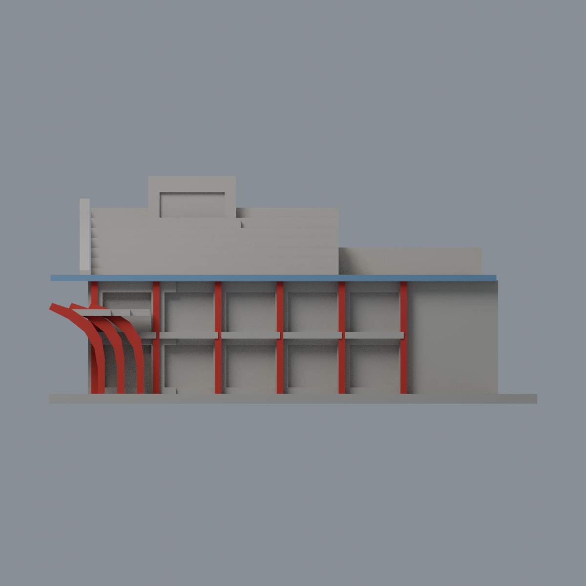
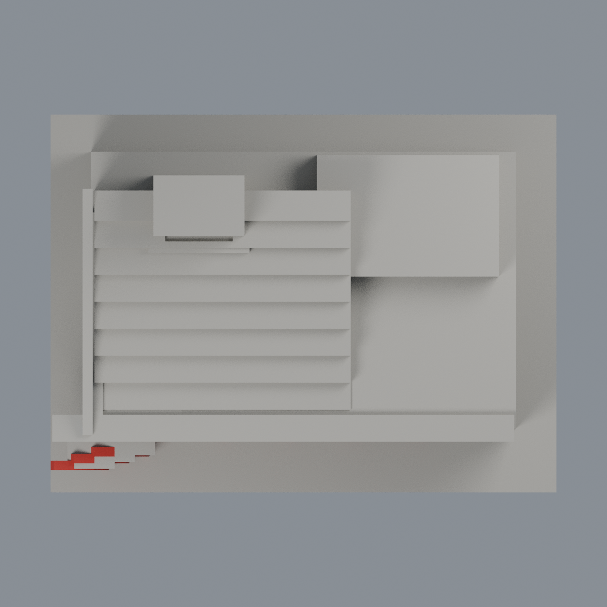

# 成大綠色魔法學校紅入口與藍簷限定配色：三材質外觀版

沿用原 **1,222 三角面／597 頂點**，不改原 STL 位元、座標、面序或幾何；這是既有模型外觀改版，不增加模型包數。

| 正面 | 未知背牆與屋頂中性 |
|---|---|
|  |  |
|  |  |

[表面色 3MF](nckumagic-appearance.3mf) · [可編輯 Blender](scene.blend) · [材質色表](palette.json) · [逐面指派與依據](face-materials.json) · [原 STL](../model.stl)

## 來源與配色邊界

親看成大[2013 校園報導](https://web.ncku.edu.tw/p/404-1000-103834.php?Lang=zh-tw)三張完整 400 像素寬官方實照（overview、入口斜角、紅構件近照），並對原單色預覽及生成器。[精確照片 URL、SHA 與日期](qa/source-review.json)。三照 nested Original 分別為 2013-03-15 15:11:05、15:20:35、14:42:21；root Modified 均 2013-03-18，不能混作拍攝日。日期屬檔案中繼資料未獨立鑑定，不宣稱 2026 現況。照片研究私用，不入公開包；不以書頁插圖當實景色證。

- 三片紅色曲線入口構件依原 XZ 剖面多邊形、前後 cap 及邊線全三角定位，分別 52／54／46 面。前後及厚邊採同構件有界紅色延伸，不烘焙日照陰影，不把整個包圍盒染紅。
- 六根既有前方細紅構件依原外表面定位；原模型為厚矩形肋而非精確圓柱，保留原簡化。柱與曲片聯集共 271 紅面。切出的窗向面不自動視為紅柱表面。
- 藍色僅前簷 y=-41 的 2 個外垂直原面，以及左斜升邊 x=-65.5 的 3 個原面。屋頂頂面、簷底與未證實反面中性；不靠天空反光推估全片藍屋頂。
- 曲片後方根部連接橫塊是原幾何簡化，缺可靠材料對應，保留中性；不把其下方走廊塗紅。陽台凹背混牆、窗和開口，不冒充整片玻璃。
- 屋頂層層平台實景綠色是植栽，不將原實心台階塗成綠色草坪。主牆、牌匾、塔樓、未知背面與其他屋頂保持中性；中性不是實景灰色還原。不新增船雕塑、文字、欄杆細絲、設備或鄰棟。
- 原 STL 位元、面序、座標與歷史 QA 不變；限定入口材料研究，不是完整實景重建，未作實體列印測試。

[原幾何與歷史來源限制](../README.md)

## 重建與核驗

安裝 [依賴](source/requirements.txt)，Blender 使用 4.3.2。由本資料夾上層提供原 model.stl：

1. `python appearance/source/build_appearance.py`
2. `python appearance/source/verify_exchange.py`
3. `blender -b -t 3 --python-exit-code 1 -P appearance/source/render_appearance.py`
4. `blender -b -t 3 --python-exit-code 1 -P appearance/source/verify_scene.py`

[獨立重建 ZIP](rebuild-source.zip)含原 STL、四支程式及依賴，不含第三方照片；不取代原建模腳本。[逐檔 SHA256](SHA256SUMS)

[交換／拓撲 QA](qa/exchange-validation.json)核對原座標與面序、全部面材質、單連通、有向水密邊、頂點 link 單環、正體積與零退化／重複面；lib3mf 嚴格讀取零警告，實際編輯單材質再存讀，其他材質及面指派不變。SDK 六位小數量化誤差另列。

[Blender 存讀與編輯](qa/scene-validation.json) · [渲染記錄](qa/render-manifest.json) · [獨立重建](qa/rebuild-validation.json)

## 製造限制照舊

尺寸仍為 150 × 112 × 70 mm；原 STL、建模程式、場景及歷史 QA 保留。原層檢與薄特徵檢查本次未重跑，不能由材質 QA 代替。

3MF 是同一網格的表面色，不是各材質各自封閉的分色實體、切片專案、噴頭映射或 G-code。切片 GUI、多材料路徑與實體列印未測；柱頭、屋簷、窗框及薄邊仍須評估材料、支撐及拆除風險，沒有保證可印或免支撐。
