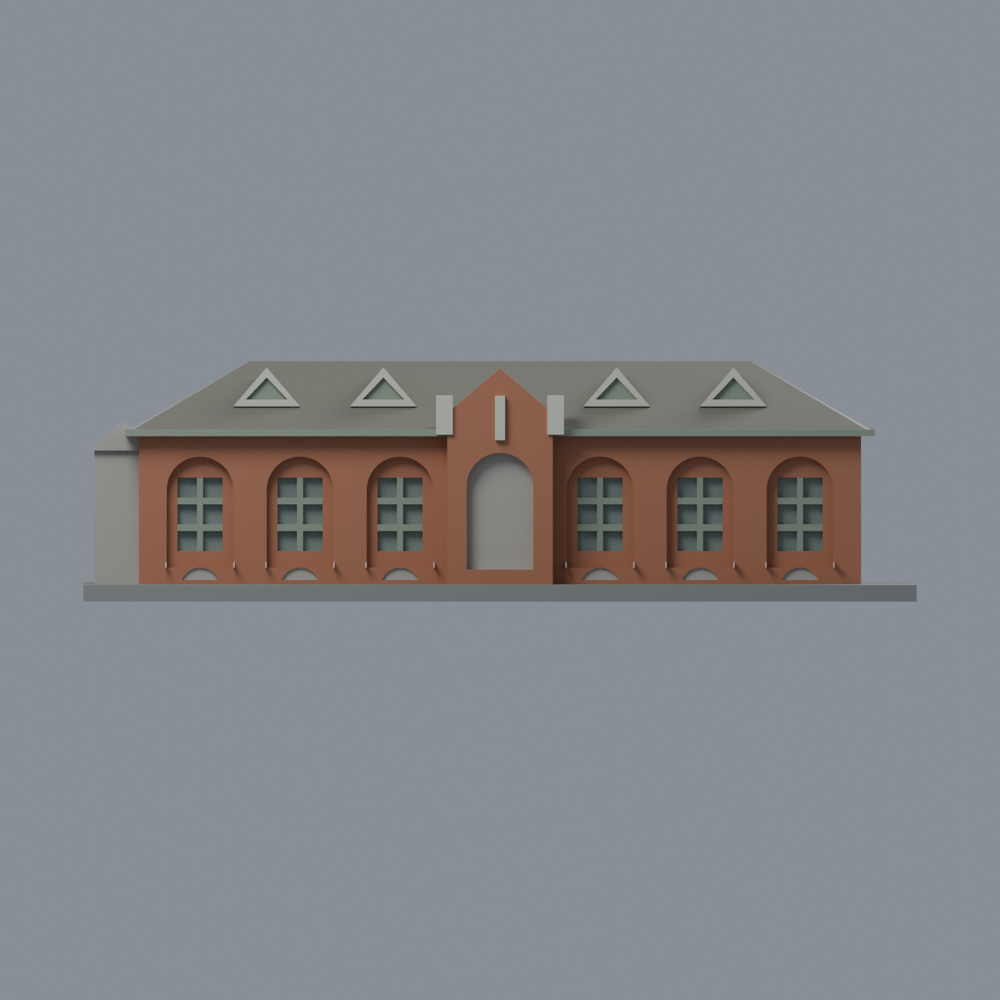
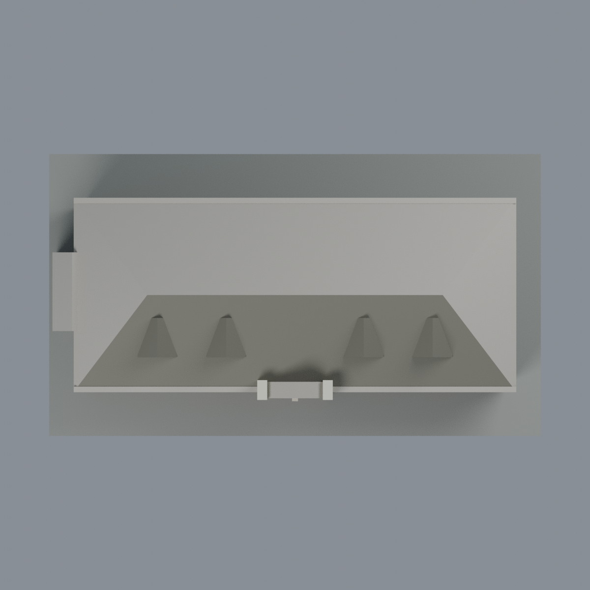

# 成大臺文系 E101：七材質外觀版

沿用原 **2,400 三角面／1,200 頂點**，不改原 STL 位元、座標、面序或幾何；這是既有模型外觀改版，不增加模型包數。

| 正面 | 背面保持中性 |
|---|---|
|  |  |
|  |  |

[表面色 3MF](e101-appearance.3mf) · [可編輯 Blender](scene.blend) · [材質色表](palette.json) · [逐面指派與依據](face-materials.json) · [原 STL](../model.stl)

## 來源與配色邊界

親自查看校方[踏溯課程臺灣文學系館頁](https://exptainan.liberal.ncku.edu.tw/index.php?id=2616&index=2&lang=cht&option=module&task=pageinfo)的[正面照片](https://exptainan.liberal.ncku.edu.tw/userfiles/111-2%E6%91%A9%E7%99%BB%E6%96%B0%E4%B8%96%E4%BB%A3-%E5%8F%B0%E6%96%87%E6%89%80.jpg)，及[校方 GIS 36471](https://db.nckumap.ncku.edu.tw/nckugis/public/uploadfiles.htm?action=listImg&q=36471)。本地影像 EXIF DateTimeOriginal 分別為 **2017-12-21 15:38:32** 和 **2010-02-25 15:24:54**；時區與拍攝日期未獨立證實，檔名 `111-2` 不是快門日期。不主張 2026 現況，來源照片不隨包散布。

- 只登錄 E101／原辦公室 048 單棟，不是全部台文系館。正面七拱的磚牆與原拱內緣為暖紅棕色，**不把整個拱廊畫成玻璃**。
- 原六個側拱內已有實心窗梃與小凹格；既有實心條／內緣採灰綠框色，實際小格背面低彩度灰綠玻璃代理。未建立的額外門扇、百葉與窗格不新增。中央深入口背面中性，不假造門葉或玻璃。
- 原肩飾、中央直條浮飾及六窗臺採暖白色；沒有獨立建出的山牆斜邊與小菱形裝飾不塗假三角形或新增圖案。
- 原正面屋頂坡及四個既有前老虎窗坡作灰棕瓦色示意；老虎窗現有正面三角邊白色、內凹灰綠，前簷立緣灰綠。沒有瓦片紋理、旗桿、字體、紀念碑或附屬設備。
- 背面、後屋坡、兩端未充分登錄屋坡及原西側小突出保持中性。西側小突出原本即是外框推估，不據前照延伸材料。照片石牆基未獨立分面，不畫跨面斜界；展示底板不是現地鋪面。
- 色值未經校準，跨 2010／2017 影像只核對共同特徵；比例、簡化肩飾與窗格仍屬原幾何近似，不是測繪復原。

[原幾何與來源界線](../README.md) · [本次來源覆核](qa/source-review.json)

## 重建與核驗

安裝 [依賴](source/requirements.txt)，Blender 使用 4.3.2。由本資料夾上層提供原 model.stl：

1. `python appearance/source/build_appearance.py`
2. `python appearance/source/verify_exchange.py`
3. `blender -b -t 3 --python-exit-code 1 -P appearance/source/render_appearance.py`
4. `blender -b -t 3 --python-exit-code 1 -P appearance/source/verify_scene.py`

[獨立重建 ZIP](rebuild-source.zip)含原 STL、四支程式及依賴，不含第三方照片；不取代原建模腳本。[逐檔 SHA256](SHA256SUMS)

[交換／拓撲 QA](qa/exchange-validation.json)核對原座標與面序、全部面材質、單連通、有向水密邊、頂點 link 單環、正體積與零退化／重複面；lib3mf 嚴格讀取零警告，實際編輯單材質再存讀，其他材質及面指派不變。SDK 六位小數量化誤差另列。

[Blender 存讀與編輯](qa/scene-validation.json) · [渲染記錄](qa/render-manifest.json) · [獨立重建](qa/rebuild-validation.json)

## 製造限制照舊

尺寸仍為 150 × 86 × 43 mm；原 STL、建模程式、場景及歷史 QA 保留。原層檢與薄特徵檢查本次未重跑，不能由材質 QA 代替。

3MF 是同一網格的表面色，不是七個封閉分色實體、切片專案、噴頭映射或 G-code。切片 GUI、多材料路徑與實體列印未測；柱頭、屋簷、窗框及薄邊仍須評估材料、支撐及拆除風險，沒有保證可印或免支撐。
