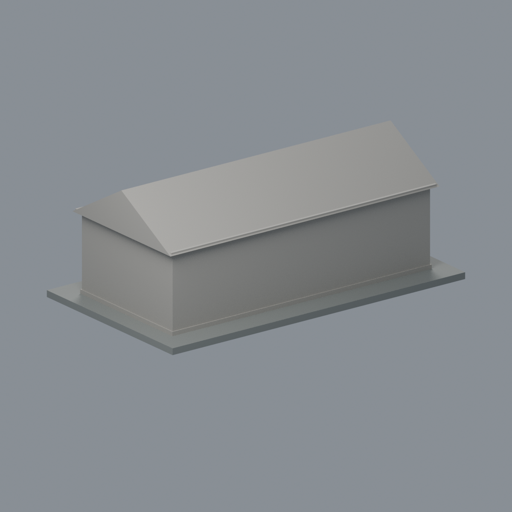
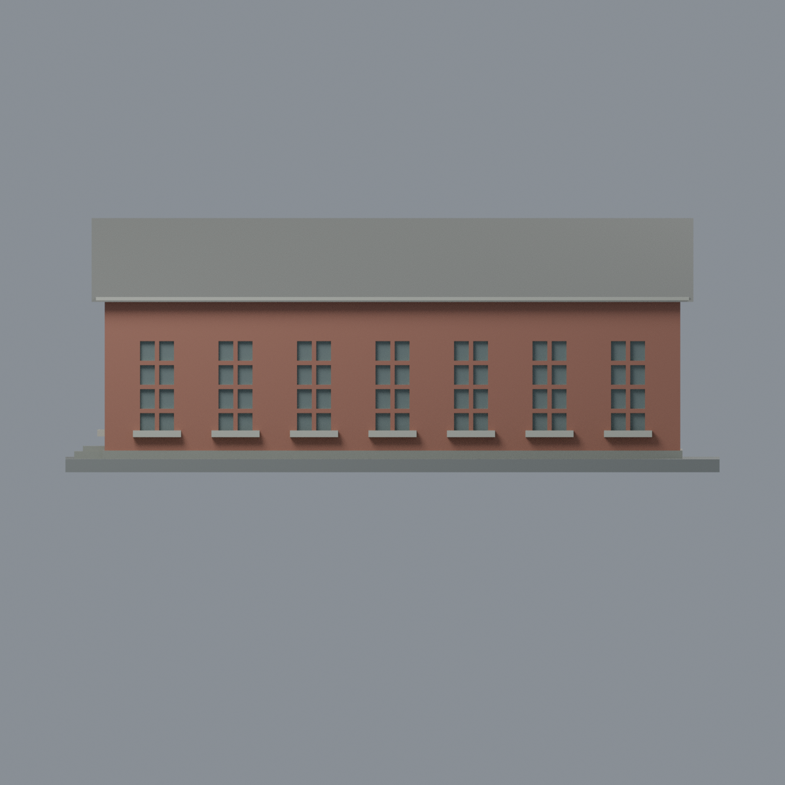
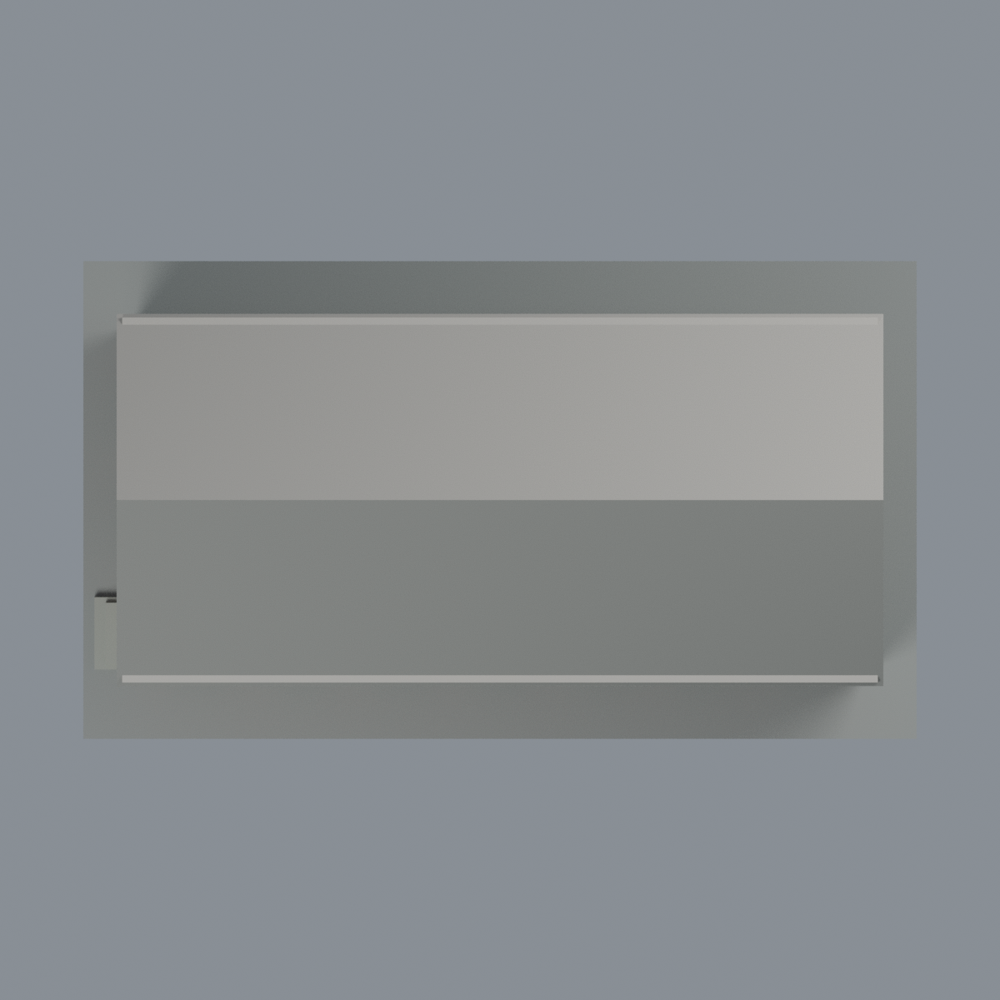

# 成大臺文系 E102：七材質外觀版

沿用原 **1,604 三角面／804 頂點**，不改原 STL 位元、座標、面序或幾何；這是既有模型外觀改版，不增加模型包數。

| 模型預覽 | 模型預覽 | 模型預覽 |
| :---: | :---: | :---: |
| 正面  | 背面保持中性  |  |
|  |  |  |

[表面色 3MF](e102-appearance.3mf) · [可編輯 Blender](scene.blend) · [材質色表](palette.json) · [逐面指派與依據](face-materials.json) · [原 STL](../model.stl)

## 來源與配色邊界

親自查看校方 [GIS 36474 轉角照片](https://db.nckumap.ncku.edu.tw/nckugis/public/uploadfiles.htm?action=listImg&q=36474)。來源內嵌 EXIF DateTimeOriginal 為 **2010-02-25 15:25:32**；時區與拍攝日期未獨立核實，這是歷史參考，**不是 2026 現況**。不隨包散布照片。

- 只登錄 E102／原營舍 042 單棟。照片可見長正面與左山牆，原對應牆面紅棕磚色；長側樹木遮擋處依原簡化窗列作同類材質近似，不宣稱逐窗位置已證。
- 原長面及左端的小凹窗背面為低彩度玻璃代理，既有凹格內緣及窗臺淡灰白。原外表面實心細條與周圍磚面跨用三角面，不能完整分出白窗框；本版讓外平面保持連續磚色，避免虛假三角色斑，**不宣稱完整白框復原**。不新增窗扇、開啟角度或空調；原八格厚化窗梃不是照片細窗框的逐根復原。
- 左端偏置門凹面淡色作門扇代理，不捏造玻璃上格與門把；原門階灰色。已有低基座立緣灰色只依原面域，並非精確現地材料高度。
- 近側原屋坡採保守均一灰色代理：照片可見灰屋緣／局部屋面，但樹木遮擋，**整坡一致色是有限推估，不是逐瓦觀察**。遠側坡保持中性。未分離的山牆斜邊不畫白色三角假邊框。
- 背面、另一端與山牆小通風凹背保持中性；不把一張照片當作四面已見。展示底板不是現地鋪面。不加入爬藤、污漬、梯架、鐵架或其他設備。
- 色值未經色卡校準，所有尺度、窗數及屋坡仍為原幾何近似；只改現有表面材質。

[原幾何與來源界線](../README.md) · [本次來源覆核](qa/source-review.json)

## 重建與核驗

安裝 [依賴](source/requirements.txt)，Blender 使用 4.3.2。由本資料夾上層提供原 model.stl：

1. `python appearance/source/build_appearance.py`
2. `python appearance/source/verify_exchange.py`
3. `blender -b -t 3 --python-exit-code 1 -P appearance/source/render_appearance.py`
4. `blender -b -t 3 --python-exit-code 1 -P appearance/source/verify_scene.py`

[獨立重建 ZIP](rebuild-source.zip)含原 STL、四支程式及依賴，不含第三方照片；不取代原建模腳本。[逐檔 SHA256](SHA256SUMS)

[交換／拓撲 QA](qa/exchange-validation.json)核對原座標與面序、全部面材質、單連通、有向水密邊、頂點 link 單環、正體積與零退化／重複面；lib3mf 嚴格讀取零警告，實際編輯單材質再存讀，其他材質及面指派不變。SDK 六位小數量化誤差另列。

[Blender 存讀與編輯](qa/scene-validation.json) · [渲染記錄](qa/render-manifest.json) · [獨立重建](qa/rebuild-validation.json)

## 製造限制照舊

尺寸仍為 150 × 86 × 58 mm；原 STL、建模程式、場景及歷史 QA 保留。原層檢與薄特徵檢查本次未重跑，不能由材質 QA 代替。

3MF 是同一網格的表面色，不是七個封閉分色實體、切片專案、噴頭映射或 G-code。切片 GUI、多材料路徑與實體列印未測；柱頭、屋簷、窗框及薄邊仍須評估材料、支撐及拆除風險，沒有保證可印或免支撐。
