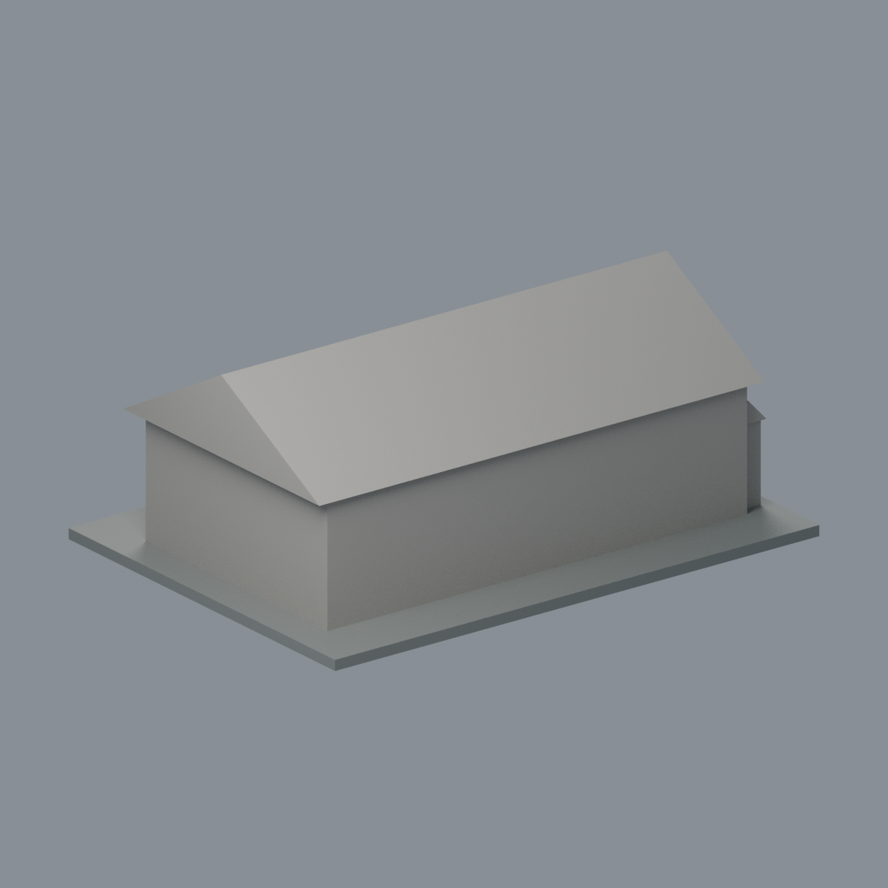

# 國立成功大學｜台文講堂E107棟（原軍方中山室035）

## 模型預覽


| 模型預覽 | 模型預覽 | 模型預覽 |
| :---: | :---: | :---: |
| 正面原幾何配色<br> | 背面與未見面保持中性<br> |  |

第十批，力行校區。尺寸 150 × 110 × 60 mm，底座最長邊150 mm，每件比例獨立。

## 最新八材質外觀版（2026-10-20）


[來源界線與四視角](appearance/README.md) · [表面色 3MF](appearance/e107-appearance.3mf) · [可編輯場景](appearance/scene.blend)

依官方 2023 來源照片登錄前面象牙抹灰、木窗內緣、左側木橫帶、近坡灰瓦與灰金屬小雨遮。原平面窗間細條因跨域三角面不能分離，保持淺色，不宣稱完整木框復原；背面、遠坡與小突出段中性。原STL與歷史QA不變，不是新增幾何。原單色正面（歷史檔案留存，不作本頁預覽）／原單色背面（歷史檔案留存，不作本頁預覽）


## 來源與像素檢視

- [校方GIS：修復後長面與短端](https://db.nckumap.ncku.edu.tw/nckugis/public/uploadfiles.htm?action=listImg&q=38153)：已檢視瓦屋頂、白牆與木板端面、大面積格窗、低連續遮簷及前階。
- [校方GIS：修復後正面](https://db.nckumap.ncku.edu.tw/nckugis/public/uploadfiles.htm?action=listImg&q=38152)：已檢視中央分組格窗、兩端門窗、粗柱和連續斜遮簷；只採外觀。
- [臺文系活動公告](https://twl.ncku.edu.tw/p/404-1143-267969.php?Lang=zh-tw)：交叉確認台文系館的台文講堂名稱，未取用任何室內配置。
- [校方GIS公開外框](https://nckumap.ncku.edu.tw/map.php)：以E007外部輪廓標示的舊軍方建物號核對財產；不使用樓層、室內配置。
- [2026/1/30財產清冊](https://prop-oga.ncku.edu.tw/var/file/59/1059/img/4743/218075103.pdf)：力行校區R1E-8-0，同名古蹟單棟，不將群棟合併。

## 範圍與近似

只作GIS E007／E107的獨立講堂（外框標原軍方中山室035），與紅磚教學長舍分開。保留長向雙坡瓦屋頂、木板端部、前側大片格窗、低連續斜遮簷及寬階梯。格窗加粗並減少格數，木板僅用水平凸條提示，不擬真材質。小端部突出和屋頂接法依照片與外框簡化；背面無照片留素面。樹木遮擋的格窗位置保守近似，不製作講堂室內、設備、坡道欄杆或脊飾。

## 交付與重建

- `model.stl`：毫米單位，與底座合成的單一實體。最長邊為 150 mm（含底座）；各棟獨立縮放，不適合直接拼成等比例校園。
- `build_model.py`：完整可攜參數化原始程式，無外部貼圖、私有路徑或參考照片依賴。
- `scene.blend`：由交付 STL 匯入，只有一個建築網格，可在 Blender 編輯頂點；細部參數請修改 Python 後重建。
- `previews/front.png`、`rear.png`、`elevation.png`：由實際交付 STL 產生。
- `validate_model.py`、`validation.json`：可重跑的幾何與重建驗證。

建議 Python 3.12，在虛擬環境執行：

```sh
python -m pip install -r requirements.txt
python build_model.py
blender -b -t 2 -P render_preview.py
python validate_model.py
```

已使用 Blender 4.3.2。驗證器在獨立臨時目錄重建 STL 並比較 SHA-256，讀取 Blender 場景的網格後比較三角形幾何。它檢查原始二進位 STL 儲存法線、面積、封閉性、邊恰有兩面、頂點連結為單一環、表面只有一個連通分量、正體積、底面位於 Z=0、最長邊 150 mm。單一封閉表面也排除獨立藏在內部的空腔殼；沒有宣稱完成所有自交的窮舉檢測。

## 製作原則與限制

這是依公開照片觀察製作的外觀近似收藏模型，不是測繪、修復、工程或精確 BIM 資料。牆身為實體，門窗、拱廊通常改成淺凹浮雕；不含室內、設備或安全配置。屋頂、深度、窗距及後側比例沒有測量基準，不能視為實際尺寸。原始參考照片未收錄、未重新授權或隨套件發布。來源權利屬原作者／校方；原創模型與程式可沿用儲存庫授權，不涵蓋外部參考照片。

## 列印說明

底座平貼平台，Z 軸向上。可從 0.4 mm 噴嘴、0.16–0.20 mm 層高、3 道外牆與 12–18% 填充開始試切片；這是設定建議，並非已測參數。小於約 0.8 mm 的淺浮雕可能因噴嘴或縮放消失。STL 是封閉實體，切片器仍會依填充率產生內部填充。

未實體試印、未執行切片器列印驗證，沒有保證免支撐。請依下列模型特有支撐需求檢查切片預覽。

連續低遮簷與大屋簷會有懸垂，可能需沿邊局部支撐；細格與木板凸條為粗化造型，應依切片預覽確認。

## 新增幾何輔助檢查

`validate_sections.py`以固定共享邊方向求交，0.20mm抽樣輪廓閉合，結果見`cross_sections.json`。`check_thin.py`先斷言輪廓閉合有效，再以1.0mm間距及0.8mm參考寬度作形態開運算；見`thin-feature-check.json`。尖屋頂/銳角也會出現面積差，不能直接當作壁厚失敗。兩項都不是實際切片器工具路徑、支撐驗證或實體試印。

查核日期：2026-10-13；GIS照片未標攝影日期，不宣稱每一細節代表2026最新現況。


## 整合版截面與薄特徵補充驗證

本整合版使用固定共同邊方向後插值的 `validate_sections.py` 與 [0.2 mm 截面結果](cross_sections.json)，避免同一邊浮點方向差異造成假斷環。原始 STL 幾何未修改。舊截面程式有閉合斷言，既有通過結果不代表曾有破面；此處以新版重跑結果為準。

另提供 `check_thin.py` 與 [新增 0.8 mm 薄特徵輔助篩查](thin-feature-check.json)：每 1 mm 水平取樣，先確認輪廓閉合與有效，再作半徑 0.4 mm 形態開運算。這不是切片器、完整壁厚分析或實體試印，尖屋頂、銳角也會造成損失，不能據此宣稱無支撐或列印成功。執行前請安裝 requirements.txt。


### 屋頂端面核對來源

兩張校方 GIS 實拍可交叉核對白色三角山牆，故採雙坡屋頂；細折簷以較厚連續屋簷簡化。
- [實拍角度一（q38153）](https://db.nckumap.ncku.edu.tw/nckugis/public/uploadfiles.htm?action=listImg&q=38153)
- [實拍角度二（q38152）](https://db.nckumap.ncku.edu.tw/nckugis/public/uploadfiles.htm?action=listImg&q=38152)
