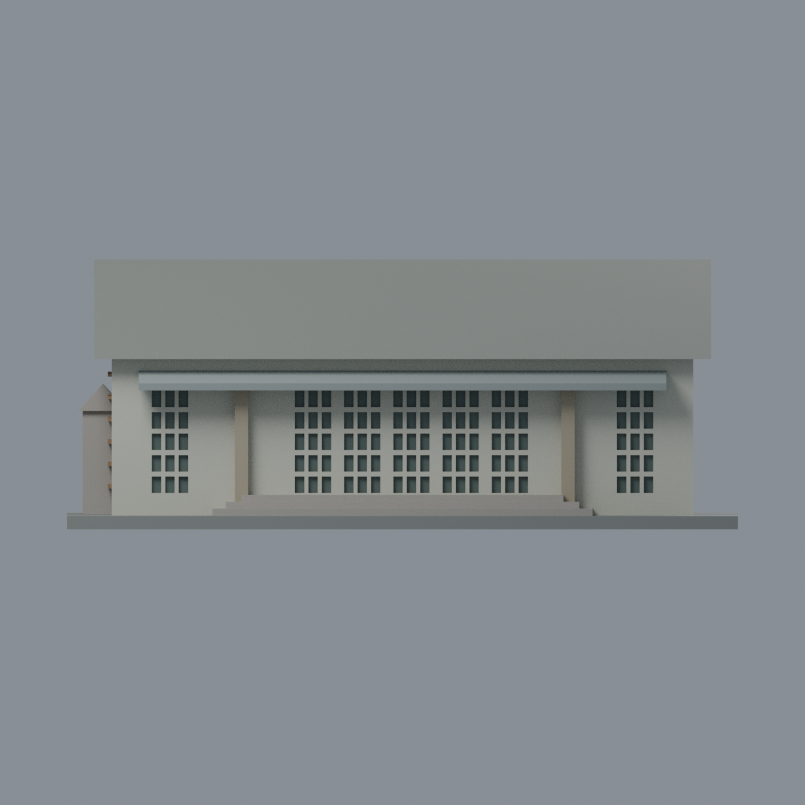
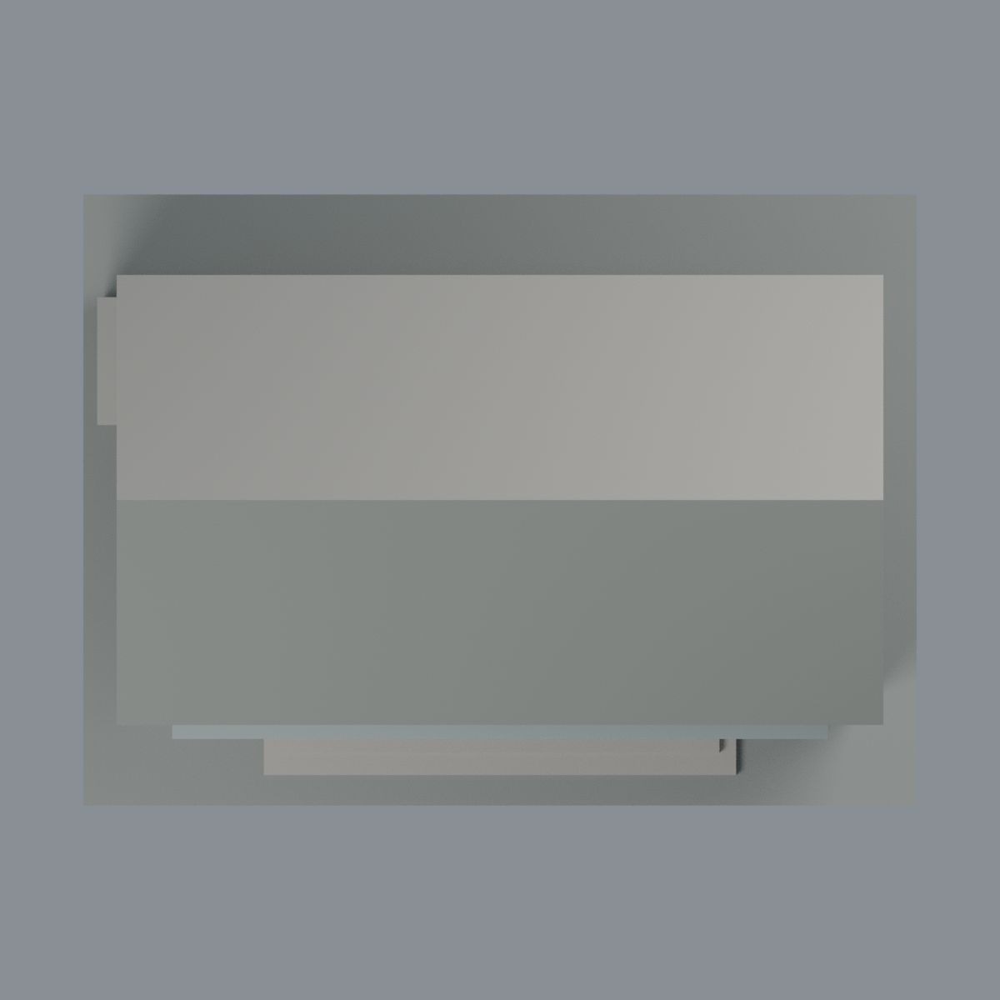

# 成大臺文講堂 E107：八材質外觀版

沿用原 **2,298 三角面／1,151 頂點**，不改原 STL 位元、座標、面序或幾何；這是既有模型外觀改版，不增加模型包數。

| 模型預覽 | 模型預覽 | 模型預覽 |
| :---: | :---: | :---: |
| 正面  | 背面保持中性  |  |
|  |  |  |

[表面色 3MF](e107-appearance.3mf) · [可編輯 Blender](scene.blend) · [材質色表](palette.json) · [逐面指派與依據](face-materials.json) · [原 STL](../model.stl)

## 來源與配色邊界

親自查看校方 [GIS 38153 正面轉角](https://db.nckumap.ncku.edu.tw/nckugis/public/uploadfiles.htm?action=listImg&q=38153) 與 [38152 轉角](https://db.nckumap.ncku.edu.tw/nckugis/public/uploadfiles.htm?action=listImg&q=38152)。內嵌 EXIF 拍攝時間皆為 **2023-09-28**，未獨立核實時區／日期，不能當作 2026 現況。來源照片不隨包散布。

- 只配色原 E107 單層講堂簡化模型，不擴建、不添加窗扇或木紋。可見正面抹灰與左上山牆為淺象牙色；左側原下段牆與凸橫帶為棕木色代理。
- 正面凹格內緣棕色、原凹背低彩度玻璃。外平面窗間細條與抹灰共用跨域三角面，無法無損分出完整木窗框，因此保持象牙色，**不宣稱完整木格框復原**，避免假三角缺口。左側既有木橫帶仍保留幾何與木色；高山牆小通風口背面中性，不當作玻璃。
- 原前側兩支實心柱以淡灰褐砌體代理。原模型未分出整條現地石基座，不能另畫假分界；門階中性，不宣稱精確石種。
- 可登錄近側主坡灰瓦色；前方原附加小雨遮為灰金屬代理，**不是紅瓦屋頂**。未添加瓦紋、排水件或金屬接縫。
- 背面、遠坡、另一端及左後小突出段保持中性；不把觀察到的一側推定為四面。原近似窗數、屋坡與尺寸保持不變。展示底板不是現地地坪。
- 色值沒有色卡校準，木、玻璃及砌體為視覺分類而非材料鑑定；不加招牌、文字、設備、樹影或污漬。

[原幾何與來源界線](../README.md) · [本次來源覆核](qa/source-review.json)

## 重建與核驗

安裝 [依賴](source/requirements.txt)，Blender 使用 4.3.2。由本資料夾上層提供原 model.stl：

1. `python appearance/source/build_appearance.py`
2. `python appearance/source/verify_exchange.py`
3. `blender -b -t 3 --python-exit-code 1 -P appearance/source/render_appearance.py`
4. `blender -b -t 3 --python-exit-code 1 -P appearance/source/verify_scene.py`

[獨立重建 ZIP](rebuild-source.zip)含原 STL、四支程式及依賴，不含第三方照片；不取代原建模腳本。[逐檔 SHA256](SHA256SUMS)

[交換／拓撲 QA](qa/exchange-validation.json)核對原座標與面序、全部面材質、單連通、有向水密邊、頂點 link 單環、正體積與零退化／重複面；lib3mf 嚴格讀取零警告，實際編輯單材質再存讀，其他材質及面指派不變。SDK 六位小數量化誤差另列。

[Blender 存讀與編輯](qa/scene-validation.json) · [渲染記錄](qa/render-manifest.json) · [獨立重建](qa/rebuild-validation.json)

## 製造限制照舊

尺寸仍為 150 × 110 × 60 mm；原 STL、建模程式、場景及歷史 QA 保留。原層檢與薄特徵檢查本次未重跑，不能由材質 QA 代替。

3MF 是同一網格的表面色，不是八個封閉分色實體、切片專案、噴頭映射或 G-code。切片 GUI、多材料路徑與實體列印未測；柱頭、屋簷、窗框及薄邊仍須評估材料、支撐及拆除風險，沒有保證可印或免支撐。
