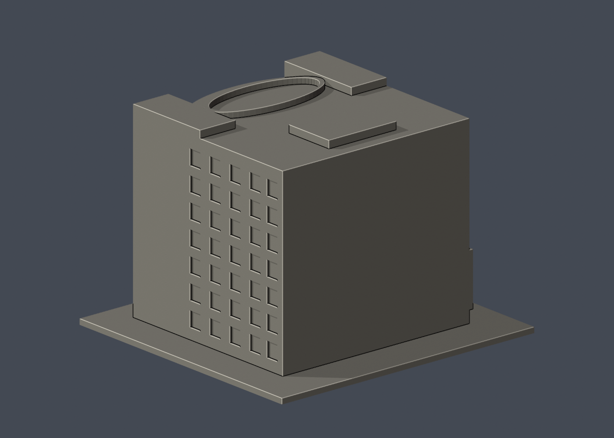

# 國立成功大學｜統一健康研究大樓（國衛院共用）

## 2 材質外觀版（2026-10-21）

| 模型預覽 | 模型預覽 | 模型預覽 |
| :---: | :---: | :---: |
| 正面與來源支持區域<br> | 未見外側背面中性<br> |  |

[來源界線與四視角](appearance/README.md) · [表面色 3MF](appearance/nckuhealth-appearance.3mf) · [可編輯場景](appearance/scene.blend)

僅依300×227官方前圖處理98個原窗背面，低飽和灰綠代理；原五角凹口是簡化，側向註冊不足故全部側窗與牆面中性，不稱逐窗或現況還原。 原 STL 與歷史 QA 不變；這是外觀改善，不是新增幾何。[原單色正面](previews/front.png)／[原單色背面](previews/rear.png)


第九批；力行校區。尺寸 150 × 142 × 106 mm，含底座最長邊150 mm；各件獨立比例。

| 模型預覽 | 模型預覽 | 模型預覽 |
| :---: | :---: | :---: |
|  |  |  |

## 公開來源與像素檢視

- [校方分子醫學研究所：交通位置](https://imm-med.ncku.edu.tw/p/412-1173-23218.php?Lang=zh-tw)：確認力行校區及大樓名稱；已檢視頁面高處外觀照：圓弧玻璃前面、兩側高實牆、低入口附翼及橢圓屋頂框。
- [校方外觀照片](https://imm-med.ncku.edu.tw/var/file/173/1173/img/3674/Building.jpg)：300×227原圖，細節解析度有限；只作可辨主輪廓。
- [校方GIS：長立面](https://db.nckumap.ncku.edu.tw/nckugis/public/uploadfiles.htm?action=listImg&q=36496)：檢視長立面多層直列凹窗及高實牆。
- [校方GIS：低入口](https://db.nckumap.ncku.edu.tw/nckugis/public/uploadfiles.htm?action=listImg&q=36495)：檢視入口低翼、懸挑門棚及後方高樓。
- [國衛院聯絡資訊](https://www.nhri.edu.tw/Webservices/contact)：確認為國衛院台南使用之建築；不是宣稱成大獨占整樓。
- [校方公開GIS外框](https://nckumap.ncku.edu.tw/map.php)：公開識別E027，只參考gis_base外部輪廓，沒有室內平面。
- [2026/1/30財產清冊](https://prop-oga.ncku.edu.tw/var/file/59/1059/img/4743/218075103.pdf)：核對力行校區及財產碼R1A-52-0；財產筆數不是獨立建物數。

## 範圍與近似

模型為校方照片可核實的統一健康研究大樓公開外殼，成大與國衛院共同使用；不作各單位內部範圍。保留圓弧前臉、兩側高實牆、低入口翼及屋頂橢圓框。外框轉向為預覽方便，非北朝上。曲面用64段圓柱加壓扁近似，弧度、窗寬、細框與屋頂形狀由低解析度照片估計。低翼與本體比例近似，背面未見全貌採素面；低翼被主體覆蓋位置不作隱藏窗洞。屋頂不加設備、字樣及標誌。

## 交付與重建

- `model.stl`：毫米單位，與底座合成的單一實體。最長邊為 150 mm（含底座）；各棟獨立縮放，不適合直接拼成等比例校園。
- `build_model.py`：完整可攜參數化原始程式，無外部貼圖、私有路徑或參考照片依賴。
- `scene.blend`：由交付 STL 匯入，只有一個建築網格，可在 Blender 編輯頂點；細部參數請修改 Python 後重建。
- `previews/front.png`、`rear.png`、`elevation.png`：由實際交付 STL 產生。
- `validate_model.py`、`validation.json`：可重跑的幾何與重建驗證。

建議 Python 3.12，在虛擬環境執行：

```sh
python -m pip install -r requirements.txt
python build_model.py
blender -b -t 2 -P render_preview.py
python validate_model.py
```

已使用 Blender 4.3.2。驗證器在獨立臨時目錄重建 STL 並比較 SHA-256，讀取 Blender 場景的網格後比較三角形幾何。它檢查原始二進位 STL 儲存法線、面積、封閉性、邊恰有兩面、頂點連結為單一環、表面只有一個連通分量、正體積、底面位於 Z=0、最長邊 150 mm。單一封閉表面也排除獨立藏在內部的空腔殼；沒有宣稱完成所有自交的窮舉檢測。

## 製作原則與限制

這是依公開照片觀察製作的外觀近似收藏模型，不是測繪、修復、工程或精確 BIM 資料。牆身為實體，門窗、拱廊通常改成淺凹浮雕；不含室內、設備或安全配置。屋頂、深度、窗距及後側比例沒有測量基準，不能視為實際尺寸。原始參考照片未收錄、未重新授權或隨套件發布。來源權利屬原作者／校方；原創模型與程式可沿用儲存庫授權，不涵蓋外部參考照片。

## 列印說明

底座平貼平台，Z 軸向上。可從 0.4 mm 噴嘴、0.16–0.20 mm 層高、3 道外牆與 12–18% 填充開始試切片；這是設定建議，並非已測參數。小於約 0.8 mm 的淺浮雕可能因噴嘴或縮放消失。STL 是封閉實體，切片器仍會依填充率產生內部填充。

未實體試印、未執行切片器列印驗證，沒有保證免支撐。請依下列模型特有支撐需求檢查切片預覽。

低入口門棚及弧面窗凹可需少量局部支撐；屋頂弧框約1.7mm厚，拆支撐注意。

## 截面抽樣

詳 `validate_sections.py` 及 `cross_sections.json`。0.20 mm抽樣水平輪廓閉合檢查，不是切片器工具路徑或實體試印。

查核日期：2026-10-13。


## 整合版截面與薄特徵補充驗證

本整合版使用固定共同邊方向後插值的 `validate_sections.py` 與 [0.2 mm 截面結果](cross_sections.json)，避免同一邊浮點方向差異造成假斷環。截面重驗本身不改動 STL；本件另外有下述幾何修訂。舊截面程式有閉合斷言，既有通過結果不代表曾有破面；此處以新版重跑結果為準。

另提供 `check_thin.py` 與 [新增 0.8 mm 薄特徵輔助篩查](thin-feature-check.json)：每 1 mm 水平取樣，先確認輪廓閉合與有效，再作半徑 0.4 mm 形態開運算。這不是切片器、完整壁厚分析或實體試印，尖屋頂、銳角也會造成損失，不能據此宣稱無支撐或列印成功。執行前請安裝 requirements.txt。


### 屋頂環框加厚修訂

新增薄篩定位原版屋頂橢圓環框短軸約0.714 mm，露出屋頂3.1 mm，底部與屋頂重疊0.5 mm，並非懸浮細梁。為改善脆弱邊緣，保持外輪廓，內半徑32.3→31 mm；實際STL在z=102.071 mm量得最窄1.25973 mm，見[環框量測](roof-ring-check.json)，可執行check_roof_ring.py重現。

原版最高3層薄篩約46.4512 mm²／1.433%損失，修版全件最大比例降至0.02384%，無超過1%的取樣層。這是幾何輔助改善，不是實體試印或切片驗證；STL、Python、Blender和預覽皆已同步。
