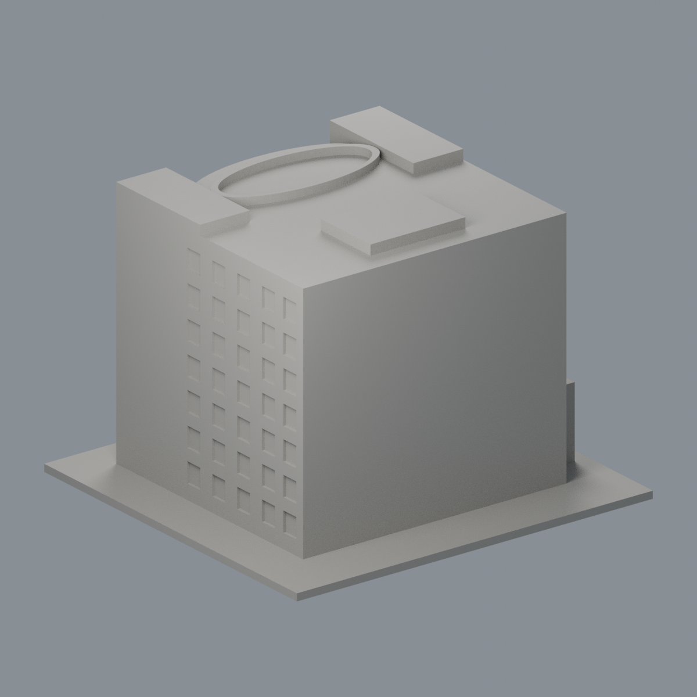
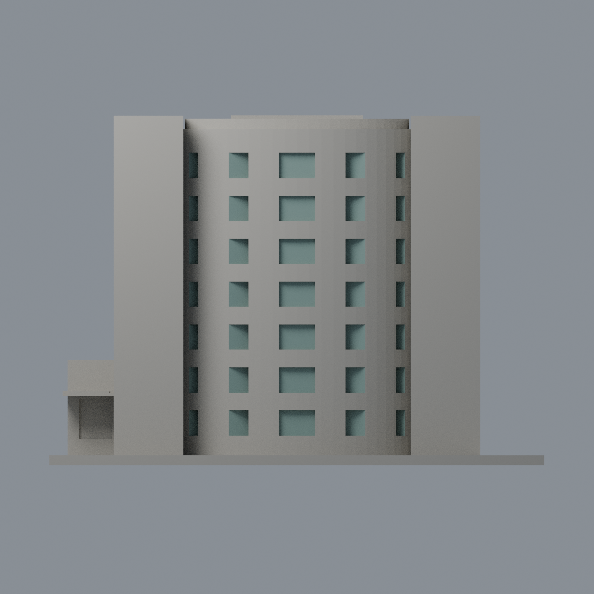
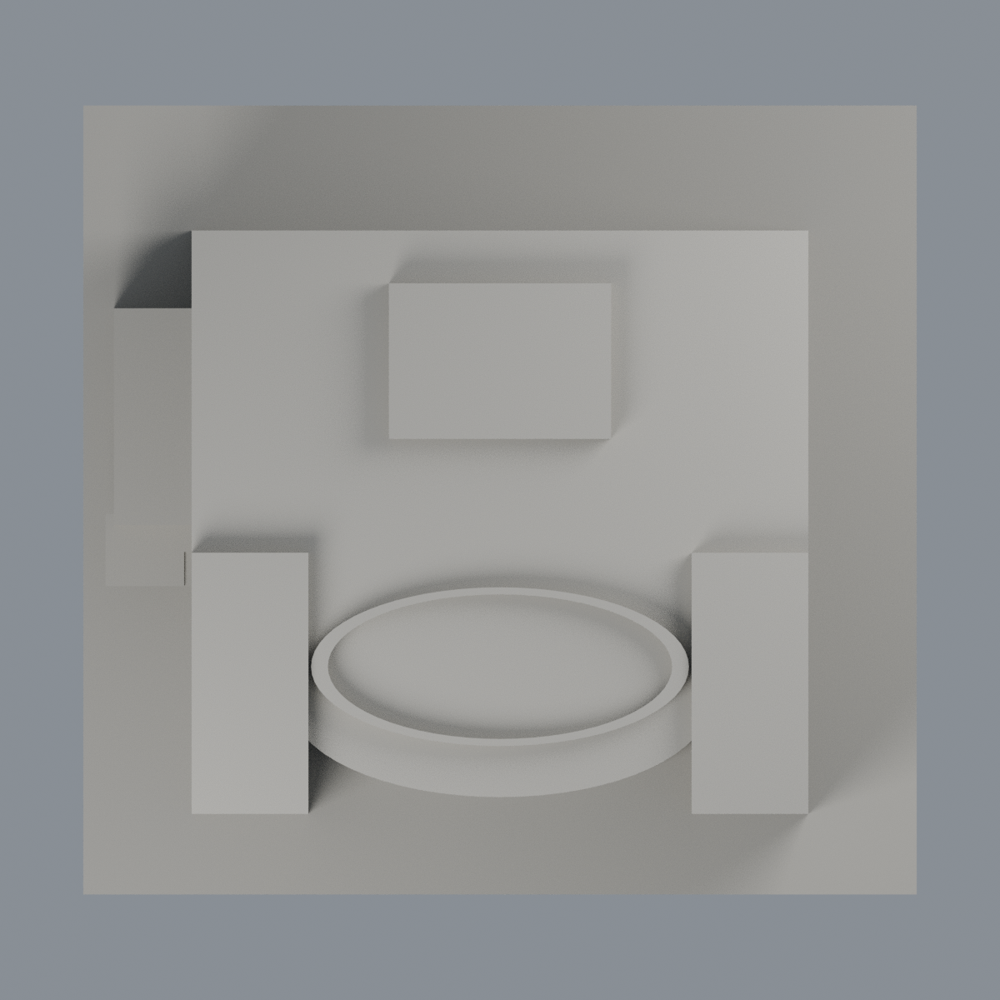

# 統一健康研究大樓前弧窗背限定配色：二材質外觀版

沿用原 **2,820 三角面／1,412 頂點**，不改原 STL 位元、座標、面序或幾何；這是既有模型外觀改版，不增加模型包數。

| 正面 | 背面保持中性 |
|---|---|
|  |  |
|  |  |

[表面色 3MF](nckuhealth-appearance.3mf) · [可編輯 Blender](scene.blend) · [材質色表](palette.json) · [逐面指派與依據](face-materials.json) · [原 STL](../model.stl)

## 來源與配色邊界

親看[成大醫學院官方完整外觀照片](https://imm-med.ncku.edu.tw/var/file/173/1173/img/3674/Building.jpg)及兩張校園 GIS 完整地面照，核對原網格、生成器與單色預覽。[精確 URL、SHA、尺寸與日期](qa/source-review.json)。本件是力行校區統一健康研究大樓，不是竹南院區建築。

- **僅前弧窗背**：官方前高角原圖只有 300 × 227 像素，足以辨識七層綠灰窗／淺色窗間牆，但不支持細框尺寸或精密色度。98 個原凹背面採低飽和灰綠代理，並非透明玻璃模擬、量測材料色或完整立面復原。
- 原生成器以每層五角切盒、合計 35 個凹口近似來源的三組前窗，窗數／框格不是逐窗忠實復刻；本次不藉配色掩蓋此幾何簡化，不新增細框或改凹口。逐個反轉切盒角度核對整個原三角形的背平面與矩形範圍，不使用圓弧面心或半徑門檻。
- GIS 36496 是 640 × 480 長側照，可見真窗與最高盲板差異，但不能獨立確定對應模型 x− 還是另一長側；GIS 36495 只補入口情境。因此本輪**全部側窗中性**，沒有照生成器對稱性猜側面。最高盲格也不當玻璃。
- 所有主牆、窗間實牆、側翼、入口、窗側揭面、屋環、屋頂及背面維持中性。中性不是實景灰色還原；本版刻意限於低解析證據足以支持的前窗類型，不將其擴張到未知面。
- 前照無 nested Original／Digitized，root Modified=2006-11-01 16:26:04，不是已證攝影日期；兩 GIS 照 nested Original=2010-02-25，公開發布日未核實。日期僅檔案 metadata，未獨立鑑定，不宣稱 2026 現況。來源照片私用、不入包。
- 原 STL 位元、座標、面序、腳本與歷史 QA 保留；沒有新增標誌、文字、設備、植栽或紋理，未做實體列印測試。

[原幾何與歷史來源限制](../README.md)

## 重建與核驗

安裝 [依賴](source/requirements.txt)，Blender 使用 4.3.2。由本資料夾上層提供原 model.stl：

1. `python appearance/source/build_appearance.py`
2. `python appearance/source/verify_exchange.py`
3. `blender -b -t 3 --python-exit-code 1 -P appearance/source/render_appearance.py`
4. `blender -b -t 3 --python-exit-code 1 -P appearance/source/verify_scene.py`

[獨立重建 ZIP](rebuild-source.zip)含原 STL、四支程式及依賴，不含第三方照片；不取代原建模腳本。[逐檔 SHA256](SHA256SUMS)

[交換／拓撲 QA](qa/exchange-validation.json)核對原座標與面序、全部面材質、單連通、有向水密邊、頂點 link 單環、正體積與零退化／重複面；lib3mf 嚴格讀取零警告，實際編輯單材質再存讀，其他材質及面指派不變。SDK 六位小數量化誤差另列。

[Blender 存讀與編輯](qa/scene-validation.json) · [渲染記錄](qa/render-manifest.json) · [獨立重建](qa/rebuild-validation.json)

## 製造限制照舊

尺寸仍為 150 × 142 × 106 mm；原 STL、建模程式、場景及歷史 QA 保留。原層檢與薄特徵檢查本次未重跑，不能由材質 QA 代替。

3MF 是同一網格的表面色，不是各材質各自封閉的分色實體、切片專案、噴頭映射或 G-code。切片 GUI、多材料路徑與實體列印未測；柱頭、屋簷、窗框及薄邊仍須評估材料、支撐及拆除風險，沒有保證可印或免支撐。
