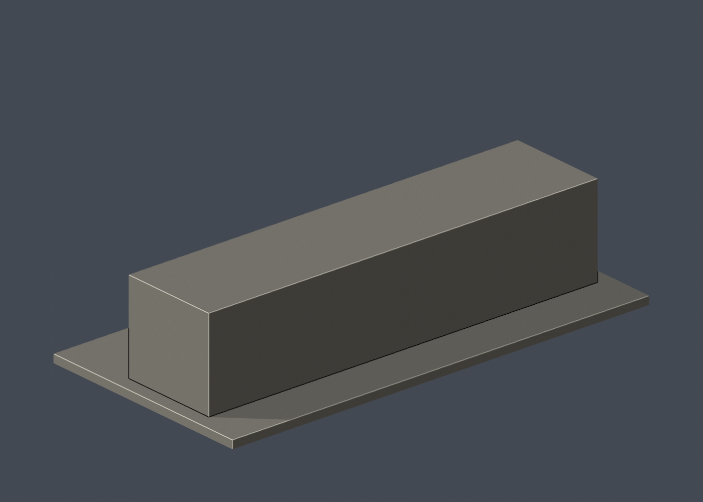

# 國立成功大學｜未來館前棟（舊總圖書館前棟）

## 模型預覽

| 模型預覽 | 模型預覽 | 模型預覽 |
| :---: | :---: | :---: |
|  |  |  |

第二批獨立外觀模型；校區：勝利校區。不是全校完成。尺寸含底座：150 × 76 × 34 mm；最長邊150 mm，各件獨立比例。


## 來源及實際像素觀察

- [校方素材網：成大未來館（2024年）](https://material.ncku.edu.tw/picture.php?/3058)：已檢視斜正面照片像素：三條大面積窗帶、偏心二樓入口、外部大樓梯、白色矩形門框。
- [校方素材網：成大未來館（2024年另一張）](https://material.ncku.edu.tw/picture.php?/3057)：已檢視較正向的全幅外觀像素，以確認入口相對位置與整體長寬比。
- [校方博物館圖組報導及現況照片](https://web.ncku.edu.tw/p/404-1000-293070.php?Lang=zh-tw)：已檢視現況正面照片及公開南北外立面圖像素；歷史立面圖只作比例交叉比對，不當作現況背立面測繪。
- [校方虛擬校園：未來館](https://virtualcampustour.ossd.ncku.edu.tw/index.php?id=32&inter=detail)：確認前棟與歷史後棟區分。
- [校方校園規劃會議資料（2020）](https://main-oga.ncku.edu.tw/var/file/60/1060/img/2806/419404439.pdf)：說明中、後棟增建部分於旺宏館案配合拆除，不在本件中復原成舊T形。

## 本件範圍、保留與近似

只建現存未來館前棟，不包含已拆除的中後棟、舊書庫、旺宏館及連接設施，也不宣稱完成整個舊總圖建築群。保留三層玻璃格網、偏左的大樓梯和矩形入口框。窗格用約0.9 mm豎框與0.6 mm橫檔加粗；樓梯為實心階梯，細欄杆改成實心斜條，樓梯底部不鏤空。樓梯遮住的底層窗格省略，避免形成封閉內腔。正面與歷史南北外立面已見，但現況後側及短端缺足夠照片，採簡化實牆；深度、屋頂、窗格數與樓梯步數均為近似。

## 交付與重建

- `model.stl`：毫米單位，與底座合成的單一實體。最長邊為 150 mm（含底座）；各棟獨立縮放，不適合直接拼成等比例校園。
- `build_model.py`：完整可攜參數化原始程式，無外部貼圖、私有路徑或參考照片依賴。
- `scene.blend`：由交付 STL 匯入，只有一個建築網格，可在 Blender 編輯頂點；細部參數請修改 Python 後重建。
- `previews/front.png`、`rear.png`、`elevation.png`：由實際交付 STL 產生。
- `validate_model.py`、`validation.json`：可重跑的幾何與重建驗證。

建議 Python 3.12，在虛擬環境執行：

```sh
python -m pip install -r requirements.txt
python build_model.py
blender -b -t 2 -P render_preview.py
python validate_model.py
```

已使用 Blender 4.3.2。驗證器在獨立臨時目錄重建 STL 並比較 SHA-256，讀取 Blender 場景的網格後比較三角形幾何。它檢查原始二進位 STL 儲存法線、面積、封閉性、邊恰有兩面、頂點連結為單一環、表面只有一個連通分量、正體積、底面位於 Z=0、最長邊 150 mm。單一封閉表面也排除獨立藏在內部的空腔殼；沒有宣稱完成所有自交的窮舉檢測。

## 製作原則與限制

這是依公開照片觀察製作的外觀近似收藏模型，不是測繪、修復、工程或精確 BIM 資料。牆身為實體，門窗、拱廊通常改成淺凹浮雕；不含室內、設備或安全配置。屋頂、深度、窗距及後側比例沒有測量基準，不能視為實際尺寸。原始參考照片未收錄、未重新授權或隨套件發布。來源權利屬原作者／校方；原創模型與程式可沿用儲存庫授權，不涵蓋外部參考照片。

## 列印說明

底座平貼平台，Z 軸向上。可從 0.4 mm 噴嘴、0.16–0.20 mm 層高、3 道外牆與 12–18% 填充開始試切片；這是設定建議，並非已測參數。小於約 0.8 mm 的淺浮雕可能因噴嘴或縮放消失。STL 是封閉實體，切片器仍會依填充率產生內部填充。

未實體試印、未執行切片器列印驗證，沒有保證免支撐。請依下列模型特有支撐需求檢查切片預覽。

樓梯已加實心底，外部矩形入口框頂部仍有約28 mm跨距，建議入口框下方配置支撐。玻璃格網凹紋較小，0.4 mm噴嘴可能簡化部分橫檔；務必先檢查切片。

查核日期：2026-10-13。


## 整合版截面與薄特徵補充驗證

本整合版使用固定共同邊方向後插值的 `validate_sections.py` 與 [0.2 mm 截面結果](cross_sections.json)，避免同一邊浮點方向差異造成假斷環。原始 STL 幾何未修改。舊截面程式有閉合斷言，既有通過結果不代表曾有破面；此處以新版重跑結果為準。

另提供 `check_thin.py` 與 [新增 0.8 mm 薄特徵輔助篩查](thin-feature-check.json)：每 1 mm 水平取樣，先確認輪廓閉合與有效，再作半徑 0.4 mm 形態開運算。這不是切片器、完整壁厚分析或實體試印，尖屋頂、銳角也會造成損失，不能據此宣稱無支撐或列印成功。執行前請安裝 requirements.txt。

## 現存前棟限域外觀層

[五材質3MF、可編輯Blend與五視角](appearance/README.md)：僅511原面（372上中窗／120低窗／2次門／17白U框正面），其餘4533面保持未查證中性。5044原面／STL bytes不變，不復原已拆T形後翼，不染大牆／共面細框／實心梯／後頂。兩張官照上傳2024-08-07不是拍攝日期，無EXIF拍攝日期，3058 PNG CreationTime只自報建立時間。原170截面／34薄層歷史記錄與前棟近似不變；不是全樓幾何升級或可直接列印版。
