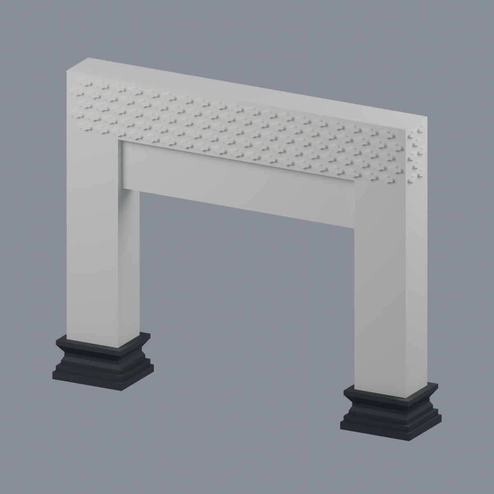
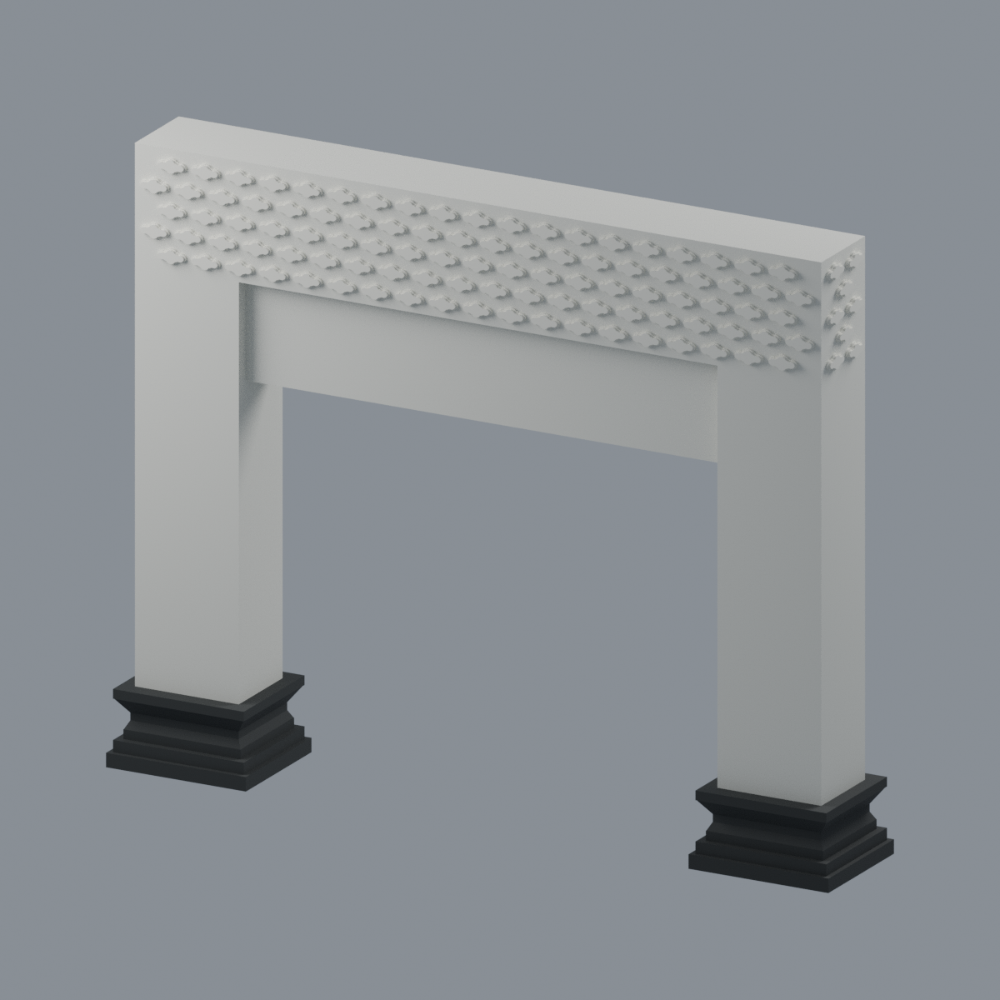
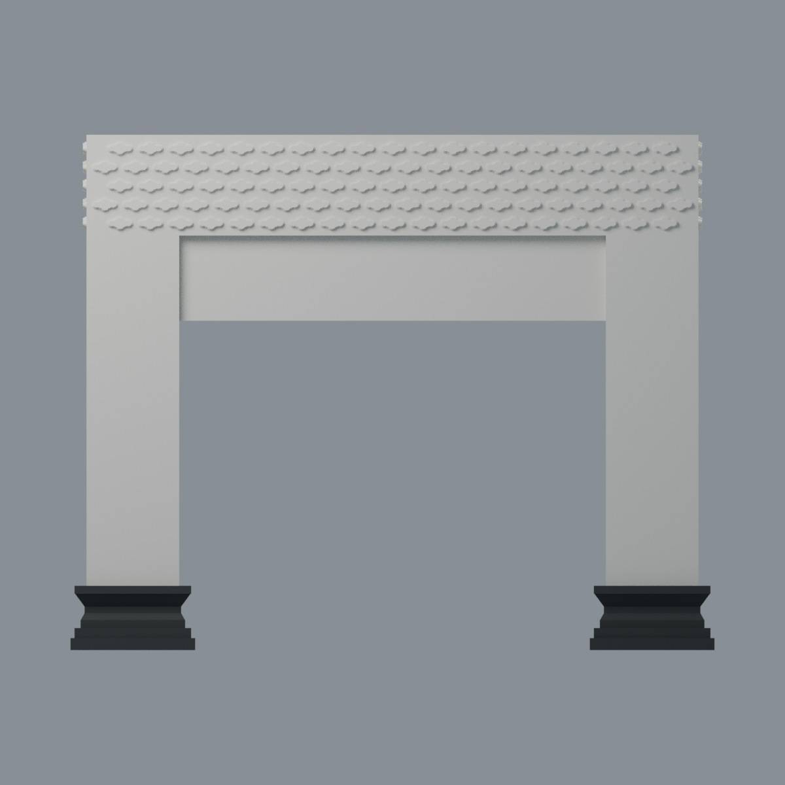
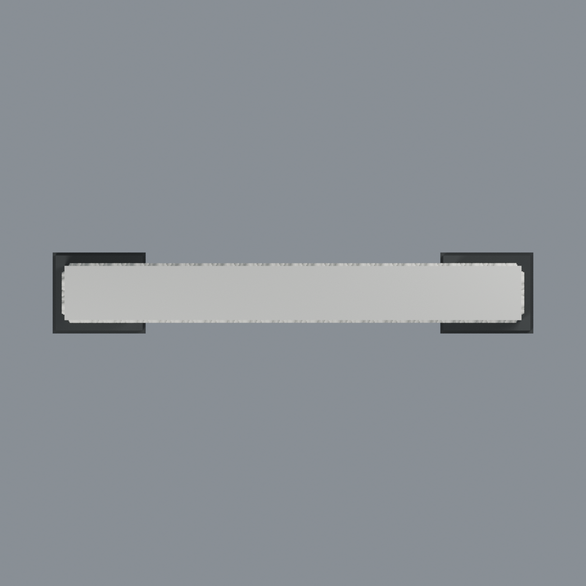
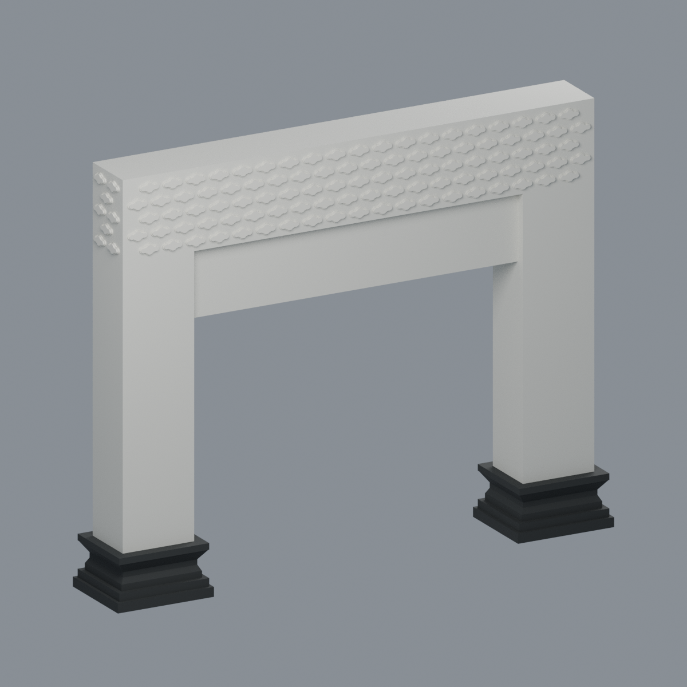

# 國立成功大學｜紀念校門（窮理致知牌坊）

1956 年紀念校門的**地上整體外觀近似模型**；不是測繪、修復或結構圖。官方虛擬校園將本項列在「勝利校區」，但實際位於大學路／勝利路交叉口，不是圍合校區內的一座門。

| 模型預覽 | 模型預覽 | 模型預覽 |
| :---: | :---: | :---: |
|  |  |  |

[西面](previews/front.png) · [東面](previews/rear.png) · [立面](previews/elevation.png) · [頂面](previews/top.png) · [另一斜視](previews/left_oblique.png)

| 模型預覽 | 模型預覽 | 模型預覽 |
| :---: | :---: | :---: |
| 東面  | 立面  | 頂面  |
| 另一斜視  |  |  |

## 檔案與範圍

[STL](model.stl) · [可編輯 3MF](model.3mf) · [Blender](scene.blend) · [參數原始碼](build_model.py) · [來源](SOURCES.md) · [品質與限制](QA.md)

- 成品外包絡 **160 × 27 × 128 mm**。這是展示尺寸，不宣稱 1:100 或實測尺度。
- 黑色簡化須彌座、寬白柱、內退門楣、五排錯列雙層抽象如意雲紋。白色與炭黑是外觀顯示材質，不是多色列印機的擠出機配置。
- 兩面均有官方照片支援；頂端看不到的表面採平整封口，不代表真實歷史構造。厚度依斜照估計。
- 中文碑文及題款**全部留白**，沒有以不相符的字體或杜撰筆畫冒充原書法。西側實物為校名、東側為「窮理致知」。
- 原創雲紋保留圓肩、中央瓣與階層浮雕，不是圓點矩陣。此版前後各 97、端面各 8，共 210 朵；總數呼應官方記載，但**位置、輪廓與各面分配是近似重排，並非逐朵測量復刻**。
- 整體高寬比採 1:1.25；須彌座上方門洞以寬 106 mm、高 106/1.61 mm 作近似設計依據；比例文字未定義精確量測端點，不能當作原物各端點已精確驗證。參考照片有透視及拼接差異，比例數字不是實測尺寸。
- 道路、行道樹、鄰房、燈具、反光片、管線、地下基礎與內部砌體均未重建。沒有新增連接兩座基腳的假道路底板。

## 製造提醒

這是**需支撐評估的數位近似模型，未實體試印**。直立輸出時門楣形成約 106 mm 大跨距，不能當作無支撐可列印；可在切片器另行評估改向、支撐或拆件。雲紋根部已融合本體，沒有浮空獨立小殼，但 0.27 mm 階肩與雲尖可能不完整保留。全域截面通過不代表所有細節通過：局部雲尖有 19 個取樣高度未通過嚴格 0.8 mm 存活篩查，完整報告保留。

## 重建

安裝 `requirements.txt` 所列 Python 套件後執行 `python build_model.py`、`python qa_model.py`、`python check_features.py`；用 Blender 背景模式執行 `render_model.py`。交換格式與場景核對腳本另見 `verify_exchange.py`、`verify_scene.py`、`verify_render.py`。原始照片未附於公開包。
