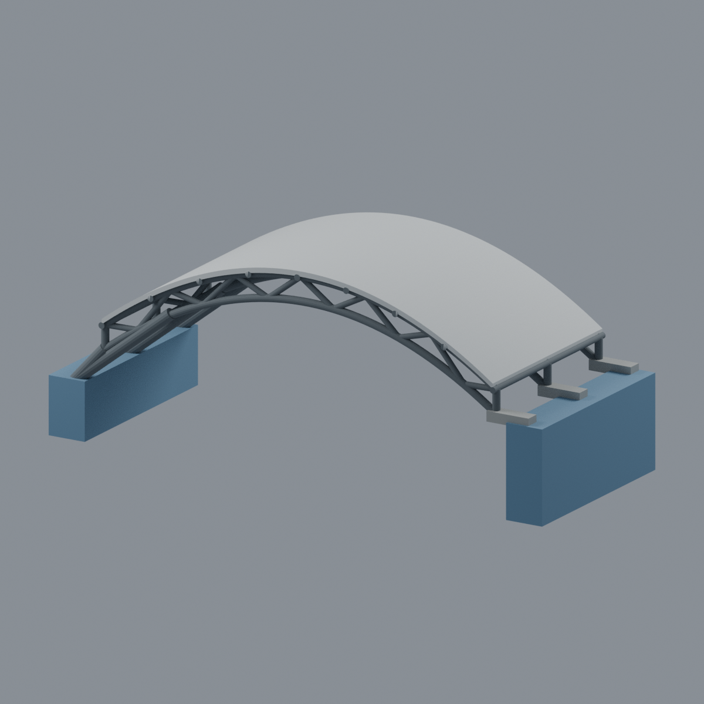
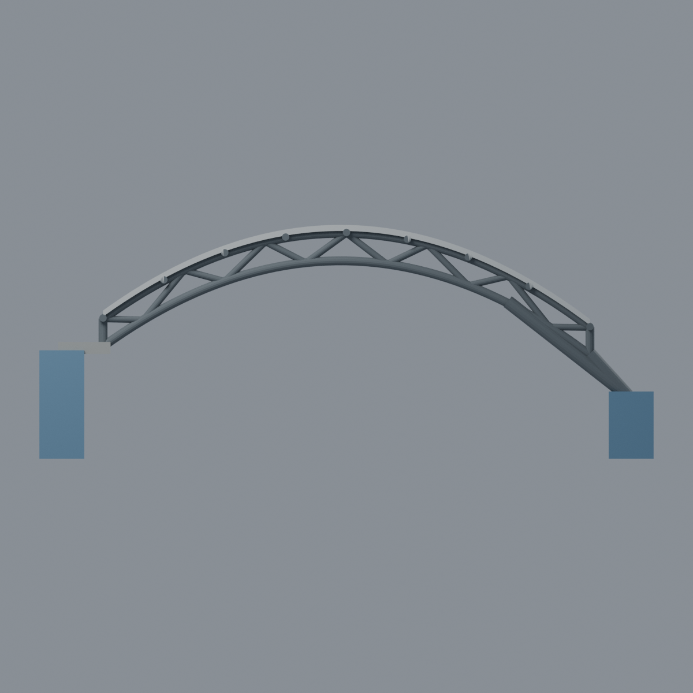
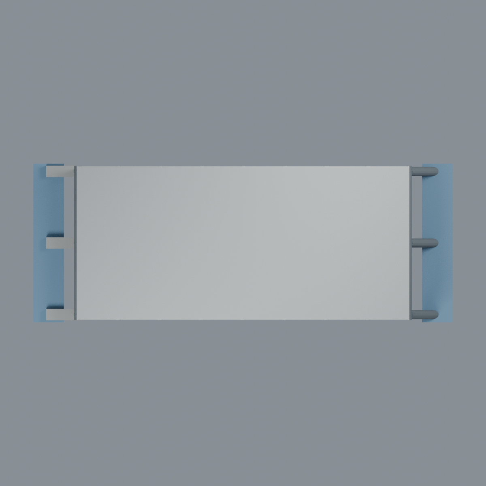
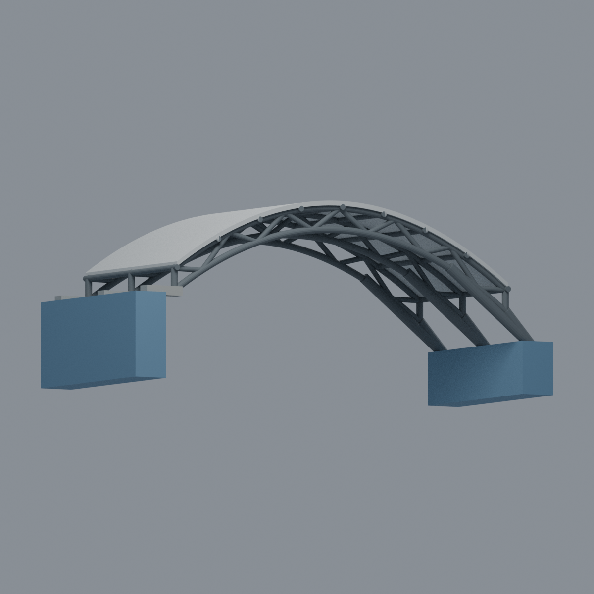

# 國立成功大學｜安南校區｜研究總中心共享中庭弧棚雙跨構架段

| 模型預覽 | 模型預覽 | 模型預覽 |
| :---: | :---: | :---: |
|  |  |  |

以設計者官方歷史照片為依據的估算展示模型，**僅取三道橫向桁架／兩跨縱向構架段**，不是完整中庭、第三棟大樓或測繪模型。既有研究總中心高翼、入口低翼模型明確排除此共享弧棚；本件也不重建兩翼、連橋、欄杆、樓梯及室內。

## 下載與編輯
- [STL](model.stl)：單一連通封閉表面，無色。
- [彩色 3MF](model.3mf)：逐面展示材質，不是多料列印配置。
- [可編輯 Blender 場景](scene.blend)：與 STL 相同三角面，四種材質可編輯。
- [參數生成程式](build_model.py)、[實際網格渲染程式](render_model.py)。單位 mm。
- [來源與保留事項](SOURCES.md)、[驗證與列印限制](QA.md)。

## 範圍與辨識
淺弧屋面、開放三角桁架、縱向檁條、左側短支承、右側分叉斜撐。**兩側藍色實心塊是新增展示切端座，不是建築本體、地面基礎或落地柱**。只保留屋頂高度附近的支承意象；隱藏錨固未知。原始照片未放入公開包。

跨度估算 130 mm；整體約 164 × 62 × 62.46 mm。尺度、弧率、桁架深度和支承角度皆由透視照片估算，構件加粗；每榀 12 格腹桿與 9 道檁條是估算簡化，不是來源逐格量測。既有兩翼各自縮放，本件不能宣稱可直接拼裝或同一比例。

屋皮材質／透明度不明，採中性銀灰不透明薄皮；省略密集平行細條、螺栓和不可辨設備。鋼構深灰。藍色展示切端座刻意與建築區分，不宣稱照片中存在藍色構件。照片拍攝日期未知；2003 是作品頁完工年，非照片年份，2018 URL 路徑不是拍攝證據，也不稱為 2026 現況。

## 五個實際網格視角
| 模型預覽 | 模型預覽 | 模型預覽 |
| :---: | :---: | :---: |
| 正斜視  | 後斜視  | 正立面  |
| 俯視  |  |  |

| 模型預覽 | 模型預覽 | 模型預覽 |
| :---: | :---: | :---: |
|  |  |  |

## 重建
Python 依賴見 requirements.txt；執行 `python build_model.py`、`python qa_model.py`、`python check_features.py`；Blender 執行 `blender -b --python render_model.py`。SDK 驗證需 lib3mf；可用 `BUILD_PYTHON` 指定含 manifold3d 的 Python。

**沒有實體試印，不保證免支撐或一次列印成功。** 完整拓樸通過不等於所有局部可印；細尖端、曲面頂端以及水平薄屋皮需切片、支撐、方向與試印評估。詳見 QA.md，不把失敗切層排除。
