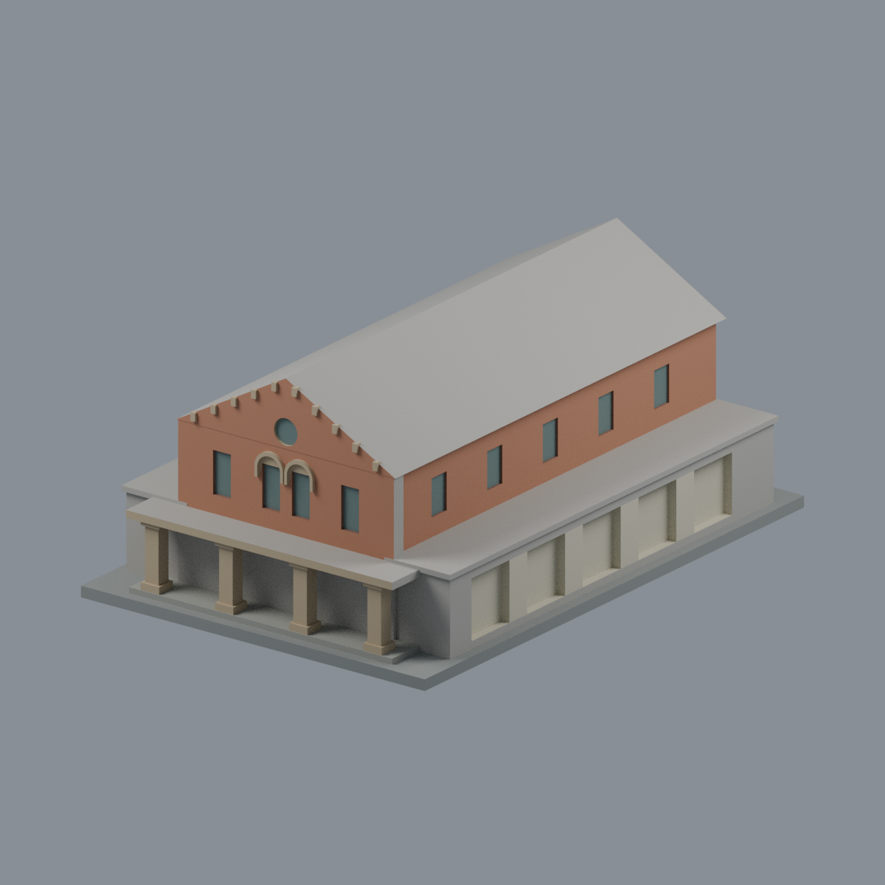
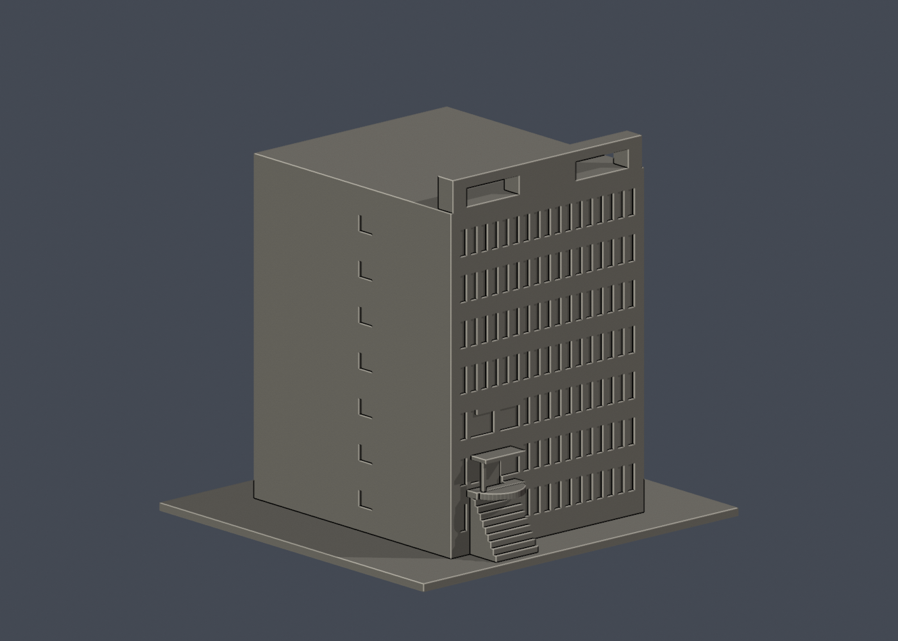
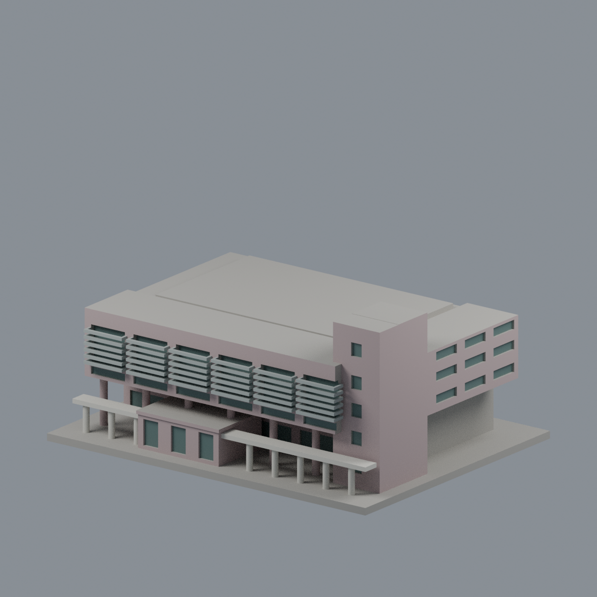
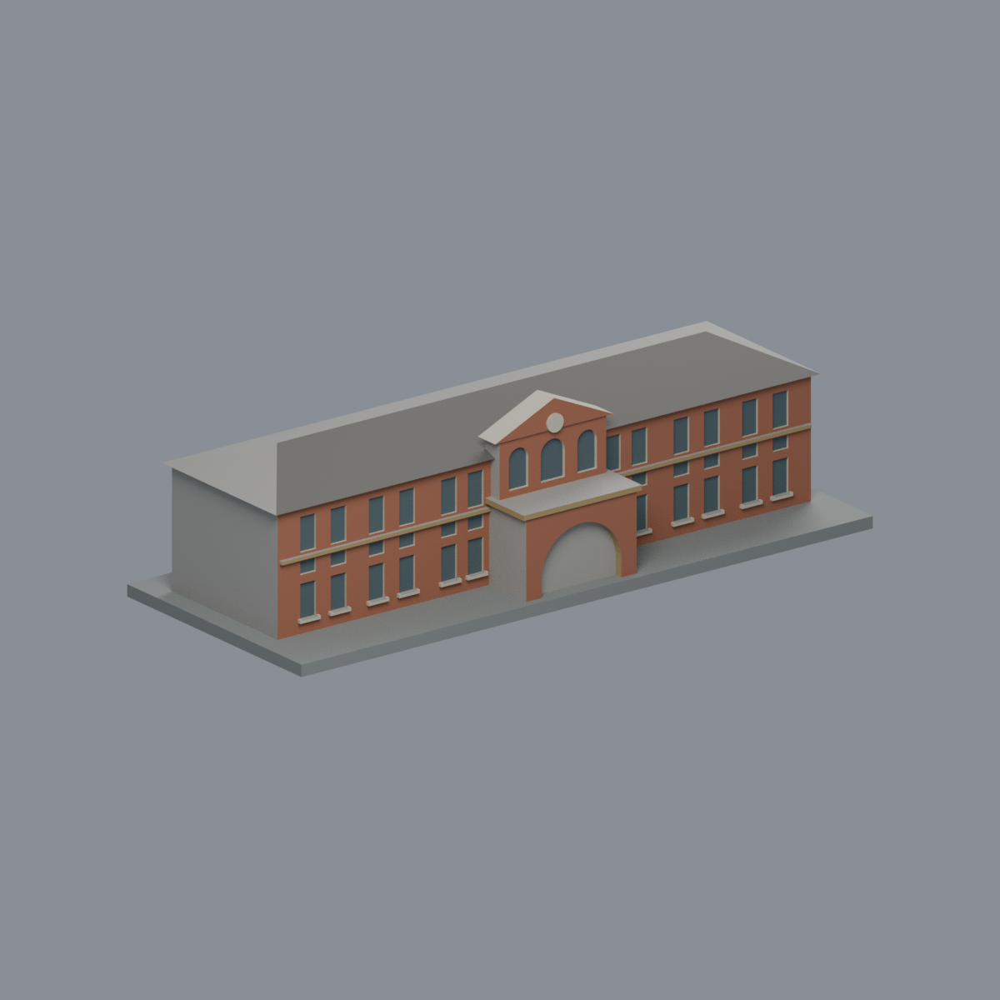
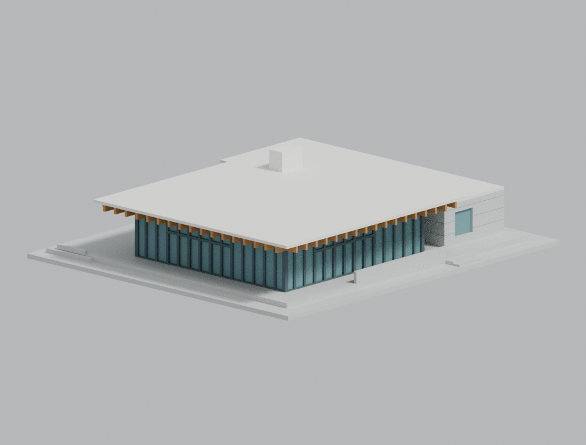
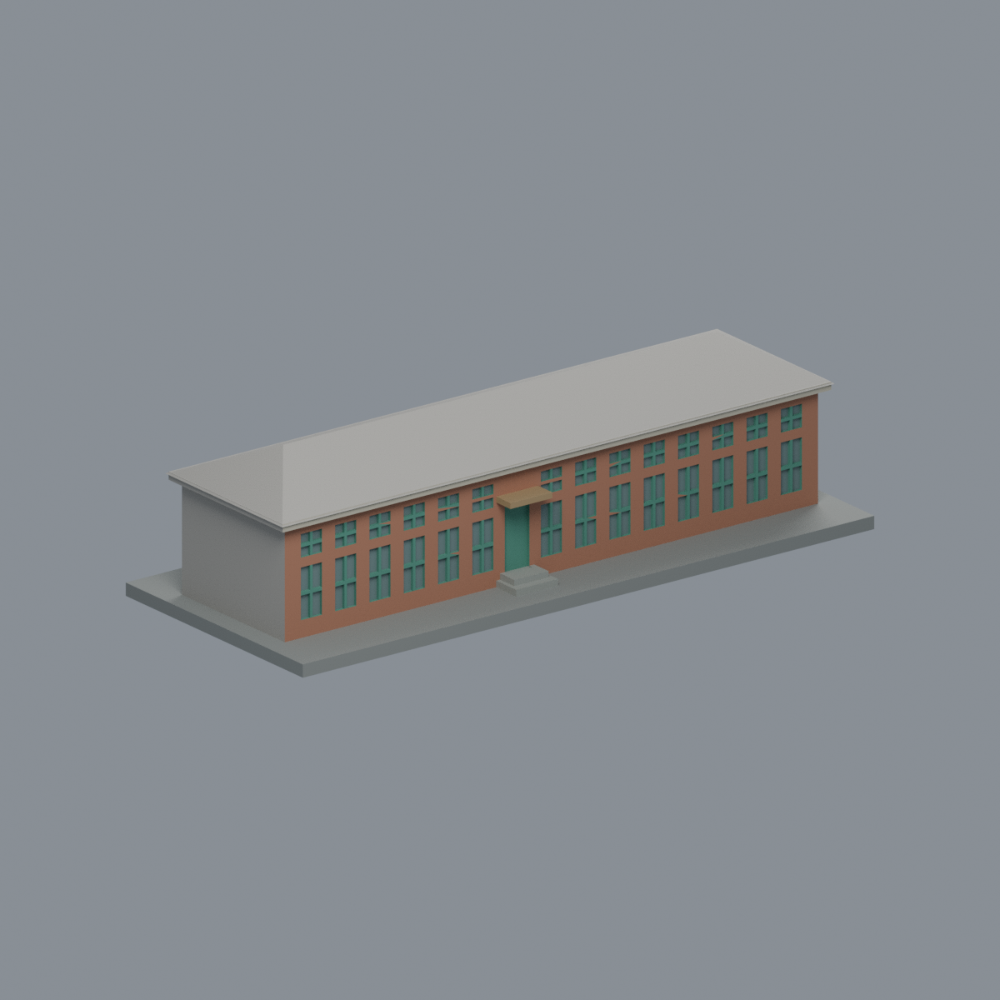
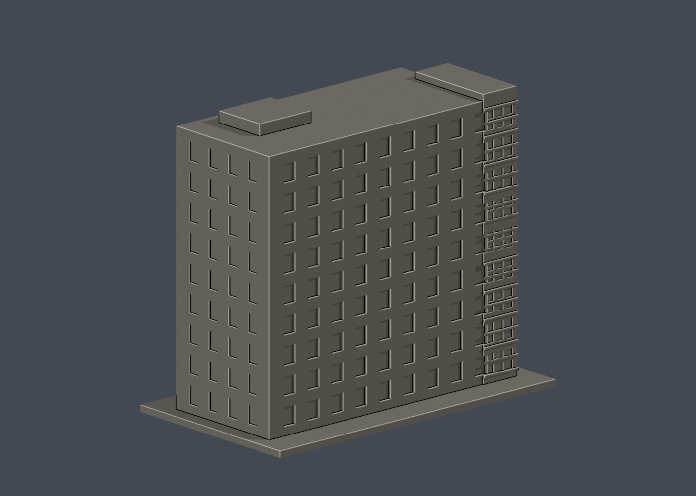
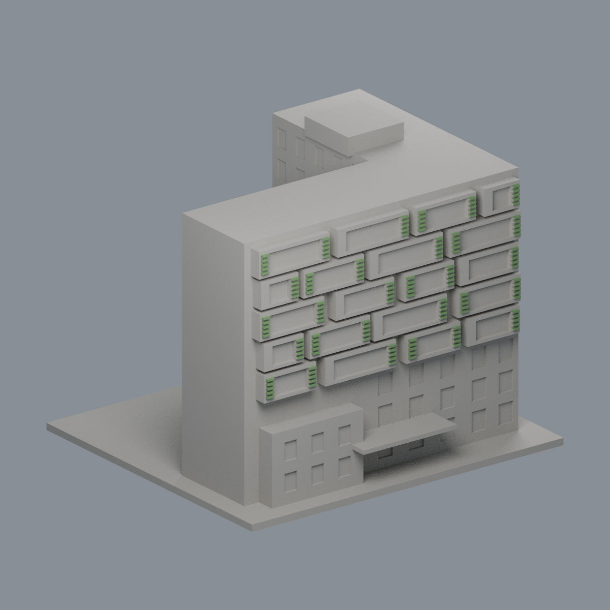
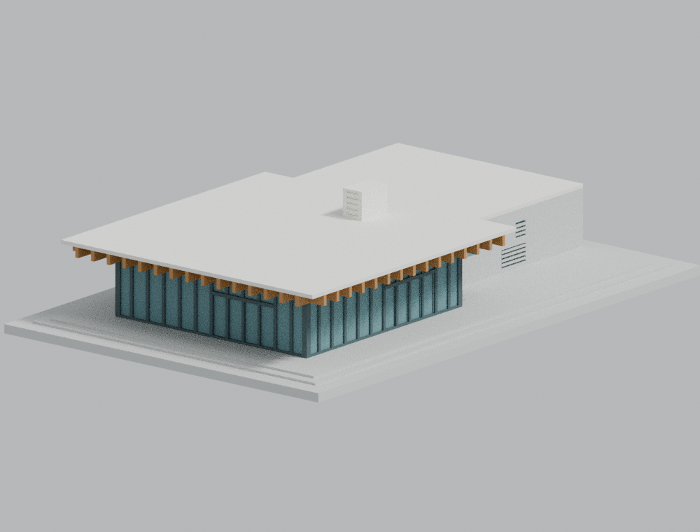
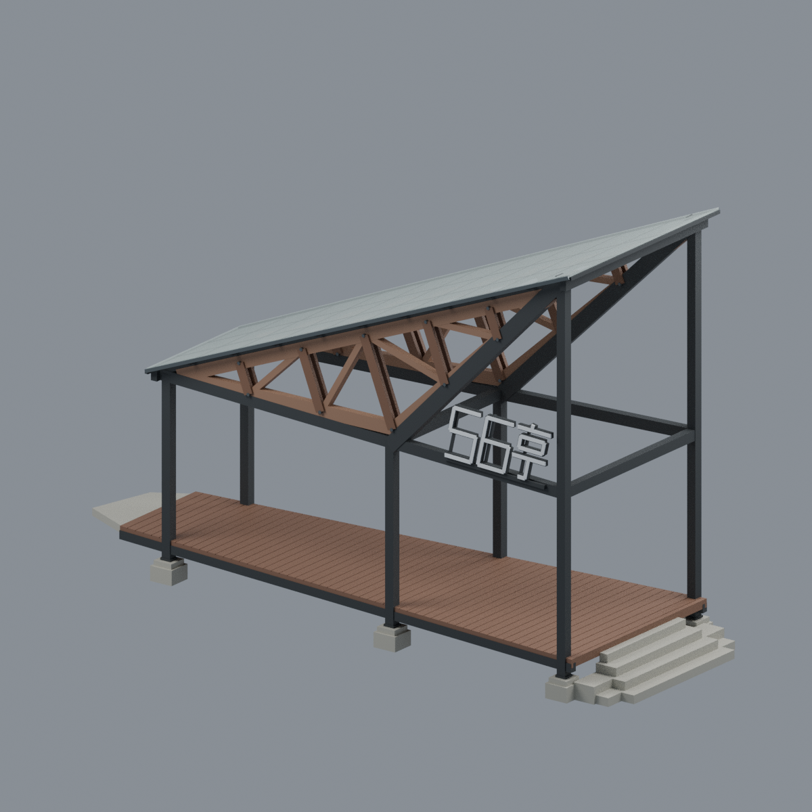

# 國立成功大學・成功校區

[返回學校總覽](../README.md)

本校區目前收錄 10 件數位外觀近似模型；包含局部段或同一財產不同量體，件數不等於完整建物棟數。既有9件含底座最長150mm；56亭含局部兩端收尾為228mm展示長，各件獨立縮尺。尚未完成全校，未實體試印或進行印表機切片驗證。

## 三欄模型圖鑑

每格是一件不同模型。範圍、來源年代、近似與薄件警示以各件詳頁為準。

| 建築模型 | 建築模型 | 建築模型 |
| :---: | :---: | :---: |
| **國立成功大學｜格致堂**  [正面](buildings/gechi-hall/appearance/previews/front.png) · [背面](buildings/gechi-hall/appearance/previews/rear.png) [說明與來源](buildings/gechi-hall/README.md) · [STL](buildings/gechi-hall/model.stl) | **國立成功大學｜資訊大樓高棟**  [正面](buildings/information-building/previews/front.png) · [背面](buildings/information-building/previews/rear.png) [說明與來源](buildings/information-building/README.md) · [STL](buildings/information-building/model.stl) | **國立成功大學｜總圖書館**  [正面](buildings/main-library/appearance/previews/front.png) · [背面](buildings/main-library/appearance/previews/rear.png) [說明與來源](buildings/main-library/README.md) · [STL](buildings/main-library/model.stl) |
| **國立成功大學｜成大博物館**  [正面](buildings/museum/appearance/previews/front.png) · [背面](buildings/museum/appearance/previews/rear.png) [說明與來源](buildings/museum/README.md) · [STL](buildings/museum/model.stl) | **國立成功大學｜大新園西棟（校友會館・幾何修正版）**  [正面](buildings/new-garden-west-pavilion/previews/front.png) · [背面](buildings/new-garden-west-pavilion/previews/rear.png) [說明與來源](buildings/new-garden-west-pavilion/README.md) · [STL](buildings/new-garden-west-pavilion/model.stl) | **國立成功大學｜舊物理系館南棟（原理化學實驗室）**  [正面](buildings/old-physics-south-hall/appearance/previews/front.png) · [背面](buildings/old-physics-south-hall/appearance/previews/rear.png) [說明與來源](buildings/old-physics-south-hall/README.md) · [STL](buildings/old-physics-south-hall/model.stl) |
| **國立成功大學｜理學教學大樓北棟高層量體（化學棟）**  [正面](buildings/science-north-high-wing/previews/front.png) · [背面](buildings/science-north-high-wing/previews/rear.png) [說明與來源](buildings/science-north-high-wing/README.md) · [STL](buildings/science-north-high-wing/model.stl) | **國立成功大學｜理學教學大樓南棟高層量體（物理棟）**  [正面](buildings/science-south-high-wing/appearance/previews/front.png) · [背面](buildings/science-south-high-wing/appearance/previews/rear.png) [說明與來源](buildings/science-south-high-wing/README.md) · [STL](buildings/science-south-high-wing/model.stl) | **國立成功大學｜大新園東棟（學生藝文沙龍）**  [正面](buildings/new-garden-east-pavilion/previews/front.png) · [背面](buildings/new-garden-east-pavilion/previews/rear.png) [說明與限定覆核](buildings/new-garden-east-pavilion/README.md) · [STL](buildings/new-garden-east-pavilion/model.stl) |
|  **[國立成功大學｜成功校區｜56亭（Rotate Truss Pavilion）](buildings/ncku-56-rotate-truss-pavilion/README.md)** |  |  |

大新園東棟為本次新增，西棟為等比例重建的替換版本，不重複計數。各自採用不同尺寸與來源判讀，完整數位覆核限制、正反圖及未試印警示見模型說明。

[七材質外觀與來源界線](buildings/museum/appearance/README.md)

[八材質外觀與來源界線](buildings/old-physics-south-hall/appearance/README.md)

[八材質外觀與來源界線](buildings/gechi-hall/appearance/README.md)

