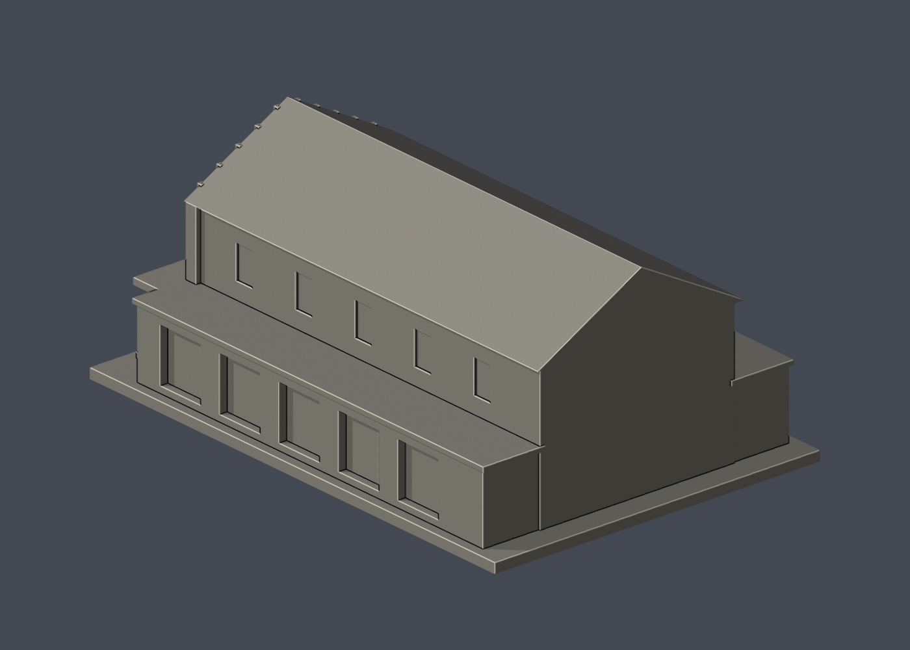

# 國立成功大學｜格致堂

首批代表建築外觀近似模型；僅此一棟，並非全校完成。校區：成功校區。查核與建模日期：2026-10-13。

尺寸（含底座）：102 × 150 × 63.7 mm。




## 來源與像素觀察

- [校方格致堂專文與正面、斜側、廊道照片，2021-09-28](https://news-secr.ncku.edu.tw/p/404-1037-228375.php)：已逐張檢視正面、前方斜側及東側廊道像素：山牆、牛眼窗、四個長窗、中央雙拱裝飾、四柱入口與低側廊。
- [校方虛擬校園：格致堂](https://virtualcampustour.ossd.ncku.edu.tw/index.php?id=29&inter=detail)：確認建物名稱、校區及外觀特徵。

## 本件保留與近似

保留高斜屋頂主堂、前方山牆、圓形凹窗、四個上層長窗、中央成對拱飾、四柱平頂門廊與低側廊。屋簷下方小齒飾加粗。東側廊道改為淺凹開間，非可進入的走廊；西側採相似節奏近似，非完整觀察。柱頭改成方形疊層，磚縫、文字、窗櫺省略。主堂總長、側窗數與背面擴建範圍未測繪；北側簡化封閉端牆，沒有聲稱準確重建1960年後側加建。

## 交付與重建

- `model.stl`：毫米單位，與底座合成的單一實體。最長邊為 150 mm（含底座）；各棟獨立縮放，不適合直接拼成等比例校園。
- `build_model.py`：完整可攜參數化原始程式，無外部貼圖、私有路徑或參考照片依賴。
- `scene.blend`：由交付 STL 匯入，只有一個建築網格，可在 Blender 編輯頂點；細部參數請修改 Python 後重建。
- `previews/front.png`、`rear.png`、`elevation.png`：由實際交付 STL 產生。
- `validate_model.py`、`validation.json`：可重跑的幾何與重建驗證。

建議 Python 3.12，在虛擬環境執行：

```sh
python -m pip install -r requirements.txt
python build_model.py
blender -b -t 2 -P render_preview.py
python validate_model.py
```

已使用 Blender 4.3.2。驗證器在獨立臨時目錄重建 STL 並比較 SHA-256，讀取 Blender 場景的網格後比較三角形幾何。它檢查原始二進位 STL 儲存法線、面積、封閉性、邊恰有兩面、頂點連結為單一環、表面只有一個連通分量、正體積、底面位於 Z=0、最長邊 150 mm。單一封閉表面也排除獨立藏在內部的空腔殼；沒有宣稱完成所有自交的窮舉檢測。

## 製作原則與限制

這是依公開照片觀察製作的外觀近似收藏模型，不是測繪、修復、工程或精確 BIM 資料。牆身為實體，門窗、拱廊通常改成淺凹浮雕；不含室內、設備或安全配置。屋頂、深度、窗距及後側比例沒有測量基準，不能視為實際尺寸。原始參考照片未收錄、未重新授權或隨套件發布。來源權利屬原作者／校方；原創模型與程式可沿用儲存庫授權，不涵蓋外部參考照片。

## 列印說明

底座平貼平台，Z 軸向上。可從 0.4 mm 噴嘴、0.16–0.20 mm 層高、3 道外牆與 12–18% 填充開始試切片；這是設定建議，並非已測參數。小於約 0.8 mm 的淺浮雕可能因噴嘴或縮放消失。STL 是封閉實體，切片器仍會依填充率產生內部填充。

未實體試印、未執行切片器列印驗證，沒有保證免支撐。請依下列模型特有支撐需求檢查切片預覽。

前方四柱之間的平頂門廊存在約18–20 mm跨距及向前懸挑，建議門廊底部使用可移除支撐；屋簷也需切片檢查。避免把模型縮得太小使方柱與齒飾脆弱。
