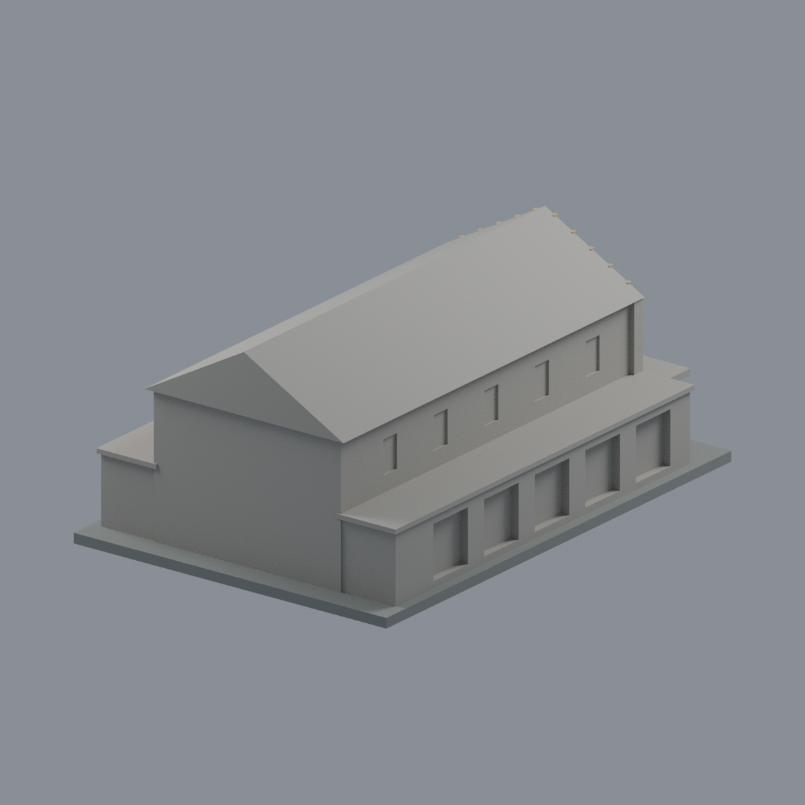
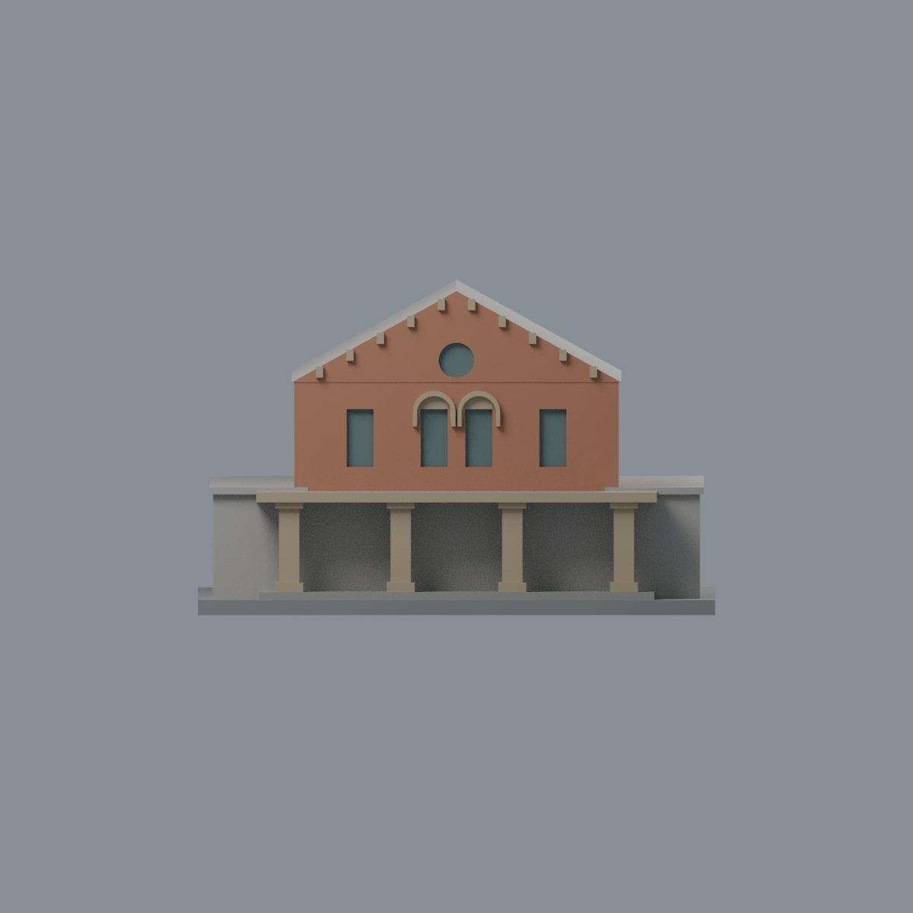
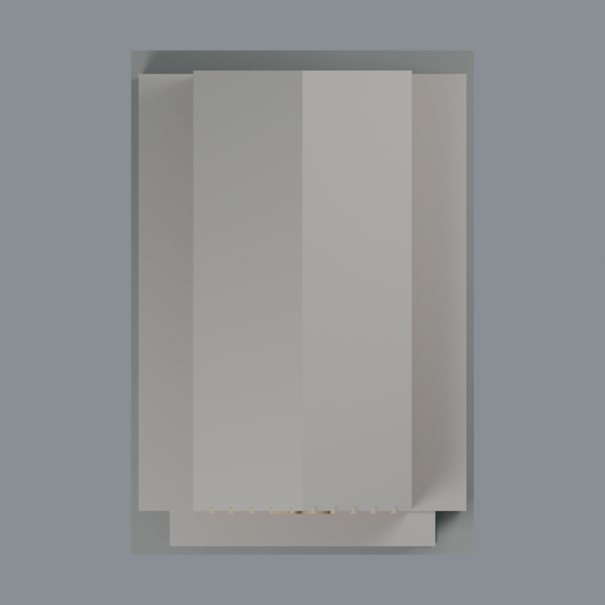

# 成大格致堂：八材質外觀版

沿用原 **1,678 三角面／833 頂點**，不改原 STL 位元、座標、面序或幾何；這是既有模型外觀改版，不增加模型包數。

| 模型預覽 | 模型預覽 | 模型預覽 |
| :---: | :---: | :---: |
| 正面  | 背面保持中性  |  |
|  |  |  |

[表面色 3MF](gechi-appearance.3mf) · [可編輯 Blender](scene.blend) · [材質色表](palette.json) · [逐面指派與依據](face-materials.json) · [原 STL](../model.stl)

## 來源與配色邊界

親自查看校方[2021-09-28 格致堂文章](https://news-secr.ncku.edu.tw/p/404-1037-228375.php)所附[廣角正面](https://web.ncku.edu.tw/var/file/0/1000/img/252488792.png)、[正面近照](https://web.ncku.edu.tw/var/file/0/1000/img/362878436.png)及[東廊照片](https://web.ncku.edu.tw/var/file/0/1000/img/795328556.png)。本文日期不是精確拍攝日期；照片版本與目前現況未核實，不宣稱 2026 現況，不隨模型散布來源照片。

- 正面上層山牆及東側上層可見磚牆採橙棕色；原四個正面窗、東側上層凹窗內緣紅棕，背面採低彩度玻璃代理，沒有補新窗梃或窗扇。
- 正面四根柱、柱腳柱頭與前簷立緣是暖灰赭**石材**，不是木柱。既有成對拱飾及齒飾赭色；圓窗只對原洞內緣及凹背指派，不憑空加凸環或文字。
- 東廊原幾何只有外牆與淺凹面，沒有照片中完整的獨立木柱、窗與灰磚牆裙。本版僅對可登錄凹面採淡奶油色代理，**不把實心牆假染成木柱或玻璃，也不虛構水平牆裙分界**。不能據此外觀當成完整東廊復原。
- 前廊內部照片有奶油粉刷、磚牆及石牆裙，但原網格未分開，內牆保持中性。原門廊、主屋面、廊頂上表面、西側與背面也保持中性。底板僅為展示底板；原前平台灰色近似。
- 顏色未經色卡校正，為來源有界的材質示意；仍保留原簡化比例、方柱及推估背面。沒有磚瓦紋理、金字、照明、設備、污漬、植物或陰影色塊。

[原幾何與來源界線](../README.md) · [本次來源覆核](qa/source-review.json)

## 重建與核驗

安裝 [依賴](source/requirements.txt)，Blender 使用 4.3.2。由本資料夾上層提供原 model.stl：

1. `python appearance/source/build_appearance.py`
2. `python appearance/source/verify_exchange.py`
3. `blender -b -t 3 --python-exit-code 1 -P appearance/source/render_appearance.py`
4. `blender -b -t 3 --python-exit-code 1 -P appearance/source/verify_scene.py`

[獨立重建 ZIP](rebuild-source.zip)含原 STL、四支程式及依賴，不含第三方照片；不取代原建模腳本。[逐檔 SHA256](SHA256SUMS)

[交換／拓撲 QA](qa/exchange-validation.json)核對原座標與面序、全部面材質、單連通、有向水密邊、頂點 link 單環、正體積與零退化／重複面；lib3mf 嚴格讀取零警告，實際編輯單材質再存讀，其他材質及面指派不變。SDK 六位小數量化誤差另列。

[Blender 存讀與編輯](qa/scene-validation.json) · [渲染記錄](qa/render-manifest.json) · [獨立重建](qa/rebuild-validation.json)

## 製造限制照舊

尺寸仍為 102 × 150 × 63.7 mm；原 STL、建模程式、場景及歷史 QA 保留。原層檢與薄特徵檢查本次未重跑，不能由材質 QA 代替。

3MF 是同一網格的表面色，不是八個封閉分色實體、切片專案、噴頭映射或 G-code。切片 GUI、多材料路徑與實體列印未測；柱頭、屋簷、窗框及薄邊仍須評估材料、支撐及拆除風險，沒有保證可印或免支撐。
