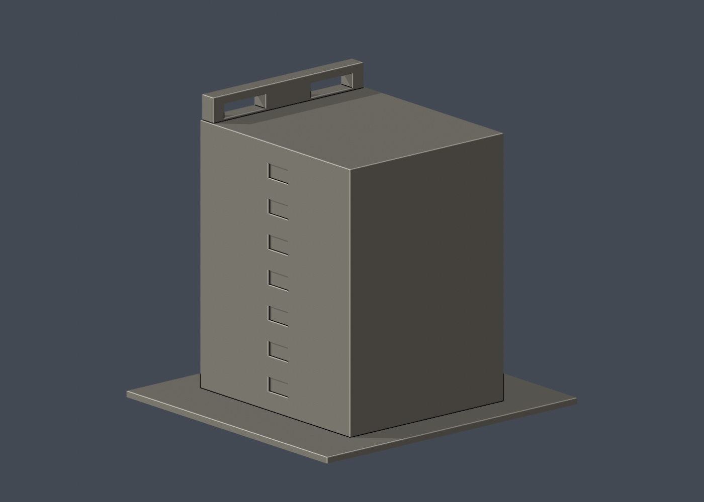

# 國立成功大學｜資訊大樓高棟

第七批；成功校區。尺寸 150 × 142 × 143 mm，最長邊150 mm含底座，各件比例獨立。

| 模型預覽 | 模型預覽 | 模型預覽 |
| :---: | :---: | :---: |
|  |  |  |

## 公開來源及像素檢視

- [校方GIS：資訊大樓外觀](https://db.nckumap.ncku.edu.tw/nckugis/public/uploadfiles.htm?action=listImg&q=36314)：檢視細直窗格、高屋頂框洞、不同尺寸窗區及外部入口階梯。
- [校方GIS：資訊大樓近角](https://db.nckumap.ncku.edu.tw/nckugis/public/uploadfiles.htm?action=listImg&q=36315)：檢視上層入口與圓角平臺；旁邊長樓未當作本高棟。
- [校方素材網：2026外觀](https://material.ncku.edu.tw/picture.php?/3827)：檢視2026年上傳正面遠景，確認高棟灰色窗格及頂框保留。
- [校方素材網：側面](https://material.ncku.edu.tw/picture.php?/1948)：檢視紅磚短端少量窗與長面窗格；此照片較早，背面現況未逐處核實。
- [校方公開GIS建物範圍圖](https://nckumap.ncku.edu.tw/map.php)：只使用外部輪廓圖層gis_base及公開建物識別B006；未使用樓層室內平面或設備資料。
- [2026/1/30校方財產清冊](https://prop-oga.ncku.edu.tw/var/file/59/1059/img/4743/218075103.pdf)：交叉核對校區與財產碼R1A-23-0，財產筆數不等於完整單棟數。

## 建模範圍與近似

本件只作校方GIS B006所辨識的資訊大樓高棟及貼接外部入口階梯。R1A-23-0財產名是「資訊暨理化實驗大樓」，本件不能宣稱該筆整個複合體完成，旁邊長條理化樓與兩棟之間連橋未納入。保留狹長直窗、低層較大窗區、頂部兩組矩形框洞及階梯圓角平臺。依公開外框估計主體深度，細小折角未逐一復刻；入口雨棚簡化，鋼製細欄杆省略。完整背面未取得，採素面而非虛構精細背窗。屋頂平台沒有建設備或室內。

## 交付與重建

- `model.stl`：毫米單位，與底座合成的單一實體。最長邊為 150 mm（含底座）；各棟獨立縮放，不適合直接拼成等比例校園。
- `build_model.py`：完整可攜參數化原始程式，無外部貼圖、私有路徑或參考照片依賴。
- `scene.blend`：由交付 STL 匯入，只有一個建築網格，可在 Blender 編輯頂點；細部參數請修改 Python 後重建。
- `previews/front.png`、`rear.png`、`elevation.png`：由實際交付 STL 產生。
- `validate_model.py`、`validation.json`：可重跑的幾何與重建驗證。

建議 Python 3.12，在虛擬環境執行：

```sh
python -m pip install -r requirements.txt
python build_model.py
blender -b -t 2 -P render_preview.py
python validate_model.py
```

已使用 Blender 4.3.2。驗證器在獨立臨時目錄重建 STL 並比較 SHA-256，讀取 Blender 場景的網格後比較三角形幾何。它檢查原始二進位 STL 儲存法線、面積、封閉性、邊恰有兩面、頂點連結為單一環、表面只有一個連通分量、正體積、底面位於 Z=0、最長邊 150 mm。單一封閉表面也排除獨立藏在內部的空腔殼；沒有宣稱完成所有自交的窮舉檢測。

## 製作原則與限制

這是依公開照片觀察製作的外觀近似收藏模型，不是測繪、修復、工程或精確 BIM 資料。牆身為實體，門窗、拱廊通常改成淺凹浮雕；不含室內、設備或安全配置。屋頂、深度、窗距及後側比例沒有測量基準，不能視為實際尺寸。原始參考照片未收錄、未重新授權或隨套件發布。來源權利屬原作者／校方；原創模型與程式可沿用儲存庫授權，不涵蓋外部參考照片。

## 列印說明

底座平貼平台，Z 軸向上。可從 0.4 mm 噴嘴、0.16–0.20 mm 層高、3 道外牆與 12–18% 填充開始試切片；這是設定建議，並非已測參數。小於約 0.8 mm 的淺浮雕可能因噴嘴或縮放消失。STL 是封閉實體，切片器仍會依填充率產生內部填充。

未實體試印、未執行切片器列印驗證，沒有保證免支撐。請依下列模型特有支撐需求檢查切片預覽。

頂部框洞的水平跨梁、入口平臺和小雨棚需局部支撐；階梯加厚連至主體。

## 截面閉合檢查

`validate_sections.py` 以0.20 mm間距抽樣實際STL水平截面，檢查閉合、節點度數及零長線段。結果見 `cross_sections.json`，不能當成切片路徑、支撐效果或實體試印驗證。

查核日期：2026-10-13。


## 整合版截面與薄特徵補充驗證

本整合版使用固定共同邊方向後插值的 `validate_sections.py` 與 [0.2 mm 截面結果](cross_sections.json)，避免同一邊浮點方向差異造成假斷環。原始 STL 幾何未修改。舊截面程式有閉合斷言，既有通過結果不代表曾有破面；此處以新版重跑結果為準。

另提供 `check_thin.py` 與 [新增 0.8 mm 薄特徵輔助篩查](thin-feature-check.json)：每 1 mm 水平取樣，先確認輪廓閉合與有效，再作半徑 0.4 mm 形態開運算。這不是切片器、完整壁厚分析或實體試印，尖屋頂、銳角也會造成損失，不能據此宣稱無支撐或列印成功。執行前請安裝 requirements.txt。
