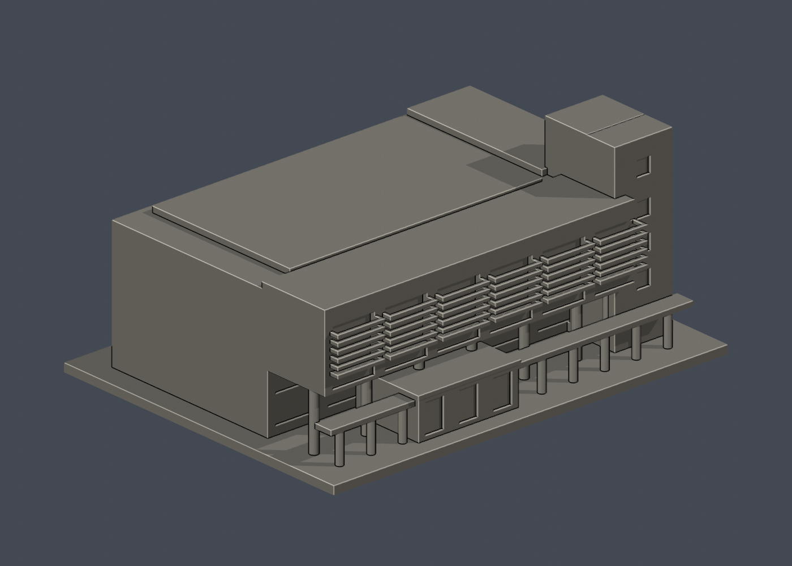
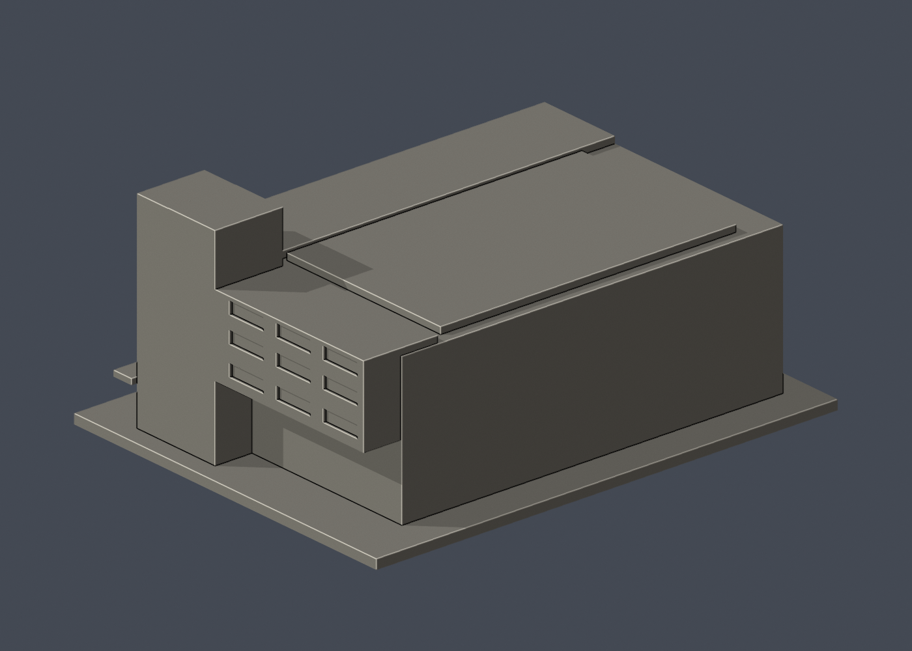

# 國立成功大學｜總圖書館

第三批外觀近似模型；校區：成功校區。最長邊150 mm（含底座），各模型獨立比例。尺寸：150 × 116 × 67 mm。





## 公開來源及像素查核

- [校方圖書館：歷代館舍介紹](https://www.lib.ncku.edu.tw/guide/building.php)：已檢視第三代館舍a3_1日景及a3_2夜景照片像素，見前方長柱廊、突出上層、六組橫向百葉、右側高出體塊與側翼。只看外觀圖，不建室內。
- [校方圖書館設計理念及特色](https://www.lib.ncku.edu.tw/journal/pdf/0708/0708_03.pdf)：文字確認地上五層和南向正立面；沒有把屋頂、深度推估當成測量。
- [校方虛擬校園目錄](https://virtualcampustour.ossd.ncku.edu.tw/)：確認總圖書館在成功校區，與勝利校區舊總圖前棟分開。

## 本件範圍、保留與近似

範圍為成功校區現總圖書館外觀主體，不包含周邊系館、地下室或下沉廣場。保留前柱廊、中央低入口、上層深挑出、底層退縮柱列、六組實體水平遮陽片、右側全高階梯塔及側翼。上層與底層外牆相差約24.5 mm，遮陽片深5.8 mm、厚1.2 mm；這些是列印模型設計尺寸，不是原建築測量。前方入口曲率簡化成直邊，窗改成淺槽。深度、後方、屋頂完整配置無俯視證據，採單純實體量塊；未觀察後面保留實牆，並沒有將正面百葉任意複製。照片中的地坪高差、省略的廣場拱門及精細材質不在本件範圍。

## 交付與重建

- `model.stl`：毫米單位，與底座合成的單一實體。最長邊為 150 mm（含底座）；各棟獨立縮放，不適合直接拼成等比例校園。
- `build_model.py`：完整可攜參數化原始程式，無外部貼圖、私有路徑或參考照片依賴。
- `scene.blend`：由交付 STL 匯入，只有一個建築網格，可在 Blender 編輯頂點；細部參數請修改 Python 後重建。
- `previews/front.png`、`rear.png`、`elevation.png`、`comparison.png`（較低角度）：由實際交付 STL 產生。
- `validate_model.py`、`validation.json`：可重跑的幾何與重建驗證。

建議 Python 3.12，在虛擬環境執行：

```sh
python -m pip install -r requirements.txt
python build_model.py
blender -b -t 2 -P render_preview.py
python validate_model.py
```

已使用 Blender 4.3.2。驗證器在獨立臨時目錄重建 STL 並比較 SHA-256，讀取 Blender 場景的網格後比較三角形幾何。它檢查原始二進位 STL 儲存法線、面積、封閉性、邊恰有兩面、頂點連結為單一環、表面只有一個連通分量、正體積、底面位於 Z=0、最長邊 150 mm。單一封閉表面也排除獨立藏在內部的空腔殼；沒有宣稱完成所有自交的窮舉檢測。

## 製作原則與限制

這是依公開照片觀察製作的外觀近似收藏模型，不是測繪、修復、工程或精確 BIM 資料。牆身為實體，門窗、拱廊通常改成淺凹浮雕；不含室內、設備或安全配置。屋頂、深度、窗距及後側比例沒有測量基準，不能視為實際尺寸。原始參考照片未收錄、未重新授權或隨套件發布。來源權利屬原作者／校方；原創模型與程式可沿用儲存庫授權，不涵蓋外部參考照片。

## 列印說明

底座平貼平台，Z 軸向上。可從 0.4 mm 噴嘴、0.16–0.20 mm 層高、3 道外牆與 12–18% 填充開始試切片；這是設定建議，並非已測參數。小於約 0.8 mm 的淺浮雕可能因噴嘴或縮放消失。STL 是封閉實體，切片器仍會依填充率產生內部填充。

未實體試印、未執行切片器列印驗證，沒有保證免支撐。請依下列模型特有支撐需求檢查切片預覽。

前方細圓柱廊的頂板及上層外挑有局部懸垂，建議柱廊下方放支撐；側翼與凸出屋簷也要逐層檢查。新增深懸挑、遮陽片與底層柱間必須檢查支撐，不能視為免支撐模型。最細圓柱直徑約2.6 mm，不建議再大幅縮小。

## 抽樣逐層截面檢查

新增 `validate_sections.py` 與 `cross_sections.json`，對實際STL每0.20 mm高度抽樣一次平面交線，檢查每節點度數為2及無零長線段；恰遇頂點平面時向下避開0.0173 mm，細節記錄於JSON。這是截面閉合檢查，不是切片器工具路徑、支撐或擠出驗證。執行 `python validate_sections.py` 可重跑。

查核日期：2026-10-13。


## 整合版截面與薄特徵補充驗證

本整合版使用固定共同邊方向後插值的 `validate_sections.py` 與 [0.2 mm 截面結果](cross_sections.json)，避免同一邊浮點方向差異造成假斷環。截面重驗本身不改動 STL；本件另外有下述幾何修訂。舊截面程式有閉合斷言，既有通過結果不代表曾有破面；此處以新版重跑結果為準。

另提供 `check_thin.py` 與 [新增 0.8 mm 薄特徵輔助篩查](thin-feature-check.json)：每 1 mm 水平取樣，先確認輪廓閉合與有效，再作半徑 0.4 mm 形態開運算。這不是切片器、完整壁厚分析或實體試印，尖屋頂、銳角也會造成損失，不能據此宣稱無支撐或列印成功。執行前請安裝 requirements.txt。


### 遮陽條連通修訂

整合檢查發現先前版本有36根懸浮遮陽橫條。此修訂將各條兩端延長1 mm接回框柱，保持主要外觀與尺寸，重建為單一連通表面。STL、Python、Blender與預覽均同步重建，舊版本已由本件取代。
