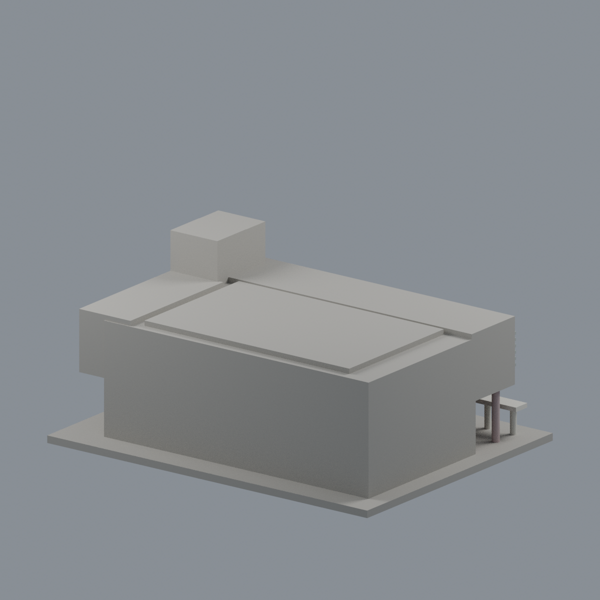
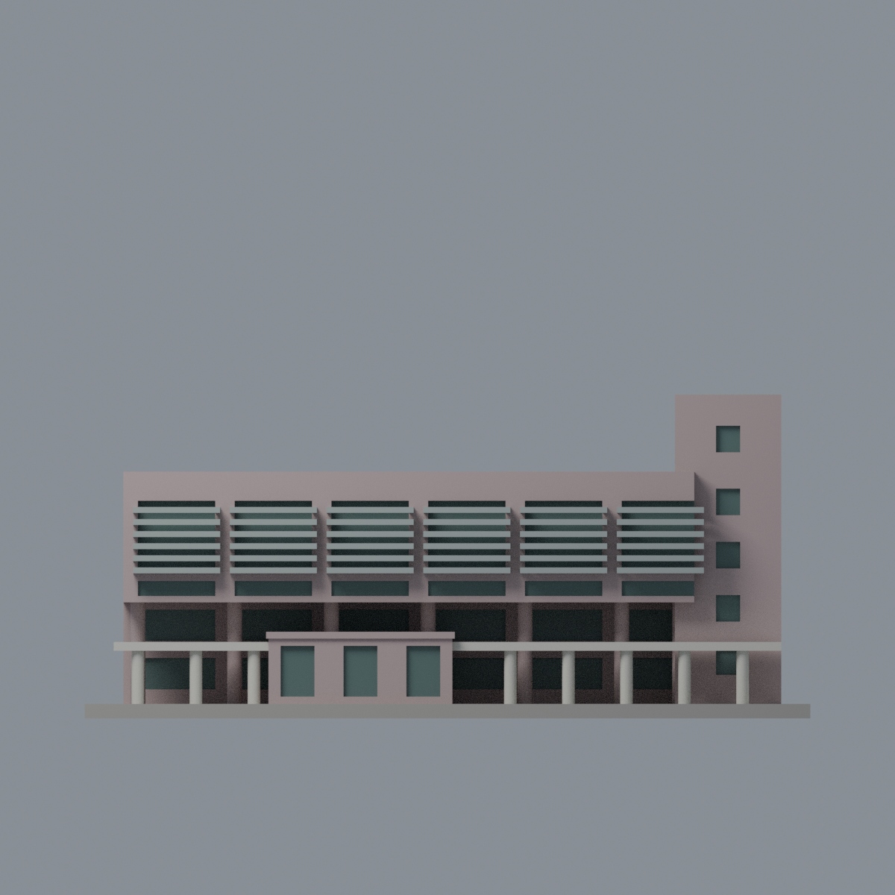
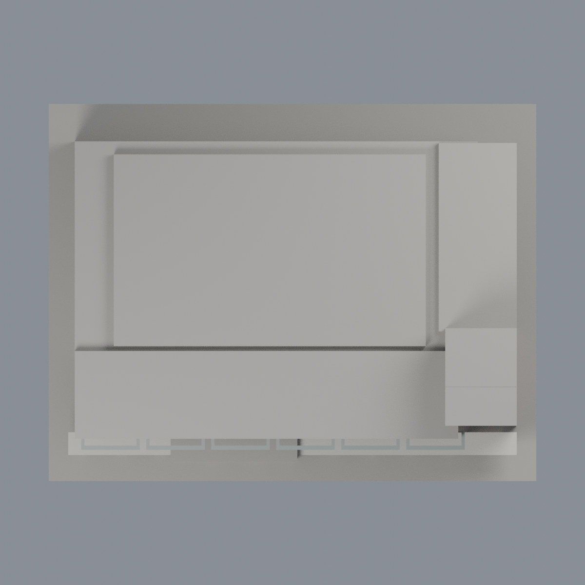

# 成大總圖書館有限配色：五材質外觀版

沿用原 **3,644 三角面／1,724 頂點**，不改原 STL 位元、座標、面序或幾何；這是既有模型外觀改版，不增加模型包數。

| 正面 | 背面保持中性 |
|---|---|
|  |  |
|  |  |

[表面色 3MF](nckulib-appearance.3mf) · [可編輯 Blender](scene.blend) · [材質色表](palette.json) · [逐面指派與依據](face-materials.json) · [原 STL](../model.stl)

## 來源與配色邊界

親看成大圖書館官方現館介紹的完整日照、夜照與原單色網格／生成器；不是舊圖書館。[精確 URL、SHA 與日期欄](qa/source-review.json)。日照相機 nested Original 為 2025-01-13 15:37:19，root Modified 為 2025-01-20 08:36:19；相機自報拍攝欄未獨立認證，修改日不當拍攝日。夜照無日期，不推定拍攝年，不聲稱 2026 現況。原照私有研究，不入包。

- 日照支持前主殼、入口低量體、樓梯塔與已註冊右側的低飽和粉灰磁磚；大懸挑下方粗承重柱也同粉灰，不能因前景細柱白色便全部柱染白。
- 前景八根細圓柱與橫梁是暖白小磁磚；原整構件側面作同材料有界延伸。六組原遮陽片銀灰、窗凹背灰綠玻璃代理。只指派原完整三角面，窗色不溢到遮陽片或柱。
- 夜照只用於右側窗及入口排列註冊，不烘焙黃色照明、藍天或室內燈光。入口三凹面為門／玻璃區代理，非臆稱實門板材質。
- 屋頂上面、後牆、未見左端與基座保持中性。原未分的細磁磚縫、塔樓細白線、小窗框與室內隔板均省略；不畫斜色界、不補地下廣場、拱洞、燈、人、招牌或植栽。
- 原層高、深度、柱距與遮陽簡化照舊；這是既有網格外觀改善，不是新幾何或實測現況模型。

[原幾何與歷史來源限制](../README.md)

## 重建與核驗

安裝 [依賴](source/requirements.txt)，Blender 使用 4.3.2。由本資料夾上層提供原 model.stl：

1. `python appearance/source/build_appearance.py`
2. `python appearance/source/verify_exchange.py`
3. `blender -b -t 3 --python-exit-code 1 -P appearance/source/render_appearance.py`
4. `blender -b -t 3 --python-exit-code 1 -P appearance/source/verify_scene.py`

[獨立重建 ZIP](rebuild-source.zip)含原 STL、四支程式及依賴，不含第三方照片；不取代原建模腳本。[逐檔 SHA256](SHA256SUMS)

[交換／拓撲 QA](qa/exchange-validation.json)核對原座標與面序、全部面材質、單連通、有向水密邊、頂點 link 單環、正體積與零退化／重複面；lib3mf 嚴格讀取零警告，實際編輯單材質再存讀，其他材質及面指派不變。SDK 六位小數量化誤差另列。

[Blender 存讀與編輯](qa/scene-validation.json) · [渲染記錄](qa/render-manifest.json) · [獨立重建](qa/rebuild-validation.json)

## 製造限制照舊

尺寸仍為 150 × 116 × 67 mm；原 STL、建模程式、場景及歷史 QA 保留。原層檢與薄特徵檢查本次未重跑，不能由材質 QA 代替。

3MF 是同一網格的表面色，不是各材質各自封閉的分色實體、切片專案、噴頭映射或 G-code。切片 GUI、多材料路徑與實體列印未測；柱頭、屋簷、窗框及薄邊仍須評估材料、支撐及拆除風險，沒有保證可印或免支撐。
