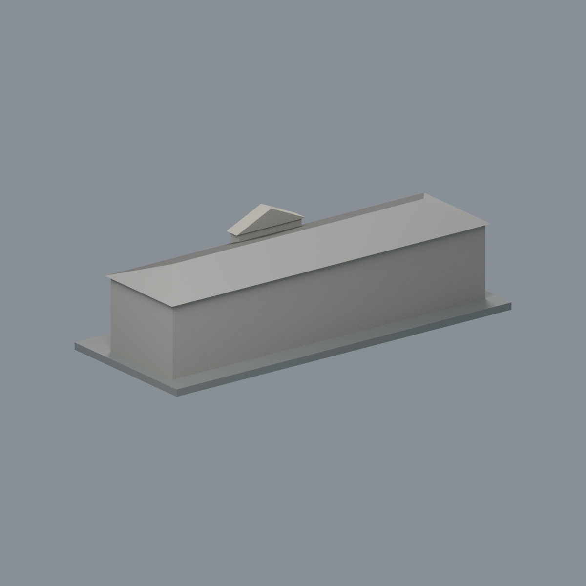
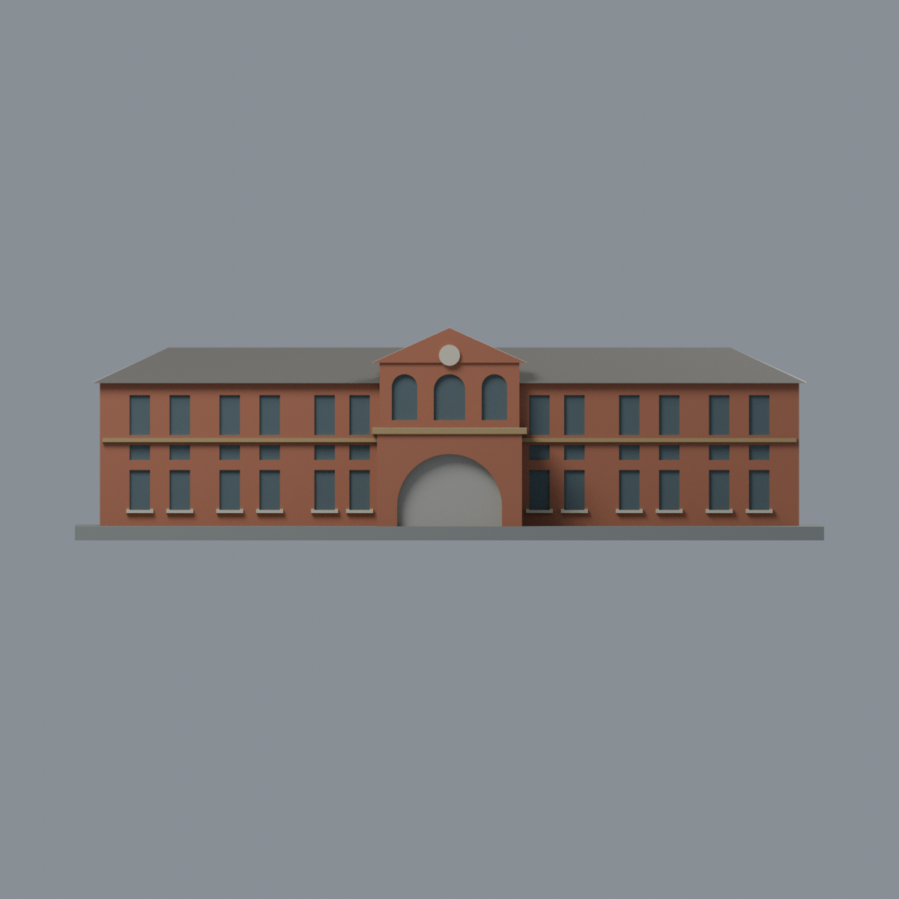
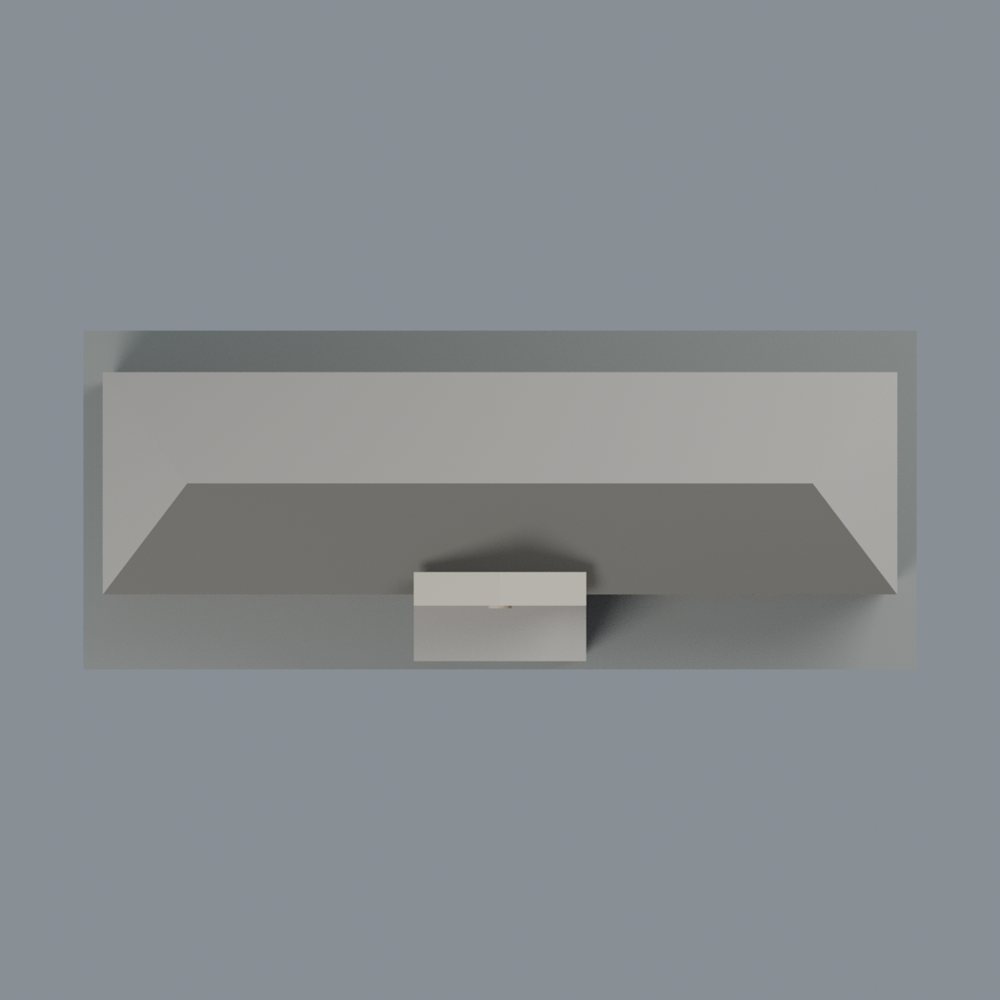

# 成大博物館：七材質外觀版

沿用原 **1,646 三角面／825 頂點**，不改原 STL 位元、座標、面序或幾何；這是既有模型外觀改版，不增加模型包數。

| 模型預覽 | 模型預覽 | 模型預覽 |
| :---: | :---: | :---: |
| 正面  | 背面保持中性  |  |
|  |  |  |

[表面色 3MF](museum-appearance.3mf) · [可編輯 Blender](scene.blend) · [材質色表](palette.json) · [逐面指派與依據](face-materials.json) · [原 STL](../model.stl)

## 來源與配色邊界

親自查看校方[2021-09-15 博物館介紹](https://web.ncku.edu.tw/p/404-1000-227880.php?Lang=zh-tw)與[正面近照](https://web.ncku.edu.tw/var/file/0/1000/img/687120922.png)，文、圖署名成大博物館；並核對素材網[歷史廣角照片頁](https://material.ncku.edu.tw/picture.php?/1690)與[原圖](https://material.ncku.edu.tw/_data/i/upload/2016/06/24/20160624154952-cf874876-me.jpg)，署名計網中心行政與諮詢組陳永川。

廣角圖上架日 **2016-06-24** 不是拍攝日。畫面有 2008 展覽旗幟，內嵌 EXIF DateTimeOriginal 為 **2008-12-02 15:42:02**，Canon EOS 400D；時區及拍攝日未獨立確認。近照 PNG 無 EXIF，2021 是文章更新日，非已核實快門日期。本件明確使用跨年外觀證據，不宣稱 2026 現況。照片不隨模型散布。

- 正面兩翼、中央山牆和車寄外牆為紅棕面磚色代理；原文描述淺褐面磚，照片受日照與年代影響，色值未校正，不宣稱精確材料色。
- 既有窗台及原凹窗內緣奶油色，背面深灰藍。三個中央上部拱形凹面沿用原簡化：中央實際為有玻璃雙開門、兩側半圓高窗；本次不修改其幾何為門扇。
- 原入口拱口凹緣和簷台立邊為暖赭色代理；原網格沒有精細拱外雕線，沒有靠塗色新增假浮雕。封閉淺凹口背面中性，不把陰影畫黑。
- 只依廣角照對可見主屋頂前坡給灰褐色；中央山牆厚度上緣為奶油色木簷邊代理，不新增雕花。未知後坡、屋頂平台、車寄頂平面、側端與背面中性。
- 原圓盤維持無字淡色，不畫博物館 logo、校名字體、布條、年份或設備。原網格未分出黃色洗石子牆基，不用跨三角面假造新的黃色基座區。展示底板不是噴泉或水池。
- 仍是既有 1977 年後兩層翼部簡化量體，不以較早單層外觀重造；沒有新增石獅、植栽、磚縫或窗扇。

[原幾何與來源界線](../README.md) · [本次來源與 EXIF 覆核](qa/source-review.json)

## 重建與核驗

安裝 [依賴](source/requirements.txt)，Blender 使用 4.3.2。由本資料夾上層提供原 model.stl：

1. `python appearance/source/build_appearance.py`
2. `python appearance/source/verify_exchange.py`
3. `blender -b -t 3 --python-exit-code 1 -P appearance/source/render_appearance.py`
4. `blender -b -t 3 --python-exit-code 1 -P appearance/source/verify_scene.py`

[獨立重建 ZIP](rebuild-source.zip)含原 STL、四支程式及依賴，不含第三方照片；不取代原建模腳本。[逐檔 SHA256](SHA256SUMS)

[交換／拓撲 QA](qa/exchange-validation.json)核對原座標與面序、全部面材質、單連通、有向水密邊、頂點 link 單環、正體積與零退化／重複面；lib3mf 嚴格讀取零警告，實際編輯單材質再存讀，其他材質及面指派不變。SDK 六位小數量化誤差另列。

[Blender 存讀與編輯](qa/scene-validation.json) · [渲染記錄](qa/render-manifest.json) · [獨立重建](qa/rebuild-validation.json)

## 製造限制照舊

尺寸仍為 150 × 61 × 42.5 mm；原 STL、建模程式、場景及歷史 QA 保留。原層檢與薄特徵檢查本次未重跑，不能由材質 QA 代替。

3MF 是同一網格的表面色，不是七個封閉分色實體、切片專案、噴頭映射或 G-code。切片 GUI、多材料路徑與實體列印未測；淺凹拱口、窗台、山牆與屋簷薄邊仍須評估材料、支撐及拆除風險，沒有保證可印或免支撐。
