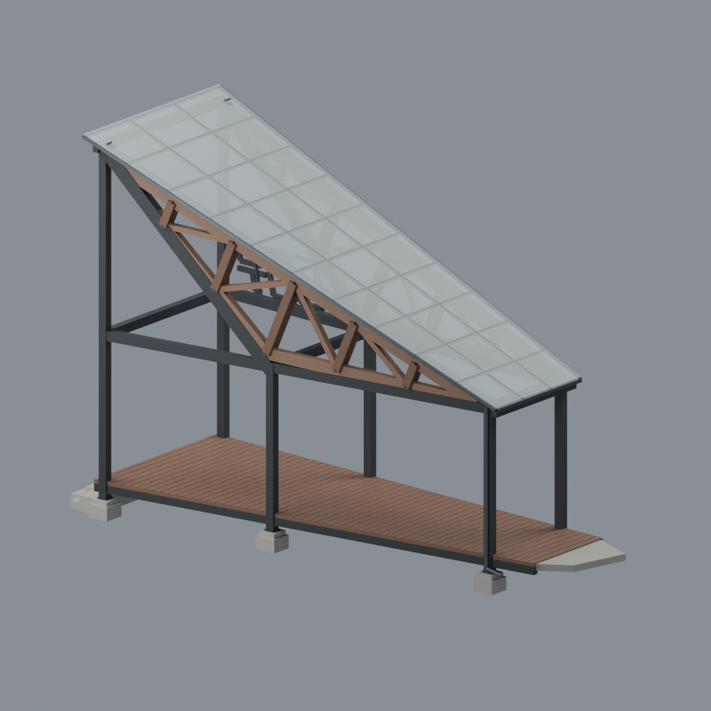
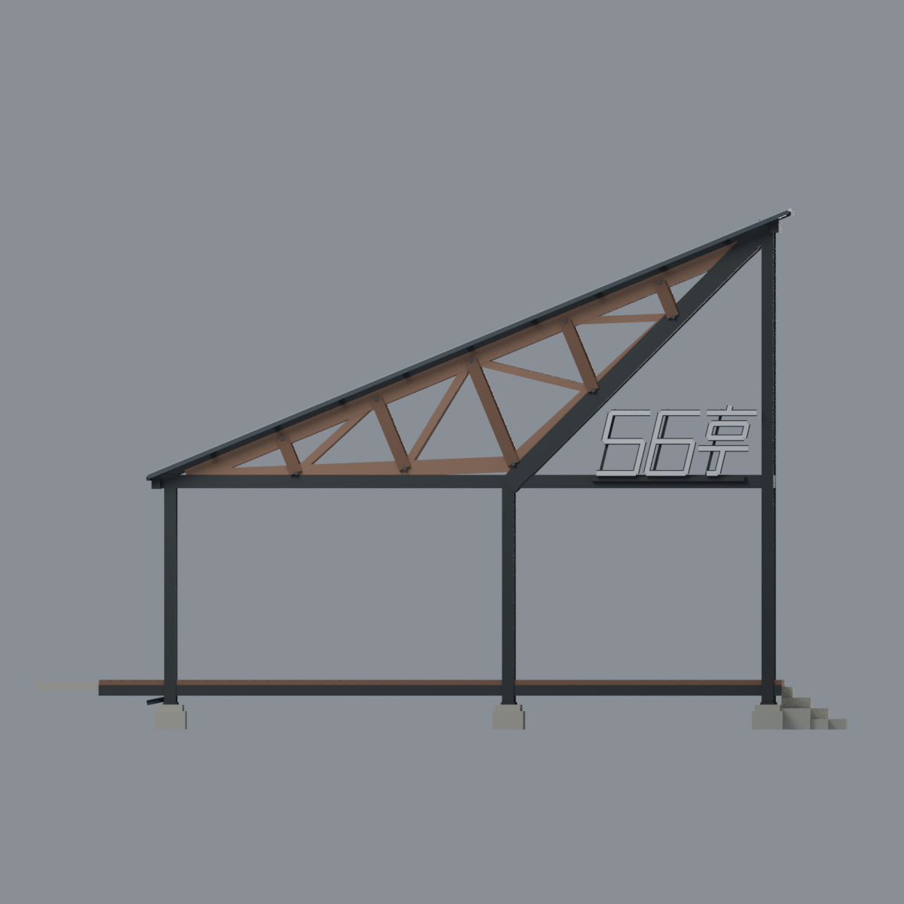
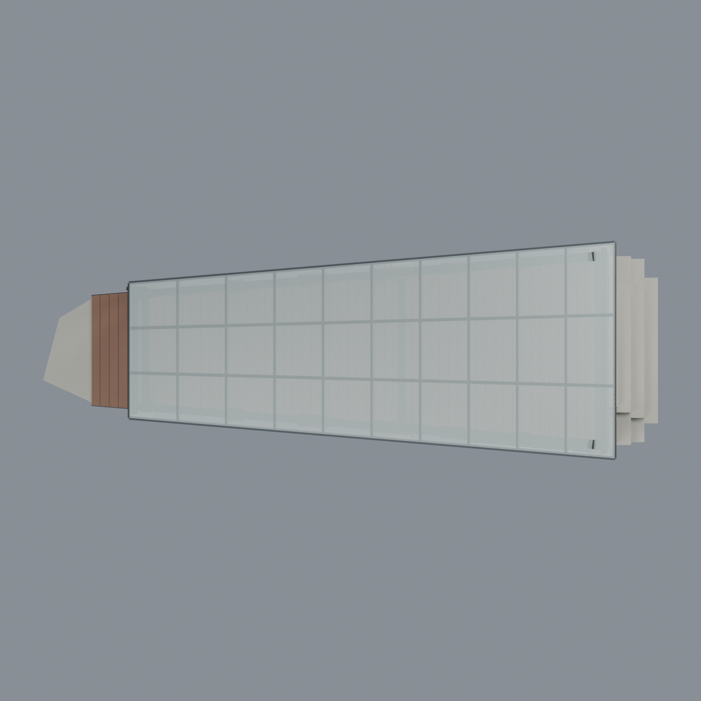
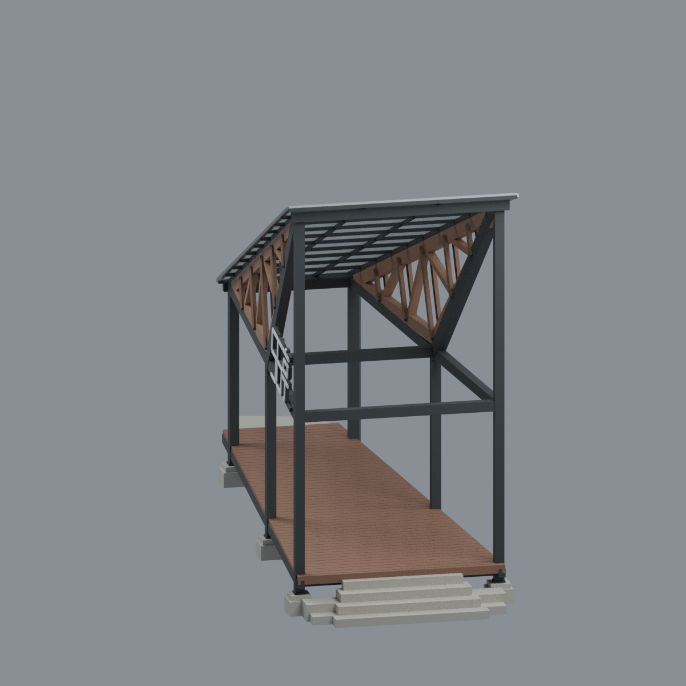

# 國立成功大學｜成功校區｜56亭（Rotate Truss Pavilion）

## 模型預覽

| 正面斜視 | 反面斜視 | 長側立面 |
|---|---|---|
|  |  |  |

**完整可見亭體外觀近似；非測繪、非全校完成。** 2021年建成、2022-11-11揭牌；另用2023-08-07拍攝的官方全景核對，拍攝日不等於2023-08-09上傳日。本包不是2026年現況調查。

[可編輯Blender](scene.blend) · [八材質3MF](model.3mf) · [單色實體STL](model.stl) · [來源](SOURCES.md) · [完整QA](QA.md)

## 實際最終mesh五視圖
所有PNG從交付3MF內與STL逐三角相同的幾何生成，非概念圖、照片或AI繪製。


| 模型預覽 | 模型預覽 | 模型預覽 |
| :---: | :---: | :---: |
| 俯視漸縮屋面<br> | 寬高端及屋頂底面<br> |  |

## 這個模型保留什麼
- **單一傾斜平面透明PC頂**，從窄低端升往寬高端；屋面與塑木平台都呈漸縮梯形，不是矩形雙坡涼亭。
- 兩榀翻轉舊三角木桁架，褐木長弦、下方折線、斜腹材及代表性雙板／螺栓；新黑鋼框架與舊木清楚區分。
- 兩列共六根落地柱；高端到中柱及中柱到低端按圖面365／475不等跨比例。兩根大斜撐不是額外柱腳。
- 四邊開放、六組分離小基腳、架高地坪下方真空氣；寬高端居中漸級階梯、低窄端局部斜接片。
- 前長側只有一組近似「56亭」招牌；反面看同組招牌背部，不複製另一組正讀文字。

展示外包尺寸 **228.00 × 81.43 × 146.38 mm**，包含兩端局部收尾；**沒有測量比例或可與其他模型直接拼接的承諾**。8材質、8,894個三角面、1個連通閉殼。

## 顏色、透明與編輯
Blender與3MF保留8個具名材質及逐面分派；PC顯示alpha為112／255。材質透明只是顯示設定，不是實物PC性能，3MF是否顯示alpha取決於軟體。**STL沒有顏色或透明資訊，PC仍是實體封閉薄片，不會因畫面透明變成可穿過的空洞。** 建議先編輯縮尺／拆件與支撐，避免把展示渲染誤當可直接實印結果。

## 實印警告
未使用實際印表機或切片器試印，**不保證免支撐**。raw拓樸0錯誤不代表可印；732個全局0.2mm切層保留13個薄層／23個薄成分警告。局部102實體、63空氣樣本均符合預期，但不是全表面最小厚度證明。1169個向下超45°三角面，包括架高平台、長屋面、樑、木桁架及標牌；需自行規劃支撐與去支撐方式。PC約0.832mm法向薄片、招牌筆畫、螺栓與排水管仍容易折損。

## 重建與檢查
Python依賴見[requirements.txt](requirements.txt)，另需Blender4.3.2或相容版。所有路徑相對此包，不需要原圖或外部字型。

```bash
python build_model.py
blender -b -t 8 --python-exit-code 1 --python render_model.py
python qa_model.py
python check_features.py
python verify_exchange.py
blender -b -t 8 --python-exit-code 1 --python verify_scene.py
blender -b -t 8 --python-exit-code 1 --python verify_render.py
python rebuild.py --output ../new-clean-rebuild --blender blender --threads 8
python verify_identity.py
python verify_package.py
```

`rebuild.py`要求全新輸出目錄，核對4個核心輸出及5張PNG逐byte相同；不同Blender／套件版本可能改變渲染或布林輸出。`verify_exchange.py`若跨Python環境，可用`BUILD_PYTHON`指向具建模依賴的Python。`SHA256SUMS`涵蓋此包除校驗檔本身外全部檔案。

來源照片／圖紙不隨包散布。細尺寸、坡度、格網、字形與五金為近似；完整界線見[SOURCES.md](SOURCES.md)。
