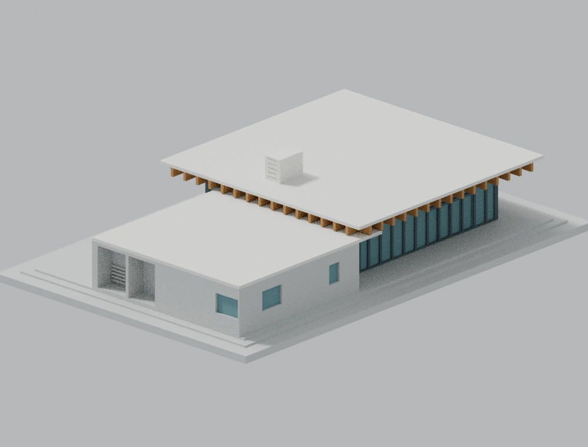
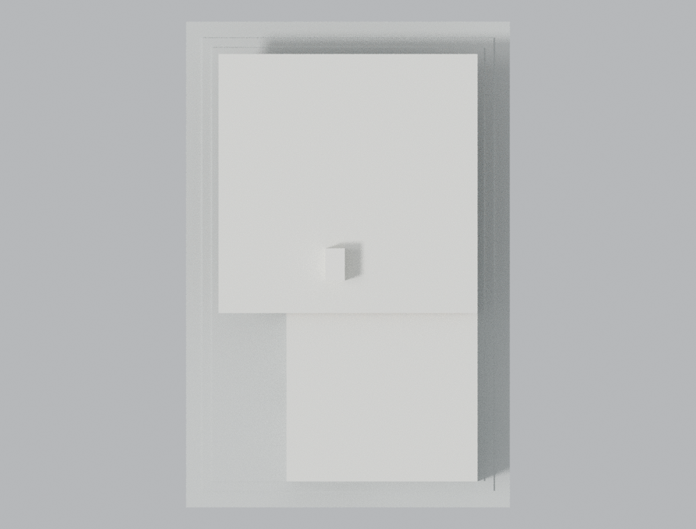

# 成功大學大新園東棟／學生藝文沙龍 1.0.0

本正式交付版已通過限定範圍的獨立幾何、完整性與重現性審核。模型、場景、六張預覽、程式及數值證據與受審版本完全相同；[獨立審核摘要](INDEPENDENT-REVIEW.zh-TW.md) 說明條件與限制。原始法向診斷的 1,430 筆短弦仍維持 `passed=false`，局部背襯證據不等同所有方向壁厚通過，亦尚未完成實機列印。

## 實際 STL 正反視圖

以下兩張圖均由本包實際 STL 渲染；材質僅供構件辨識，來源照片不包含在模型包內。

| 模型預覽 | 模型預覽 | 模型預覽 |
| :---: | :---: | :---: |
| 正面斜視<br> | 背面斜視<br> |  |

[下載 STL](model.stl) · [Blender 場景](scene.blend) · [俯視圖](previews/top.png)

| 模型預覽 | 模型預覽 | 模型預覽 |
| :---: | :---: | :---: |
| 俯視圖<br> |  |  |

依公開圖面與實景製作的**整棟外觀近似模型**。範圍是成功校區大新園東棟的玻璃廳、混凝土服務尾端及主要地台；不包含另一西棟、舊官舍或跨園長廊。

本模型不是測繪、施工圖或2026現況數位分身。尺寸來自公開立面上的公尺比例尺與平面交叉估算，合理誤差約0.2公尺以上；不能把列出的數值當作實際丈量結果。

## 模型內容

- 約1:200，單位毫米；底座100 × 150毫米，含底座總高31.1毫米
- 主屋頂外緣約16 × 16公尺，玻璃牆約12.2 × 12.2公尺，保留深挑簷與可見正交木格梁
- 南服務低屋面約11.8 × 12.4公尺，主體南北約10.4公尺，偏東退縮並含接合段；兩屋面投影約重疊2公尺
- 主屋頂頂約4.0公尺、低屋頂約3.2公尺；主要白色百葉屋突頂約5.5公尺
- 屋突約1.2 × 2.0公尺，位於主屋頂靠南部分，兩短面表達水平百葉
- 北、東、西玻璃門群、主要窗框，東服務兩窗與退縮單門、西側方窗與上下百葉、南側設備凹槽及東南轉角窗
- 主要地台階差；未重建整個園區的路面、植栽或通道

主屋頂16 × 16公尺指屋簷外緣，不是玻璃牆外緣。服務體的偏移與較低屋面有刻意保留，並非兩個同寬盒子相接。

## 為列印所作的化簡

- 玻璃以有實體背襯的淺凹面表達，內部填實，不提供透明玻璃或可進入室內；窗框／柱列表達為背靠牆面的直立肋
- 屋面薄板增厚至1.0毫米，木格梁寬1.0毫米；一般窗框0.9毫米、轉角加寬，避免薄根或零厚度接合
- 門把、細部金屬接頭、混凝土模板孔與細縫省略
- 屋突百葉與窗面是淺凹浮雕，並非貫穿孔；浮雕深度不能解讀成獨立壁厚
- 屋面主形依圖面保留水平簷口；未見的排水微坡、防水分縫、小管件與小型機電省略
- 南設備凹槽保留外形；圖面有百葉、早期實景有外露機組，模型不塑出機器，也不宣稱當前設備狀態
- 地台與階差為列印化簡，不等同現地所有無障礙坡度與排水高程

## 列印建議與限制

建議0.4毫米噴嘴、0.2毫米層高，底座平放。格梁與深挑簷包含懸挑，請在切片軟體檢查並依設備加支撐，尤其玻璃牆外的屋簷底部、服務接合段和凹槽上方。可用PLA、15–20%填充、至少3圈外牆作為起始設定；這些是試印起點，不是已完成實機試印的保證。

不得直接縮小後沿用通過結果。若改比例、梁寬、窗框或底座，請重新執行驗證與切片。

## 檔案與重建

- `model.stl`：單一有效封閉外表面，已輸出實體，單位毫米
- `scene.blend`：直接匯入同一STL原始三角面；無幾何修改器或其他裝飾網格
- `previews/`：同一STL的正反、東西側、俯視及東側正投影近圖。材質色只是辨識輔助，STL本身沒有顏色
- `build_model.py`、`parameters.json`：參數化來源程式及主要尺寸
- `check_raw_mesh.py`、`check_component_detail.py`：原始三角面拓樸與每0.2毫米剖面／逐Polygon 0.8毫米開運算
- `sources.json`：可追溯網址、日期與證據限制；不附原始來源影像
- `SHA256SUMS`：交付檔案校驗碼

環境：Python 3、`requirements.txt` 中的套件；完整數值重跑另需 g++（C++17／OpenMP），渲染使用 Blender 4.3.2。收到封裝後的唯讀完整驗證：

```
python validate_model.py
```

完整重建與數值重跑只在可寫副本進行，步驟見 `QA.md`；所有 Blender Python 指令必須使用 `--python-exit-code 1`。

嚴格原法向檢查共 41,580 點，1,430 點小於 0.8 毫米，最短約 0.400 毫米，原始報告保留 `passed=false`。這些點的固定區域根部、背襯與材料／空氣區間另有逐筆證據，未當作全局豁免，也不宣稱每一方向均有 0.8 毫米厚度。完整限制與證據鏈見 `QA.md`。

STL輸出座標為+X東、+Y北、+Z上；程式中的建築平面參數採X東、Y南，輸出時轉成右手座標並同步調整面繞序，避免鏡像誤置。

驗證直接讀STL原始面，不執行修補、刪面或頂點四捨五入。逐層形態開運算只是XY平面細部篩檢，不等於所有方向最小壁厚證明，也不取代切片和試印。

## 公開來源

- [設計者Dwell作品頁](https://www.dwell.com/home/ncku-art-lounges-da-hsin-yuan-e16dffbd)：1F平面、BB剖面及西立面
- [ArchDaily作品頁](https://www.archdaily.com/1033380/ncku-art-lounges-da-hsin-yuan-mayu-architects)：2025-08-23發表，東、北、南立面與剖面
- [建築師雜誌作品資料](https://www.twarchitect.org.tw/works/成功大學大新園/)：施工2021/10–2022/12，全案高度資訊
- [校方2700西側實景](https://material.ncku.edu.tw/picture.php?/2700)、[2694東側實景](https://material.ncku.edu.tw/picture.php?/2694)、[2698南側凹槽](https://material.ncku.edu.tw/picture.php?/2698)、[2702東南角](https://material.ncku.edu.tw/picture.php?/2702)、[2906整體斜角](https://material.ncku.edu.tw/picture.php?/2906)

查證日期：2026-10-15。發布／上傳日期不等於攝影日期。部分圖面外部標題與圖內定位箭頭不符，棟別按圖內位置與門窗節奏交叉判讀。校方2905未作本模型直接幾何證據。

原照片與建築圖面權利屬原權利人，模型包不重新散布它們。此模型不是校方或設計者認可的官方成果。
