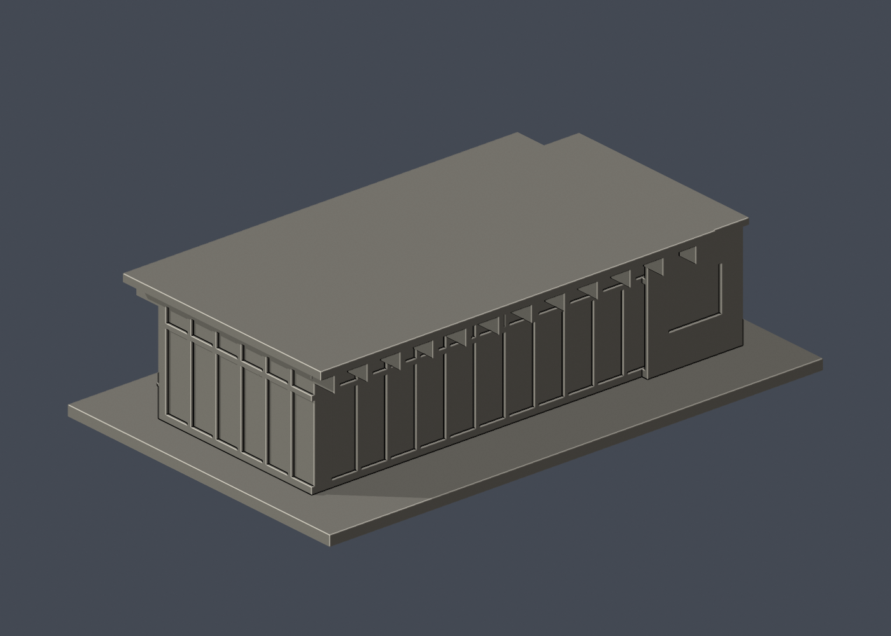
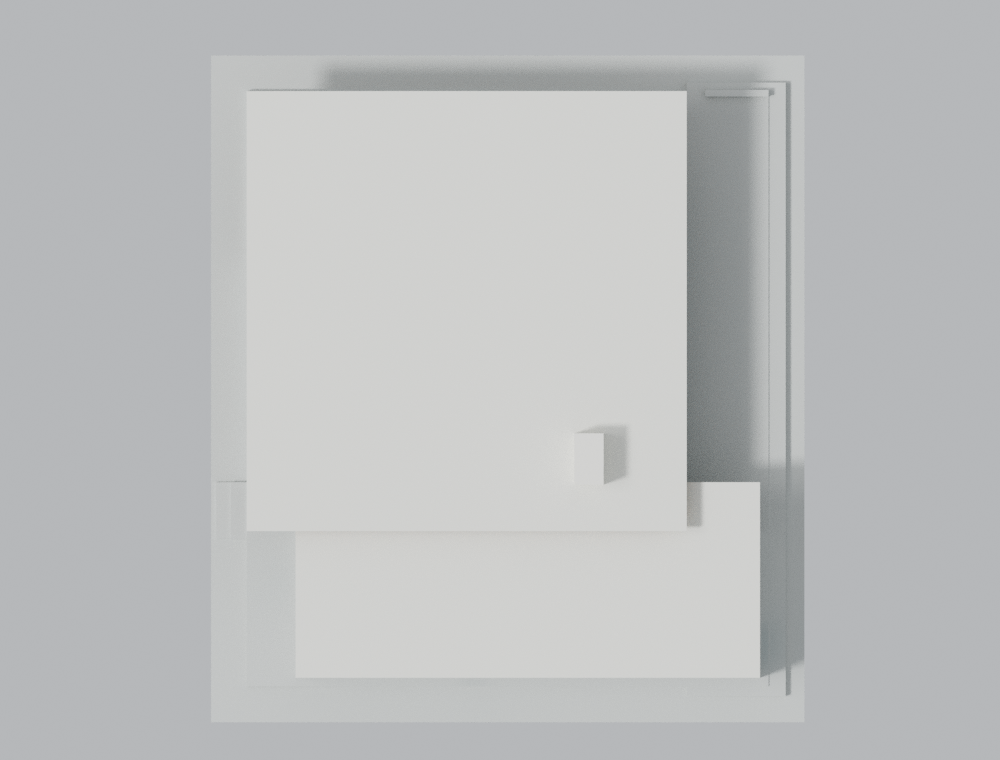

# 國立成功大學大新園西棟：校友會館外觀近似模型

正式交付版 2.0.0。本包以已通過獨立技術審查的 2.0.0-rc3 為基線，原始 STL、Blend、六張 PNG、建構／驗證程式、參數與數值證據均保持不變。僅新增[獨立審查摘要](ncku-west-pavilion-v2-independent-review.md)，更新交付說明與完整性清單。未做實體試印。

## 實際 STL 正反視圖

以下兩張圖均由本包實際 STL 渲染；材質僅供構件辨識，來源照片不包含在模型包內。

| 模型預覽 | 模型預覽 | 模型預覽 |
| :---: | :---: | :---: |
| 正面斜視<br> | 背面斜視<br> |  |

[下載 STL](model.stl) · [Blender 場景](scene.blend) · [俯視圖](previews/top.png)

| 模型預覽 | 模型預覽 | 模型預覽 |
| :---: | :---: | :---: |
| 俯視圖<br> |  |  |


依 MAYU architects 公開的 2022 建成案圖面與照片，重建成功校區大新園西棟（Alumni Club）。這是適合小比例實體製作的外觀近似模型，並非測繪、BIM、施工圖、室內模型或 2026 現況紀錄。

## 交付內容

- `model.stl`：毫米單位、單一封閉實體，包含地台與底座。
- `scene.blend`：直接保存同一 STL 原始三角面，沒有幾何修改器、外部貼圖或參考照片。
- `previews/`：由實際 STL 產生的西北斜視、東南斜視、東／西／南立面與俯視 PNG。
- `build_model.py`、`parameters.json`：可重跑的參數化 CSG 建構程式。
- `sources.json`：逐項來源、圖面位置及用途。原照片與圖紙不隨模型散布。
- `QA.md`、檢查程式與 JSON／壓縮逐樣點資料：作者驗證、失敗偵測控制與適用限制。

## 尺度與建築辨識

底座為 133.5 × 150.0 mm，完整模型高約 33.775 mm。採等比例 5.5 mm/m，約 1:181.8；沒有為了底座獨立壓窄任何水平軸。

- 主要玻璃廳約 14 × 14 m，模型約 77 × 77 mm。
- 主屋頂約 18 × 18 m，模型實際 99 × 99 mm，保留四周深簷與木格梁。
- 南側服務主體約 19 × 6 m，向東偏出；低屋面總包絡約 19 × 8 m。北側約 2 m 接合帶只有退縮的連接體，沒有全填成大盒子。
- 主屋面約 4.05 m，服務低屋面約 3.15 m。屋面包絡約 21 × 24 m。
- 白色屋突約 1.2 × 2.1 × 1.4 m，保留南短面百葉。其存在由立面及實景交叉支持，不推斷機電用途。
- 北、東、西各保留三組雙扇落地門，位置依各面分別處理；另有東服務端落地大門、西側大直窗及退縮單門、南側窗門節奏、西面低牆與階差。

以上公尺數值是網路圖面比例尺反推值，並非圖上標註的施工尺寸。大水平尺寸誤差估計約 ±0.5 m，小高度約 ±0.2 m。門窗局部尺寸、梁間距及低牆位置亦作合理近似，不能宣稱精確到毫米。

## 來源與棟別核對

主要資料：[MAYU architects 提供的 ArchDaily 專案圖文](https://www.archdaily.com/1033380/ncku-art-lounges-da-hsin-yuan-mayu-architects)，記載建成年份 2022，照片署名 Yu-Chen Chao。頁面刊登時間不等於照片拍攝時間。完整圖像網址見 `sources.json`。

- 1F 平面左側編號 2 Alumni Club 是本模型西棟；右側 Student Salon 是不同建物。
- 東／西立面以圖內定位箭頭與開口節奏判讀，沒有只採外部圖片標題。西棟東面是服務大門、三組玻璃雙門；西面是大直窗與退縮門。
- 南、北立面含兩棟：南立面取圖左西棟，北立面取圖右西棟。
- CC 剖面穿西棟主廳與南服務體；DD 僅穿南服務條帶，沒有用 DD 誤定主廳寬度。
- Featured Image 與 `_YU_4006` 的後景直接顯示西棟白色矩形屋突；`_YU_4158` 的前景是西棟西北角。
- [成大校方西南角照片 2902](https://material.ncku.edu.tw/picture.php?/2902) 交叉核對西側直窗、南側橫窗與低牆。

本版重新建構西棟幾何，未延用過往狹長主頂，也未套用東棟尺寸。校方 2905 是東棟照片，未用作本版西棟幾何依據。

## 列印與簡化

- 玻璃做成有厚實背材的淺凹實面；門扇不活動，模型內部實心。PNG 的材質色彩只用於辨識構件，不代表 STL 含顏色或透明材質。
- 細框、梁及低牆作列印加粗。主窗框約 1.0 mm、格梁寬約 1.05 mm、主屋面片厚約 1.15 mm、低屋面片厚約 1.10 mm。
- 建議底座朝下。約 11 mm 深挑簷及屋簷格梁需在切片軟體檢查懸空與支撐；不能只因封閉有效就選擇無支撐列印。
- 可用 0.4 mm 噴嘴、0.16–0.20 mm 層高作切片起點，須自行確認支撐接觸面、框線、首層與材料設定。縮小列印會一起縮薄細節。
- 未做實體試印；數值檢查不是特定機器、材料或列印成功率保證。

省略室內家具、商家招牌、植栽、鄰棟、保留官舍、跨園長廊、管件及無法確認的屋面排水細節。屋頂表面的精確微坡、分縫與零星設備沒有完整俯視證據。南面主要根據設計立面／剖面，未聲稱以完整現況實景核對每個開口。局部地形與東西地台階差有簡化。

## 重建與驗證

使用 Python 3.11 以上、`requirements.txt` 所列套件，Blender 4.3.2 與可編譯 C++17 的 g++。在此資料夾執行：

```sh
export PYTHONDONTWRITEBYTECODE=1
python -B build_model.py
blender -b -t 1 --python-exit-code 1 --python render_preview.py
python -B run_checks.py
```

`run_checks.py` 會對既有 STL 進行原始面、水密拓樸、每 0.2 mm 層的逐 Polygon 0.8 mm 開運算、原始面密集法向、負控制、場景一致性與隔離重建／六向重渲染檢查。所有必須成立的條件使用明確例外或非零退出，不會因 `python -O` 移除 assert 而失效。Blender 子程序指定 `--python-exit-code 1`。

最後彙總會重新掃描實際交付檔案，核對圖片、說明文件、來源與檢查程式的當前內容雜湊；舊的通過報告不能替代現況驗證。細節見 `QA.md`。

正式交付來源為本 ZIP 的檔案清單。重跑請先解壓至另外的乾淨目錄，保留上述禁止產生 Python bytecode 的設定；重新打包時不得加入 `__pycache__`、`.pyc`、原始參考照片或執行環境快取。建構參數與場景保留審核候選版本標記，以便追溯同一份已驗證幾何。
