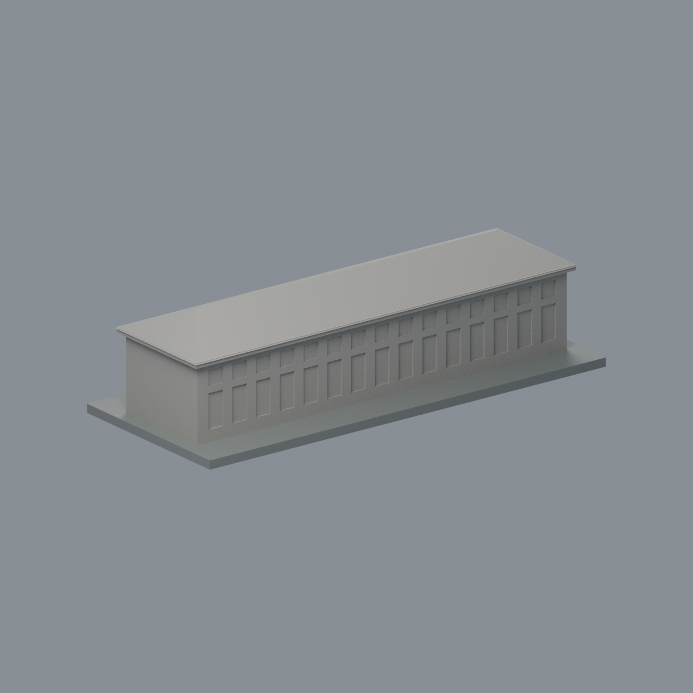
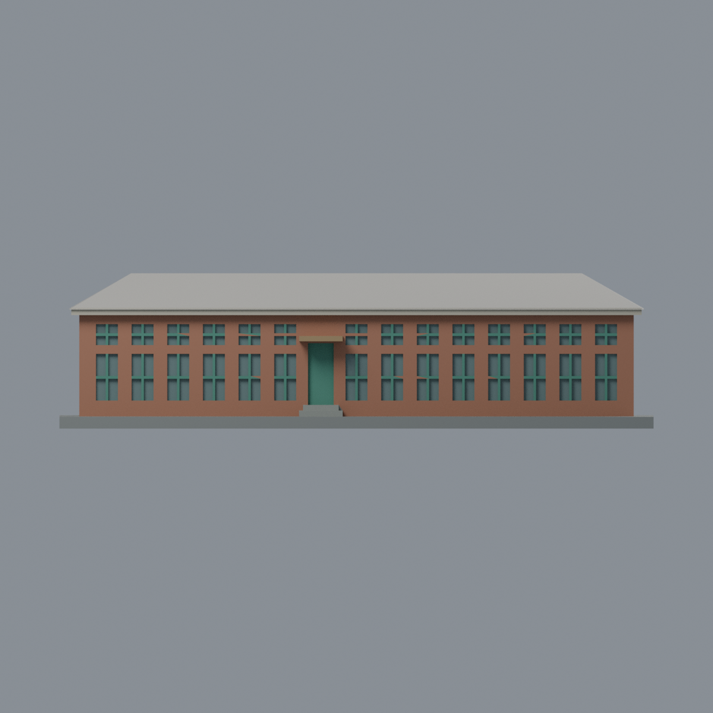
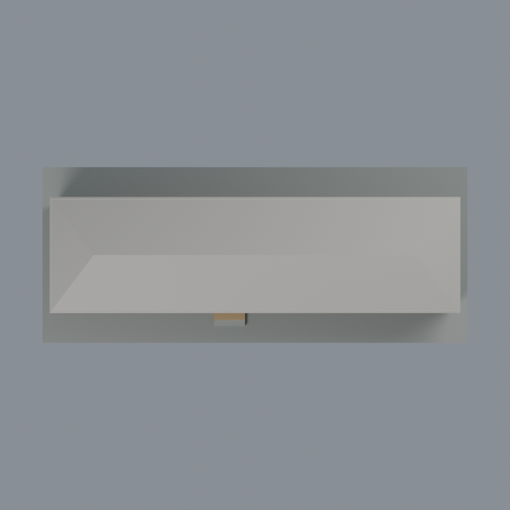

# 成大舊物理南館：八材質外觀版

沿用原 **2,436 三角面／1,220 頂點**，不改原 STL 位元、座標、面序或幾何；這是既有模型外觀改版，不增加模型包數。

| 模型預覽 | 模型預覽 | 模型預覽 |
| :---: | :---: | :---: |
| 正面  | 背面保持中性  |  |
|  |  |  |

[表面色 3MF](physics-appearance.3mf) · [可編輯 Blender](scene.blend) · [材質色表](palette.json) · [逐面指派與依據](face-materials.json) · [原 STL](../model.stl)

## 來源與配色邊界

親自查看校方素材網[正面頁](https://material.ncku.edu.tw/picture.php?/2964)的[照片](https://material.ncku.edu.tw/_data/i/upload/2023/11/13/20231113092606-6a3f71a8-me.jpg)，及[門口頁](https://material.ncku.edu.tw/picture.php?/2965)的[照片](https://material.ncku.edu.tw/_data/i/upload/2023/11/13/20231113092831-3e2219d2-me.jpg)，兩者署名計網中心教學科技組郭淑芬，上架日 2023-11-13。內嵌 EXIF DateTimeOriginal 分別為 **2023-11-12 10:44:55** 和 **2023-11-12 10:47:33**；時區與拍攝時間未獨立核實。不拿上架日當快門日期，不宣稱 2026 現況，照片不隨模型散布。

- 僅正面紅棕磚牆；原雙列凹窗間的細實心窗梃與內緣青綠色，凹窗背面灰綠玻璃代理。照片中部分窗扇打開見黑影，本件不把黑影當黑玻璃，不改原窗格幾何。
- 原中央門凹面整體青綠作門扇代理；原網格沒有分出門的玻璃上格、下部木板及開啟扇，不另畫假分割或門把。
- 原門口雨棚暖赭色、階梯灰色、正面屋簷立緣淡暖灰。來源灰色牆基在原三角面中跨界，嘗試逐面指派會出現虛假斜角色塊，因此**沒有另畫完整灰牆基區**；該連續面沿原磚色代理，不宣稱精確材料邊界。
- 所有屋面、側端與背面保持中性；原背面推估重複凹窗不因已有幾何就延伸正面綠框色。未知部分不模仿現場後棟。
- 仍只有一層的舊物理南館段，不是照片背景較高的兩層後館。不增瓦片、招牌文字、設備、樹影、污漬或柏油路。展示底板不當現地鋪面。
- 色值未校正，屬來源可支持的展示近似，不是建材標準色或完整逐材質測繪。

[原幾何與來源界線](../README.md) · [本次來源與 EXIF 覆核](qa/source-review.json)

## 重建與核驗

安裝 [依賴](source/requirements.txt)，Blender 使用 4.3.2。由本資料夾上層提供原 model.stl：

1. `python appearance/source/build_appearance.py`
2. `python appearance/source/verify_exchange.py`
3. `blender -b -t 3 --python-exit-code 1 -P appearance/source/render_appearance.py`
4. `blender -b -t 3 --python-exit-code 1 -P appearance/source/verify_scene.py`

[獨立重建 ZIP](rebuild-source.zip)含原 STL、四支程式及依賴，不含第三方照片；不取代原建模腳本。[逐檔 SHA256](SHA256SUMS)

[交換／拓撲 QA](qa/exchange-validation.json)核對原座標與面序、全部面材質、單連通、有向水密邊、頂點 link 單環、正體積與零退化／重複面；lib3mf 嚴格讀取零警告，實際編輯單材質再存讀，其他材質及面指派不變。SDK 六位小數量化誤差另列。

[Blender 存讀與編輯](qa/scene-validation.json) · [渲染記錄](qa/render-manifest.json) · [獨立重建](qa/rebuild-validation.json)

## 製造限制照舊

尺寸仍為 150 × 62 × 39 mm；原 STL、建模程式、場景及歷史 QA 保留。原層檢與薄特徵檢查本次未重跑，不能由材質 QA 代替。

3MF 是同一網格的表面色，不是八個封閉分色實體、切片專案、噴頭映射或 G-code。切片 GUI、多材料路徑與實體列印未測；柱頭、屋簷、窗框及薄邊仍須評估材料、支撐及拆除風險，沒有保證可印或免支撐。
