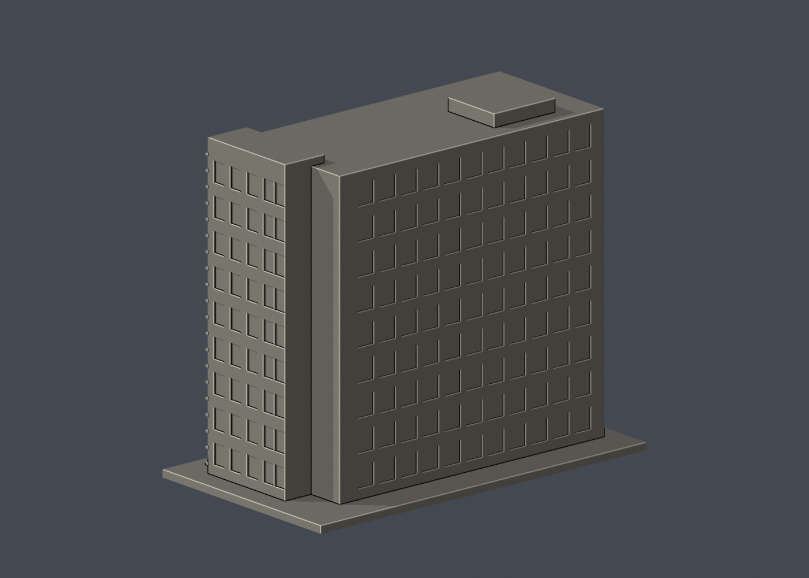

# 國立成功大學｜理學教學大樓北棟高層量體（化學棟）

## 模型預覽

| 模型預覽 | 模型預覽 | 模型預覽 |
| :---: | :---: | :---: |
|  |  |  |

第九批；成功校區。尺寸 150 × 86 × 129 mm，含底座最長邊150 mm；各件獨立比例。


## 公開來源與像素檢視

- [設計建築師作品頁](https://eds-tw.com/eds_projects/國立成功大學理學院大樓/)：確認北棟化學及北側U型玻璃外表皮，與南棟、共用門廳分置。
- [校方GIS：北棟外立面](https://db.nckumap.ncku.edu.tw/nckugis/public/uploadfiles.htm?action=listImg&q=38124)：已檢視規則直列深窗與右側全高玻璃階梯塔；前方低灰色塊為共享連接部分，未包括。
- [校方素材網：理學教學大樓](https://material.ncku.edu.tw/picture.php?/2466)：已檢視玻璃塔轉角與化學系周年布條，交叉辨識北棟；不建字樣或玻璃後的樓梯。
- [理學院：化學系](https://science.ncku.edu.tw/p/412-1016-21254.php?Lang=zh-tw)：核對新館位於理學教學大樓北棟；避免混入舊二層化學系館。
- [校方公開GIS外框](https://nckumap.ncku.edu.tw/map.php)：公開識別B104，只參考gis_base外部輪廓，沒有室內平面。
- [2026/1/30財產清冊](https://prop-oga.ncku.edu.tw/var/file/59/1059/img/4743/218075103.pdf)：核對成功校區及財產碼R1A-71-0；財產筆數不是獨立建物數。

## 範圍與近似

本件只作北棟長條高層主體及其全高玻璃端塔，排除共享低層門廳、南棟及鄰棟。與南棟共享R1A-71-0及GIS B104，不把兩件模型說成整組建物完成。正面依校方實景保留九層窗列與全高玻璃端塔的外格網；玻璃用有背板淺凹表現，沒有內部樓梯。另一側U型玻璃只有建築師文字佐證，無足夠完整像素，故保守簡化為淺直列窗帶，不宣稱玻璃片數準確。端部小折角、比例及屋頂高差近似，無屋頂設備。

## 交付與重建

- `model.stl`：毫米單位，與底座合成的單一實體。最長邊為 150 mm（含底座）；各棟獨立縮放，不適合直接拼成等比例校園。
- `build_model.py`：完整可攜參數化原始程式，無外部貼圖、私有路徑或參考照片依賴。
- `scene.blend`：由交付 STL 匯入，只有一個建築網格，可在 Blender 編輯頂點；細部參數請修改 Python 後重建。
- `previews/front.png`、`rear.png`、`elevation.png`：由實際交付 STL 產生。
- `validate_model.py`、`validation.json`：可重跑的幾何與重建驗證。

建議 Python 3.12，在虛擬環境執行：

```sh
python -m pip install -r requirements.txt
python build_model.py
blender -b -t 2 -P render_preview.py
python validate_model.py
```

已使用 Blender 4.3.2。驗證器在獨立臨時目錄重建 STL 並比較 SHA-256，讀取 Blender 場景的網格後比較三角形幾何。它檢查原始二進位 STL 儲存法線、面積、封閉性、邊恰有兩面、頂點連結為單一環、表面只有一個連通分量、正體積、底面位於 Z=0、最長邊 150 mm。單一封閉表面也排除獨立藏在內部的空腔殼；沒有宣稱完成所有自交的窮舉檢測。

## 製作原則與限制

這是依公開照片觀察製作的外觀近似收藏模型，不是測繪、修復、工程或精確 BIM 資料。牆身為實體，門窗、拱廊通常改成淺凹浮雕；不含室內、設備或安全配置。屋頂、深度、窗距及後側比例沒有測量基準，不能視為實際尺寸。原始參考照片未收錄、未重新授權或隨套件發布。來源權利屬原作者／校方；原創模型與程式可沿用儲存庫授權，不涵蓋外部參考照片。

## 列印說明

底座平貼平台，Z 軸向上。可從 0.4 mm 噴嘴、0.16–0.20 mm 層高、3 道外牆與 12–18% 填充開始試切片；這是設定建議，並非已測參數。小於約 0.8 mm 的淺浮雕可能因噴嘴或縮放消失。STL 是封閉實體，切片器仍會依填充率產生內部填充。

未實體試印、未執行切片器列印驗證，沒有保證免支撐。請依下列模型特有支撐需求檢查切片預覽。

端塔細外格、窗凹上緣可能需要局部支撐；小窗格可依實際切片解析度加粗。

## 截面抽樣

詳 `validate_sections.py` 及 `cross_sections.json`。0.20 mm抽樣水平輪廓閉合檢查，不是切片器工具路徑或實體試印。

查核日期：2026-10-13。


## 整合版截面與薄特徵補充驗證

本整合版使用固定共同邊方向後插值的 `validate_sections.py` 與 [0.2 mm 截面結果](cross_sections.json)，避免同一邊浮點方向差異造成假斷環。原始 STL 幾何未修改。舊截面程式有閉合斷言，既有通過結果不代表曾有破面；此處以新版重跑結果為準。

另提供 `check_thin.py` 與 [新增 0.8 mm 薄特徵輔助篩查](thin-feature-check.json)：每 1 mm 水平取樣，先確認輪廓閉合與有效，再作半徑 0.4 mm 形態開運算。這不是切片器、完整壁厚分析或實體試印，尖屋頂、銳角也會造成損失，不能據此宣稱無支撐或列印成功。執行前請安裝 requirements.txt。
