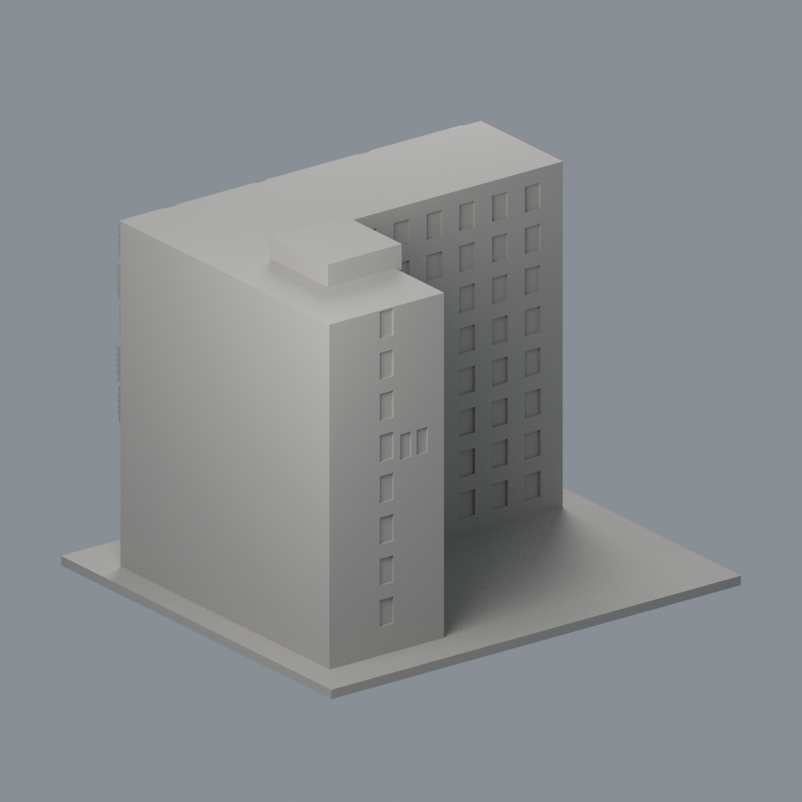
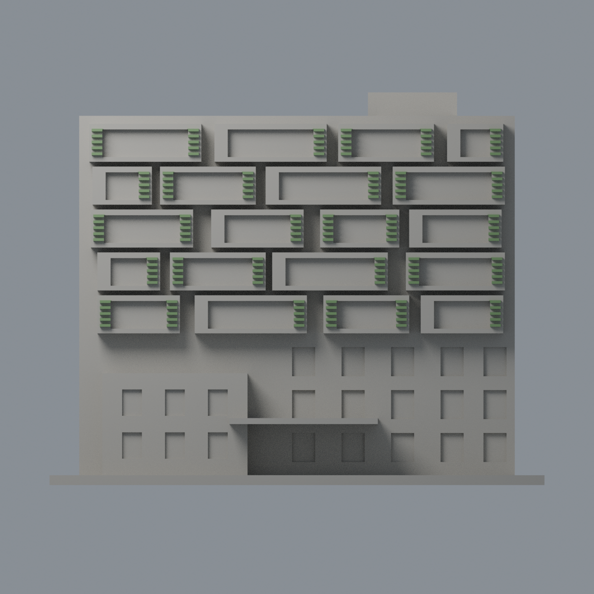
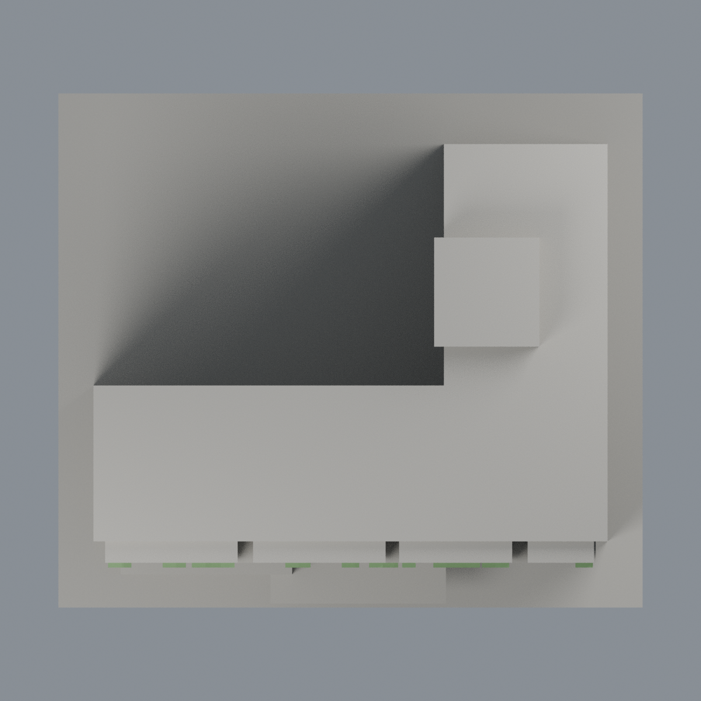

# 成大理學南高棟百葉構件限定配色：二材質外觀版

沿用原 **5,324 三角面／2,664 頂點**，不改原 STL 位元、座標、面序或幾何；這是既有模型外觀改版，不增加模型包數。

| 模型預覽 | 模型預覽 | 模型預覽 |
| :---: | :---: | :---: |
| 正面  | 背面保持中性  |  |
|  |  |  |

[表面色 3MF](nckuscisouth-appearance.3mf) · [可編輯 Blender](scene.blend) · [材質色表](palette.json) · [逐面指派與依據](face-materials.json) · [原 STL](../model.stl)

## 來源與配色邊界

親看成大官方校園 GIS 三張完整照片，核對原單色網格、預覽與生成器。[精確 URL、SHA、完整解碼及日期](qa/source-review.json)。[38126 正面](https://db.nckumap.ncku.edu.tw/nckugis/public/uploadfiles.htm?action=listImg&q=38126)為 800 × 600 日照，直接支持綠色百葉；38122 空拍及 38123 端部只核對同一 L 型高棟／端形，不冒稱也拍到綠百葉。模型只含理學南高棟，不含共同低入口或北高棟。

- 僅 150 個原獨立厚百葉盒、1,320 個原完整面採低飽和綠色；逐盒三頂點範圍及表面平面定位，沒有新增切面。原粗條的上下與側面依同構材質作有界延伸，不聲稱照片逐面皆可見。
- 實景百葉為較寬而密的整片細葉，原模型每組只留五支粗短條，左右配置也為概略節奏；配色仍保留這項簡化，不新增完整綠背板、不把間隔或白箱框一起染綠，不宣稱百葉密度／排布逐片復原。
- 原突出箱框保持中性；其大凹背是開放走廊與混合背牆，不當整片玻璃。其他窗背、低層磚／米色混牆、入口、端部、屋頂及未知面中性。中性色不是實景灰色還原，本版僅已識別百葉構件的材料研究。
- nested Original／Digitized／root Modified 在各照片內相同：38126 為 2018-10-04 11:07:07，38123 為同日 11:01:19，38122 為 2018-09-26 14:46:15。這是檔案 metadata，未獨立鑑定；不將檢查日或網頁路徑當拍攝日，不宣稱 2026 現況。來源照片私用、不入包。
- 原 STL 位元、座標、面序、建模腳本與歷史 QA 不變；不增加文字、設備、欄杆、植栽或紋理，未做實體列印測試。

[原幾何與歷史來源限制](../README.md)

## 重建與核驗

安裝 [依賴](source/requirements.txt)，Blender 使用 4.3.2。由本資料夾上層提供原 model.stl：

1. `python appearance/source/build_appearance.py`
2. `python appearance/source/verify_exchange.py`
3. `blender -b -t 3 --python-exit-code 1 -P appearance/source/render_appearance.py`
4. `blender -b -t 3 --python-exit-code 1 -P appearance/source/verify_scene.py`

[獨立重建 ZIP](rebuild-source.zip)含原 STL、四支程式及依賴，不含第三方照片；不取代原建模腳本。[逐檔 SHA256](SHA256SUMS)

[交換／拓撲 QA](qa/exchange-validation.json)核對原座標與面序、全部面材質、單連通、有向水密邊、頂點 link 單環、正體積與零退化／重複面；lib3mf 嚴格讀取零警告，實際編輯單材質再存讀，其他材質及面指派不變。SDK 六位小數量化誤差另列。

[Blender 存讀與編輯](qa/scene-validation.json) · [渲染記錄](qa/render-manifest.json) · [獨立重建](qa/rebuild-validation.json)

## 製造限制照舊

尺寸仍為 150 × 132 × 119 mm；原 STL、建模程式、場景及歷史 QA 保留。原層檢與薄特徵檢查本次未重跑，不能由材質 QA 代替。

3MF 是同一網格的表面色，不是各材質各自封閉的分色實體、切片專案、噴頭映射或 G-code。切片 GUI、多材料路徑與實體列印未測；柱頭、屋簷、窗框及薄邊仍須評估材料、支撐及拆除風險，沒有保證可印或免支撐。
