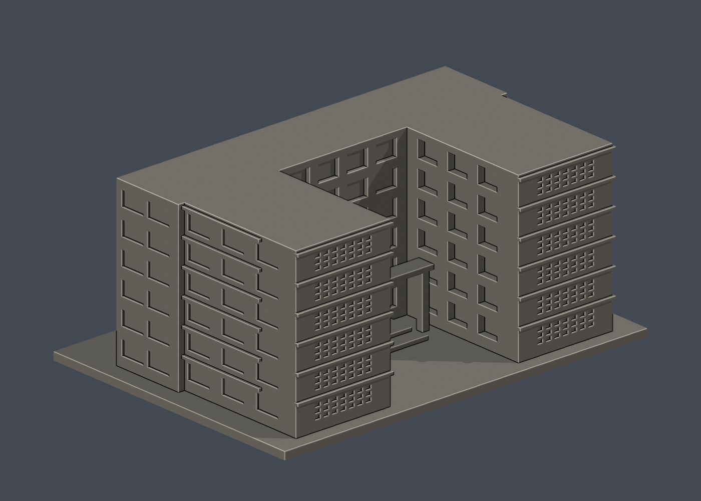
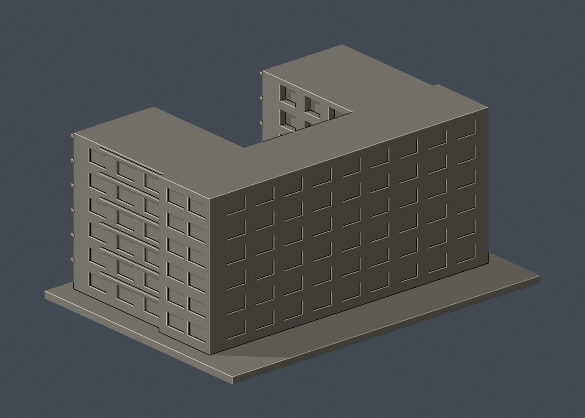

# 國立成功大學｜敬業校區教職員單舍

## 模型預覽

| 模型預覽 | 模型預覽 | 模型預覽 |
| :---: | :---: | :---: |
|  |  |  |

第八批；敬業校區。尺寸 150 × 108 × 65.9 mm，含底座最長邊150 mm，每件比例獨立。


## 公開來源與像素檢視

- [校方GIS：長面轉角](https://db.nckumap.ncku.edu.tw/nckugis/public/uploadfiles.htm?action=listImg&q=36504)：已檢視六層節奏、灰色水平帶、紅磚端面與前方退縮。
- [校方GIS：入口側](https://db.nckumap.ncku.edu.tw/nckugis/public/uploadfiles.htm?action=listImg&q=36503)：已檢視端部穿孔屏、深廊與入口粗柱。
- [資產保管組：敬業單房間職務宿舍](https://prop-oga.ncku.edu.tw/p/412-1059-18061.php?Lang=zh-tw)：確認宿舍名稱與用途；只採外觀照片，不採室內照片。
- [校方公開GIS建物範圍圖](https://nckumap.ncku.edu.tw/map.php)：建物識別F004，只參考外框圖層gis_base；未使用樓層室內配置。
- [2026/1/30校方財產清冊](https://prop-oga.ncku.edu.tw/var/file/59/1059/img/4743/218075103.pdf)：核對校區及校碼R2A-4-0。

## 範圍與近似

本件為校方GIS F004所示獨立U形建築，與學生敬一、敬三分開。保留U形外框、退縮入口、粗柱門廊、水平樓層帶與端部透孔屏。透孔以加大的7欄×3列淺凹格近似原有細密格網，不宣稱孔數與實物相同。樹木遮擋處、外框小折角及背面窗距簡化，未作室內走廊、居住空間或設備。未見屋頂俯視，採平屋面。

## 交付與重建

- `model.stl`：毫米單位，與底座合成的單一實體。最長邊為 150 mm（含底座）；各棟獨立縮放，不適合直接拼成等比例校園。
- `build_model.py`：完整可攜參數化原始程式，無外部貼圖、私有路徑或參考照片依賴。
- `scene.blend`：由交付 STL 匯入，只有一個建築網格，可在 Blender 編輯頂點；細部參數請修改 Python 後重建。
- `previews/front.png`、`rear.png`、`elevation.png`：由實際交付 STL 產生。
- `validate_model.py`、`validation.json`：可重跑的幾何與重建驗證。

建議 Python 3.12，在虛擬環境執行：

```sh
python -m pip install -r requirements.txt
python build_model.py
blender -b -t 2 -P render_preview.py
python validate_model.py
```

已使用 Blender 4.3.2。驗證器在獨立臨時目錄重建 STL 並比較 SHA-256，讀取 Blender 場景的網格後比較三角形幾何。它檢查原始二進位 STL 儲存法線、面積、封閉性、邊恰有兩面、頂點連結為單一環、表面只有一個連通分量、正體積、底面位於 Z=0、最長邊 150 mm。單一封閉表面也排除獨立藏在內部的空腔殼；沒有宣稱完成所有自交的窮舉檢測。

## 製作原則與限制

這是依公開照片觀察製作的外觀近似收藏模型，不是測繪、修復、工程或精確 BIM 資料。牆身為實體，門窗、拱廊通常改成淺凹浮雕；不含室內、設備或安全配置。屋頂、深度、窗距及後側比例沒有測量基準，不能視為實際尺寸。原始參考照片未收錄、未重新授權或隨套件發布。來源權利屬原作者／校方；原創模型與程式可沿用儲存庫授權，不涵蓋外部參考照片。

## 列印說明

底座平貼平台，Z 軸向上。可從 0.4 mm 噴嘴、0.16–0.20 mm 層高、3 道外牆與 12–18% 填充開始試切片；這是設定建議，並非已測參數。小於約 0.8 mm 的淺浮雕可能因噴嘴或縮放消失。STL 是封閉實體，切片器仍會依填充率產生內部填充。

未實體試印、未執行切片器列印驗證，沒有保證免支撐。請依下列模型特有支撐需求檢查切片預覽。

入口橫梁、內向深窗凹與水平樓層帶有懸垂，可能需要局部支撐；端部1.35mm高淺孔可能因切片設定變鈍。

## 逐層截面檢查

`validate_sections.py` 以0.20 mm間距抽樣實際STL水平交線，檢查端點節點度數及零長線段；見 `cross_sections.json`。這不是切片器工具路徑或實體列印驗證。

查核日期：2026-10-13。


## 整合版截面與薄特徵補充驗證

本整合版使用固定共同邊方向後插值的 `validate_sections.py` 與 [0.2 mm 截面結果](cross_sections.json)，避免同一邊浮點方向差異造成假斷環。原始 STL 幾何未修改。舊截面程式有閉合斷言，既有通過結果不代表曾有破面；此處以新版重跑結果為準。

另提供 `check_thin.py` 與 [新增 0.8 mm 薄特徵輔助篩查](thin-feature-check.json)：每 1 mm 水平取樣，先確認輪廓閉合與有效，再作半徑 0.4 mm 形態開運算。這不是切片器、完整壁厚分析或實體試印，尖屋頂、銳角也會造成損失，不能據此宣稱無支撐或列印成功。執行前請安裝 requirements.txt。
