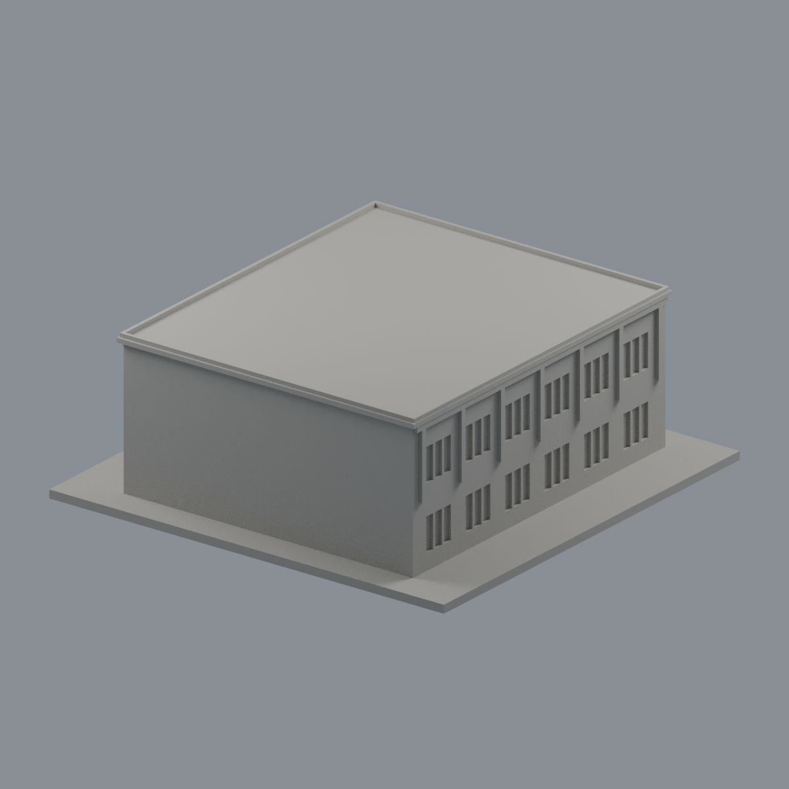
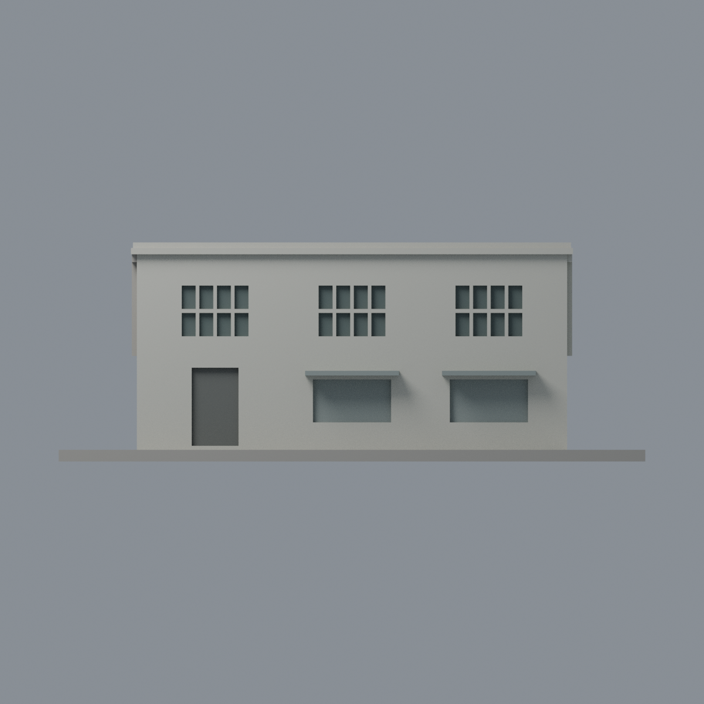
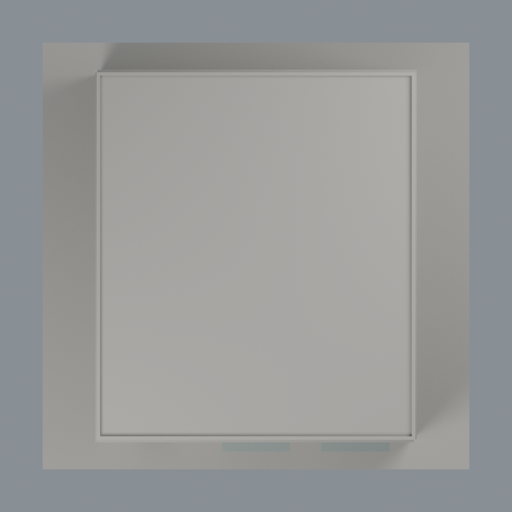

# 成大航太中心辦公大樓歷史有限配色：五材質外觀版

沿用原 **1,998 三角面／1,001 頂點**，不改原 STL 位元、座標、面序或幾何；這是既有模型外觀改版，不增加模型包數。

| 模型預覽 | 模型預覽 | 模型預覽 |
| :---: | :---: | :---: |
| 正面  | 背面保持中性  |  |
|  |  |  |

[表面色 3MF](nckuaero-appearance.3mf) · [可編輯 Blender](scene.blend) · [材質色表](palette.json) · [逐面指派與依據](face-materials.json) · [原 STL](../model.stl)

## 來源與配色邊界

親看成大官方 GIS 36581／36580 兩張完整照片、原單色網格與生成器。[精確 URL、SHA 與日期欄](qa/source-review.json)。雖然下載端點為 .htm，回傳確為完整 JPEG 而非 HTML 錯誤。兩照相機 Original 自報 2010-04-09 15:33:34／15:31:35，未獨立認證；這是 **2010 歷史外觀**，不是 2026 現況。照片私有研究，不入包。

- 範圍只為歸仁航太中心 I023 辦公大樓外觀，不包括相鄰研究設施、鐵皮棚或設備。短端左入口與兩灰捲門位置可註冊；主牆及原構件採暖白／灰，污漬、風化及樹影不是材料色。
- 短端上層原分格凹背為低飽和深灰窗代理；左下門口採深灰混合入口代理，不宣稱藍玻璃。**下方另兩個寬凹面是照片中的關閉金屬捲門，採中灰，不作玻璃**；未增加捲門細槽。兩個原扁平遮罩採灰色金屬近似，非重建精細折板。
- 36581 可見短端右長側，對應 x 正側。該側主牆、凸立柱與窗系統向遮蔽區作明示有界延伸；第二照片不被當成獨立證明反側。原鏡射的 x 負長側、未知後端、屋頂上面與基座中性，未沿用原幾何對稱去假稱兩側有來源。
- 本版正面相機改從 x 正側觀看，以呈現可註冊短端與右長側；不是鏡像／旋轉幾何。原窗數、兩排分格、兩長側對稱近似均保留，無實測精度。
- 不補原未建的細黑框、磁磚縫、空調、坡道、消防箱、人、植栽、文字或招牌；完整三角面直接賦色，不新增切面或斜色界。

[原幾何與歷史來源限制](../README.md)

## 重建與核驗

安裝 [依賴](source/requirements.txt)，Blender 使用 4.3.2。由本資料夾上層提供原 model.stl：

1. `python appearance/source/build_appearance.py`
2. `python appearance/source/verify_exchange.py`
3. `blender -b -t 3 --python-exit-code 1 -P appearance/source/render_appearance.py`
4. `blender -b -t 3 --python-exit-code 1 -P appearance/source/verify_scene.py`

[獨立重建 ZIP](rebuild-source.zip)含原 STL、四支程式及依賴，不含第三方照片；不取代原建模腳本。[逐檔 SHA256](SHA256SUMS)

[交換／拓撲 QA](qa/exchange-validation.json)核對原座標與面序、全部面材質、單連通、有向水密邊、頂點 link 單環、正體積與零退化／重複面；lib3mf 嚴格讀取零警告，實際編輯單材質再存讀，其他材質及面指派不變。SDK 六位小數量化誤差另列。

[Blender 存讀與編輯](qa/scene-validation.json) · [渲染記錄](qa/render-manifest.json) · [獨立重建](qa/rebuild-validation.json)

## 製造限制照舊

尺寸仍為 150 × 150 × 56 mm；原 STL、建模程式、場景及歷史 QA 保留。原層檢與薄特徵檢查本次未重跑，不能由材質 QA 代替。

3MF 是同一網格的表面色，不是各材質各自封閉的分色實體、切片專案、噴頭映射或 G-code。切片 GUI、多材料路徑與實體列印未測；柱頭、屋簷、窗框及薄邊仍須評估材料、支撐及拆除風險，沒有保證可印或免支撐。
