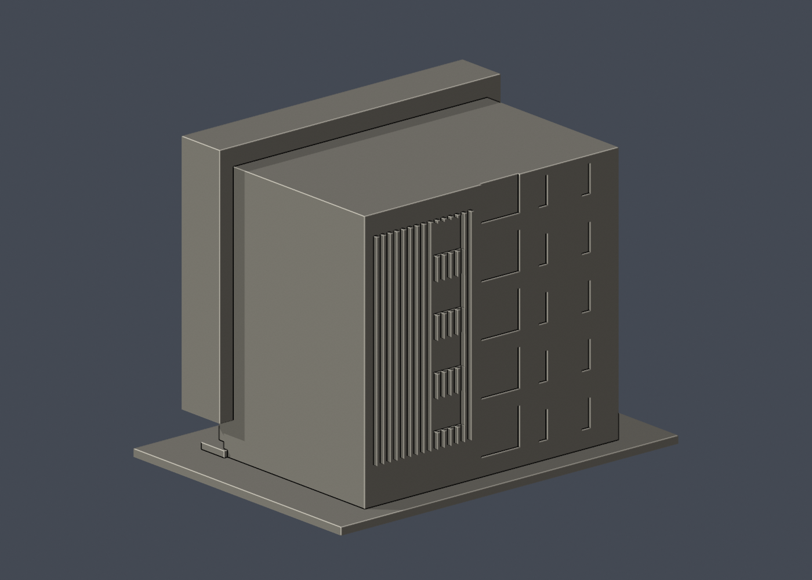

# 國立成功大學｜啟端館

第四批外觀近似模型；校區：自強校區。最長邊150 mm（含底座），各模型獨立比例。尺寸：150 × 109 × 115 mm。

| 模型預覽 | 模型預覽 | 模型預覽 |
| :---: | :---: | :---: |
|  |  |  |

## 公開來源及像素查核

- [校方啟用新聞及正面照片](https://web.ncku.edu.tw/p/406-1000-246541,r3374.php?Lang=zh-tw)：已檢視團體照背景的整體正立面：外周深框、玻璃幕牆、水平遮陽與低入口雨棚。確認獨立館名與自強校區位置。
- [校方素材網：另一立面](https://material.ncku.edu.tw/_data/i/upload/2023/02/23/20230223124720-c597293e-me.jpg)：已檢視窄窗與寬窗相鄰的淺色立面，不將旁邊紅磚樓併入。
- [校方素材網：轉角與格柵](https://material.ncku.edu.tw/_data/i/upload/2023/02/23/20230223124934-804b899b-me.jpg)：已檢視長條格柵、逐層露台與平屋頂的像素。

## 本件範圍、保留與近似

只作啟端館本體，不含左右化工、電機系館與地下部分。主入口立面保留深外框、退縮底層、立柱、玻璃開間及實體遮陽板；另一立面保留窄窗列、較寬玻璃帶與格柵帶。格柵加粗為1.2 mm，遮陽板厚1.5 mm。窗格與樓層間距為照片估算，玻璃、露台以實牆淺凹近似。兩側接鄰處與完整屋頂深度欠缺照片，採素面與平屋頂，不把相鄰紅磚樓當本館。

## 交付與重建

- `model.stl`：毫米單位，與底座合成的單一實體。最長邊為 150 mm（含底座）；各棟獨立縮放，不適合直接拼成等比例校園。
- `build_model.py`：完整可攜參數化原始程式，無外部貼圖、私有路徑或參考照片依賴。
- `scene.blend`：由交付 STL 匯入，只有一個建築網格，可在 Blender 編輯頂點；細部參數請修改 Python 後重建。
- `previews/front.png`、`rear.png`、`elevation.png`：由實際交付 STL 產生。
- `validate_model.py`、`validation.json`：可重跑的幾何與重建驗證。

建議 Python 3.12，在虛擬環境執行：

```sh
python -m pip install -r requirements.txt
python build_model.py
blender -b -t 2 -P render_preview.py
python validate_model.py
```

已使用 Blender 4.3.2。驗證器在獨立臨時目錄重建 STL 並比較 SHA-256，讀取 Blender 場景的網格後比較三角形幾何。它檢查原始二進位 STL 儲存法線、面積、封閉性、邊恰有兩面、頂點連結為單一環、表面只有一個連通分量、正體積、底面位於 Z=0、最長邊 150 mm。單一封閉表面也排除獨立藏在內部的空腔殼；沒有宣稱完成所有自交的窮舉檢測。

## 製作原則與限制

這是依公開照片觀察製作的外觀近似收藏模型，不是測繪、修復、工程或精確 BIM 資料。牆身為實體，門窗、拱廊通常改成淺凹浮雕；不含室內、設備或安全配置。屋頂、深度、窗距及後側比例沒有測量基準，不能視為實際尺寸。原始參考照片未收錄、未重新授權或隨套件發布。來源權利屬原作者／校方；原創模型與程式可沿用儲存庫授權，不涵蓋外部參考照片。

## 列印說明

底座平貼平台，Z 軸向上。可從 0.4 mm 噴嘴、0.16–0.20 mm 層高、3 道外牆與 12–18% 填充開始試切片；這是設定建議，並非已測參數。小於約 0.8 mm 的淺浮雕可能因噴嘴或縮放消失。STL 是封閉實體，切片器仍會依填充率產生內部填充。

未實體試印、未執行切片器列印驗證，沒有保證免支撐。請依下列模型特有支撐需求檢查切片預覽。

前面深外框、遮陽板、入口雨棚及底層柱間需局部支撐，請查看切片懸垂；細格柵為貼附實體浮雕，不是可穿透百葉。

## 抽樣逐層截面檢查

`validate_sections.py` 以0.20 mm間距抽樣實際STL，檢查平面交線每個節點度數為2及無零長線段。接近頂點平面時向下避開0.0173 mm，結果見 `cross_sections.json`。這不是切片器、支撐或實體列印驗證。

查核日期：2026-10-13。


## 整合版截面與薄特徵補充驗證

本整合版使用固定共同邊方向後插值的 `validate_sections.py` 與 [0.2 mm 截面結果](cross_sections.json)，避免同一邊浮點方向差異造成假斷環。原始 STL 幾何未修改。舊截面程式有閉合斷言，既有通過結果不代表曾有破面；此處以新版重跑結果為準。

另提供 `check_thin.py` 與 [新增 0.8 mm 薄特徵輔助篩查](thin-feature-check.json)：每 1 mm 水平取樣，先確認輪廓閉合與有效，再作半徑 0.4 mm 形態開運算。這不是切片器、完整壁厚分析或實體試印，尖屋頂、銳角也會造成損失，不能據此宣稱無支撐或列印成功。執行前請安裝 requirements.txt。
