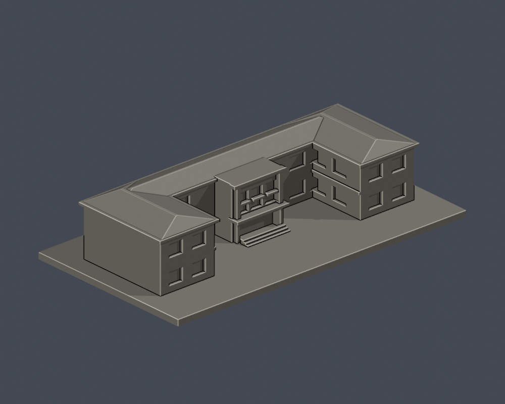
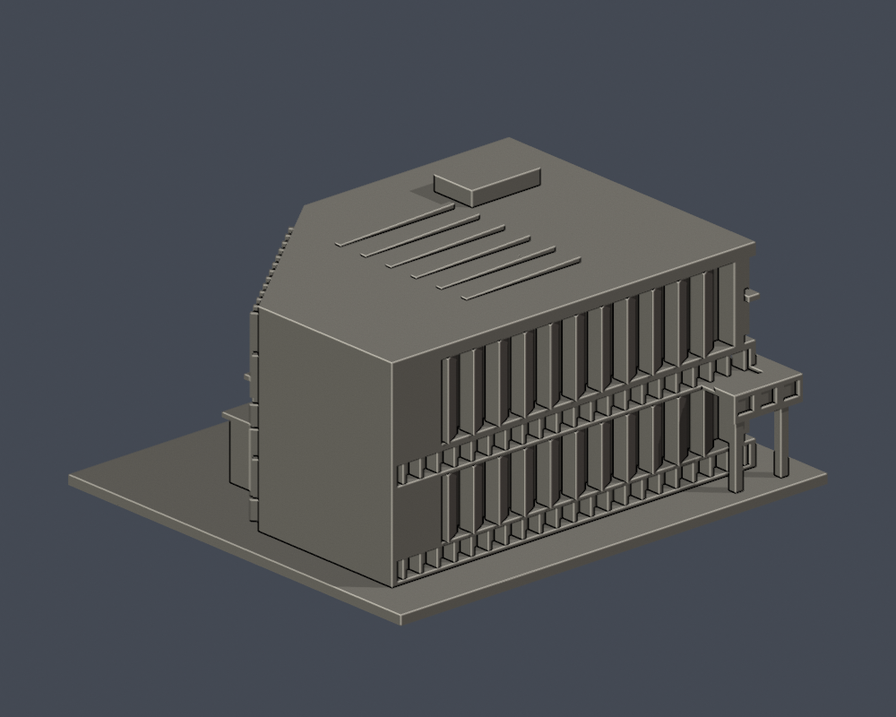
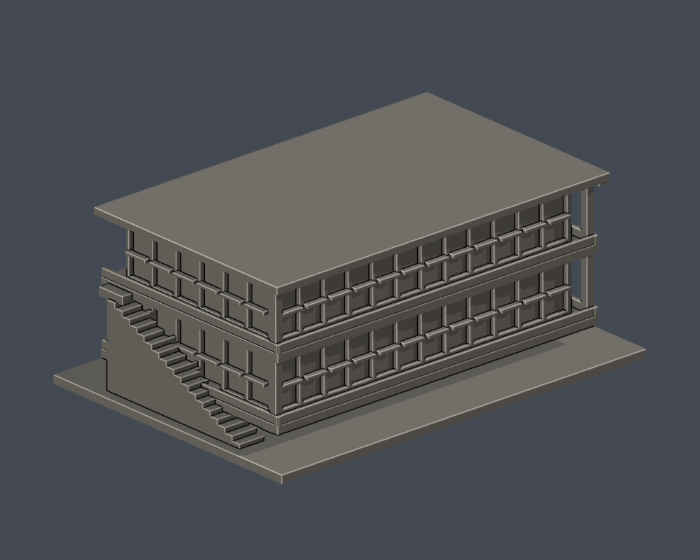

# 國立政治大學｜校園建築模型

目前8件完整建物外觀近似，山下6件、指南2件。全校、其他校區及實體試印未完成；不把官方地圖項目數、防災表數或使用單位數當獨立樓棟數。

| 建物 | 建物 | 建物 |
|---|---|---|
|    [果夫樓](山下校區/buildings/nccu-guofu/) |    [志希樓](山下校區/buildings/nccu-zhixi/) |    [四維堂（修復前外觀近似）](山下校區/buildings/nccu-siwei/) |
|    [達賢圖書館主棟](指南校區/buildings/nccu-seetoo-library/) |    [湖濱悅讀小屋](指南校區/buildings/nccu-lakeside-reading-house/) |    [井塘樓](山下校區/buildings/nccu-jingtang/) |
|    [中正圖書館](山下校區/buildings/nccu-zhongzheng-library/) |    [行政大樓](山下校區/buildings/nccu-administration/) |  |

[山下校區](山下校區/) · [指南校區](指南校區/) · [覆蓋範圍](coverage.json) · [精確續接清單](research-handoff/)

每件含底座最長150mm，各館獨立比例，依公開實拍和平面外輪廓自建，非測繪。各頁有实际STL正背、俯視、STL、可編輯Blend、重建來源、來源URL、驗證與逐檔SHA。

四維堂為修復前近似；達賢主棟與獨棟湖濱小屋各一件，空橋未納入。未知後立面及細件簡化逐件註明。

主要校區為山下、山上、指南、化南及金華公企中心；桃園創新校區另列籌設/已建成範圍待核。附中、附小、幼兒園非高教用途另判。
