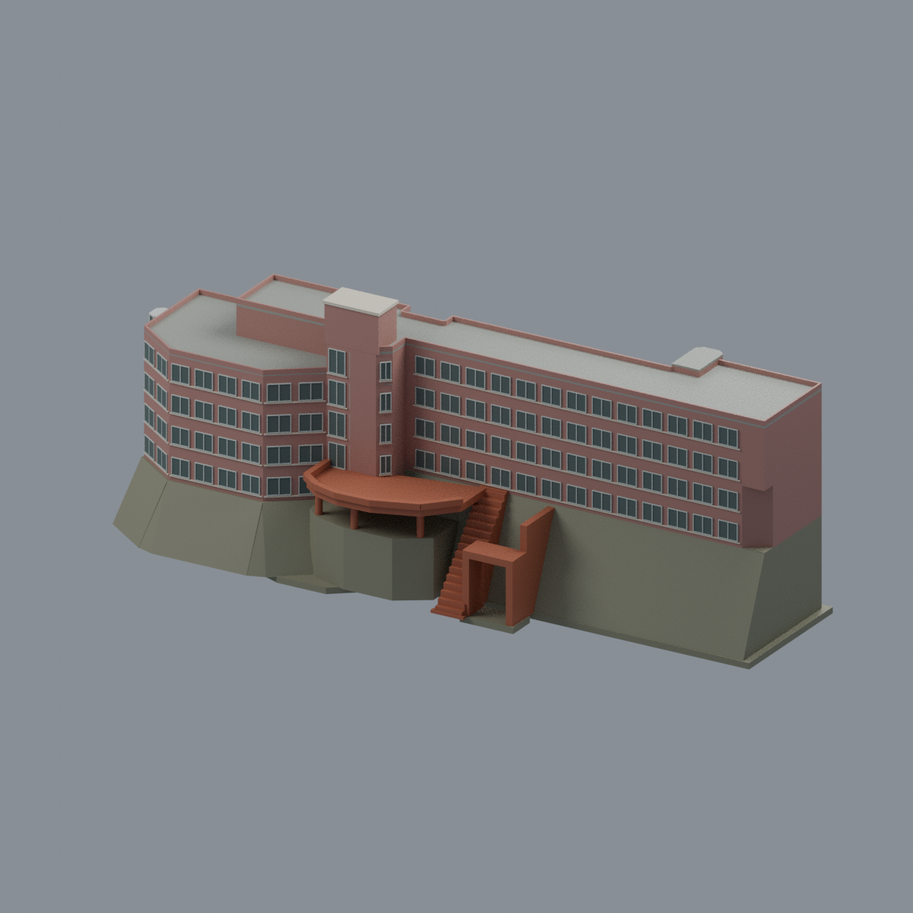
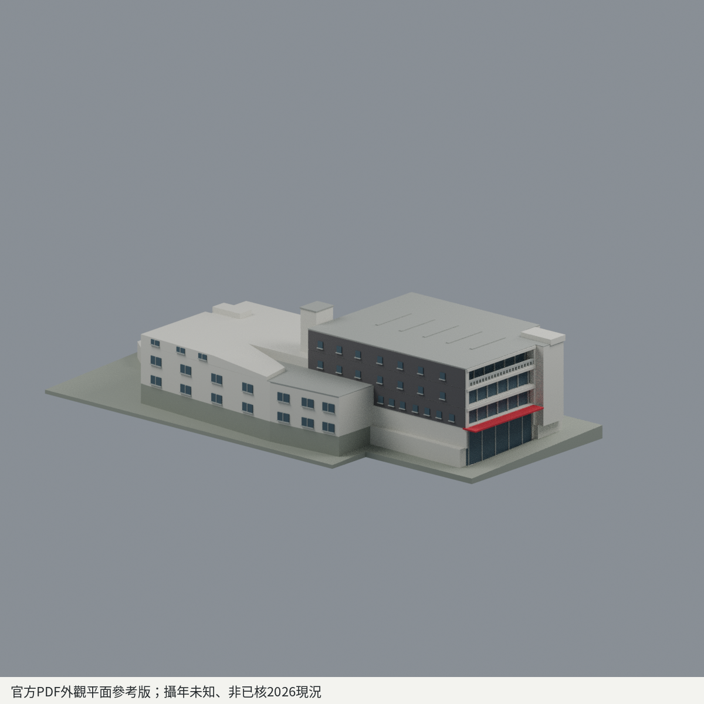
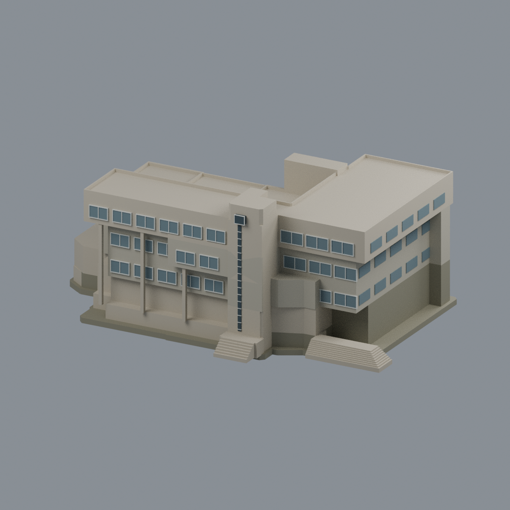

# 國立政治大學｜校園建築模型

目前17套建築外觀近似模型：山下10套、山上4套、指南2套、金華1套；金華公企中心住宿棟、會展棟與公共連接合計一套。全校、其他校區及實體試印未完成；不把官方地圖項目數、防災表數或使用單位數當獨立樓棟數。

| 建築模型 | 建築模型 | 建築模型 |
| :---: | :---: | :---: |
|    [果夫樓](山下校區/buildings/nccu-guofu/) |    [志希樓](山下校區/buildings/nccu-zhixi/) |    [四維堂（修復前外觀近似）](山下校區/buildings/nccu-siwei/) |
|    [達賢圖書館主棟](指南校區/buildings/nccu-seetoo-library/) |    [湖濱悅讀小屋](指南校區/buildings/nccu-lakeside-reading-house/) |    [井塘樓](山下校區/buildings/nccu-jingtang/) |
|    [中正圖書館](山下校區/buildings/nccu-zhongzheng-library/) |    [行政大樓](山下校區/buildings/nccu-administration/) |    [公企中心整案（住宿＋會展＋公共連接）](金華校區/buildings/nccu-public-center-2021/) |
|  **[逸仙樓](山下校區/buildings/nccu-yixian/README.md)** |  **[風雩樓](山下校區/buildings/nccu-fengyu/README.md)** |  **[健康中心大樓](山下校區/buildings/nccu-health/README.md)** |
|  **[研究大樓 — 官方PDF記錄之修繕前瓷磚外觀版，非2026修繕後現況](山下校區/buildings/nccu-research-building/README.md)** |  **[季陶樓](山上校區/buildings/nccu-jitao-hall/README.md)** |  **[國際大樓](山上校區/buildings/nccu-international-building/README.md)** |
|  **[研究暨創新育成總中心（研創總中心）](山上校區/buildings/nccu-innovation-center/README.md)** |  **[傳播學院主樓](山上校區/buildings/nccu-communication-building/README.md)** |  |

[山下校區](山下校區/) · [山上校區](山上校區/README.md) · [指南校區](指南校區/) · [金華校區](金華校區/) · [覆蓋範圍](coverage.json) · [精確續接清單](research-handoff/)

各件獨立比例，尺寸見各模型說明，依公開實拍和平面外輪廓自建，非測繪。各頁有实际STL正背、俯視、STL、可編輯Blend、重建來源、來源URL、驗證與逐檔SHA。

四維堂為修復前近似；達賢主棟與獨棟湖濱小屋各一件，空橋未納入。未知後立面及細件簡化逐件註明。

主要校區為山下、山上、指南、化南及金華公企中心；桃園創新校區另列籌設/已建成範圍待核。附中、附小、幼兒園非高教用途另判。

公企中心為2021完工、依2021–2022公開影像建立的整案外觀近似，未聲稱2026現況或測繪精度；保留4個原法向共面邊界旗標，獨立審核僅作限定條件接受，不是全域壁厚或無支撐列印保證。尚未實體試印。詳見[模型與來源](金華校區/buildings/nccu-public-center-2021/)及[獨立審核摘要](inventory/qa/nccu-public-center-2021-review.md)。

[井塘樓前庭有限白牆／雨棚配色與五視角](山下校區/buildings/nccu-jingtang/appearance/README.md)（1404完整原面，其餘4772面中性；拍攝年代未知，非整樓現況全彩復原）。

## 模型版本與製造範圍

逸仙樓、風雩樓、健康中心大樓、研究大樓歷史外觀版、季陶樓為五套完整主要外觀比例近似模型；依官方PDF照片／逃生平面與各件列明的歷史來源交叉約束，非實測或已核2026現況。研究大樓為「官方PDF記錄之修繕前瓷磚外觀版，非2026修繕後現況」。校區依官方PDF第9頁正文與第10頁地圖圖例／位置聯讀：前四棟山下、季陶山上；不補猜精確門牌或測繪座標。各件可編輯Blend／3MF、STL、五張實際網格PNG及原byte重建來源ZIP；薄窗框／格柵、懸挑與封閉空腔等各件製造警示保留，未實印、不保證免支撐或全域最小壁厚。來源自身條款、署名及第三方權利見各模型使用範圍說明；來源照片／PDF／含來源像素比較圖不入公開包，非全校完成。

國際大樓、研究暨創新育成總中心（研創總中心）、傳播學院主樓為三套完整相連主樓比例近似模型，依官方PDF外觀照片與逃生平面交叉約束；照片攝年未知，非已核2026現況或實測。三棟山上分組依官方PDF第9頁正文與第10頁圖例／位置聯讀，不補猜地址或地理坐標。各件含Blend／3MF／STL、五張實際網格PNG、原byte可重建來源ZIP及獨立技術檢驗。國際大樓保留外殼與一個負向封腔，研創保留外殼與兩個負向廳腔；封腔可能困樹脂或令FFF內部支撐不可取。傳播主樓塔頂及窗格為明示粗化近似。各件薄框、壓頂、懸挑、切層薄警及有限法向取樣數值仍見QA，未實印、不保證免支撐、全域壁厚或可直接列印。來源條款、署名及第三方權利見模型說明，來源照片／PDF／含來源像素比較圖不入模型包；非全校完成。
