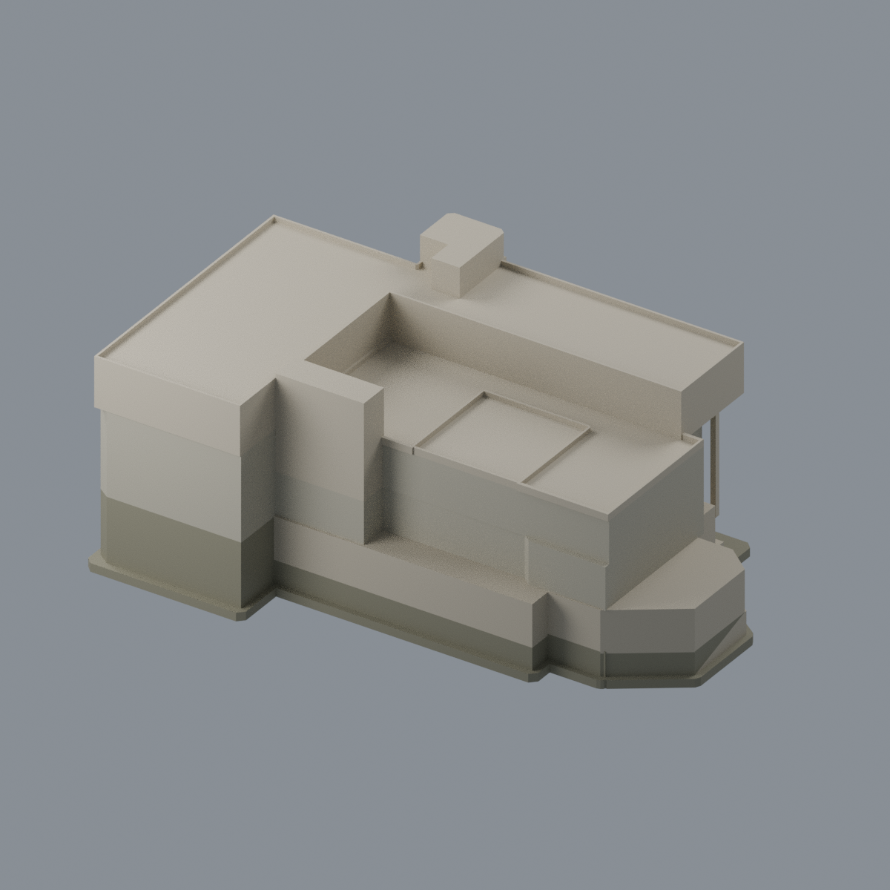
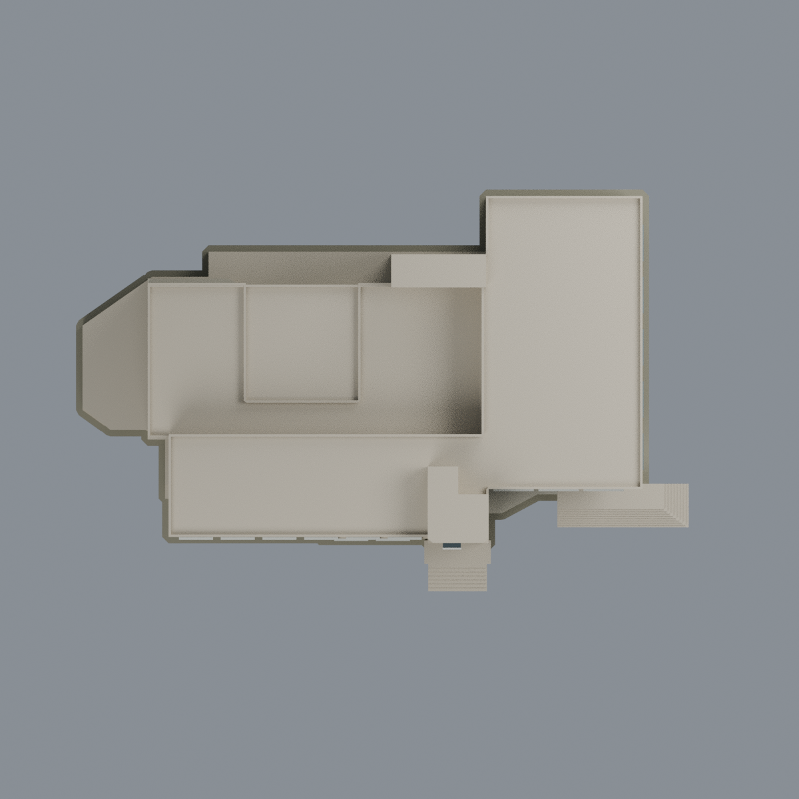

# 國立政治大學｜傳播學院主樓

## 模型預覽

| 正面 | 背面 | 頂視 |
| :---: | :---: | :---: |
|  |  |  |

[山上校區圖鑑](../../README.md) · [政大圖鑑](../../../README.md) · [全部模型](../../../../README.md)

官方 PDF 所記錄的外觀與平面參考版；照片攝年未知，非已核 2026 現況。不是實測模型，尚未實體試印，不稱可直接列印。

## 完整建築範圍
B1 寬廣左側下部、1–3F 寬廣主體、4F L 形教室翼、3F 低頂、前方共同梯塔、後方共同梯核、主入口平台與附屬階梯、1F 右側 L 轉角外階與局部坡地接觸。保留 4F 局部前挑、下層退縮與柱支承；中央低頂不是通地天井，2/3F 廳堂不挖通。前景獨立大門樓、相鄰紅磚樓、整座山坡及道路不納入本主樓模型。

## 檔案
- `scene.blend`：Blender 4.3.2 原生可編輯網格與多色材質。
- `model.3mf`：毫米制真網格、逐三角材質索引；可編輯頂點和材質。
- `model.stl`：單色幾何交換；STL 不含顏色、材質或透明度。
- `previews/`：實際模型的五張視圖，不是照片紋理或想像圖。
- `build_model.py`、`render_model.py`、`run_all_checks.py`：完整可執行來源與檢驗。

## 重建
使用 `requirements.txt` 的 Python 套件及 Blender 4.3.2。先執行 `python build_model.py`，再執行 `blender -b -t 4 --python-exit-code 1 --python render_model.py`，最後 `python run_all_checks.py`。不需來源照片、PDF、網路或工作目錄外的模型檔。乾淨重建比較 STL、3MF、mesh/palette JSON 及五張 PNG，Blend 以語意及真編輯存讀測試驗證，不宣稱容器位元組確定性。

## 解讀與限制
塔頂照片中的小折面凸窗以矩形凸箱粗化代理，並非照片中精確外形。

共同前梯為平面座標原點，圖面 X 向右、Y 向上，無地理方位或鏡射保證以外的羅盤宣稱。高度、地形、隱蔽小窗和屋頂小核高度為明示近似。前方窗帶按可見照片重建，背側細部不作實測宣稱。地形代理僅支承建築自然接地，並非新增地下教室。保留退縮空氣與屋頂凹部，未為單殼而填死必要空間。牆體內部作外觀實心代理，未建可使用室內。

沒有全域最小壁厚、無支撐或製造認證。細框、女兒牆、突出窗和懸挑底面須逐材質、噴嘴與切片支撐評估；截面及取樣薄件警告見 `QA.md`。

## 模型預覽與下載

[可編輯 Blend](scene.blend) · [彩色 3MF](model.3mf) · [單色 STL](model.stl) · [重建來源 ZIP](rebuild-source.zip) · [來源](SOURCES.md) · [數值檢驗及製造限制](QA.md)
