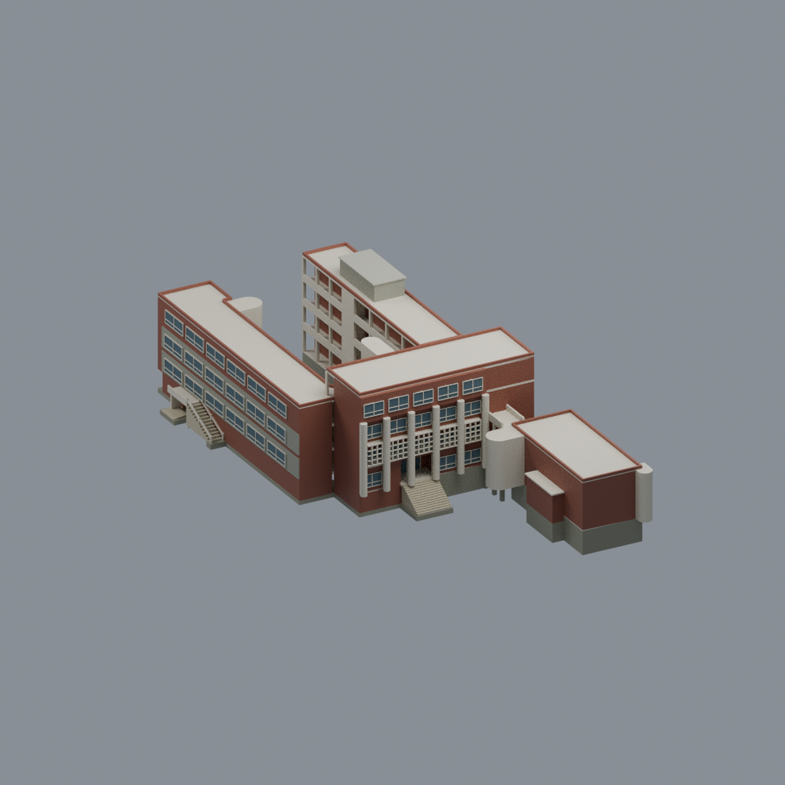
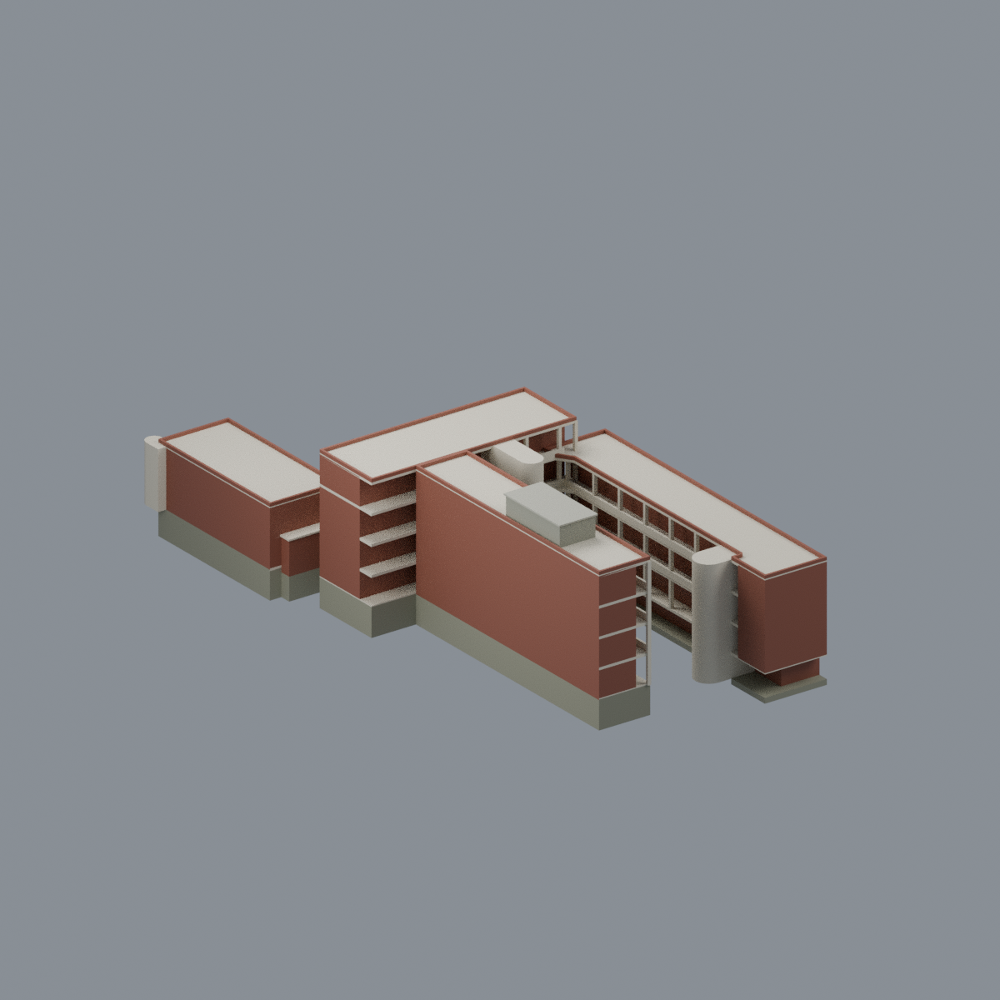
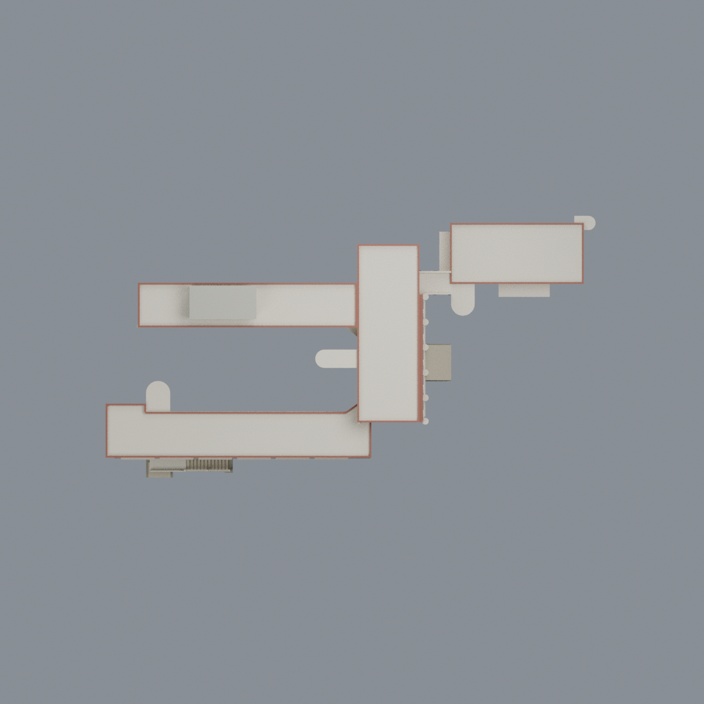

# 國立政治大學｜道藩樓

## 模型預覽

| 模型預覽 | 模型預覽 | 模型預覽 |
| :---: | :---: | :---: |
|  |  |  |

[山上校區圖鑑](../../README.md) · [政大圖鑑](../../../README.md) · [全部模型](../../../../README.md)

依官方防災資料所記錄之外觀與簡易配置製作的近似彩色模型。照片攝影年未知，**不是已核實的 2026 年現況測繪**。


## 範圍

保留完整 C 形主樓、局部地下層、上翼與側腿四層實房、下翼三層低頂、三處共同梯核、開放走廊、外側柱列與格屏、退凹入口及貼樓外階。窄廊連接兩層附廳，另保留附廳近端局部夾層、兩端圓梯，以及一樓獨有側房與下側突房帶。沒有把整個內庭填實，沒有將附廳拉成主樓四層。

各樓層以共同樓梯配準，不按整頁寬度各自縮放；斷廊的紙面留白不當作實際距離。窄廊長度、層高、細窗、局部屋突及有限貼樓坡地均為近似。沒有獨立屋頂實測圖，以四樓實房及有證低翼閉合主要屋面。

## 檔案

- `scene.blend`：可編輯網格、材質、相機與燈光。
- `model.3mf`：毫米單位、多材質及每面材質指派。
- `model.stl`：相同幾何；STL 不承載顏色或透明度。
- `build_model.py`、`render_model.py`：參數化生成器及實網格渲染。
- `previews/`：五張實模型預覽。
- `SOURCES.md`、`QA.md`：來源、近似範圍與數值驗證／製造限制。

模型尺寸約 208.75 × 111.50 × 59.19 mm，**不是實體建築尺寸**。玻璃以不透明藍灰浮雕表現，沒有原始照片貼圖。未見背面細窗保持中性，不鏡射已見立面。

## 列印限制

尚未實體試印。約 0.3–0.5 mm 格屏、細框、柱廊和窄廊底面須依尺度、材料及方向評估。附廳內部為近似空間代理，兩個封閉空腔不代表已取得室內測繪，也不等於圖示全層挑空；樹脂排液／通氣與 FFF 內部支撐尚未解決。水密與數值檢查**不等同可直接列印、無支撐或全域最小壁厚證明**。

## 重建

使用 Python 3.12、`requirements.txt` 所列套件與 Blender 4.3.2：

```sh
python build_model.py
blender -b -t 4 --python-exit-code 1 --python render_model.py
python run_all_checks.py
```

`python rebuild.py --output /新的空目錄 --blender blender` 可重建四個核心檔案及五張 PNG，再逐位元比較。無須重新下載原始照片或大 PDF。

屋面灰色圍護的數目、精確位置與用途未獲獨立屋頂圖確認；採單一有限屋面量體近似，**不表示已證實兩照為同一機房或樓梯間**。照片比較只檢查候選視角的手性、主要量體與遮擋可行性，不是精確相機配準。

## 模型預覽與下載

| 正面 | 背面 | 頂視 |
| :---: | :---: | :---: |
|  |  |  |

[可編輯 Blend](scene.blend) · [彩色 3MF](model.3mf) · [單色 STL](model.stl) · [重建來源 ZIP](rebuild-source.zip) · [來源](SOURCES.md) · [數值檢驗及製造限制](QA.md)

模型約 208.75 × 111.50 × 59.19 mm；尺寸、細窗及高程為比例近似。
