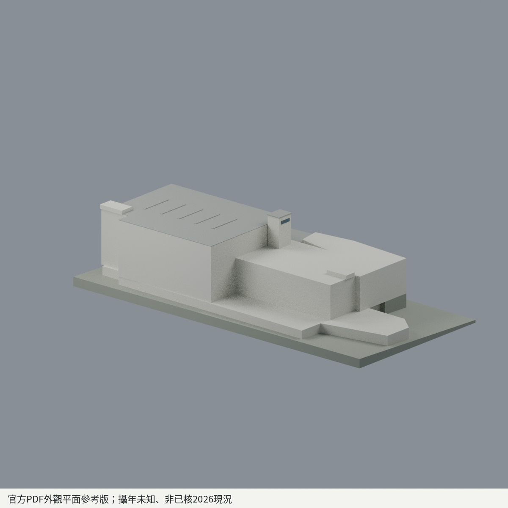
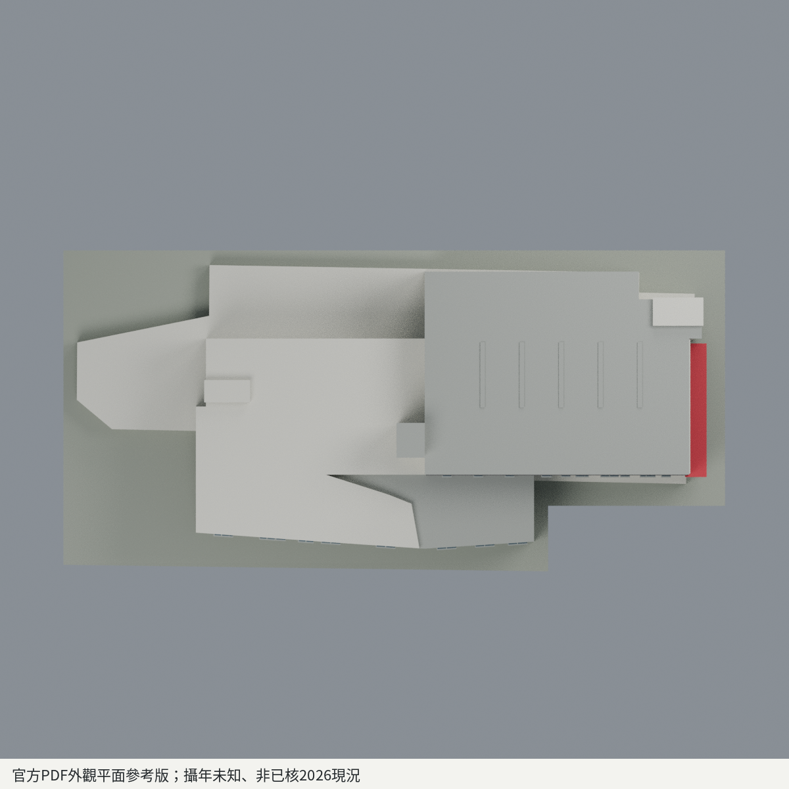

# 政大研創總中心

## 模型預覽

| 正面 | 背面 | 頂視 |
| :---: | :---: | :---: |
|  |  |  |

[山上校區圖鑑](../../README.md) · [政大圖鑑](../../../README.md) · [全部模型](../../../../README.md)
## 官方PDF外觀與平面參考版；照片攝年未知、非已核2026現況

完整相連主樓的來源約束簡化模型；不是實測竣工圖，也未做實體列印。研究暨創新育成總中心／產學營運暨創新育成總中心為本棟別名，不另算建築。

### 範圍與版本
B1+5F主樓。地下停車及機房不逐間建模、不額外露出一整層地下室。保留相連高低翼、1F西側附體、右下入口相鄰量體、紅色雨篷、共用電梯核及兩端梯核。左翼5F圖空白是較低屋頂；4F350425階梯教室保留有界斜頂代理，不被旁3F低屋面吞掉。R圖是真屋頂，不因p143表欄寫6F就新增第六層。

右2F展演廳與3/4F大X作有限封閉內腔，5F635㎡交流區是實樓板及占用量體、上有R屋頂，沒有鑽成通天中庭。左2/3F有限挑空亦保留，上部房間封頂。全體一個正向外殼及兩個反向封閉內腔邊界；不是三個漂浮實體，不為追求單表面殼填死來源挑空。

### 座標及近似
2F共用電梯與兩端梯核為基準，其他樓層以三個共同錨點仿射註冊並逐點描外輪廓；設計單位不是實測公尺。圖右+X、圖上+Y只是相對座標。841小窗深色長面暫定−Y，839淺色深水平帶端面暫定+X。兩面不能混成整翼深色，也不將一面窗列鏡貼全部背面。入口右下低量體按1F外皮保留；照片839低附體的精確對應仍屬限界近似，不宣稱房號或小X符號就是照片低盒。

不同圖版仿射殘差不能當作真實齒狀退台：高翼2F至R、左翼2/3F重複牆線依穩定2F共同外緣規整；1F附體、4F階梯教室/低屋頂/端梯凸出等實質變化不被統一消除，原始trace與實用輪廓均留數值。全樓共用樓層基準，只有左4F屋蓋局部降低作照片比例近似，不以左右不同樓高任意累加。839上三列外觀帶含頂層深退廊/欄杆；紅篷與下部兩層的外觀分帶標高未測，不據此刪樓板或填廳腔。

平面圖尺度/線寬與跨層外緣有差異；高度、窗數、細窗框、屋頂壓頂及材質RGB均為近似，不造測繪精度。未見背面保持中性簡化。R五條藍X僅以五條淺中性構件代理，功能未知，不命名太陽能板或天窗、不鑽穿全樓。小型坡地接地為近似展示基座，不是完整校園地形。來源圖像不作貼圖、不嵌入交付檔。

### 檔案與重建
`scene.blend`：毫米、單一可編輯網格與七種材質；`model.3mf`：原生base-materials及逐三角頂點屬性；`model.stl`：同一原始三角幾何，不攜色。`mesh.json`/`palette.json`提供可讀資料。五張PNG皆由實際網格渲染，非概念圖。

`build_model.py`以Boolean原始run材質來源直接匯出，不用最近面回塗。Python依賴見requirements；Blender4.3.2 CPU Cycles。`rebuild.py --output NEW_DIRECTORY`建立新目錄、實際重建4核心+5PNG並比對bytes。`run_all_checks.py`執行原始拓樸/SAT、切片、空實/薄壁取樣、封腔間距、3MF及Blend真編輯存讀、重開渲染。

### 製造限制
未實印、未保證可列印或免支撐。斜坡/懸挑、入口篷、細框、跨層外緣及階梯教室屋面需按機台切片檢視。封閉內腔可能困住樹脂/粉末；FFF封腔內支撐可能不可取，不能把未經評估的封腔模型視為任何工法均可印。切片成分侵蝕存活不等於全域最小壁厚認證，所有失敗及薄樣本保留於QA。

來源、日期、權利與包外修正見SOURCES.md；數值與實驗限制見QA.md。

## 模型預覽與下載

[可編輯 Blend](scene.blend) · [彩色 3MF](model.3mf) · [單色 STL](model.stl) · [重建來源 ZIP](rebuild-source.zip) · [來源](SOURCES.md) · [數值檢驗及製造限制](QA.md)
