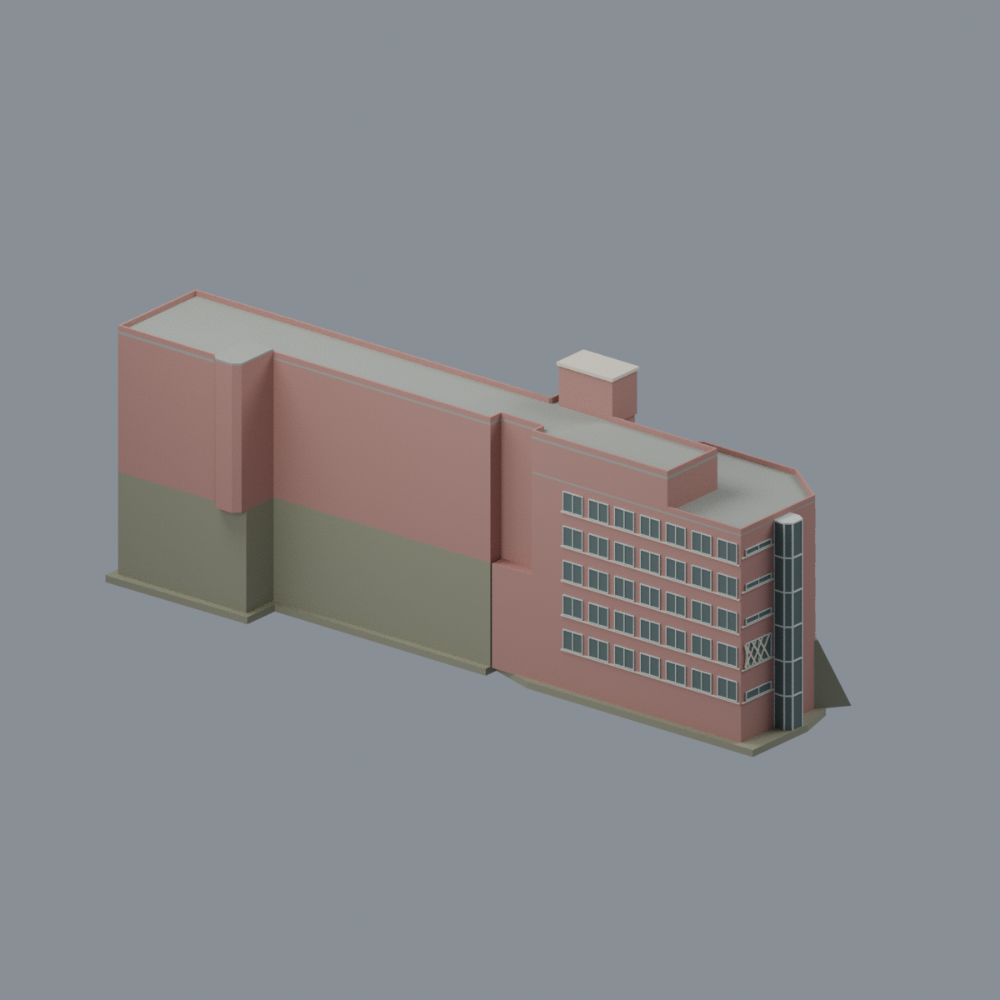
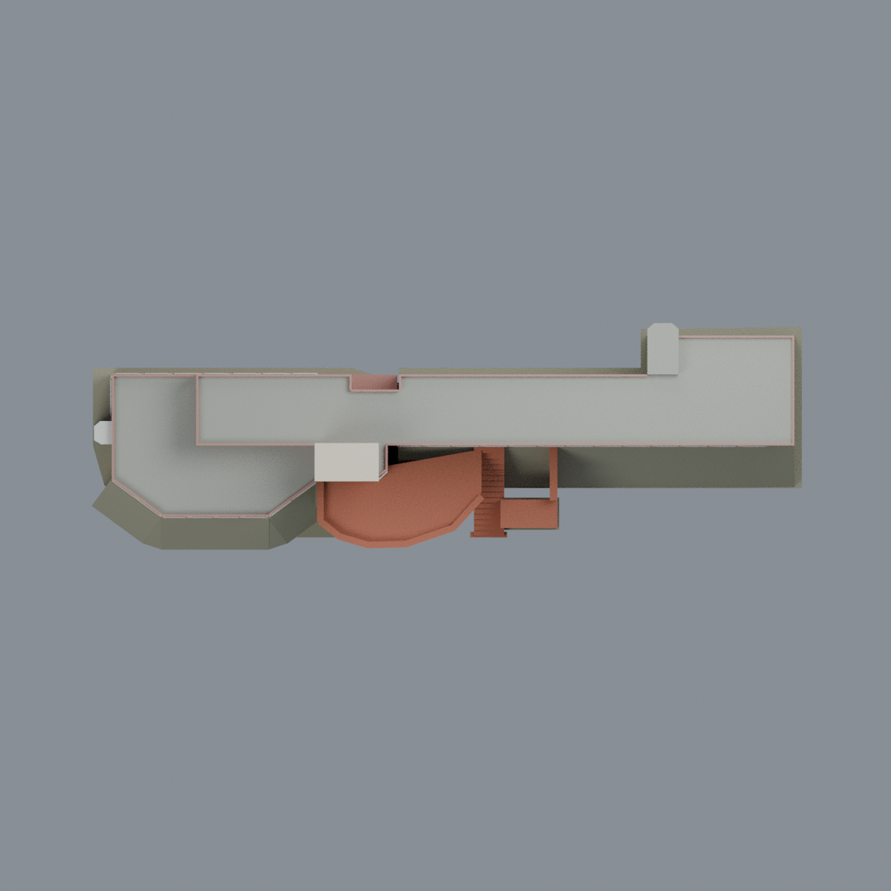

# 國立政治大學 國際大樓 — proportional exterior reference

## 模型預覽

| 正面 | 背面 | 頂視 |
| :---: | :---: | :---: |
|  |  |  |

[山上校區圖鑑](../../README.md) · [政大圖鑑](../../../README.md) · [全部模型](../../../../README.md)

完整相連的左多角深身、中核、右長翼，含附著曲面前平台、柱承、右階梯與限縮坡地近似。不是國際學人暨學生會館、不是局部入口。版本：**官方PDF所記錄的國際大樓外觀與平面參考版；照片攝年未知、非已核2026現況**。

## Deliverables
Editable Blender4.3.2 `scene.blend`; per-triangle seven opaque materials in millimetre `model.3mf`; identical monochrome triangles `model.stl`; five1200px actual-geometry PNGs; generators, raw QA, source/rights notes. Studio lights/background are not model geometry. No original source pixels or textures embedded.

Output approximately187.347 ×59.750 ×74.700mm. Coordinate X=(reading-plan pixel x−85)/10,Y=(250−pixel y)/10, output2.5mm/designunit. This is proportional tracing, not measured metres or a certified real scale. Shared middle stair x22–25.3/y2.1–7.5 registers floors; R drawing is aligned by its common stair (57px vertical reading offset), never by page layout. Axes are plan-relative, not compass.

## Form and uncertainty
B1–2F contain left deep polygon and central core only. B1 retains its narrow front slot recess;1F–2F enclose above it. Lower1F–2F central back extends to the full rectangular edge while3F introduces the actual back notch, not a raster-offset artefact. 3F introduces the complete right long wing; its underside meets explicitly coloured ground support, not a suspended wing over fabricated empty floors. 5F right end is squared. 6F occupies610-and-east upper band/middle/right wing; left polygonal front and far-left unnumbered bay remain **two lower roofs**, not full sixth-floor masses. Highest R roof is not a seventh storey. The separate R inset is tentatively associated with the central named tower; its exact association/height is unmeasured and this is not a newly located wing.

855 is interpreted from the lower long side,856 from left short end/adjoining upper side; same-hand source comparison is retained privately. The left glazed stair projection, central polygonal glazing, pink tile proxy, pale bands/frames and end windows are bounded visible features. Window counts/positions, exact wall/floor heights, sill depths and tower height are approximate. Unseen rear fine windows and interiors are neutral, not invented mirrored detail. Seven opaque colours approximate materials; no claim of transparent glass or photometric colour matching.

The front platform retains a recessed open undercroft above a bounded terraced-ground proxy and three approximate supports with only upper segments exposed. Local855-front grade rises to roughly2F bottom, leaving four visible window rows;856-side grade stays lower, preserving the true1F/B1 geometry rather than deleting a floor. The platform has a thick solid planter-edge proxy. Its faceted curve and right attached access staircase meet natural interfaces; not the entire landscaped road/forecourt. One finite thick retaining/column portal proxies the visible right access interface; the crop is not an extra wing or reconstruction of all foreground garage spans. Slope is an explicitly simplified olive ground proxy, no measured contours. Solid interior proxy is exterior modelling, not a claim real rooms are filled. Hidden basement fit-out omitted. The original B1 front slot is retained. The approximate raised terrain covers its mouth, resulting in a **B1退槽與近似地形合成的封閉空腔代理**, not proof of a real sealed underground room. Mesh has two boundary shells: one positive outer shell and one fully contained negative cavity shell, not two detached solid bodies. No unsupported drain or tunnel was invented simply to force one shell.

## Manufacturing limits
No physical print or printer/material-specific slicing. The enclosed cavity can trap resin in SLA and make FFF internal supports inaccessible; this is not a print-ready model. Fine window frame relief nominal0.225mm, parapets0.55mm and solid platform rim1.75mm need scale/slicer review. Undercroft soffit and projections require support consideration. Raw topology/SAT/sections and finite ray samples do not certify a global minimum wall, load strength, support-free fabrication or printability. Exact warning counts in QA.md and qa reports.

## Rebuild
Python dependencies in requirements.txt; Blender4.3.2. `python build_model.py` makes STL/3MF/mesh/palette. `blender -b -t 4 --python-exit-code 1 --python render_model.py` makes Blend and five PNGs. `python run_all_checks.py` executes raw topology/SAT/sections, feature/ray probes, strict3MF native edit/save/reopen, Blend edit/save/reopen and render framing checks. `python rebuild.py --output NEW_EMPTY_DIRECTORY` regenerates four core artifacts and five previews and byte-compares all nine. Blend bytes are not deterministic due to session/path metadata; semantic geometry/material checks are used.

來源及第三方權利說明見 [LICENSE.txt](LICENSE.txt) 與 [SOURCES.md](SOURCES.md)。

## 模型預覽與下載

[可編輯 Blend](scene.blend) · [彩色 3MF](model.3mf) · [單色 STL](model.stl) · [重建來源 ZIP](rebuild-source.zip) · [來源](SOURCES.md) · [數值檢驗及製造限制](QA.md)
