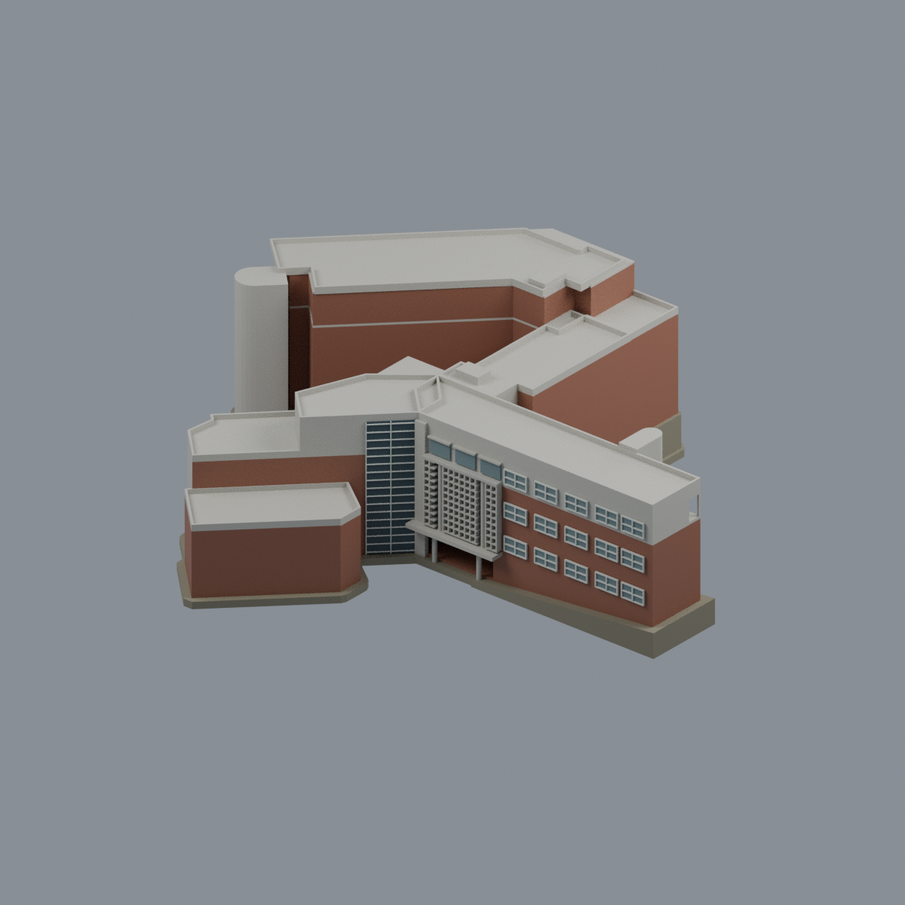
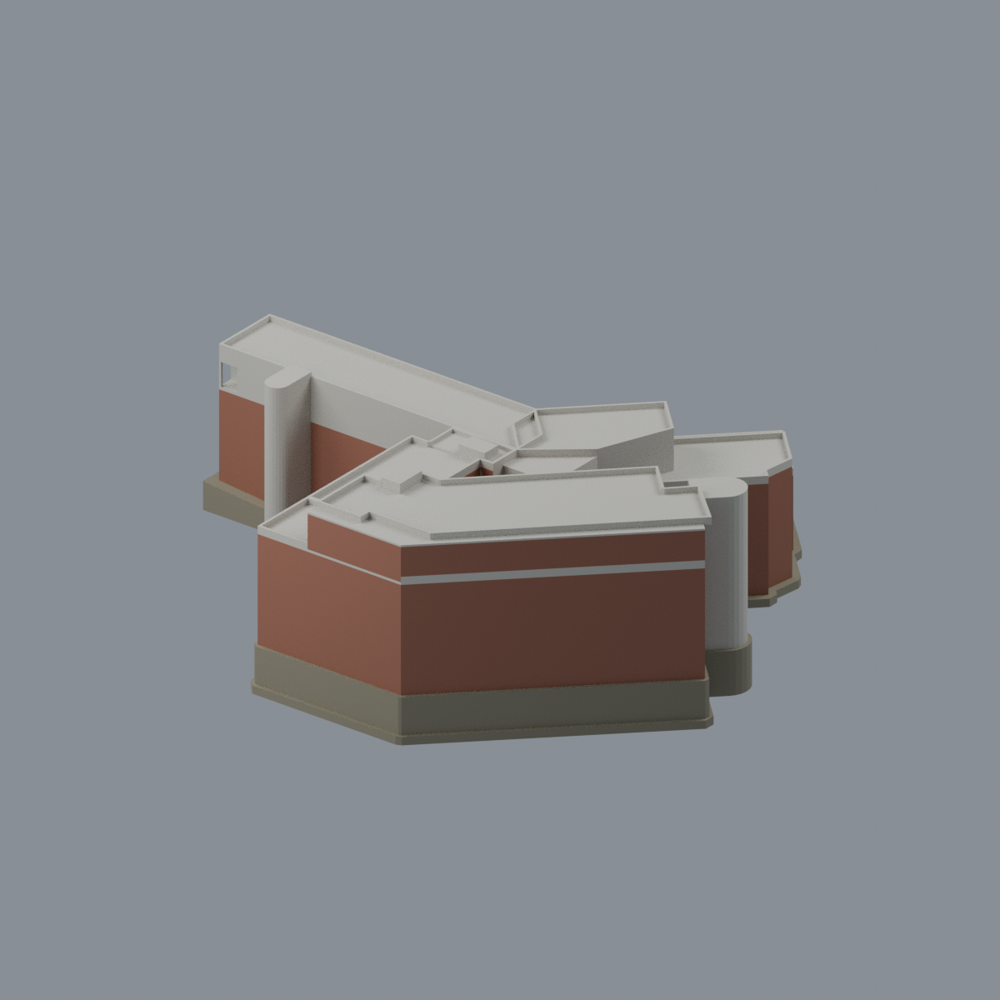
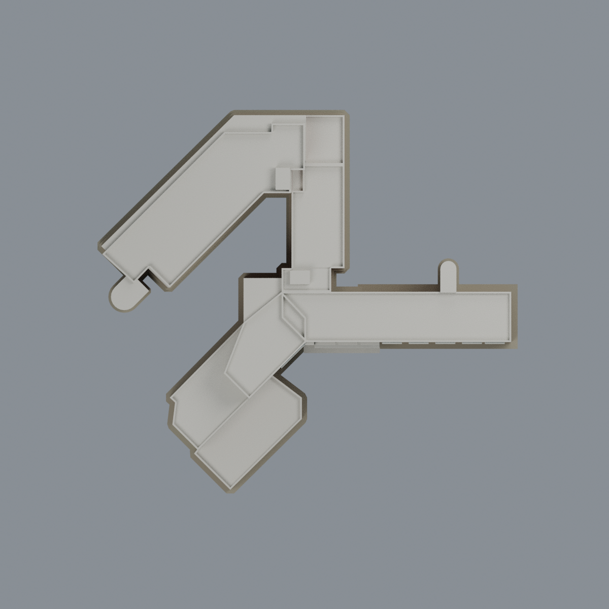

# 國立政治大學季陶樓｜完整主樓參考模型

## 模型預覽

| 正面 | 背面 | 頂視 |
| :---: | :---: | :---: |
|  |  |  |

[山上校區圖鑑](../../README.md) · [政大圖鑑](../../../README.md) · [全部模型](../../../../README.md)

**版本：官方 PDF 所記錄的外觀與平面參考版；照片攝年未知，非已核 2026 現況。**

這是完整相連主樓的比例近似模型，不是測繪、施工或結構資料。含前下斜翼、右直翼、後上斜翼、連接翼、附梯與入口；不是只取一面立面。彩色 Blender／3MF 使用六個可編輯實體材質；STL 不存顏色。五張 PNG 是同一網格的實際渲染，無照片材質貼圖。

## 已保留的建築關係
- 1F 沒有後上斜翼；後翼由 2F 開始，坡地代理直接接觸其基腳，不架空或虛構整條 B1。
- 前下斜翼旁 1–2F 寬低附群，3F 消失；4F 斜翼房間止於409附近，其末端無房號區作較低露臺的**有界解讀**，無剖面證實精確高度。全部已見外輪廓與低屋面仍保留。
- 5F 只在後上斜翼；右直翼、直連接翼和後翼東端空白區是較低屋面，不加第五層房間。
- R 以兩梯共同錨定後獨描局部台階頂界，保留完整5F封頂，沒有把不同圖形挖成漏頂或把全樓加成六層。R→5F採約(-112.5,-5)像素平移，兩梯約4像素殘差；這不是精密量測。小梯頂房高度近似。
- 入口三段實體格屏、兩根跨上層圓柱、下方兩圓柱與真空門廊；玻璃梯旁直立混凝土帶。右直翼端的上層框洞是空腔，不是暗色貼片。

## 有界處理
以2011高解析逃生圖共梯核註冊，不把頁面排版偏移變成樓層退縮；影像Y向下改為世界Y向上，未鏡像、未宣稱方位角。所有絕對尺寸、樓高、女兒牆高及坡度均是比例設計值。源圖未見的後側細窗、空調與小設備採中性簡化，沒有把入口窗數複製到全樓。名稱牆保留形體而不猜刻字體。827同角圖玻璃左上小白斜角經原始面來源ID核對，屬4F下斜翼頂側及屋面幾何遮擋（設計z14.10–14.22），非材質誤塗；未見細部保留比例簡化。隱藏B1室內不建；2011文字「後棟2樓」414/413對應平面4F，是稱呼差，不加兩層。

地形是明示的無植被輪廓式地基代理：前側低、右端緩升、後側接至2F底；不是實測等高線。道路、其他校舍和植栽不屬此模型。

## 重建
環境：Python及`requirements.txt`、Blender4.3.2。由source ZIP乾淨解壓後：
```
python build_model.py
blender -b -t 4 --python-exit-code 1 --python render_model.py
python run_all_checks.py
```
`rebuild.py --output /new/empty/path --blender blender --threads 4`在新目錄實建四核心檔與五PNG並逐byte比較。Blend驗語義、真頂點/材質編輯及存讀，不要求其容器bytes跨建立相同。

生成端採布林並集、保留原始面材質來源；在輸出前轉入float32表示並簡化幾何。QA再讀最終raw STL，只做精確相等座標索引，無修網、填洞、刪薄件或改輪廓。不得用QA結果冒充實印成功。

## 權利與安全
完整主要外觀比例近似模型。官方來源沒有找到可適用的明授權，不宣廣泛CC或公共領域；原照片、掃描圖、旋圖和含來源像素overlay不裝入交付ZIP。請見`SOURCES.md`、`LICENSE.txt`、`QA.md`。門廊、格柵、窗框、端框及R局部挑簷均需切片/支撐評估；**未實印，不保證免支撐或全域最小壁厚**。

## 模型預覽與下載


[可編輯 Blend](scene.blend) · [彩色 3MF](model.3mf) · [單色 STL](model.stl) · [已驗證重建來源 ZIP](rebuild-source.zip) · [技術與製造限制](QA.md)

`qa/independent/` 收錄獨立技術審核；具體製造限制見 `QA.md`。
